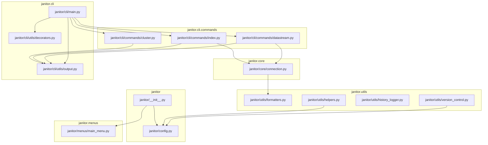
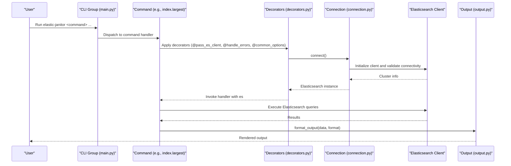

# API Reference

<cite>
**Referenced Files in This Document**
- [janitor/__init__.py](file://janitor/__init__.py)
- [janitor/config.py](file://janitor/config.py)
- [janitor/cli/main.py](file://janitor/cli/main.py)
- [janitor/core/connection.py](file://janitor/core/connection.py)
- [janitor/utils/formatters.py](file://janitor/utils/formatters.py)
- [janitor/utils/helpers.py](file://janitor/utils/helpers.py)
- [janitor/utils/history_logger.py](file://janitor/utils/history_logger.py)
- [janitor/utils/version_control.py](file://janitor/utils/version_control.py)
- [janitor/cli/utils/decorators.py](file://janitor/cli/utils/decorators.py)
- [janitor/cli/utils/output.py](file://janitor/cli/utils/output.py)
- [janitor/menus/main_menu.py](file://janitor/menus/main_menu.py)
- [janitor/cli/commands/index.py](file://janitor/cli/commands/index.py)
- [janitor/cli/commands/datastream.py](file://janitor/cli/commands/datastream.py)
- [janitor/cli/commands/cluster.py](file://janitor/cli/commands/cluster.py)
- [pyproject.toml](file://pyproject.toml)
</cite>

## Table of Contents
1. [Introduction](#introduction)
2. [Project Structure](#project-structure)
3. [Core Components](#core-components)
4. [Architecture Overview](#architecture-overview)
5. [Detailed Component Analysis](#detailed-component-analysis)
6. [Dependency Analysis](#dependency-analysis)
7. [Performance Considerations](#performance-considerations)
8. [Troubleshooting Guide](#troubleshooting-guide)
9. [Conclusion](#conclusion)
10. [Appendices](#appendices)

## Introduction
This API reference documents Elastic Janitor’s public interfaces and modules. It covers:
- Module organization and package structure
- Public CLI commands and their parameters
- Programmatic entry points for interactive menus and operations
- Utility APIs for formatting, output, configuration, and version control
- Internal APIs relevant for advanced users and contributors
- Versioning and compatibility information

The tool targets Elasticsearch cluster management via a CLI and an interactive menu system, with robust output formatting, error handling, and dry-run capabilities.

## Project Structure
The project is organized into cohesive packages:
- janitor: Top-level package exposing the main entrypoint and configuration
- janitor.core: Elasticsearch connection and index metadata retrieval
- janitor.cli: CLI framework and command groups
- janitor.cli.commands: Command implementations for cluster, index, datastream, etc.
- janitor.cli.utils: Shared CLI decorators and output formatting
- janitor.utils: Formatting, helpers, history logging, and generic version control
- janitor.menus: Interactive main menu and submenus

**Diagram sources**
- [janitor/__init__.py](file://janitor/__init__.py#L1-L15)
- [janitor/config.py](file://janitor/config.py#L1-L78)
- [janitor/cli/main.py](file://janitor/cli/main.py#L1-L57)
- [janitor/core/connection.py](file://janitor/core/connection.py#L1-L72)
- [janitor/cli/utils/decorators.py](file://janitor/cli/utils/decorators.py#L1-L89)
- [janitor/cli/utils/output.py](file://janitor/cli/utils/output.py#L1-L153)
- [janitor/cli/commands/cluster.py](file://janitor/cli/commands/cluster.py#L1-L239)
- [janitor/cli/commands/index.py](file://janitor/cli/commands/index.py#L1-L318)
- [janitor/cli/commands/datastream.py](file://janitor/cli/commands/datastream.py#L1-L328)
- [janitor/utils/formatters.py](file://janitor/utils/formatters.py#L1-L53)
- [janitor/utils/helpers.py](file://janitor/utils/helpers.py#L1-L258)
- [janitor/utils/history_logger.py](file://janitor/utils/history_logger.py#L1-L73)
- [janitor/utils/version_control.py](file://janitor/utils/version_control.py#L1-L974)
- [janitor/menus/main_menu.py](file://janitor/menus/main_menu.py#L1-L125)

**Section sources**
- [janitor/__init__.py](file://janitor/__init__.py#L1-L15)
- [janitor/config.py](file://janitor/config.py#L1-L78)
- [janitor/cli/main.py](file://janitor/cli/main.py#L1-L57)
- [janitor/menus/main_menu.py](file://janitor/menus/main_menu.py#L1-L125)

## Core Components
This section outlines the primary modules and their roles.

- janitor: Exposes the main interactive entrypoint and package metadata.
- janitor.config: Centralized configuration constants and UI settings.
- janitor.core.connection: Elasticsearch connectivity and index metadata retrieval.
- janitor.cli: CLI group registration and command wiring.
- janitor.cli.utils: Decorators for connection, error handling, dry-run, and common options; output formatting utilities.
- janitor.utils: Formatting helpers, interactive helpers, history logging, and generic version control.
- janitor.menus: Interactive main menu and submenu orchestration.

Key public APIs:
- Programmatic access via the interactive main menu entrypoint
- CLI entrypoints registered under the “elastic-janitor” group
- Utilities for formatting, output, and version control

**Section sources**
- [janitor/__init__.py](file://janitor/__init__.py#L1-L15)
- [janitor/config.py](file://janitor/config.py#L1-L78)
- [janitor/core/connection.py](file://janitor/core/connection.py#L1-L72)
- [janitor/cli/main.py](file://janitor/cli/main.py#L1-L57)
- [janitor/cli/utils/decorators.py](file://janitor/cli/utils/decorators.py#L1-L89)
- [janitor/cli/utils/output.py](file://janitor/cli/utils/output.py#L1-L153)
- [janitor/utils/formatters.py](file://janitor/utils/formatters.py#L1-L53)
- [janitor/utils/helpers.py](file://janitor/utils/helpers.py#L1-L258)
- [janitor/utils/history_logger.py](file://janitor/utils/history_logger.py#L1-L73)
- [janitor/utils/version_control.py](file://janitor/utils/version_control.py#L1-L974)
- [janitor/menus/main_menu.py](file://janitor/menus/main_menu.py#L1-L125)

## Architecture Overview
High-level flow:
- CLI entrypoint registers command groups and routes to subcommands
- Commands use shared decorators to inject an Elasticsearch client, handle errors, and apply dry-run semantics
- Output formatting utilities render results in JSON, YAML, CSV, or Rich tables
- Core connection module retrieves index metadata and connects to Elasticsearch
- Interactive menu orchestrates operations and delegates to submenu handlers

**Diagram sources**
- [janitor/cli/main.py](file://janitor/cli/main.py#L1-L57)
- [janitor/cli/utils/decorators.py](file://janitor/cli/utils/decorators.py#L1-L89)
- [janitor/core/connection.py](file://janitor/core/connection.py#L1-L72)
- [janitor/cli/utils/output.py](file://janitor/cli/utils/output.py#L1-L153)

## Detailed Component Analysis

### Package and Module Organization
- janitor: Provides package metadata and exports the main interactive entrypoint
- janitor.config: Constants for Elasticsearch endpoint, timeouts, dry-run mode, and UI configuration
- janitor.core: Connection and index metadata retrieval
- janitor.cli: CLI group and command registration
- janitor.cli.utils: Decorators and output formatting
- janitor.utils: Formatting, helpers, history logging, and version control
- janitor.menus: Interactive menu orchestration

**Section sources**
- [janitor/__init__.py](file://janitor/__init__.py#L1-L15)
- [janitor/config.py](file://janitor/config.py#L1-L78)
- [janitor/menus/main_menu.py](file://janitor/menus/main_menu.py#L1-L125)

### CLI Entry Points and Commands
Public CLI commands are grouped under the “elastic-janitor” command. Each command supports common options and integrates with decorators for connection, error handling, and dry-run behavior.

- Command groups: cluster, index, datastream, performance, governance, tuning, template, policy, dry-run
- Common options: --output, --verbose, --quiet
- Error handling: centralized decorator catches exceptions and exits with appropriate codes
- Dry-run: optional flag to preview actions without executing

Example invocation patterns are documented in the CLI group docstrings.

**Section sources**
- [janitor/cli/main.py](file://janitor/cli/main.py#L1-L57)
- [janitor/cli/utils/decorators.py](file://janitor/cli/utils/decorators.py#L1-L89)

### Cluster Commands
- cluster health: Displays cluster health, nodes, shards, and optional stats
- cluster nodes: Lists node information and optional JVM/OS stats
- cluster stats: Aggregated cluster statistics

Parameters:
- Output format: json, table, yaml, csv
- Verbose: include additional metrics
- Quiet: suppress non-essential output

Exit codes:
- Red status: failure
- Yellow status: success with warnings
- Green status: success

**Section sources**
- [janitor/cli/commands/cluster.py](file://janitor/cli/commands/cluster.py#L1-L239)

### Index Commands
- index largest: Lists largest indices by size, filtered by pattern and top-N
- index health: Shows index health and status, optionally filtered by health status
- index analyze-patterns: Analyzes query workload and recommends optimal index patterns

Parameters:
- index largest: --top, --pattern, --output, --verbose, --quiet
- index health: --pattern, --status, --output, --verbose, --quiet
- index analyze-patterns: --days, --pattern, --output, --verbose, --quiet

**Section sources**
- [janitor/cli/commands/index.py](file://janitor/cli/commands/index.py#L1-L318)
- [janitor/core/connection.py](file://janitor/core/connection.py#L1-L72)

### Data Stream Commands
- datastream clean: Cleans old backing indices from data streams respecting retention and batch limits
- datastream migrate: Previews migration between clusters or within the same cluster

Parameters:
- datastream clean: --retention, --pattern, --batch-size, --dry-run, --output, --verbose, --quiet
- datastream migrate: --source, --dest, --mode, --dry-run, --output, --verbose, --quiet

Exceptions and validations:
- Enforces MAX_DELETE_LIMIT for safety
- Skips system resources when protection is enabled
- Parses retention periods with units s, m, h, d, w, M, y

**Section sources**
- [janitor/cli/commands/datastream.py](file://janitor/cli/commands/datastream.py#L1-L328)
- [janitor/config.py](file://janitor/config.py#L1-L78)
- [janitor/utils/helpers.py](file://janitor/utils/helpers.py#L1-L258)

### Interactive Menu System
Programmatic access to functionality is available via the main menu entrypoint. The menu orchestrates:
- Connection to Elasticsearch
- Category selection
- Delegation to submenu handlers
- Dry-run mode toggling

Entry point:
- main(): Starts the interactive session and loops until quit

**Section sources**
- [janitor/menus/main_menu.py](file://janitor/menus/main_menu.py#L1-L125)
- [janitor/core/connection.py](file://janitor/core/connection.py#L1-L72)

### Output Formatting Utilities
OutputFormat enum supports json, table, yaml, csv. The formatter handles:
- JSON/YAML serialization
- CSV writing for lists/dicts/simple values
- Rich table rendering with configurable headers and titles
- Convenience functions for success, error, warning, info messages

Usage:
- Commands call format_output(data, OutputFormat, headers, title)
- Color-coded output via Rich console

**Section sources**
- [janitor/cli/utils/output.py](file://janitor/cli/utils/output.py#L1-L153)

### Decorators and Error Handling
- @pass_es_client: Injects an Elasticsearch client; exits on connection failures
- @handle_errors: Catches keyboard interrupts and general exceptions; prints optional stack traces
- @dry_run_option: Adds a --dry-run flag
- @common_options: Adds --verbose, --quiet, --output

Behavior:
- Graceful cancellation on Ctrl+C
- Consistent exit codes for different failure modes

**Section sources**
- [janitor/cli/utils/decorators.py](file://janitor/cli/utils/decorators.py#L1-L89)

### Formatting Utilities
- parse_epoch_millis: Converts milliseconds to UTC datetime
- size_to_bytes: Parses human-readable sizes to bytes
- bytes_to_human: Formats bytes into human-readable units

**Section sources**
- [janitor/utils/formatters.py](file://janitor/utils/formatters.py#L1-L53)

### Helper Utilities
- Safe input handling with keyboard interrupt support
- System resource detection (protects system indices when enabled)
- Confirmation dialogs and interactive selections
- Index pattern discovery and selection with fuzzy search

**Section sources**
- [janitor/utils/helpers.py](file://janitor/utils/helpers.py#L1-L258)
- [janitor/config.py](file://janitor/config.py#L1-L78)

### History Logging
- log_operation(operation_type, affected_resources, description): Logs to janitor_history.log
- get_recent_operations(n): Retrieves recent entries
- clear_history(): Removes the log file

Behavior:
- Non-intrusive logging; failures are silently ignored

**Section sources**
- [janitor/utils/history_logger.py](file://janitor/utils/history_logger.py#L1-L73)

### Generic Version Control (Advanced Users)
Provides versioning and rollback for Elasticsearch resources using SQLite. Key functions:
- save_resource_version(resource_type, resource_name, configuration, comment, is_known_good)
- get_resource_versions(resource_type, resource_name)
- get_resource_version(resource_type, resource_name, version_number)
- get_last_known_good_version(resource_type, resource_name)
- delete_resource_versions(resource_type, resource_name)
- get_all_versioned_resources(resource_type)
- get_version_count(resource_type, resource_name)
- save_resource_version_with_dependencies(es, resource_type, resource_name, configuration, comment, is_known_good)
- get_resource_dependencies(resource_type, resource_name, version_number)
- compare_dependency_with_current(es, dependency)

Constants:
- RESOURCE_TYPE_PIPELINE, RESOURCE_TYPE_INDEX_TEMPLATE, RESOURCE_TYPE_COMPONENT_TEMPLATE
- MAX_VERSIONS_PER_RESOURCE
- DB_DIR, DB_PATH

Notes:
- Automatically migrates legacy pipeline version database
- Supports dependency tracking with configurable depth and breadth
- Uses JSON serialization for configurations

**Section sources**
- [janitor/utils/version_control.py](file://janitor/utils/version_control.py#L1-L974)
- [janitor/config.py](file://janitor/config.py#L1-L78)

## Dependency Analysis
External dependencies and compatibility:
- Python: >=3.8
- Elasticsearch client: >=8.0.0
- UI and interactivity: rich, questionary
- CLI framework: click
- Serialization: pyyaml
- Networking: requests
- Optional dev dependencies: pytest, black, flake8, mypy

Versioning and compatibility:
- Package version: 2.0.0
- Classifier indicates Python 3.8–3.12 support

**Section sources**
- [pyproject.toml](file://pyproject.toml#L1-L102)

## Performance Considerations
- Batch deletion limits: enforced by MAX_DELETE_LIMIT to avoid overwhelming the cluster
- Query timeouts: configurable defaults for general, slow, request, and reindex operations
- Dry-run mode: reduces risk and allows preview of operations
- Output formatting: efficient table rendering via Rich and CSV writer for large datasets

[No sources needed since this section provides general guidance]

## Troubleshooting Guide
Common issues and resolutions:
- Connection failures: Verify ELASTIC_URL and ELASTIC_API_KEY; the connection routine prints explicit errors and exits
- Keyboard interrupts: Commands catch Ctrl+C and exit with a standardized code
- Excessive deletions: If eligible indices exceed MAX_DELETE_LIMIT, the command aborts with guidance to adjust batch size
- Pattern discovery fallback: If automatic pattern detection fails, the system falls back to manual input

Operational checks:
- Use --dry-run to preview changes
- Use --verbose to inspect stack traces
- Use --quiet to minimize output noise

**Section sources**
- [janitor/core/connection.py](file://janitor/core/connection.py#L1-L72)
- [janitor/cli/utils/decorators.py](file://janitor/cli/utils/decorators.py#L1-L89)
- [janitor/cli/commands/datastream.py](file://janitor/cli/commands/datastream.py#L1-L328)
- [janitor/utils/helpers.py](file://janitor/utils/helpers.py#L1-L258)

## Conclusion
Elastic Janitor exposes a comprehensive CLI and interactive menu system for Elasticsearch cluster management. Its modular design separates concerns across connection, formatting, output, and version control, enabling both safe automation and guided workflows. Advanced users can leverage the generic version control and dependency tracking APIs for robust configuration management.

[No sources needed since this section summarizes without analyzing specific files]

## Appendices

### API Usage Patterns
- CLI usage: See command docstrings for examples and options
- Programmatic access: Call the interactive main entrypoint to navigate submenus
- Dry-run mode: Enable globally or per-command to preview changes

**Section sources**
- [janitor/cli/main.py](file://janitor/cli/main.py#L1-L57)
- [janitor/menus/main_menu.py](file://janitor/menus/main_menu.py#L1-L125)

### Versioning and Compatibility
- Package version: 2.0.0
- Python versions supported: 3.8–3.12
- Elasticsearch client: >=8.0.0

**Section sources**
- [pyproject.toml](file://pyproject.toml#L1-L102)