# CLI Interface API

<cite>
**Referenced Files in This Document**
- [janitor/cli/main.py](file://janitor/cli/main.py)
- [janitor/cli/__init__.py](file://janitor/cli/__init__.py)
- [janitor/cli/utils/__init__.py](file://janitor/cli/utils/__init__.py)
- [janitor/cli/utils/decorators.py](file://janitor/cli/utils/decorators.py)
- [janitor/cli/utils/output.py](file://janitor/cli/utils/output.py)
- [janitor/cli/commands/__init__.py](file://janitor/cli/commands/__init__.py)
- [janitor/cli/commands/cluster.py](file://janitor/cli/commands/cluster.py)
- [janitor/cli/commands/index.py](file://janitor/cli/commands/index.py)
- [janitor/cli/commands/datastream.py](file://janitor/cli/commands/datastream.py)
- [janitor/cli/commands/dryrun.py](file://janitor/cli/commands/dryrun.py)
- [janitor/cli/commands/performance.py](file://janitor/cli/commands/performance.py)
- [janitor/cli/commands/governance.py](file://janitor/cli/commands/governance.py)
- [janitor/cli/commands/tuning.py](file://janitor/cli/commands/tuning.py)
- [janitor/cli/commands/template.py](file://janitor/cli/commands/template.py)
- [janitor/cli/commands/policy.py](file://janitor/cli/commands/policy.py)
</cite>

## Table of Contents
1. [Introduction](#introduction)
2. [Project Structure](#project-structure)
3. [Core Components](#core-components)
4. [Architecture Overview](#architecture-overview)
5. [Detailed Component Analysis](#detailed-component-analysis)
6. [Dependency Analysis](#dependency-analysis)
7. [Performance Considerations](#performance-considerations)
8. [Troubleshooting Guide](#troubleshooting-guide)
9. [Conclusion](#conclusion)
10. [Appendices](#appendices)

## Introduction
This document describes the CLI interface API for Elastic Janitor, focusing on the Click framework integration, command registration system, argument parsing, and output formatting. It explains how command groups and subcommands are organized, how options are handled, and how CLI commands relate to underlying operation modules. It also provides guidance for extending the CLI with custom commands, adding new options, and handling execution, including error handling, help system integration, and completion mechanisms. Finally, it documents the programmatic interface for automated usage.

## Project Structure
The CLI is implemented under the janitor/cli package with a clear separation between the main entry point, command groups, shared utilities, and output formatting.

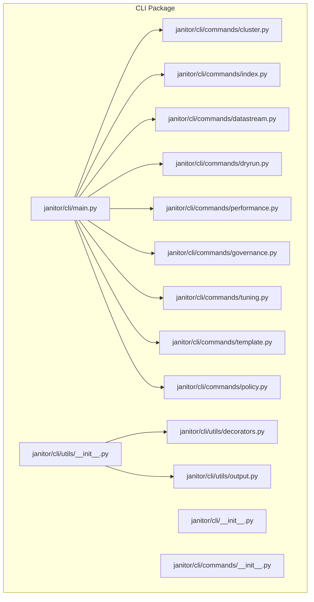

**Diagram sources**
- [janitor/cli/main.py](file://janitor/cli/main.py#L1-L57)
- [janitor/cli/__init__.py](file://janitor/cli/__init__.py#L1-L8)
- [janitor/cli/utils/__init__.py](file://janitor/cli/utils/__init__.py#L1-L9)
- [janitor/cli/utils/decorators.py](file://janitor/cli/utils/decorators.py#L1-L89)
- [janitor/cli/utils/output.py](file://janitor/cli/utils/output.py#L1-L153)
- [janitor/cli/commands/__init__.py](file://janitor/cli/commands/__init__.py#L1-L5)
- [janitor/cli/commands/cluster.py](file://janitor/cli/commands/cluster.py#L1-L239)
- [janitor/cli/commands/index.py](file://janitor/cli/commands/index.py#L1-L318)
- [janitor/cli/commands/datastream.py](file://janitor/cli/commands/datastream.py#L1-L328)
- [janitor/cli/commands/dryrun.py](file://janitor/cli/commands/dryrun.py#L1-L87)
- [janitor/cli/commands/performance.py](file://janitor/cli/commands/performance.py#L1-L194)
- [janitor/cli/commands/governance.py](file://janitor/cli/commands/governance.py#L1-L153)
- [janitor/cli/commands/tuning.py](file://janitor/cli/commands/tuning.py#L1-L142)
- [janitor/cli/commands/template.py](file://janitor/cli/commands/template.py#L1-L75)
- [janitor/cli/commands/policy.py](file://janitor/cli/commands/policy.py#L1-L74)

**Section sources**
- [janitor/cli/main.py](file://janitor/cli/main.py#L1-L57)
- [janitor/cli/__init__.py](file://janitor/cli/__init__.py#L1-L8)

## Core Components
- Click-based CLI entry point and command registry
- Shared decorators for common CLI behaviors
- Output formatting utilities supporting multiple formats
- Command groups and subcommands for distinct functional areas

Key responsibilities:
- Main CLI entry point defines the top-level group and registers subcommands.
- Utilities provide standardized option handling, error handling, dry-run support, and output formatting.
- Commands encapsulate Elasticsearch operations and present results in configurable formats.

**Section sources**
- [janitor/cli/main.py](file://janitor/cli/main.py#L8-L51)
- [janitor/cli/utils/decorators.py](file://janitor/cli/utils/decorators.py#L13-L89)
- [janitor/cli/utils/output.py](file://janitor/cli/utils/output.py#L14-L153)

## Architecture Overview
The CLI architecture follows a layered design:
- Top-level Click group aggregates subcommand groups.
- Each subcommand group defines related subcommands with Click decorators for options and arguments.
- Decorators inject common behaviors (connection, error handling, dry-run, verbosity, output format).
- Output utilities render results consistently across formats.

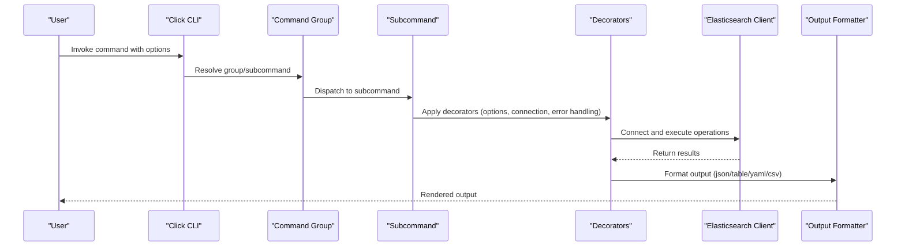

**Diagram sources**
- [janitor/cli/main.py](file://janitor/cli/main.py#L8-L51)
- [janitor/cli/utils/decorators.py](file://janitor/cli/utils/decorators.py#L13-L89)
- [janitor/cli/utils/output.py](file://janitor/cli/utils/output.py#L22-L153)

## Detailed Component Analysis

### Main CLI Entry Point
- Defines the top-level Click group with version and help options.
- Registers all command groups programmatically.
- Provides example invocations and usage guidance.

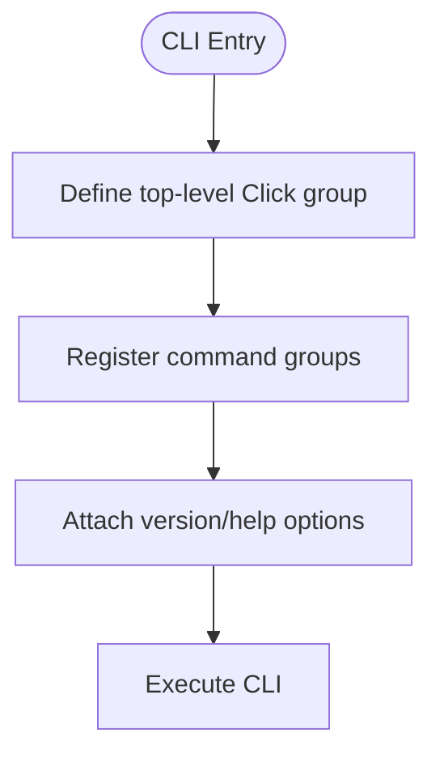

**Diagram sources**
- [janitor/cli/main.py](file://janitor/cli/main.py#L8-L51)

**Section sources**
- [janitor/cli/main.py](file://janitor/cli/main.py#L8-L51)

### Command Registration and Groups
- Command groups are defined as Click groups and registered in the main CLI.
- Each group exposes one or more subcommands with Click decorators for options and arguments.

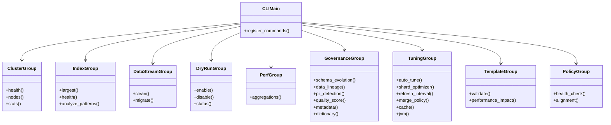

**Diagram sources**
- [janitor/cli/main.py](file://janitor/cli/main.py#L40-L51)
- [janitor/cli/commands/cluster.py](file://janitor/cli/commands/cluster.py#L10-L13)
- [janitor/cli/commands/index.py](file://janitor/cli/commands/index.py#L11-L14)
- [janitor/cli/commands/datastream.py](file://janitor/cli/commands/datastream.py#L14-L17)
- [janitor/cli/commands/dryrun.py](file://janitor/cli/commands/dryrun.py#L9-L12)
- [janitor/cli/commands/performance.py](file://janitor/cli/commands/performance.py#L10-L13)
- [janitor/cli/commands/governance.py](file://janitor/cli/commands/governance.py#L17-L20)
- [janitor/cli/commands/tuning.py](file://janitor/cli/commands/tuning.py#L17-L20)
- [janitor/cli/commands/template.py](file://janitor/cli/commands/template.py#L13-L16)
- [janitor/cli/commands/policy.py](file://janitor/cli/commands/policy.py#L13-L16)

**Section sources**
- [janitor/cli/main.py](file://janitor/cli/main.py#L40-L51)
- [janitor/cli/commands/cluster.py](file://janitor/cli/commands/cluster.py#L10-L13)
- [janitor/cli/commands/index.py](file://janitor/cli/commands/index.py#L11-L14)
- [janitor/cli/commands/datastream.py](file://janitor/cli/commands/datastream.py#L14-L17)
- [janitor/cli/commands/dryrun.py](file://janitor/cli/commands/dryrun.py#L9-L12)
- [janitor/cli/commands/performance.py](file://janitor/cli/commands/performance.py#L10-L13)
- [janitor/cli/commands/governance.py](file://janitor/cli/commands/governance.py#L17-L20)
- [janitor/cli/commands/tuning.py](file://janitor/cli/commands/tuning.py#L17-L20)
- [janitor/cli/commands/template.py](file://janitor/cli/commands/template.py#L13-L16)
- [janitor/cli/commands/policy.py](file://janitor/cli/commands/policy.py#L13-L16)

### Argument Parsing and Options
- Common options include verbose, quiet, and output format selection.
- Group-specific options define command behavior (e.g., retention periods, patterns, thresholds).
- Dry-run flag is supported via a dedicated decorator.

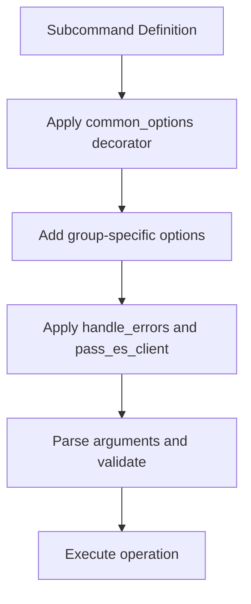

**Diagram sources**
- [janitor/cli/utils/decorators.py](file://janitor/cli/utils/decorators.py#L64-L87)
- [janitor/cli/commands/index.py](file://janitor/cli/commands/index.py#L17-L23)
- [janitor/cli/commands/datastream.py](file://janitor/cli/commands/datastream.py#L20-L28)

**Section sources**
- [janitor/cli/utils/decorators.py](file://janitor/cli/utils/decorators.py#L64-L87)
- [janitor/cli/commands/index.py](file://janitor/cli/commands/index.py#L17-L23)
- [janitor/cli/commands/datastream.py](file://janitor/cli/commands/datastream.py#L20-L28)

### Output Formatting
- OutputFormat enum supports JSON, table, YAML, and CSV.
- format_output routes to specialized handlers based on format.
- Rich-based table rendering with optional titles and headers.
- Convenience functions for success, error, warning, and info messages.

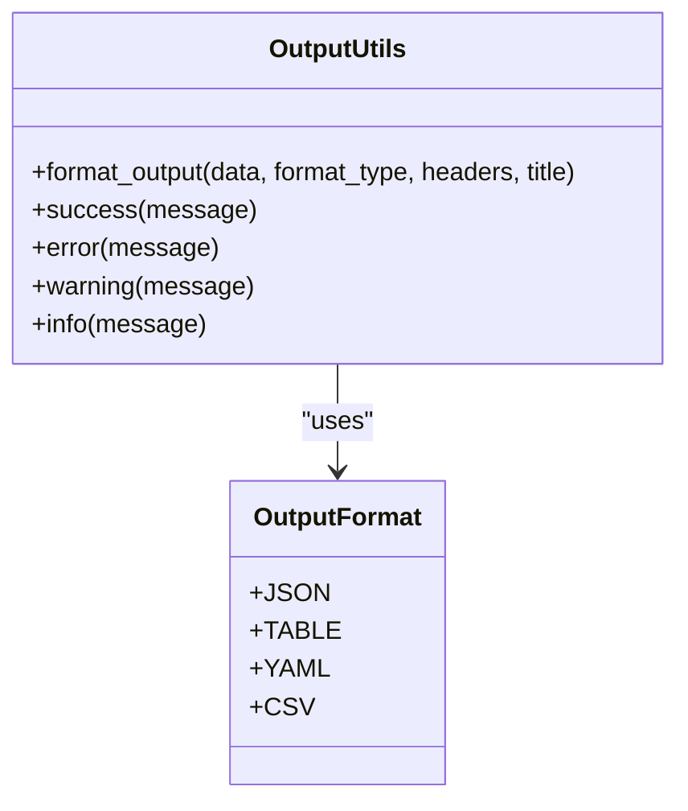

**Diagram sources**
- [janitor/cli/utils/output.py](file://janitor/cli/utils/output.py#L14-L153)

**Section sources**
- [janitor/cli/utils/output.py](file://janitor/cli/utils/output.py#L14-L153)

### Error Handling and Execution Flow
- Centralized error handling decorator catches exceptions and exits with meaningful codes.
- Keyboard interrupt handling provides graceful cancellation feedback.
- Connection decorator manages Elasticsearch client creation and failure reporting.

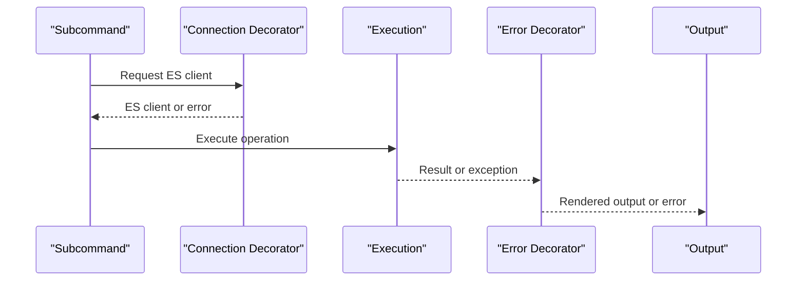

**Diagram sources**
- [janitor/cli/utils/decorators.py](file://janitor/cli/utils/decorators.py#L13-L46)

**Section sources**
- [janitor/cli/utils/decorators.py](file://janitor/cli/utils/decorators.py#L13-L46)

### Command-Specific Details

#### Cluster Commands
- health: Retrieves cluster health and stats, supports verbose mode and multiple output formats.
- nodes: Lists nodes with role, IP, version, and optionally JVM/OS metrics.
- stats: Displays cluster-wide statistics including indices and node counts.

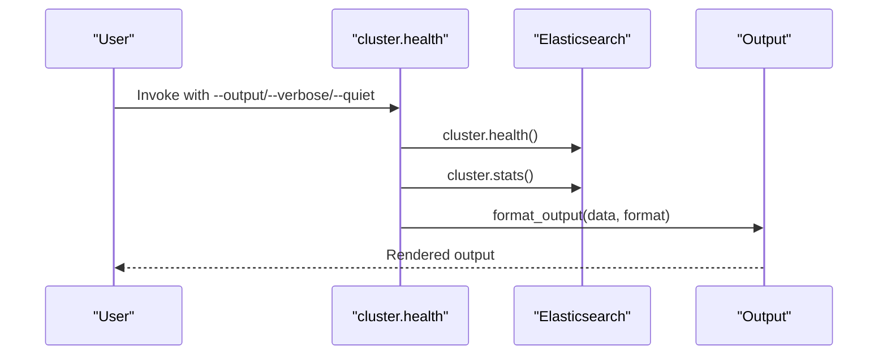

**Diagram sources**
- [janitor/cli/commands/cluster.py](file://janitor/cli/commands/cluster.py#L16-L132)

**Section sources**
- [janitor/cli/commands/cluster.py](file://janitor/cli/commands/cluster.py#L16-L132)

#### Index Commands
- largest: Lists top N largest indices by size, supports pattern filtering and verbose output.
- health: Shows index health and status, with optional status filters.
- analyze_patterns: Analyzes query workload and recommends optimal index patterns.

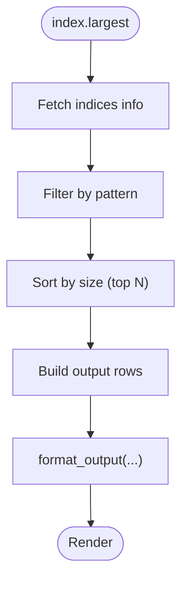

**Diagram sources**
- [janitor/cli/commands/index.py](file://janitor/cli/commands/index.py#L17-L102)

**Section sources**
- [janitor/cli/commands/index.py](file://janitor/cli/commands/index.py#L17-L102)

#### Data Stream Commands
- clean: Identifies and deletes backing indices older than a retention period, with dry-run support and batch limits.
- migrate: Provides a preview of migration actions (cross-cluster or same-cluster), with dry-run support.

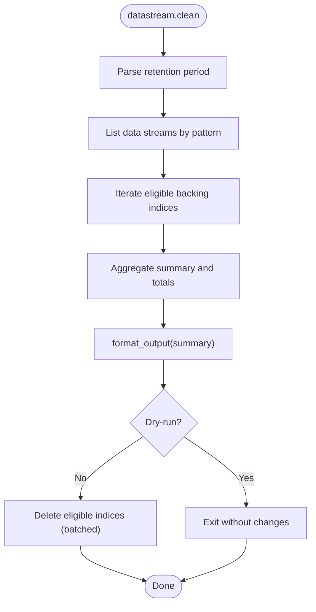

**Diagram sources**
- [janitor/cli/commands/datastream.py](file://janitor/cli/commands/datastream.py#L20-L194)

**Section sources**
- [janitor/cli/commands/datastream.py](file://janitor/cli/commands/datastream.py#L20-L194)

#### Dry-Run Management
- enable/disable/status: Global toggle for dry-run mode affecting destructive operations.

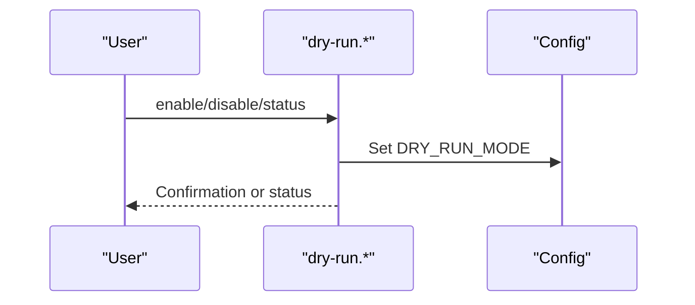

**Diagram sources**
- [janitor/cli/commands/dryrun.py](file://janitor/cli/commands/dryrun.py#L15-L86)

**Section sources**
- [janitor/cli/commands/dryrun.py](file://janitor/cli/commands/dryrun.py#L15-L86)

#### Performance Monitoring
- aggregations: Analyzes slow aggregation queries and provides optimization recommendations.

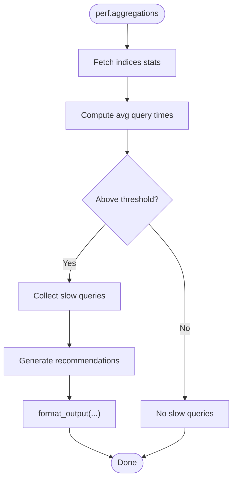

**Diagram sources**
- [janitor/cli/commands/performance.py](file://janitor/cli/commands/performance.py#L16-L181)

**Section sources**
- [janitor/cli/commands/performance.py](file://janitor/cli/commands/performance.py#L16-L181)

#### Governance Commands
- schema_evolution, data_lineage, pii_detection, quality_score, metadata, dictionary: Delegate to operation modules.

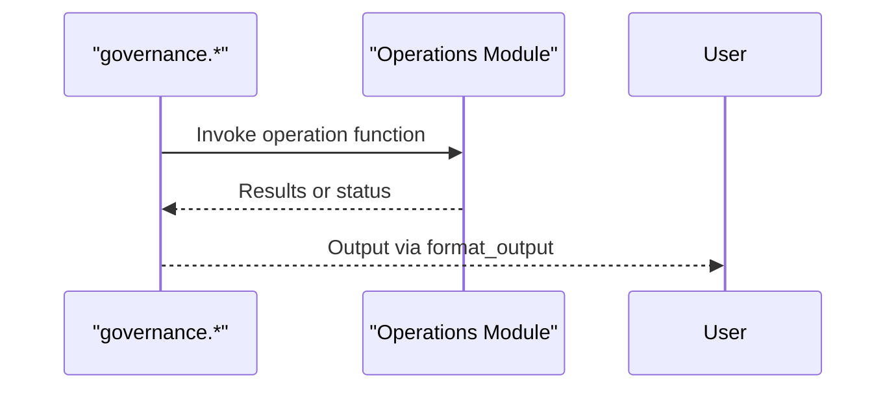

**Diagram sources**
- [janitor/cli/commands/governance.py](file://janitor/cli/commands/governance.py#L23-L152)

**Section sources**
- [janitor/cli/commands/governance.py](file://janitor/cli/commands/governance.py#L23-L152)

#### Tuning Commands
- auto_tune, shard_optimizer, refresh_interval, merge_policy, cache, jvm: Analyze and recommend optimizations.

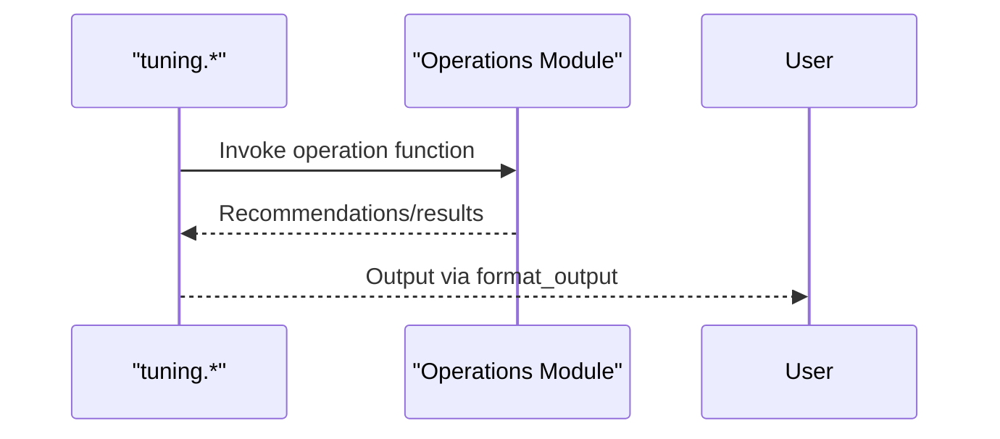

**Diagram sources**
- [janitor/cli/commands/tuning.py](file://janitor/cli/commands/tuning.py#L23-L141)

**Section sources**
- [janitor/cli/commands/tuning.py](file://janitor/cli/commands/tuning.py#L23-L141)

#### Template Commands
- validate, performance_impact: Analyze templates for configuration and performance issues.

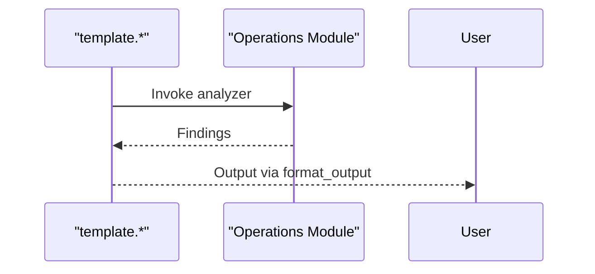

**Diagram sources**
- [janitor/cli/commands/template.py](file://janitor/cli/commands/template.py#L19-L74)

**Section sources**
- [janitor/cli/commands/template.py](file://janitor/cli/commands/template.py#L19-L74)

#### Policy Commands
- health_check, alignment: Analyze ILM policies and template-policy alignment.

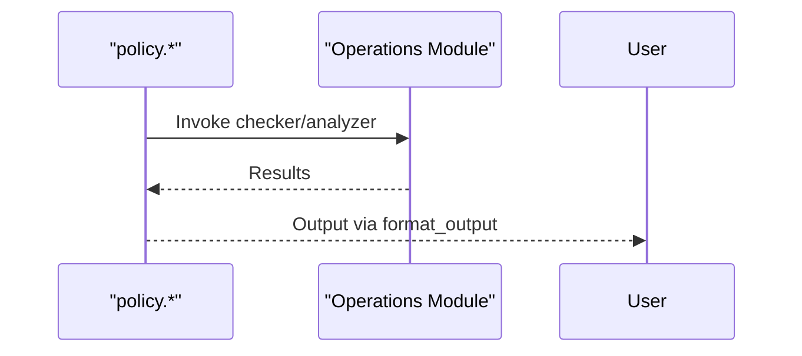

**Diagram sources**
- [janitor/cli/commands/policy.py](file://janitor/cli/commands/policy.py#L19-L73)

**Section sources**
- [janitor/cli/commands/policy.py](file://janitor/cli/commands/policy.py#L19-L73)

## Dependency Analysis
The CLI depends on Click for command definition and dispatch, on shared utilities for consistent behavior, and on operation modules for business logic. The main CLI registers all command groups, which in turn register their subcommands.

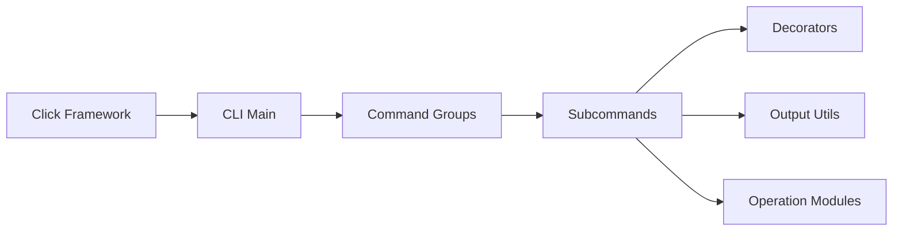

**Diagram sources**
- [janitor/cli/main.py](file://janitor/cli/main.py#L40-L51)
- [janitor/cli/utils/decorators.py](file://janitor/cli/utils/decorators.py#L1-L89)
- [janitor/cli/utils/output.py](file://janitor/cli/utils/output.py#L1-L153)

**Section sources**
- [janitor/cli/main.py](file://janitor/cli/main.py#L40-L51)

## Performance Considerations
- Output formatting is optimized for readability and scriptability; choose JSON or CSV for automation.
- Dry-run mode avoids heavy operations during previews.
- Batch sizes and thresholds (e.g., retention parsing, target shard size) influence runtime and memory usage.
- Use quiet mode to reduce console overhead in automated environments.

## Troubleshooting Guide
- Connection failures: The connection decorator reports connection errors and exits with a specific code.
- Command errors: The error decorator handles exceptions and prints stack traces when verbose is enabled.
- Keyboard interrupts: Gracefully handled with a specific exit code and user-friendly message.
- Dry-run mode: Use the dry-run group to toggle global dry-run behavior for destructive operations.
- Help system: Each command includes inline help; use the top-level help option to see available groups and commands.

**Section sources**
- [janitor/cli/utils/decorators.py](file://janitor/cli/utils/decorators.py#L13-L46)
- [janitor/cli/commands/dryrun.py](file://janitor/cli/commands/dryrun.py#L15-L86)
- [janitor/cli/main.py](file://janitor/cli/main.py#L10-L36)

## Conclusion
The Elastic Janitor CLI leverages Click to provide a structured, extensible command interface. Shared decorators and output utilities ensure consistent behavior and formatting across all commands. The modular design allows easy addition of new command groups and subcommands, while dry-run and error-handling mechanisms improve safety and reliability. The programmatic interface is accessible via the exported CLI object for automated usage.

## Appendices

### Programmatic Interface for Automated Usage
- Import the CLI object from the CLI package to integrate with external scripts or frameworks.
- Invoke the CLI programmatically by passing arguments as a list to trigger command execution.

**Section sources**
- [janitor/cli/__init__.py](file://janitor/cli/__init__.py#L4-L6)

### Extending the CLI with Custom Commands
- Create a new command group module under the commands directory.
- Define Click group and subcommands with desired options and arguments.
- Import and register the new group in the main CLI entry point.
- Add shared options via the common options decorator and apply error/connection decorators as needed.
- Use the output formatter to render results consistently.

**Section sources**
- [janitor/cli/main.py](file://janitor/cli/main.py#L40-L51)
- [janitor/cli/utils/decorators.py](file://janitor/cli/utils/decorators.py#L64-L87)
- [janitor/cli/utils/output.py](file://janitor/cli/utils/output.py#L22-L153)

### Adding New Options
- Use Click’s option decorator within subcommands to define new flags or parameters.
- For frequently reused options, add them to the common options decorator.
- Ensure validation and helpful help text are included for clarity.

**Section sources**
- [janitor/cli/commands/index.py](file://janitor/cli/commands/index.py#L17-L23)
- [janitor/cli/commands/datastream.py](file://janitor/cli/commands/datastream.py#L20-L28)
- [janitor/cli/utils/decorators.py](file://janitor/cli/utils/decorators.py#L64-L87)

### Handling Command Execution
- Decorators manage connection, error handling, and dry-run behavior.
- Output formatting adapts to user preferences and automation needs.
- Exit codes reflect operational outcomes for robust automation.

**Section sources**
- [janitor/cli/utils/decorators.py](file://janitor/cli/utils/decorators.py#L13-L89)
- [janitor/cli/utils/output.py](file://janitor/cli/utils/output.py#L22-L153)