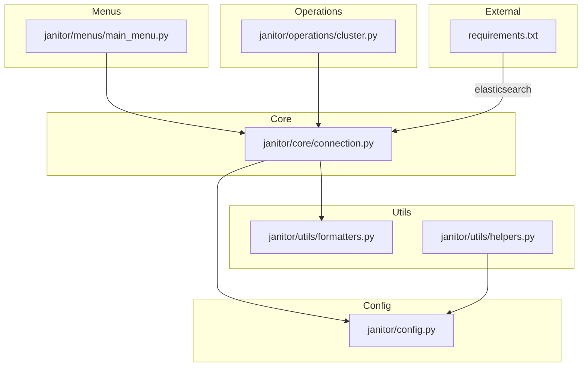
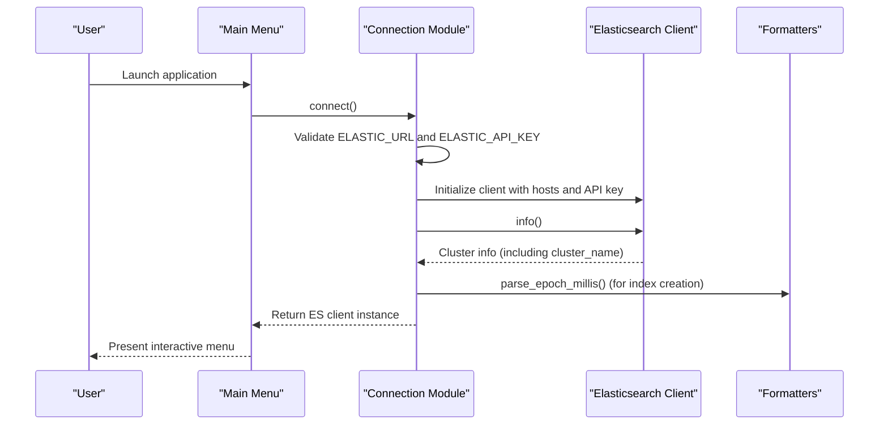
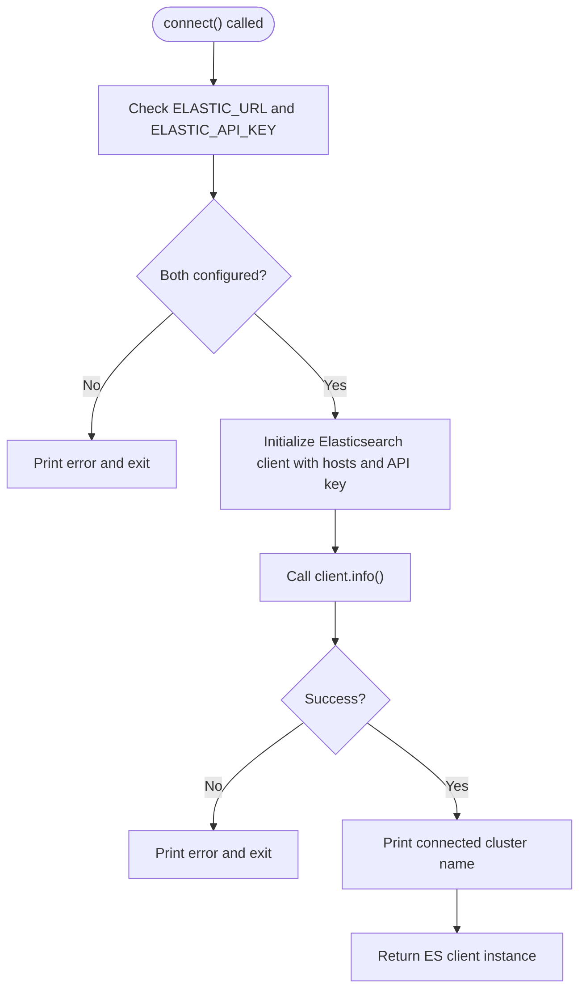
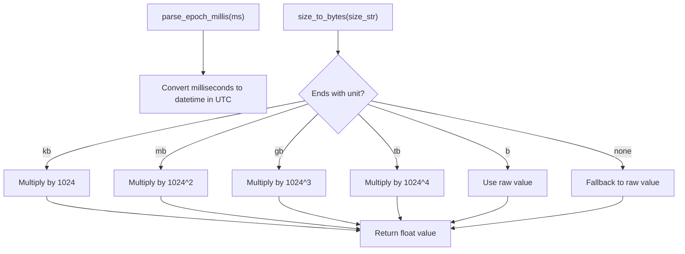
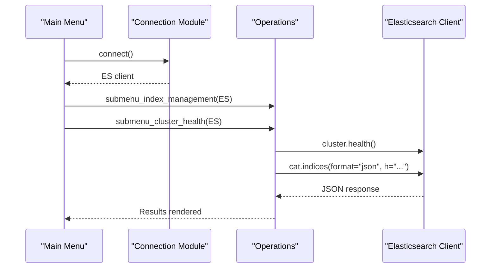
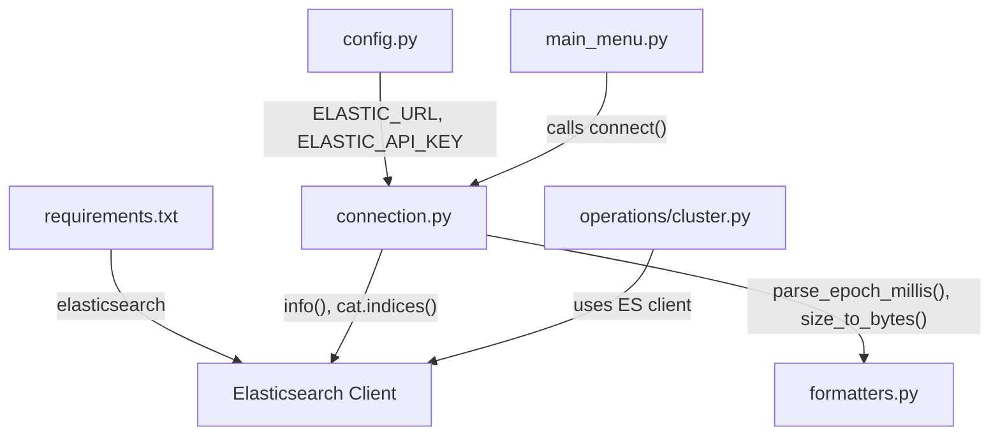

# Core Modules

<cite>
**Referenced Files in This Document**
- [connection.py](file://janitor/core/connection.py)
- [config.py](file://janitor/config.py)
- [formatters.py](file://janitor/utils/formatters.py)
- [helpers.py](file://janitor/utils/helpers.py)
- [main_menu.py](file://janitor/menus/main_menu.py)
- [cluster.py](file://janitor/operations/cluster.py)
- [requirements.txt](file://requirements.txt)
- [README.md](file://README.md)
</cite>

## Table of Contents
1. [Introduction](#introduction)
2. [Project Structure](#project-structure)
3. [Core Components](#core-components)
4. [Architecture Overview](#architecture-overview)
5. [Detailed Component Analysis](#detailed-component-analysis)
6. [Dependency Analysis](#dependency-analysis)
7. [Performance Considerations](#performance-considerations)
8. [Troubleshooting Guide](#troubleshooting-guide)
9. [Conclusion](#conclusion)

## Introduction
This document provides comprehensive API documentation for Elastic Janitor’s core modules with a focus on connection management. It explains how the Elasticsearch client is initialized, how connections are established and reused, and how errors are handled. It also documents the public interfaces exposed by the core connection module, configuration options, timeouts, and operational patterns used across the application. Guidance is included for thread safety, connection reuse, and practical examples of connecting, managing states, and handling failures.

## Project Structure
The core connection logic resides in the core package and is consumed by menu-driven flows and operations. Supporting utilities provide formatting and interactive helpers. Configuration constants define connection parameters and timeouts.

**Diagram sources**
- [connection.py](file://janitor/core/connection.py#L1-L72)
- [config.py](file://janitor/config.py#L1-L78)
- [formatters.py](file://janitor/utils/formatters.py#L1-L53)
- [helpers.py](file://janitor/utils/helpers.py#L1-L258)
- [main_menu.py](file://janitor/menus/main_menu.py#L1-L125)
- [cluster.py](file://janitor/operations/cluster.py#L1-L242)
- [requirements.txt](file://requirements.txt#L1-L7)

**Section sources**
- [connection.py](file://janitor/core/connection.py#L1-L72)
- [config.py](file://janitor/config.py#L1-L78)
- [README.md](file://README.md#L143-L184)

## Core Components
This section documents the core connection module’s public interfaces, configuration options, and lifecycle management.

- Public interface functions
  - connect(): Establishes an Elasticsearch connection using configured credentials and validates connectivity.
  - get_index_creation(es, index_name): Retrieves an index’s creation date from cluster settings.
  - get_all_indices_info(es): Fetches index metadata (creation date, sizes, and tier) for all indices in a single call.

- Configuration options
  - ELASTIC_URL: Elasticsearch endpoint URL.
  - ELASTIC_API_KEY: API key for authentication.
  - DEFAULT_QUERY_TIMEOUT, SLOW_QUERY_TIMEOUT, REQUEST_TIMEOUT, REINDEX_TIMEOUT: Client-side and operation-specific timeouts.
  - DRY_RUN_MODE: Global dry-run flag affecting downstream operations.
  - PROTECT_SYSTEM, MAX_DELETE_LIMIT: Operational safeguards.

- Connection lifecycle
  - Initialization: connect() constructs an Elasticsearch client with hosts and API key, then calls cluster info to validate connectivity.
  - Validation: On success, the function prints the cluster name and returns the client instance.
  - Failure handling: On exception, an error message is printed and the process exits.

- Data formatting utilities
  - parse_epoch_millis(): Converts millisecond timestamps to UTC datetime.
  - size_to_bytes(): Parses human-readable sizes (e.g., kb, mb, gb, tb) to bytes.

- Example usage patterns
  - Establishing a connection: Call connect() from the main menu or operations to obtain an Elasticsearch client instance.
  - Managing connection state: Use the returned client instance across operations until the session ends.
  - Handling failures: Rely on connect()’s built-in error handling and exit behavior; wrap downstream operations in try/except blocks as needed.

**Section sources**
- [connection.py](file://janitor/core/connection.py#L11-L33)
- [connection.py](file://janitor/core/connection.py#L35-L39)
- [connection.py](file://janitor/core/connection.py#L42-L70)
- [config.py](file://janitor/config.py#L11-L12)
- [config.py](file://janitor/config.py#L29-L40)
- [config.py](file://janitor/config.py#L18-L24)
- [formatters.py](file://janitor/utils/formatters.py#L7-L38)
- [main_menu.py](file://janitor/menus/main_menu.py#L48-L48)

## Architecture Overview
The connection module integrates with the configuration and utilities to provide a cohesive connection lifecycle. Menus and operations consume the client instance returned by connect().

**Diagram sources**
- [main_menu.py](file://janitor/menus/main_menu.py#L48-L48)
- [connection.py](file://janitor/core/connection.py#L11-L33)
- [formatters.py](file://janitor/utils/formatters.py#L7-L9)

## Detailed Component Analysis

### Connection Module
The connection module exposes three primary functions and orchestrates client initialization and validation.

- Parameters and configuration
  - ELASTIC_URL: Host endpoint used to initialize the client.
  - ELASTIC_API_KEY: Authentication credential passed to the client.
  - DEFAULT_QUERY_TIMEOUT, SLOW_QUERY_TIMEOUT, REQUEST_TIMEOUT, REINDEX_TIMEOUT: While timeouts are defined in configuration, the current connect() implementation does not pass them to the client constructor. Downstream operations may apply these timeouts when invoking client APIs.

- Authentication method
  - API key authentication is used during client initialization.

- SSL/TLS configuration
  - The client is initialized with a host URL; SSL/TLS behavior follows the underlying client defaults. No explicit TLS parameters are set in the current implementation.

- Error handling patterns
  - connect(): Validates configuration, attempts client.info(), catches exceptions, prints a red error message, and exits the process.
  - get_all_indices_info(): Wraps the indices retrieval in a progress spinner and returns a structured map of index metadata. Exceptions are not explicitly caught in this function; callers should handle exceptions when invoking it.

- Retry mechanisms
  - There is no built-in retry logic in the connection module. Retries are not implemented in connect() or the index retrieval functions.

- Thread safety and reuse
  - The Elasticsearch client instance returned by connect() is intended for use within a single session. The module does not implement connection pooling or long-lived client reuse. Each invocation of connect() creates a new client instance.

- Practical examples
  - Establishing a connection: See the main menu’s call to connect().
  - Managing connection state: Use the returned client instance across menu submenus and operations.
  - Handling failures: Rely on connect()’s error handling; wrap downstream operations in try/except blocks as needed.

**Section sources**
- [connection.py](file://janitor/core/connection.py#L11-L33)
- [connection.py](file://janitor/core/connection.py#L42-L70)
- [config.py](file://janitor/config.py#L11-L12)
- [config.py](file://janitor/config.py#L29-L40)
- [main_menu.py](file://janitor/menus/main_menu.py#L48-L48)

### Data Formatting Utilities
The formatting utilities support parsing and converting index metadata retrieved from the cluster.

- Purpose
  - parse_epoch_millis(): Converts creation timestamps from milliseconds to UTC datetime.
  - size_to_bytes(): Converts human-readable sizes to bytes for numerical comparisons.

- Usage in connection module
  - get_all_indices_info() uses parse_epoch_millis() to normalize creation dates and size_to_bytes() to convert textual sizes to numeric byte values.

**Section sources**
- [formatters.py](file://janitor/utils/formatters.py#L7-L38)
- [connection.py](file://janitor/core/connection.py#L35-L39)
- [connection.py](file://janitor/core/connection.py#L60-L68)

### Menu and Operations Integration
The main menu obtains the client instance and passes it to submenus and operations.

- Key points
  - The main menu calls connect() once per session and forwards the client to all operations.
  - Operations like cluster health and index listing rely on the shared client instance.
  - get_all_indices_info() is used by operations to aggregate index metadata efficiently.

**Section sources**
- [main_menu.py](file://janitor/menus/main_menu.py#L88-L118)
- [cluster.py](file://janitor/operations/cluster.py#L127-L200)
- [connection.py](file://janitor/core/connection.py#L42-L70)

## Dependency Analysis
External dependencies and internal relationships are summarized below.

**Diagram sources**
- [requirements.txt](file://requirements.txt#L1-L7)
- [config.py](file://janitor/config.py#L11-L12)
- [connection.py](file://janitor/core/connection.py#L17-L29)
- [connection.py](file://janitor/core/connection.py#L50-L68)
- [formatters.py](file://janitor/utils/formatters.py#L7-L38)
- [main_menu.py](file://janitor/menus/main_menu.py#L48-L48)
- [cluster.py](file://janitor/operations/cluster.py#L127-L200)

**Section sources**
- [requirements.txt](file://requirements.txt#L1-L7)
- [config.py](file://janitor/config.py#L11-L12)
- [connection.py](file://janitor/core/connection.py#L17-L29)
- [connection.py](file://janitor/core/connection.py#L50-L68)
- [formatters.py](file://janitor/utils/formatters.py#L7-L38)
- [main_menu.py](file://janitor/menus/main_menu.py#L48-L48)
- [cluster.py](file://janitor/operations/cluster.py#L127-L200)

## Performance Considerations
- Single-client sessions: The connection module initializes a new client per session. This avoids complex pooling logic but means each operation uses a fresh connection instance.
- Efficient metadata retrieval: get_all_indices_info() consolidates index metadata in a single API call, reducing round-trips and improving throughput for dashboards and analytics.
- Timeout configuration: While timeouts are defined in configuration, the current connect() implementation does not pass them to the client. Downstream operations should apply appropriate timeouts when invoking client APIs.

[No sources needed since this section provides general guidance]

## Troubleshooting Guide
Common issues and resolutions:

- Missing configuration
  - Symptom: Immediate exit after printing an error message.
  - Cause: ELASTIC_URL or ELASTIC_API_KEY is not set.
  - Resolution: Set both values in configuration or environment variables and rerun.

- Connection failure
  - Symptom: Error message indicating inability to connect; process exits.
  - Cause: Network issues, invalid URL, or incorrect API key.
  - Resolution: Verify endpoint accessibility, credentials, and network connectivity.

- Index metadata retrieval errors
  - Symptom: Exceptions when fetching indices.
  - Cause: Cluster state changes or permission issues.
  - Resolution: Retry after ensuring cluster stability and permissions; wrap calls in try/except blocks.

- Timeout-related delays
  - Symptom: Slow operations or timeouts.
  - Cause: Long-running queries or insufficient timeouts.
  - Resolution: Adjust DEFAULT_QUERY_TIMEOUT, SLOW_QUERY_TIMEOUT, REQUEST_TIMEOUT, or REINDEX_TIMEOUT as needed.

**Section sources**
- [connection.py](file://janitor/core/connection.py#L13-L15)
- [connection.py](file://janitor/core/connection.py#L30-L32)
- [config.py](file://janitor/config.py#L29-L40)

## Conclusion
The core connection module provides a straightforward, configuration-driven mechanism to establish and validate an Elasticsearch client instance. It integrates cleanly with menus and operations, offering efficient index metadata retrieval and robust error handling at the connection boundary. For production deployments, consider externalizing secrets, adding retry logic, and enabling connection pooling if long-lived sessions are required. The existing utilities and configuration options provide a solid foundation for extending connection management capabilities.