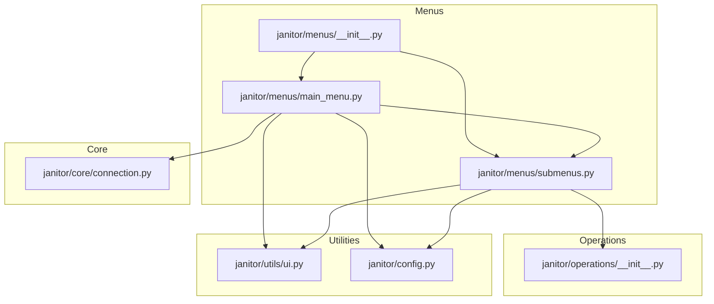
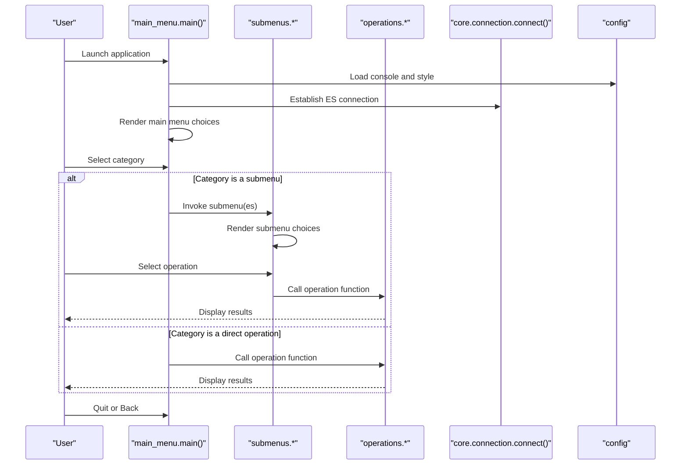
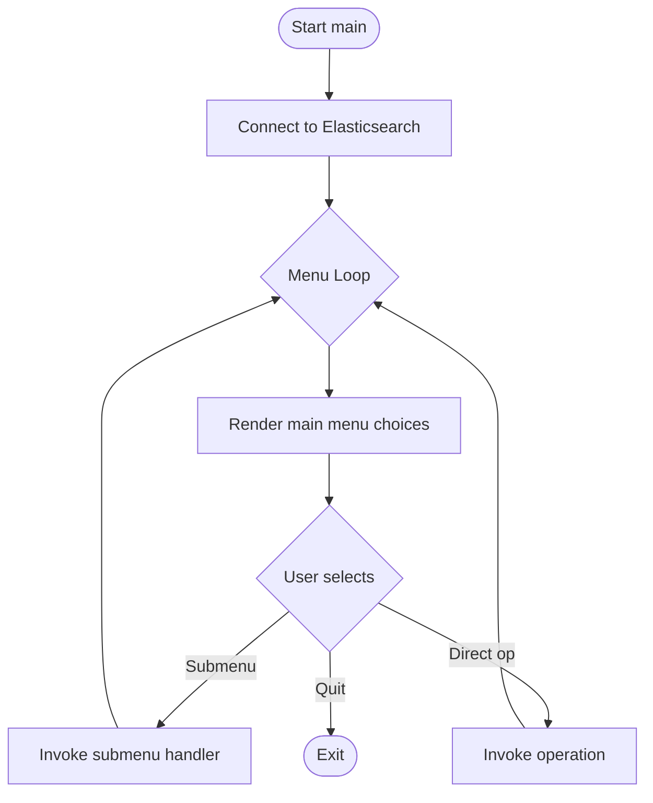
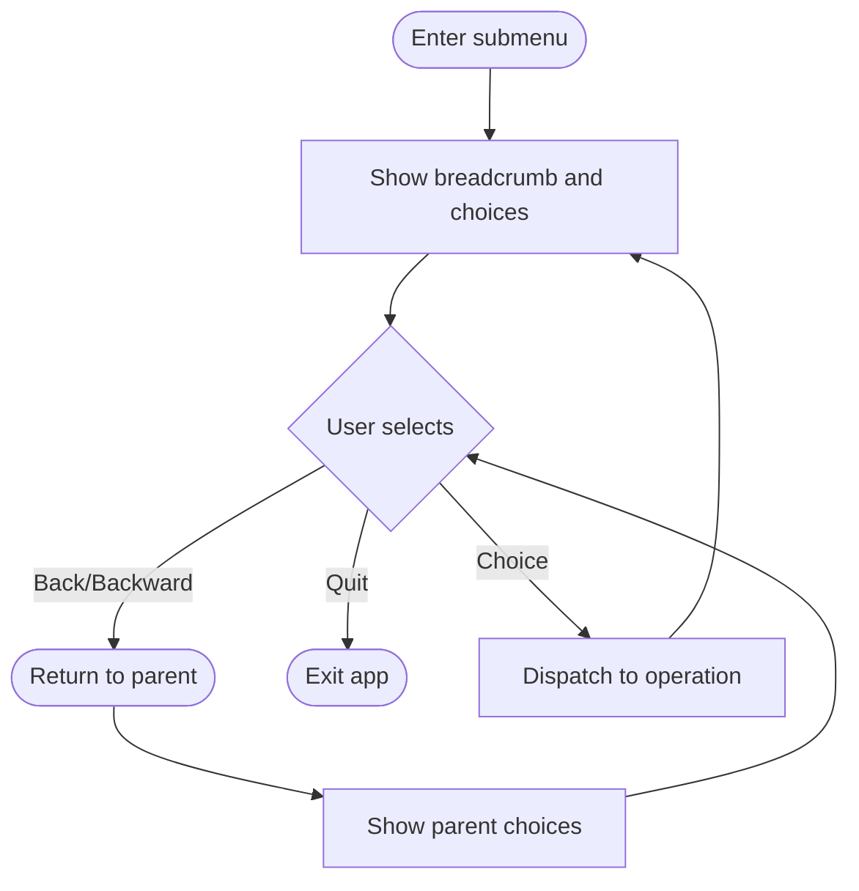
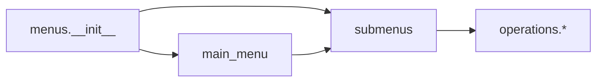
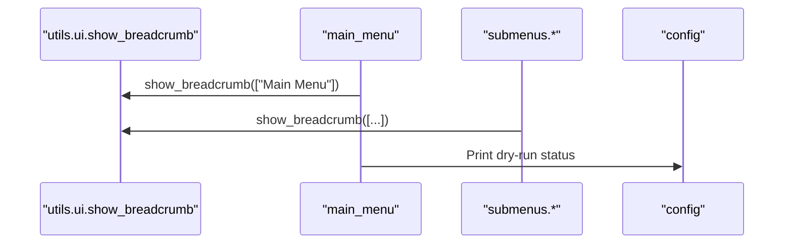
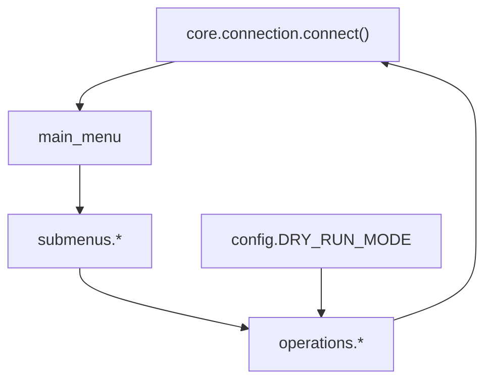
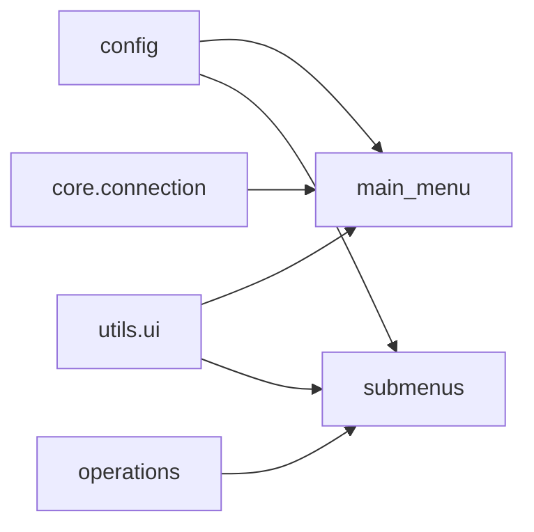

# Menu System API

<cite>
**Referenced Files in This Document**
- [janitor/menus/__init__.py](file://janitor/menus/__init__.py)
- [janitor/menus/main_menu.py](file://janitor/menus/main_menu.py)
- [janitor/menus/submenus.py](file://janitor/menus/submenus.py)
- [janitor/utils/ui.py](file://janitor/utils/ui.py)
- [janitor/config.py](file://janitor/config.py)
- [janitor/operations/__init__.py](file://janitor/operations/__init__.py)
- [janitor/core/connection.py](file://janitor/core/connection.py)
</cite>

## Table of Contents
1. [Introduction](#introduction)
2. [Project Structure](#project-structure)
3. [Core Components](#core-components)
4. [Architecture Overview](#architecture-overview)
5. [Detailed Component Analysis](#detailed-component-analysis)
6. [Dependency Analysis](#dependency-analysis)
7. [Performance Considerations](#performance-considerations)
8. [Troubleshooting Guide](#troubleshooting-guide)
9. [Conclusion](#conclusion)

## Introduction
This document describes the interactive menu system used by Elastic Janitor. It covers the main menu structure, submenu organization, navigation patterns, and the callback mechanism that routes user selections to underlying operation modules. It also documents the breadcrumb navigation system, menu state management, rendering and formatting options, and accessibility features. Finally, it explains how the menu system integrates with the operation modules and the Elasticsearch connection layer.

## Project Structure
The menu system is organized under the janitor/menus package and integrates with the janitor/operations package for callbacks and janitor/utils for UI utilities. The configuration module supplies the console and styling used across the menus.

**Diagram sources**
- [janitor/menus/main_menu.py](file://janitor/menus/main_menu.py#L1-L125)
- [janitor/menus/submenus.py](file://janitor/menus/submenus.py#L1-L1149)
- [janitor/menus/__init__.py](file://janitor/menus/__init__.py#L1-L44)
- [janitor/operations/__init__.py](file://janitor/operations/__init__.py#L1-L351)
- [janitor/utils/ui.py](file://janitor/utils/ui.py#L1-L12)
- [janitor/config.py](file://janitor/config.py#L1-L78)
- [janitor/core/connection.py](file://janitor/core/connection.py#L1-L72)

**Section sources**
- [janitor/menus/__init__.py](file://janitor/menus/__init__.py#L1-L44)
- [janitor/menus/main_menu.py](file://janitor/menus/main_menu.py#L1-L125)
- [janitor/menus/submenus.py](file://janitor/menus/submenus.py#L1-L1149)
- [janitor/operations/__init__.py](file://janitor/operations/__init__.py#L1-L351)
- [janitor/utils/ui.py](file://janitor/utils/ui.py#L1-L12)
- [janitor/config.py](file://janitor/config.py#L1-L78)
- [janitor/core/connection.py](file://janitor/core/connection.py#L1-L72)

## Core Components
- Main menu controller: orchestrates top-level navigation and invokes submenus or operations.
- Submenus: provide categorized navigation into operational capabilities.
- Operation callbacks: functions in janitor/operations that implement the actions selected by the user.
- UI utilities: breadcrumb rendering and shared styling.
- Configuration: console, custom style, and global flags (e.g., dry-run mode).

Key responsibilities:
- Menu creation and rendering: questionary-based interactive selection with custom styling.
- Navigation control: loop-based navigation with explicit back controls and quit handling.
- Callback dispatch: routing user choices to operation functions.
- State management: dry-run mode toggling and breadcrumb updates.

**Section sources**
- [janitor/menus/main_menu.py](file://janitor/menus/main_menu.py#L31-L125)
- [janitor/menus/submenus.py](file://janitor/menus/submenus.py#L161-L1149)
- [janitor/operations/__init__.py](file://janitor/operations/__init__.py#L1-L351)
- [janitor/utils/ui.py](file://janitor/utils/ui.py#L7-L11)
- [janitor/config.py](file://janitor/config.py#L61-L76)

## Architecture Overview
The menu system follows a layered architecture:
- Presentation layer: main_menu and submenus render interactive prompts.
- Control layer: menu functions parse user input and dispatch to operations.
- Operations layer: janitor/operations implements the actionable tasks.
- Utilities and configuration: UI helpers and styling; console and global flags.

**Diagram sources**
- [janitor/menus/main_menu.py](file://janitor/menus/main_menu.py#L44-L125)
- [janitor/menus/submenus.py](file://janitor/menus/submenus.py#L161-L1149)
- [janitor/operations/__init__.py](file://janitor/operations/__init__.py#L1-L351)
- [janitor/core/connection.py](file://janitor/core/connection.py#L11-L33)
- [janitor/config.py](file://janitor/config.py#L61-L76)

## Detailed Component Analysis

### Main Menu
The main menu presents top-level categories and handles navigation to submenus or direct operations. It prints a dry-run status banner and supports quitting or keyboard interrupts.

- Function signature: main() initializes the console panel, connects to Elasticsearch, and loops through the main menu prompt.
- Navigation: Uses questionary.select with a predefined set of choices mapped to submenu invocations or direct operations.
- Quit handling: Recognizes quit keywords and exits gracefully.
- Dry-run mode: Prints current status and is toggled via a dedicated operation.

**Diagram sources**
- [janitor/menus/main_menu.py](file://janitor/menus/main_menu.py#L44-L125)

**Section sources**
- [janitor/menus/main_menu.py](file://janitor/menus/main_menu.py#L31-L125)
- [janitor/core/connection.py](file://janitor/core/connection.py#L11-L33)

### Submenu Organization
Each submenu encapsulates a functional domain and provides a local back navigation. Submenus are grouped by capability areas such as Index Management, Data Streams, Templates & Policies, Snapshots, Cluster Health, Storage Optimization, Performance Monitoring, Bulk Automation, Advanced Cleanup, Data Quality, AWS Ingestion, Developer Tools, Data Governance, and Performance Tuning.

- Structure: Each submenu is a loop that renders its own choices and returns on back or interrupt.
- Navigation: Choices map to either deeper submenus (e.g., Templates -> Index Templates) or direct operations.
- Formatting: Uses questionary with a consistent custom style and rich panels for headers.

```mermaid
graph TB
MM["Main Menu"]
IM["Index Management"]
DS["Data Streams"]
TP["Templates & Policies"]
SN["Snapshots"]
CH["Cluster Health"]
SO["Storage Optimization"]
PM["Performance Monitoring"]
BA["Bulk Automation"]
AC["Advanced Cleanup"]
DQ["Data Quality"]
AI["AWS Ingestion"]
DT["Developer Tools"]
DG["Data Governance"]
PT["Performance Tuning"]
MM --> IM
MM --> DS
MM --> TP
MM --> SN
MM --> CH
MM --> SO
MM --> PM
MM --> BA
MM --> AC
MM --> DQ
MM --> AI
MM --> DT
MM --> DG
MM --> PT
TP --> IT["Index Templates"]
TP --> CT["Component Templates"]
TP --> IP["Ingest Pipelines"]
TP --> IL["ILM Policies"]
TP --> TA["Template Analysis Tools"]
SN --> SM["Snapshot Management"]
SN --> SL["SLM Policies"]
SN --> SA["Advanced Operations"]
```

**Diagram sources**
- [janitor/menus/submenus.py](file://janitor/menus/submenus.py#L161-L1149)

**Section sources**
- [janitor/menus/submenus.py](file://janitor/menus/submenus.py#L161-L1149)

### Navigation Patterns
- Back navigation: Each submenu recognizes a back command to return to the previous level.
- Quit handling: Top-level and submenu loops support quit keywords to exit the program.
- Interrupt handling: Keyboard interrupts are caught and handled gracefully with a user-friendly message.
- Dry-run toggle: A dedicated menu choice toggles the global dry-run flag and informs the user.

**Diagram sources**
- [janitor/menus/submenus.py](file://janitor/menus/submenus.py#L161-L1149)
- [janitor/menus/main_menu.py](file://janitor/menus/main_menu.py#L79-L85)

**Section sources**
- [janitor/menus/submenus.py](file://janitor/menus/submenus.py#L161-L1149)
- [janitor/menus/main_menu.py](file://janitor/menus/main_menu.py#L79-L85)

### Menu Item Registration and Callback Mechanisms
- Registration: The menus package exports menu entry points and submenus via its __init__ module.
- Dispatch: The main menu routes choices to specific submenu functions or direct operations.
- Operations linkage: The operations package exposes all operation functions; submenus call these functions directly.

**Diagram sources**
- [janitor/menus/__init__.py](file://janitor/menus/__init__.py#L4-L43)
- [janitor/menus/main_menu.py](file://janitor/menus/main_menu.py#L13-L28)
- [janitor/menus/submenus.py](file://janitor/menus/submenus.py#L8-L136)
- [janitor/operations/__init__.py](file://janitor/operations/__init__.py#L1-L351)

**Section sources**
- [janitor/menus/__init__.py](file://janitor/menus/__init__.py#L4-L43)
- [janitor/menus/main_menu.py](file://janitor/menus/main_menu.py#L13-L28)
- [janitor/menus/submenus.py](file://janitor/menus/submenus.py#L8-L136)
- [janitor/operations/__init__.py](file://janitor/operations/__init__.py#L1-L351)

### Breadcrumb Navigation and State Management
- Breadcrumb: A shared utility displays a navigational trail to help users understand their current location.
- State: The global dry-run mode flag is toggled by a menu choice and reflected in the main menu banner.

**Diagram sources**
- [janitor/utils/ui.py](file://janitor/utils/ui.py#L7-L11)
- [janitor/menus/main_menu.py](file://janitor/menus/main_menu.py#L31-L40)
- [janitor/menus/submenus.py](file://janitor/menus/submenus.py#L161-L1149)
- [janitor/config.py](file://janitor/config.py#L22-L23)

**Section sources**
- [janitor/utils/ui.py](file://janitor/utils/ui.py#L7-L11)
- [janitor/menus/main_menu.py](file://janitor/menus/main_menu.py#L31-L40)
- [janitor/menus/submenus.py](file://janitor/menus/submenus.py#L161-L1149)
- [janitor/config.py](file://janitor/config.py#L22-L23)

### Rendering, Formatting, and Accessibility
- Rendering: questionary is used for interactive selection with a custom style applied consistently.
- Formatting: Rich console is used for panels, tables, and breadcrumbs; separators visually group items.
- Accessibility: The system uses keyboard navigation (arrow keys) and clear textual labels; consider adding screen reader support by annotating labels and ensuring focus order.

**Section sources**
- [janitor/menus/main_menu.py](file://janitor/menus/main_menu.py#L54-L78)
- [janitor/menus/submenus.py](file://janitor/menus/submenus.py#L167-L185)
- [janitor/config.py](file://janitor/config.py#L61-L76)

### Relationship Between Menu System and Underlying Operation Modules
- Connection: The main menu obtains an Elasticsearch client via core.connection.connect() and passes it to submenus and operations.
- Operations: Submenus call functions from janitor/operations that implement the actual tasks (e.g., index management, data streams, templates, snapshots, cluster health, performance monitoring, automation, cleanup, quality, AWS ingestion, governance, and performance tuning).
- Dry-run mode: A global flag managed by the configuration module influences behavior in operations.

**Diagram sources**
- [janitor/core/connection.py](file://janitor/core/connection.py#L11-L33)
- [janitor/menus/main_menu.py](file://janitor/menus/main_menu.py#L48-L49)
- [janitor/menus/submenus.py](file://janitor/menus/submenus.py#L1-L136)
- [janitor/operations/__init__.py](file://janitor/operations/__init__.py#L1-L351)
- [janitor/config.py](file://janitor/config.py#L22-L23)

**Section sources**
- [janitor/core/connection.py](file://janitor/core/connection.py#L11-L33)
- [janitor/menus/main_menu.py](file://janitor/menus/main_menu.py#L48-L49)
- [janitor/menus/submenus.py](file://janitor/menus/submenus.py#L1-L136)
- [janitor/operations/__init__.py](file://janitor/operations/__init__.py#L1-L351)
- [janitor/config.py](file://janitor/config.py#L22-L23)

## Dependency Analysis
The menu system depends on:
- Configuration for console and styling.
- UI utilities for breadcrumb rendering.
- Operations for action callbacks.
- Core connection for Elasticsearch connectivity.

**Diagram sources**
- [janitor/config.py](file://janitor/config.py#L61-L76)
- [janitor/menus/main_menu.py](file://janitor/menus/main_menu.py#L9-L12)
- [janitor/menus/submenus.py](file://janitor/menus/submenus.py#L6-L7)
- [janitor/utils/ui.py](file://janitor/utils/ui.py#L4-L10)
- [janitor/operations/__init__.py](file://janitor/operations/__init__.py#L1-L351)
- [janitor/core/connection.py](file://janitor/core/connection.py#L7-L8)

**Section sources**
- [janitor/config.py](file://janitor/config.py#L61-L76)
- [janitor/menus/main_menu.py](file://janitor/menus/main_menu.py#L9-L12)
- [janitor/menus/submenus.py](file://janitor/menus/submenus.py#L6-L7)
- [janitor/utils/ui.py](file://janitor/utils/ui.py#L4-L10)
- [janitor/operations/__init__.py](file://janitor/operations/__init__.py#L1-L351)
- [janitor/core/connection.py](file://janitor/core/connection.py#L7-L8)

## Performance Considerations
- Interactive loops: The menu system uses while loops for navigation; ensure minimal blocking operations inside loops.
- Network calls: Elasticsearch calls are performed within operations; consider batching or caching where appropriate.
- Rendering: Rich console rendering is lightweight; avoid excessive table generation in tight loops.

## Troubleshooting Guide
- Connection failures: The connection module prints errors and exits if credentials are missing or the cluster is unreachable.
- Interrupt handling: Keyboard interrupts are caught and reported; the system returns to the previous menu or exits gracefully.
- Dry-run mode: Verify the global flag is toggled correctly; the main menu reflects the current status.

**Section sources**
- [janitor/core/connection.py](file://janitor/core/connection.py#L13-L32)
- [janitor/menus/main_menu.py](file://janitor/menus/main_menu.py#L79-L81)
- [janitor/menus/submenus.py](file://janitor/menus/submenus.py#L186-L188)

## Conclusion
The Elastic Janitor menu system provides a structured, extensible interface for navigating Elasticsearch operations. Its modular design separates presentation, control, and operations, enabling straightforward customization and maintenance. The breadcrumb system and consistent styling improve usability, while the integration with the operations and configuration modules ensures robust behavior across functional domains.