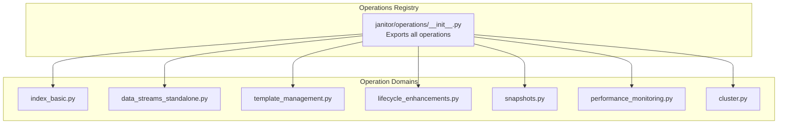
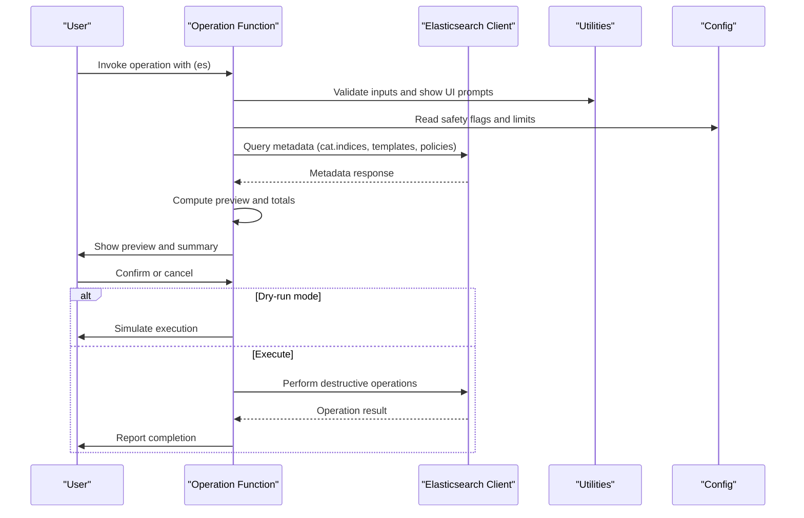
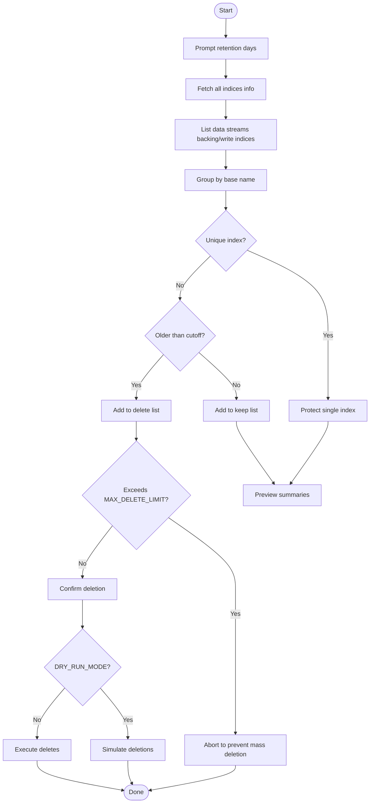
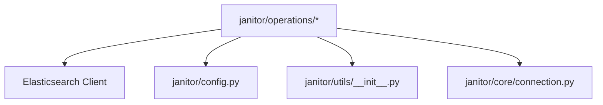

# Operation Modules API

<cite>
**Referenced Files in This Document**
- [janitor/operations/__init__.py](file://janitor/operations/__init__.py)
- [janitor/operations/index_basic.py](file://janitor/operations/index_basic.py)
- [janitor/operations/data_streams_standalone.py](file://janitor/operations/data_streams_standalone.py)
- [janitor/operations/template_management.py](file://janitor/operations/template_management.py)
- [janitor/operations/lifecycle_enhancements.py](file://janitor/operations/lifecycle_enhancements.py)
- [janitor/operations/snapshots.py](file://janitor/operations/snapshots.py)
- [janitor/operations/performance_monitoring.py](file://janitor/operations/performance_monitoring.py)
- [janitor/operations/cluster.py](file://janitor/operations/cluster.py)
- [janitor/utils/__init__.py](file://janitor/utils/__init__.py)
- [janitor/config.py](file://janitor/config.py)
- [janitor/core/__init__.py](file://janitor/core/__init__.py)
- [janitor/core/connection.py](file://janitor/core/connection.py)
- [janitor/operations/bulk_automation.py](file://janitor/operations/bulk_automation.py)
- [janitor/operations/rollback.py](file://janitor/operations/rollback.py)
- [janitor/operations/change_history.py](file://janitor/operations/change_history.py)
</cite>

## Table of Contents
1. [Introduction](#introduction)
2. [Project Structure](#project-structure)
3. [Core Components](#core-components)
4. [Architecture Overview](#architecture-overview)
5. [Detailed Component Analysis](#detailed-component-analysis)
6. [Dependency Analysis](#dependency-analysis)
7. [Performance Considerations](#performance-considerations)
8. [Troubleshooting Guide](#troubleshooting-guide)
9. [Conclusion](#conclusion)
10. [Appendices](#appendices)

## Introduction
This document provides comprehensive API documentation for Elastic Janitor’s operation modules. It explains how operations are organized, the common patterns used across implementations, the operation lifecycle, parameter validation, execution patterns, and the operation registry system. It also covers error handling, progress reporting, safety checks, and the relationship between operations and underlying Elasticsearch APIs.

## Project Structure
The operation modules are grouped by functional domain under janitor/operations. Each module exposes one or more “option” functions designed to be invoked with an Elasticsearch client argument. The operations package exports a consolidated list of all available operations via its __all__ list, enabling dynamic discovery and menu wiring.

**Diagram sources**
- [janitor/operations/__init__.py](file://janitor/operations/__init__.py#L1-L351)

**Section sources**
- [janitor/operations/__init__.py](file://janitor/operations/__init__.py#L1-L351)

## Core Components
- Operation signature pattern: All operations accept an Elasticsearch client (es) as the first positional argument. They perform discovery, validation, preview, optional dry-run simulation, and execution steps as appropriate.
- Parameter validation: Inputs are validated via utility helpers (safe_input, select_from_list, confirm_delete, confirm_action, get_number_input, get_text_input). Many operations enforce safety limits (e.g., MAX_DELETE_LIMIT) and protect system resources (PROTECT_SYSTEM).
- Execution patterns:
  - Preview and summary tables using Rich tables.
  - Progress reporting with Rich Progress widgets.
  - Dry-run mode toggled globally via DRY_RUN_MODE.
  - Optional rollback capability for destructive operations.
- Relationship to Elasticsearch APIs:
  - Operations call Elasticsearch client methods (cat.indices, indices.get_settings, indices.delete, indices.get_index_template, cluster.get_component_template, ilm.get_lifecycle, snapshot.get_repository, etc.) and interpret responses to drive UI and decisions.

Key shared utilities and configuration:
- Utilities: safe_input, is_system, confirm_delete, confirm_action, select_from_list, get_number_input, get_text_input, bytes_to_human, size_to_bytes, parse_epoch_millis, show_breadcrumb.
- Configuration: PROTECT_SYSTEM, DEFAULT_RETENTION_DAYS, MAX_DELETE_LIMIT, DRY_RUN_MODE, timeouts, version control settings.

**Section sources**
- [janitor/utils/__init__.py](file://janitor/utils/__init__.py#L1-L27)
- [janitor/config.py](file://janitor/config.py#L1-L78)
- [janitor/operations/index_basic.py](file://janitor/operations/index_basic.py#L14-L217)
- [janitor/operations/data_streams_standalone.py](file://janitor/operations/data_streams_standalone.py#L15-L218)
- [janitor/operations/template_management.py](file://janitor/operations/template_management.py#L25-L821)
- [janitor/operations/lifecycle_enhancements.py](file://janitor/operations/lifecycle_enhancements.py#L20-L947)
- [janitor/operations/snapshots.py](file://janitor/operations/snapshots.py#L15-L200)
- [janitor/operations/performance_monitoring.py](file://janitor/operations/performance_monitoring.py#L20-L200)
- [janitor/operations/cluster.py](file://janitor/operations/cluster.py#L21-L200)

## Architecture Overview
The operation architecture follows a consistent flow:
- Discovery: Fetch metadata from Elasticsearch (indices, templates, policies, nodes).
- Validation: Apply safety checks (system protection, limits, user confirmation).
- Preview: Render summaries and totals for user review.
- Dry-run: Optionally simulate execution without changes.
- Execution: Perform Elasticsearch operations and update rollback/version logs.

**Diagram sources**
- [janitor/operations/data_streams_standalone.py](file://janitor/operations/data_streams_standalone.py#L15-L218)
- [janitor/operations/snapshots.py](file://janitor/operations/snapshots.py#L84-L157)
- [janitor/operations/template_management.py](file://janitor/operations/template_management.py#L222-L365)
- [janitor/config.py](file://janitor/config.py#L18-L24)

## Detailed Component Analysis

### Operation Registry and Dynamic Loading
- The operations package exports a comprehensive list of operation identifiers via __all__, enabling dynamic menu construction and command routing.
- The registry aggregates operations from domain-specific modules (index, data streams, templates, snapshots, cluster, performance, lifecycle enhancements, etc.).

Common usage pattern:
- Import the operations package to access the list of available operations.
- Use the operation identifiers to wire CLI menus or dispatchers.

**Section sources**
- [janitor/operations/__init__.py](file://janitor/operations/__init__.py#L1-L351)

### Index Management (Basic)
- option_list_largest_indices(es)
  - Purpose: Display top N largest indices by size.
  - Parameters: None (prompts for N).
  - Behavior: Fetches indices via cat.indices, parses sizes, sorts, and prints a table.
  - Safety: None (read-only).
  - Returns: Prints a table; no return value.
  - Related Elasticsearch APIs: cat.indices.

- option_index_settings_viewer(es)
  - Purpose: Compare index settings for selected indices.
  - Parameters: None (interactive selection).
  - Behavior: Lists non-system indices, selects multiple, fetches settings, displays key settings in a table.
  - Safety: None (read-only).
  - Returns: Prints settings; no return value.
  - Related Elasticsearch APIs: cat.indices, indices.get_settings.

- option_duplicate_index_detector(es)
  - Purpose: Detect potential duplicate indices by grouping patterns.
  - Parameters: None (interactive).
  - Behavior: Groups indices by base patterns, reports candidates, and shows sample rows.
  - Safety: None (read-only).
  - Returns: Prints grouped candidates; no return value.
  - Related Elasticsearch APIs: cat.indices.

**Section sources**
- [janitor/operations/index_basic.py](file://janitor/operations/index_basic.py#L14-L217)

### Data Streams (Standalone Indices)
- option_clean_standalone_indices(es)
  - Purpose: Delete standalone indices older than a retention threshold, with safeguards.
  - Parameters: Retention days (prompted).
  - Behavior:
    - Discover data streams and backing/write indices to exclude.
    - Group indices by base name to avoid deleting unique indices.
    - Separate into delete/keep lists based on retention and uniqueness.
    - Enforce MAX_DELETE_LIMIT and DRY_RUN_MODE.
    - Confirm deletion and execute deletes.
  - Safety: Protects system indices (PROTECT_SYSTEM), prevents deletion of unique indices, enforces limits.
  - Returns: Prints summaries and completion message; no return value.
  - Related Elasticsearch APIs: indices.get_data_stream, indices.get, indices.delete.

**Diagram sources**
- [janitor/operations/data_streams_standalone.py](file://janitor/operations/data_streams_standalone.py#L15-L218)
- [janitor/config.py](file://janitor/config.py#L18-L24)

**Section sources**
- [janitor/operations/data_streams_standalone.py](file://janitor/operations/data_streams_standalone.py#L15-L218)

### Template Management
- option_view_index_template_details(es)
  - Purpose: View index template details and structure.
  - Parameters: None (interactive selection).
  - Behavior: Lists templates, shows patterns, priority, composed_of, version history, and optionally full JSON.
  - Safety: None (read-only).
  - Returns: Prints details; no return value.
  - Related Elasticsearch APIs: indices.get_index_template.

- option_edit_index_template(es)
  - Purpose: Edit index template with version control and rollback support.
  - Parameters: None (interactive).
  - Behavior: Saves current state as known-good or backup, opens editor, validates JSON, shows diffs, deploys, and saves new version.
  - Safety: Uses DRY_RUN_MODE; confirms deployment; tracks dependencies.
  - Returns: Prints status; no return value.
  - Related Elasticsearch APIs: indices.get_index_template, indices.put_index_template.

- option_rollback_index_template(es)
  - Purpose: Rollback to a previous version.
  - Parameters: None (interactive).
  - Behavior: Lists versions, prompts for version number, saves backup, performs rollback, logs.
  - Safety: Confirms rollback; respects DRY_RUN_MODE.
  - Returns: Prints status; no return value.
  - Related Elasticsearch APIs: indices.get_index_template, indices.put_index_template.

- option_export_index_template(es), option_import_index_template(es)
  - Purpose: Export/import template configurations to/from JSON.
  - Parameters: Filename and template name (prompts).
  - Behavior: Reads/writes JSON, handles overwrite confirmation.
  - Safety: Validates JSON; warns on overwrite.
  - Returns: Prints status; no return value.
  - Related Elasticsearch APIs: indices.get_index_template, indices.put_index_template.

- option_view_component_template_details(es), option_edit_component_template(es), option_rollback_component_template(es), option_export_component_template(es), option_import_component_template(es)
  - Purpose: Similar to index template operations but for component templates.
  - Parameters: As above.
  - Behavior: Uses cluster.get_component_template and cluster.put_component_template.
  - Safety: Same patterns as index templates.
  - Returns: Prints status; no return value.
  - Related Elasticsearch APIs: cluster.get_component_template, cluster.put_component_template.

**Section sources**
- [janitor/operations/template_management.py](file://janitor/operations/template_management.py#L25-L821)

### Lifecycle Enhancements
- option_ilm_policy_simulator(es)
  - Purpose: Test ILM policies against existing indices and predict phase transitions.
  - Parameters: None (interactive).
  - Behavior: Lists non-system indices, policies, calculates current phase and timeline, displays results.
  - Safety: None (read-only).
  - Returns: Prints simulation panel; no return value.
  - Related Elasticsearch APIs: cat.indices, ilm.get_lifecycle.

- option_rollover_prediction(es)
  - Purpose: Predict when rollover conditions will be met for indices with rollover aliases or data streams.
  - Parameters: None (auto-detects).
  - Behavior: Calculates growth rates and predicts days until rollover triggers.
  - Safety: None (read-only).
  - Returns: Prints prediction table; no return value.
  - Related Elasticsearch APIs: cat.indices, cat.aliases.

- option_searchable_snapshot_manager(es)
  - Purpose: Manage searchable snapshots (mount/unmount) and view savings.
  - Parameters: Repository, snapshot, index name (prompts).
  - Behavior: Lists searchable snapshots, mounts/unmounts, shows savings.
  - Safety: Uses DRY_RUN_MODE; confirms actions.
  - Returns: Prints status; no return value.
  - Related Elasticsearch APIs: indices.get, searchable_snapshots.mount, indices.delete.

- option_data_stream_template_validator(es)
  - Purpose: Validate data stream templates for correctness and best practices.
  - Parameters: None (auto-discovery).
  - Behavior: Checks ILM policy existence, @timestamp mapping, component template references, hidden settings, and conflicts.
  - Safety: None (read-only).
  - Returns: Prints validation results; no return value.
  - Related Elasticsearch APIs: indices.get_index_template, ilm.get_lifecycle, cluster.get_component_template.

- option_lifecycle_phase_distribution(es)
  - Purpose: Analyze ILM phase distribution across indices and optionally compute storage costs.
  - Parameters: None (auto-discovery).
  - Behavior: Explains lifecycle for all indices, groups by policy and phase, detects errors.
  - Safety: None (read-only).
  - Returns: Prints distribution table; no return value.
  - Related Elasticsearch APIs: ilm.explain_lifecycle.

**Section sources**
- [janitor/operations/lifecycle_enhancements.py](file://janitor/operations/lifecycle_enhancements.py#L20-L947)

### Snapshots
- option_list_snapshot_repos(es)
  - Purpose: List snapshot repositories.
  - Parameters: None.
  - Behavior: Calls snapshot.get_repository and prints a table.
  - Safety: None (read-only).
  - Returns: Prints table; no return value.
  - Related Elasticsearch APIs: snapshot.get_repository.

- option_list_snapshots(es)
  - Purpose: List snapshots in a repository.
  - Parameters: Repository name (prompted).
  - Behavior: Calls snapshot.get and prints snapshot names and start times.
  - Safety: None (read-only).
  - Returns: Prints table; no return value.
  - Related Elasticsearch APIs: snapshot.get.

- option_delete_old_snapshots(es)
  - Purpose: Delete snapshots older than a retention threshold.
  - Parameters: Repository name and retention days (prompts).
  - Behavior: Builds delete list, enforces MAX_DELETE_LIMIT, confirms, simulates or executes deletion.
  - Safety: Enforces limits; respects DRY_RUN_MODE; protects system indices indirectly.
  - Returns: Prints summaries and completion; no return value.
  - Related Elasticsearch APIs: snapshot.get, snapshot.delete.

- option_list_slm(es), option_delete_slm(es)
  - Purpose: List and manage SLM policies.
  - Parameters: None (interactive).
  - Behavior: Lists policies, optionally deletes by match.
  - Safety: None (read-only for listing; destructive for deletion).
  - Returns: Prints tables or status; no return value.
  - Related Elasticsearch APIs: slm.get_lifecycle, slm.delete_lifecycle.

**Section sources**
- [janitor/operations/snapshots.py](file://janitor/operations/snapshots.py#L15-L200)

### Performance Monitoring
- option_slow_query_analyzer(es)
  - Purpose: Analyze slow queries by index using search stats.
  - Parameters: None.
  - Behavior: Fetches indices stats, computes averages, prints top slowest indices, and provides recommendations.
  - Safety: None (read-only).
  - Returns: Prints table and recommendations; no return value.
  - Related Elasticsearch APIs: indices.stats.

- Additional monitoring operations exist for indexing performance, search performance, cluster health timelines, node resource usage, hot spot detection, and JVM/thread pool monitoring.

**Section sources**
- [janitor/operations/performance_monitoring.py](file://janitor/operations/performance_monitoring.py#L20-L200)

### Cluster
- toggle_dry_run_mode()
  - Purpose: Toggle global dry-run mode.
  - Parameters: None.
  - Behavior: Updates DRY_RUN_MODE and prints status.
  - Safety: None (control-plane).
  - Returns: Prints status; no return value.
  - Related configuration: DRY_RUN_MODE.

- option_dashboard_stats_view(es)
  - Purpose: Real-time dashboard of cluster health and storage by tier.
  - Parameters: None.
  - Behavior: Creates a Live-rendered dashboard updating periodically.
  - Safety: None (read-only).
  - Returns: Prints dashboard; no return value.
  - Related APIs: cluster.health, cat.nodes, cat.indices.

- option_cluster_health_overview(es), option_node_information(es)
  - Purpose: Display cluster health and node information.
  - Parameters: None.
  - Behavior: Fetches and prints health and node tables.
  - Safety: None (read-only).
  - Returns: Prints tables; no return value.
  - Related APIs: cluster.health, cat.nodes.

**Section sources**
- [janitor/operations/cluster.py](file://janitor/operations/cluster.py#L21-L200)
- [janitor/config.py](file://janitor/config.py#L22-L24)

### Bulk Automation and Rollback
- option_batch_index_operations(es), option_scheduled_cleanup_jobs(es), option_dry_run_mode(es), option_operation_history_log(es), option_rollback_capability(es), option_export_import_configurations(es)
  - Purpose: Batch operations, scheduling, dry-run toggle, history logging, rollback, and configuration export/import.
  - Parameters: Varies by operation.
  - Behavior: Implements batch workflows, history logging, and rollback tracking for destructive operations.
  - Safety: Uses DRY_RUN_MODE; logs operations; tracks rollback eligibility.
  - Returns: Prints status; no return value.
  - Related APIs: indices.open/close, indices.put_settings, slm APIs, snapshot APIs.

- Rollback subsystem:
  - Tracks destructive operations with previous state snapshots.
  - Provides interactive rollback selection and execution.
  - Marks operations as rolled back and logs rollback events.

**Section sources**
- [janitor/operations/bulk_automation.py](file://janitor/operations/bulk_automation.py#L164-L186)
- [janitor/operations/rollback.py](file://janitor/operations/rollback.py#L196-L509)
- [janitor/operations/change_history.py](file://janitor/operations/change_history.py#L224-L256)

## Dependency Analysis
- Internal dependencies:
  - Operations depend on janitor.utils for input validation, formatting, and UI helpers.
  - Operations depend on janitor.config for safety flags, limits, and global modes.
  - Operations depend on janitor.core for index metadata retrieval.
- External dependencies:
  - Elasticsearch client methods for all data plane operations.
  - Rich for progress bars, tables, panels, and live dashboards.
  - Questionary for interactive selections and prompts.

**Diagram sources**
- [janitor/config.py](file://janitor/config.py#L1-L78)
- [janitor/utils/__init__.py](file://janitor/utils/__init__.py#L1-L27)
- [janitor/core/connection.py](file://janitor/core/connection.py#L1-L72)
- [janitor/operations/__init__.py](file://janitor/operations/__init__.py#L1-L351)

**Section sources**
- [janitor/config.py](file://janitor/config.py#L1-L78)
- [janitor/utils/__init__.py](file://janitor/utils/__init__.py#L1-L27)
- [janitor/core/connection.py](file://janitor/core/connection.py#L1-L72)
- [janitor/operations/__init__.py](file://janitor/operations/__init__.py#L1-L351)

## Performance Considerations
- Use cat.indices and targeted field selectors to minimize payload sizes.
- Prefer batch operations where supported to reduce round-trips.
- Respect MAX_DELETE_LIMIT to avoid overwhelming the cluster during cleanup.
- Use DRY_RUN_MODE to preview impact before executing destructive operations.
- For long-running operations, leverage Rich progress widgets to provide feedback without blocking the UI.

## Troubleshooting Guide
- Connection failures:
  - Verify ELASTIC_URL and ELASTIC_API_KEY are set correctly.
  - Ensure network connectivity and credentials are valid.
- Permission errors:
  - Confirm the API key has sufficient privileges for the requested operations.
- Excessive deletions:
  - Review MAX_DELETE_LIMIT and adjust retention policies to prevent accidental mass deletion.
- Dry-run confusion:
  - Toggle DRY_RUN_MODE to see simulated vs. actual behavior.
- Rollback issues:
  - Check rollback eligibility and reasons; ensure previous state snapshots were captured.

**Section sources**
- [janitor/core/connection.py](file://janitor/core/connection.py#L11-L33)
- [janitor/config.py](file://janitor/config.py#L18-L24)
- [janitor/operations/rollback.py](file://janitor/operations/rollback.py#L196-L509)

## Conclusion
Elastic Janitor’s operation modules follow a consistent, safe, and user-friendly pattern: discover, validate, preview, optionally simulate, and execute. The modular design enables dynamic command loading via the operations registry, while shared utilities and configuration ensure uniform behavior across domains. Robust safety checks, progress reporting, and rollback/versioning support make operations reliable for production use.

## Appendices

### Operation Lifecycle Summary
- Discovery: Query Elasticsearch for metadata.
- Validation: Apply safety checks and user prompts.
- Preview: Summarize impact and totals.
- Dry-run: Simulate without changes.
- Execution: Perform operations and log outcomes.
- Rollback/Versioning: Track previous state and enable recovery.

### Implementing a Custom Operation
Steps:
1. Create a new function in a domain module (e.g., janitor/operations/my_domain.py).
2. Accept (es) as the first parameter.
3. Use utilities for input validation and UI (safe_input, select_from_list, confirm_delete).
4. Fetch metadata from Elasticsearch and compute previews.
5. Enforce safety limits and DRY_RUN_MODE.
6. Execute operations and log results.
7. Add the function to the operations registry exports.

Example references:
- [janitor/operations/data_streams_standalone.py](file://janitor/operations/data_streams_standalone.py#L15-L218)
- [janitor/operations/snapshots.py](file://janitor/operations/snapshots.py#L84-L157)
- [janitor/operations/template_management.py](file://janitor/operations/template_management.py#L222-L365)

### Relationship Between Operations and Elasticsearch APIs
- Index operations: indices.get_settings, indices.delete, indices.get, indices.put_index_template, indices.get_index_template, indices.open, indices.close, indices.put_settings.
- Data streams: indices.get_data_stream, indices.get.
- Templates: cluster.get_component_template, cluster.put_component_template, indices.put_index_template.
- Lifecycle: ilm.get_lifecycle, ilm.explain_lifecycle, searchable_snapshots.mount.
- Snapshots: snapshot.get_repository, snapshot.get, snapshot.delete, slm.get_lifecycle, slm.delete_lifecycle.
- Cluster: cluster.health, cat.nodes, cat.indices.

**Section sources**
- [janitor/operations/data_streams_standalone.py](file://janitor/operations/data_streams_standalone.py#L22-L46)
- [janitor/operations/snapshots.py](file://janitor/operations/snapshots.py#L16-L53)
- [janitor/operations/template_management.py](file://janitor/operations/template_management.py#L39-L61)
- [janitor/operations/lifecycle_enhancements.py](file://janitor/operations/lifecycle_enhancements.py#L406-L428)
- [janitor/operations/snapshots.py](file://janitor/operations/snapshots.py#L165-L186)
- [janitor/operations/cluster.py](file://janitor/operations/cluster.py#L62-L82)