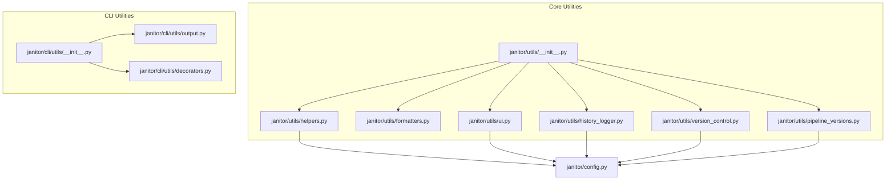
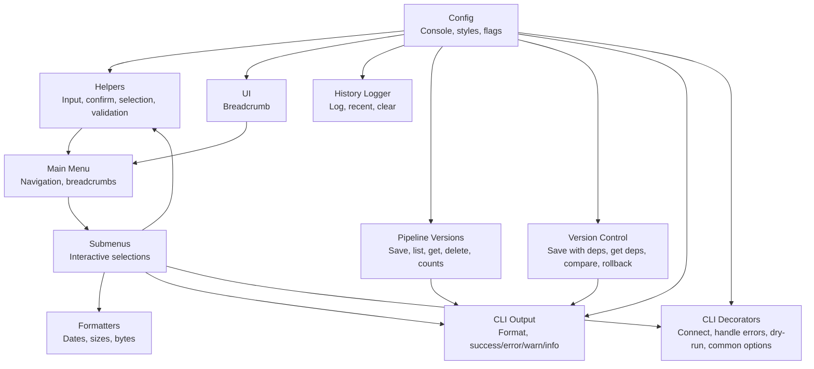
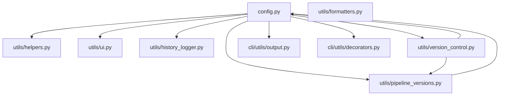

# Utility Modules API

<cite>
**Referenced Files in This Document**
- [janitor/utils/__init__.py](file://janitor/utils/__init__.py)
- [janitor/utils/helpers.py](file://janitor/utils/helpers.py)
- [janitor/utils/formatters.py](file://janitor/utils/formatters.py)
- [janitor/utils/ui.py](file://janitor/utils/ui.py)
- [janitor/utils/history_logger.py](file://janitor/utils/history_logger.py)
- [janitor/utils/pipeline_versions.py](file://janitor/utils/pipeline_versions.py)
- [janitor/utils/version_control.py](file://janitor/utils/version_control.py)
- [janitor/config.py](file://janitor/config.py)
- [janitor/cli/utils/__init__.py](file://janitor/cli/utils/__init__.py)
- [janitor/cli/utils/decorators.py](file://janitor/cli/utils/decorators.py)
- [janitor/cli/utils/output.py](file://janitor/cli/utils/output.py)
- [janitor/menus/main_menu.py](file://janitor/menus/main_menu.py)
- [janitor/menus/submenus.py](file://janitor/menus/submenus.py)
</cite>

## Table of Contents
1. [Introduction](#introduction)
2. [Project Structure](#project-structure)
3. [Core Components](#core-components)
4. [Architecture Overview](#architecture-overview)
5. [Detailed Component Analysis](#detailed-component-analysis)
6. [Dependency Analysis](#dependency-analysis)
7. [Performance Considerations](#performance-considerations)
8. [Troubleshooting Guide](#troubleshooting-guide)
9. [Conclusion](#conclusion)
10. [Appendices](#appendices)

## Introduction
This document provides comprehensive API documentation for Elastic Janitor’s utility modules. It covers helper functions for input validation and confirmation dialogs, formatting utilities for display and data transformation, UI component APIs for terminal rendering and navigation, and version control utilities for Elasticsearch resources. It also documents configuration management, logging integration, error handling patterns, and how these utilities integrate with core application functionality.

## Project Structure
The utility modules are organized under janitor/utils and janitor/cli/utils. They provide foundational capabilities used across the CLI and interactive menus:
- Input helpers and confirmations
- Formatting utilities for dates, sizes, and human-readable output
- UI helpers for breadcrumbs and navigation
- Operation history logging
- Version control systems for ingest pipelines and generic Elasticsearch resources
- CLI output formatting and common decorators

**Diagram sources**
- [janitor/utils/__init__.py](file://janitor/utils/__init__.py#L1-L27)
- [janitor/utils/helpers.py](file://janitor/utils/helpers.py#L1-L258)
- [janitor/utils/formatters.py](file://janitor/utils/formatters.py#L1-L53)
- [janitor/utils/ui.py](file://janitor/utils/ui.py#L1-L12)
- [janitor/utils/history_logger.py](file://janitor/utils/history_logger.py#L1-L73)
- [janitor/utils/pipeline_versions.py](file://janitor/utils/pipeline_versions.py#L1-L303)
- [janitor/utils/version_control.py](file://janitor/utils/version_control.py#L1-L974)
- [janitor/cli/utils/__init__.py](file://janitor/cli/utils/__init__.py#L1-L9)
- [janitor/cli/utils/decorators.py](file://janitor/cli/utils/decorators.py#L1-L89)
- [janitor/cli/utils/output.py](file://janitor/cli/utils/output.py#L1-L153)
- [janitor/config.py](file://janitor/config.py#L1-L78)

**Section sources**
- [janitor/utils/__init__.py](file://janitor/utils/__init__.py#L1-L27)
- [janitor/cli/utils/__init__.py](file://janitor/cli/utils/__init__.py#L1-L9)
- [janitor/config.py](file://janitor/config.py#L1-L78)

## Core Components
This section summarizes the primary utility modules and their responsibilities.

- Input helpers and confirmations
  - Safe input handling with keyboard interrupt protection
  - System resource detection
  - Confirmation dialogs for destructive actions
  - Interactive selection from lists (single or multi-select)
  - Validated numeric and text inputs with defaults and constraints
  - Index pattern selection with auto-discovery and fallbacks

- Formatting utilities
  - Epoch milliseconds to datetime conversion
  - Size string parsing to bytes
  - Bytes to human-readable format

- UI helpers
  - Breadcrumb navigation display

- Operation history logging
  - Logging operations to a local file
  - Retrieving recent operations
  - Clearing history

- Version control systems
  - Pipeline-specific version control using SQLite
  - Generic version control for Elasticsearch resources (pipelines, templates, component templates)
  - Dependency discovery and snapshotting
  - Known-good version tracking and rollback support

- CLI utilities
  - Output formatting (JSON, YAML, CSV, Rich table)
  - Common decorators for CLI commands (connection, error handling, dry-run, common options)

**Section sources**
- [janitor/utils/helpers.py](file://janitor/utils/helpers.py#L9-L258)
- [janitor/utils/formatters.py](file://janitor/utils/formatters.py#L7-L53)
- [janitor/utils/ui.py](file://janitor/utils/ui.py#L7-L12)
- [janitor/utils/history_logger.py](file://janitor/utils/history_logger.py#L9-L73)
- [janitor/utils/pipeline_versions.py](file://janitor/utils/pipeline_versions.py#L19-L303)
- [janitor/utils/version_control.py](file://janitor/utils/version_control.py#L24-L974)
- [janitor/cli/utils/output.py](file://janitor/cli/utils/output.py#L14-L153)
- [janitor/cli/utils/decorators.py](file://janitor/cli/utils/decorators.py#L13-L89)

## Architecture Overview
The utilities integrate with configuration, CLI, and menu systems to provide consistent UX and robust operations.

**Diagram sources**
- [janitor/config.py](file://janitor/config.py#L1-L78)
- [janitor/utils/helpers.py](file://janitor/utils/helpers.py#L1-L258)
- [janitor/utils/formatters.py](file://janitor/utils/formatters.py#L1-L53)
- [janitor/utils/ui.py](file://janitor/utils/ui.py#L1-L12)
- [janitor/utils/history_logger.py](file://janitor/utils/history_logger.py#L1-L73)
- [janitor/utils/pipeline_versions.py](file://janitor/utils/pipeline_versions.py#L1-L303)
- [janitor/utils/version_control.py](file://janitor/utils/version_control.py#L1-L974)
- [janitor/cli/utils/output.py](file://janitor/cli/utils/output.py#L1-L153)
- [janitor/cli/utils/decorators.py](file://janitor/cli/utils/decorators.py#L1-L89)
- [janitor/menus/main_menu.py](file://janitor/menus/main_menu.py#L1-L125)
- [janitor/menus/submenus.py](file://janitor/menus/submenus.py#L891-L917)

## Detailed Component Analysis

### Input Helpers API
Provides safe user input, confirmations, selections, and validated inputs.

- safe_input(prompt)
  - Purpose: Prompt for input with keyboard interrupt handling.
  - Parameters: prompt (string)
  - Returns: string or exits on interrupt
  - Behavior: Prints cancellation message and exits on Ctrl+C

- is_system(name)
  - Purpose: Determine if a resource is protected/system.
  - Parameters: name (string)
  - Returns: bool
  - Behavior: Checks configuration flag and prefix

- confirm_delete()
  - Purpose: Require explicit confirmation for deletions.
  - Parameters: none
  - Returns: bool (true if user typed DELETE)

- confirm_action(message, items_count=None)
  - Purpose: Interactive confirmation dialog.
  - Parameters: message (string), items_count (int, optional)
  - Returns: bool
  - Behavior: Uses styled questionary; handles interrupts gracefully

- select_from_list(message, choices, multi=False)
  - Purpose: Interactive selection with fuzzy search.
  - Parameters: message (string), choices (list), multi (bool)
  - Returns: selected item(s) or None on cancel

- get_number_input(message, default=None, min_val=None, max_val=None)
  - Purpose: Validated numeric input with optional bounds.
  - Parameters: message (string), default (number), min_val (number), max_val (number)
  - Returns: int or default; None on cancel

- get_text_input(message, default="")
  - Purpose: Text input with default.
  - Parameters: message (string), default (string)
  - Returns: string or None

- get_index_pattern_selection(es)
  - Purpose: Discover indices and present interactive pattern selection.
  - Parameters: es (Elasticsearch client)
  - Returns: selected pattern string or None
  - Behavior: Progress indicator, pattern extraction, fallback to manual input

Usage examples in codebase:
- Breadcrumb navigation and interactive menus use show_breadcrumb and select_from_list.
- Index pattern selection leverages get_index_pattern_selection with an ES client.

**Section sources**
- [janitor/utils/helpers.py](file://janitor/utils/helpers.py#L9-L258)
- [janitor/menus/main_menu.py](file://janitor/menus/main_menu.py#L31-L125)
- [janitor/menus/submenus.py](file://janitor/menus/submenus.py#L891-L917)

### Formatting Utilities API
Provides conversions and formatting for display.

- parse_epoch_millis(ms)
  - Purpose: Convert epoch milliseconds to UTC datetime.
  - Parameters: ms (epoch millis)
  - Returns: datetime

- size_to_bytes(s)
  - Purpose: Parse size strings (e.g., kb, mb, gb, tb, b) to bytes.
  - Parameters: s (string)
  - Returns: float bytes; 0 on invalid input

- bytes_to_human(b)
  - Purpose: Format bytes into human-readable units.
  - Parameters: b (float)
  - Returns: formatted string (e.g., "kb", "mb", "gb", "tb")

Usage examples in codebase:
- CLI commands import bytes_to_human for size display.
- Core connection module imports parse_epoch_millis and size_to_bytes.

**Section sources**
- [janitor/utils/formatters.py](file://janitor/utils/formatters.py#L7-L53)
- [janitor/core/connection.py](file://janitor/core/connection.py#L7-L7)
- [janitor/cli/commands/index.py](file://janitor/cli/commands/index.py#L6-L6)
- [janitor/cli/commands/datastream.py](file://janitor/cli/commands/datastream.py#L7-L7)
- [janitor/cli/commands/performance.py](file://janitor/cli/commands/performance.py#L6-L6)

### UI Helpers API
Provides terminal UI helpers.

- show_breadcrumb(path)
  - Purpose: Display a navigational breadcrumb.
  - Parameters: path (list of strings)
  - Returns: None
  - Behavior: Prints styled breadcrumb via console

Usage examples in codebase:
- Main menu and submenus call show_breadcrumb to indicate context.

**Section sources**
- [janitor/utils/ui.py](file://janitor/utils/ui.py#L7-L12)
- [janitor/menus/main_menu.py](file://janitor/menus/main_menu.py#L33-L33)
- [janitor/menus/submenus.py](file://janitor/menus/submenus.py#L894-L894)

### Operation History Logger API
Logs operations to a local file for auditability.

- log_operation(operation_type, affected_resources, description="")
  - Purpose: Append a log entry with timestamp and resources.
  - Parameters: operation_type (string), affected_resources (string or list), description (string)
  - Returns: None
  - Behavior: Silent failure on write errors; ensures minimal disruption

- get_recent_operations(n=20)
  - Purpose: Retrieve recent log entries.
  - Parameters: n (int)
  - Returns: list of log lines

- clear_history()
  - Purpose: Remove the history log file.
  - Parameters: none
  - Returns: bool (success)

Usage examples in codebase:
- Used to record operations performed by cleanup and governance features.

**Section sources**
- [janitor/utils/history_logger.py](file://janitor/utils/history_logger.py#L9-L73)

### Pipeline Version Control API
Manages versioning and rollback of ingest pipelines using SQLite.

- save_pipeline_version(pipeline_name, configuration, comment=None, is_known_good=False)
  - Purpose: Save a new pipeline version; enforces retention limit.
  - Parameters: pipeline_name (string), configuration (dict), comment (string), is_known_good (bool)
  - Returns: int (version_number)

- get_pipeline_versions(pipeline_name)
  - Purpose: List all versions for a pipeline.
  - Parameters: pipeline_name (string)
  - Returns: list of version dicts

- get_pipeline_version(pipeline_name, version_number)
  - Purpose: Retrieve a specific version.
  - Parameters: pipeline_name (string), version_number (int)
  - Returns: dict or None

- get_last_known_good_version(pipeline_name)
  - Purpose: Get the most recent known-good version.
  - Parameters: pipeline_name (string)
  - Returns: dict or None

- delete_pipeline_versions(pipeline_name)
  - Purpose: Remove all versions for a pipeline.
  - Parameters: pipeline_name (string)
  - Returns: int (deleted count)

- get_all_versioned_pipelines()
  - Purpose: List all pipelines with stored versions.
  - Parameters: none
  - Returns: list of strings

- get_version_count(pipeline_name)
  - Purpose: Count stored versions for a pipeline.
  - Parameters: pipeline_name (string)
  - Returns: int

Implementation highlights:
- Database initialization and indexing
- Automatic cleanup of older versions beyond a fixed retention limit
- JSON serialization of configurations
- Known-good tagging for rollback

**Section sources**
- [janitor/utils/pipeline_versions.py](file://janitor/utils/pipeline_versions.py#L19-L303)

### Generic Version Control API
Extends version control to Elasticsearch resources (pipelines, index templates, component templates) with dependency tracking.

- Constants
  - RESOURCE_TYPE_PIPELINE
  - RESOURCE_TYPE_INDEX_TEMPLATE
  - RESOURCE_TYPE_COMPONENT_TEMPLATE

- save_resource_version(resource_type, resource_name, configuration, comment=None, is_known_good=False)
  - Purpose: Save a new version of a resource; enforces retention limit.
  - Parameters: resource_type (constant), resource_name (string), configuration (dict), comment (string), is_known_good (bool)
  - Returns: int (version_number)

- get_resource_versions(resource_type, resource_name)
  - Purpose: List all versions for a resource.
  - Parameters: resource_type (constant), resource_name (string)
  - Returns: list of version dicts

- get_resource_version(resource_type, resource_name, version_number)
  - Purpose: Retrieve a specific version.
  - Parameters: resource_type (constant), resource_name (string), version_number (int)
  - Returns: dict or None

- get_last_known_good_version(resource_type, resource_name)
  - Purpose: Get the most recent known-good version.
  - Parameters: resource_type (constant), resource_name (string)
  - Returns: dict or None

- delete_resource_versions(resource_type, resource_name)
  - Purpose: Remove all versions for a resource.
  - Parameters: resource_type (constant), resource_name (string)
  - Returns: int (deleted count)

- get_all_versioned_resources(resource_type)
  - Purpose: List all resources of a given type with stored versions.
  - Parameters: resource_type (constant)
  - Returns: list of strings

- get_version_count(resource_type, resource_name)
  - Purpose: Count stored versions for a resource.
  - Parameters: resource_type (constant), resource_name (string)
  - Returns: int

- save_resource_version_with_dependencies(es, resource_type, resource_name, configuration, comment=None, is_known_good=False)
  - Purpose: Save a resource version and capture dependencies if enabled.
  - Parameters: es (Elasticsearch client), resource_type (constant), resource_name (string), configuration (dict), comment (string), is_known_good (bool)
  - Returns: int (version_number)
  - Behavior: Optionally discovers and saves dependency snapshots

- get_resource_dependencies(resource_type, resource_name, version_number)
  - Purpose: Retrieve captured dependencies for a version.
  - Parameters: resource_type (constant), resource_name (string), version_number (int)
  - Returns: list of dependency dicts

- compare_dependency_with_current(es, dependency)
  - Purpose: Compare a dependency snapshot with current state.
  - Parameters: es (Elasticsearch client), dependency (dict)
  - Returns: dict with keys: exists, changed, current_config, diff_summary

Implementation highlights:
- Unified schema for all resource types
- Dependency discovery across pipelines/templates/component templates
- Dependency snapshotting and comparison
- Migration from legacy pipeline-only database
- Configurable dependency tracking depth and enablement

**Section sources**
- [janitor/utils/version_control.py](file://janitor/utils/version_control.py#L13-L974)

### CLI Output Formatting API
Formats and prints structured output using Rich and standard libraries.

- OutputFormat (Enum)
  - Values: JSON, TABLE, YAML, CSV

- format_output(data, format_type=OutputFormat.TABLE, headers=None, title=None)
  - Purpose: Dispatch to formatter based on requested format.
  - Parameters: data (any), format_type (OutputFormat), headers (list), title (string)
  - Returns: None

- Helper functions
  - success(message)
  - error(message)
  - warning(message)
  - info(message)
  - All use Rich console for styled output

Usage examples in codebase:
- Commands import format_output and OutputFormat for consistent output.
- Utility functions are used for status messages.

**Section sources**
- [janitor/cli/utils/output.py](file://janitor/cli/utils/output.py#L14-L153)

### CLI Decorators API
Adds common behaviors to CLI commands.

- pass_es_client(f)
  - Purpose: Inject an Elasticsearch client into command functions.
  - Parameters: f (callable)
  - Returns: wrapper callable
  - Behavior: Connects to ES; handles connection errors

- handle_errors(f)
  - Purpose: Wrap command functions to handle exceptions.
  - Parameters: f (callable)
  - Returns: wrapper callable
  - Behavior: Catches keyboard interrupts and general exceptions; prints messages and exits appropriately

- dry_run_option(f)
  - Purpose: Add a --dry-run/-d flag to commands.
  - Parameters: f (callable)
  - Returns: wrapper callable

- common_options(f)
  - Purpose: Add --verbose/-v, --quiet/-q, --output/-o flags.
  - Parameters: f (callable)
  - Returns: wrapper callable

Usage examples in codebase:
- Commands import pass_es_client, handle_errors, common_options, and dry_run_option.

**Section sources**
- [janitor/cli/utils/decorators.py](file://janitor/cli/utils/decorators.py#L13-L89)

## Dependency Analysis
Utilities depend on configuration for console, styles, and feature flags. CLI utilities depend on Rich and standard libraries. Version control utilities depend on SQLite and JSON serialization.

**Diagram sources**
- [janitor/config.py](file://janitor/config.py#L1-L78)
- [janitor/utils/helpers.py](file://janitor/utils/helpers.py#L1-L258)
- [janitor/utils/formatters.py](file://janitor/utils/formatters.py#L1-L53)
- [janitor/utils/ui.py](file://janitor/utils/ui.py#L1-L12)
- [janitor/utils/history_logger.py](file://janitor/utils/history_logger.py#L1-L73)
- [janitor/utils/pipeline_versions.py](file://janitor/utils/pipeline_versions.py#L1-L303)
- [janitor/utils/version_control.py](file://janitor/utils/version_control.py#L1-L974)
- [janitor/cli/utils/output.py](file://janitor/cli/utils/output.py#L1-L153)
- [janitor/cli/utils/decorators.py](file://janitor/cli/utils/decorators.py#L1-L89)

**Section sources**
- [janitor/config.py](file://janitor/config.py#L1-L78)
- [janitor/utils/version_control.py](file://janitor/utils/version_control.py#L95-L165)

## Performance Considerations
- Input helpers use questionary for interactive prompts; avoid excessive blocking calls in tight loops.
- Index pattern selection performs an index catalog operation with a progress spinner; network latency affects perceived performance.
- Version control operations serialize/deserialize configurations; large configs increase I/O overhead.
- Dependency discovery traverses Elasticsearch metadata; configure depth limits to avoid long runs.
- CLI output formatting uses Rich tables; very large datasets may benefit from streaming or pagination.

## Troubleshooting Guide
- Keyboard interrupts
  - Safe input and confirm dialogs exit gracefully with a cancellation message.
  - CLI decorators catch keyboard interrupts and exit with a standard code.

- Connection failures
  - pass_es_client decorator catches connection errors and exits with a non-zero status.

- Logging failures
  - History logger writes silently; if auditing is critical, monitor filesystem permissions.

- Version control errors
  - Migration warnings are printed; verify database location and permissions.
  - Dependency discovery may warn and continue; verify Elasticsearch connectivity and permissions.

- Output formatting
  - Empty data is handled gracefully; ensure headers are provided for CSV/table when applicable.

**Section sources**
- [janitor/utils/helpers.py](file://janitor/utils/helpers.py#L10-L15)
- [janitor/utils/helpers.py](file://janitor/utils/helpers.py#L43-L45)
- [janitor/cli/utils/decorators.py](file://janitor/cli/utils/decorators.py#L37-L46)
- [janitor/utils/history_logger.py](file://janitor/utils/history_logger.py#L33-L35)
- [janitor/utils/version_control.py](file://janitor/utils/version_control.py#L163-L164)

## Conclusion
The utility modules provide a cohesive foundation for input handling, formatting, UI, logging, and version control across Elastic Janitor. They integrate tightly with configuration and CLI infrastructure to deliver a consistent, robust user experience. Developers can leverage these APIs to build custom implementations that follow established patterns for safety, UX, and maintainability.

## Appendices

### Configuration Management
- Centralized settings include console, custom styles, protection flags, timeouts, and version control options.
- Feature flags control dependency tracking and protection of system resources.

**Section sources**
- [janitor/config.py](file://janitor/config.py#L11-L78)

### Relationship to Core Functionality
- Menus and operations import UI helpers and input helpers for navigation and user prompts.
- CLI commands import output formatting and decorators for consistent presentation and error handling.
- Core connection module imports formatting utilities for display.
- Version control utilities support rollback and dependency-aware operations used by governance and automation features.

**Section sources**
- [janitor/menus/main_menu.py](file://janitor/menus/main_menu.py#L9-L12)
- [janitor/menus/submenus.py](file://janitor/menus/submenus.py#L891-L917)
- [janitor/core/connection.py](file://janitor/core/connection.py#L7-L7)
- [janitor/cli/utils/output.py](file://janitor/cli/utils/output.py#L1-L12)
- [janitor/cli/utils/decorators.py](file://janitor/cli/utils/decorators.py#L8-L9)