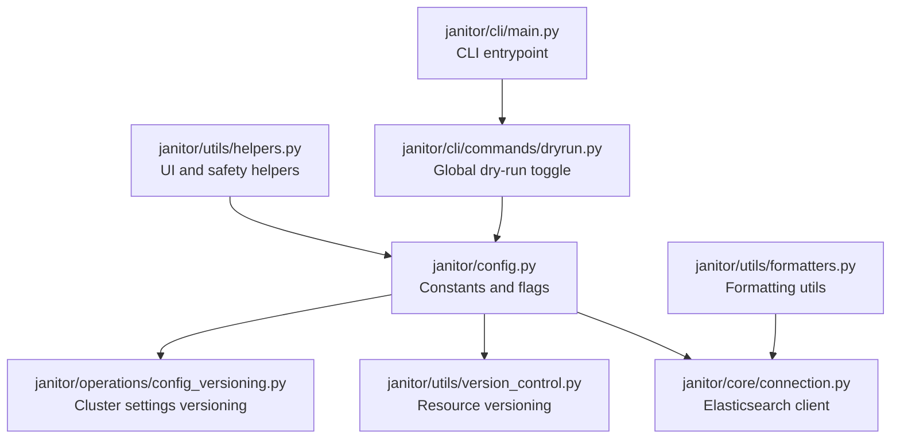
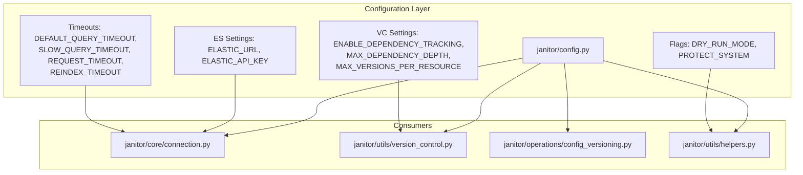
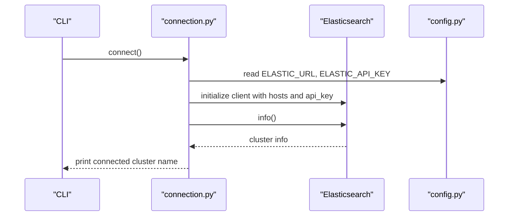
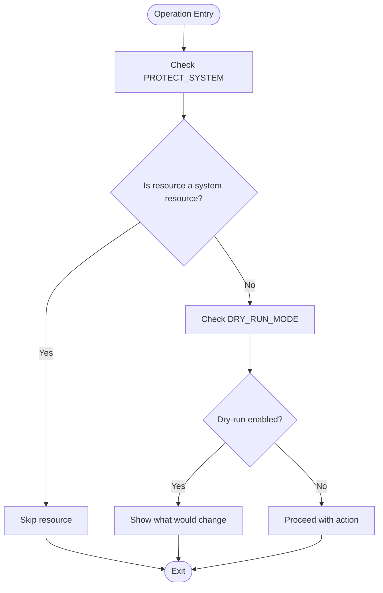
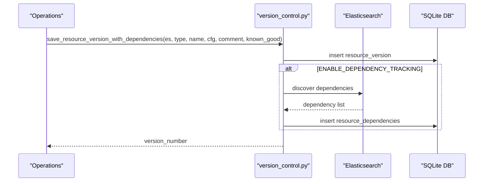
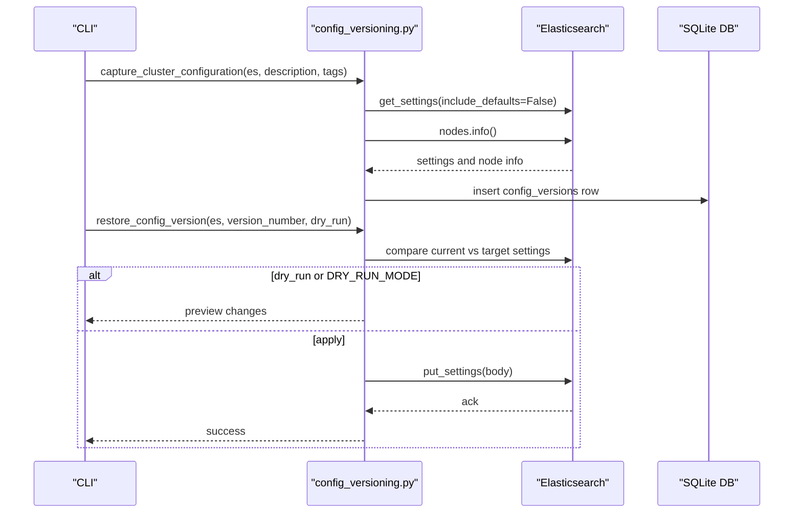
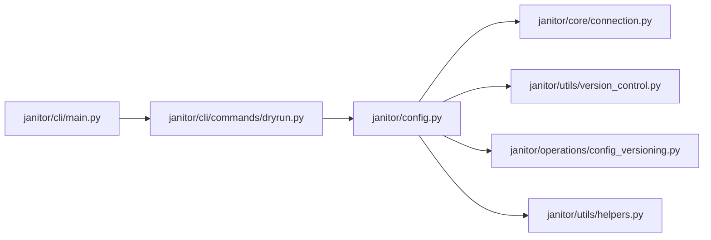

# Configuration and Customization

<cite>
**Referenced Files in This Document**
- [config.py](file://janitor/config.py)
- [connection.py](file://janitor/core/connection.py)
- [version_control.py](file://janitor/utils/version_control.py)
- [config_versioning.py](file://janitor/operations/config_versioning.py)
- [helpers.py](file://janitor/utils/helpers.py)
- [formatters.py](file://janitor/utils/formatters.py)
- [dryrun.py](file://janitor/cli/commands/dryrun.py)
- [main.py](file://janitor/cli/main.py)
- [pyproject.toml](file://pyproject.toml)
</cite>

## Table of Contents
1. [Introduction](#introduction)
2. [Project Structure](#project-structure)
3. [Core Components](#core-components)
4. [Architecture Overview](#architecture-overview)
5. [Detailed Component Analysis](#detailed-component-analysis)
6. [Dependency Analysis](#dependency-analysis)
7. [Performance Considerations](#performance-considerations)
8. [Troubleshooting Guide](#troubleshooting-guide)
9. [Conclusion](#conclusion)
10. [Appendices](#appendices)

## Introduction
This document explains Elastic Janitor’s flexible configuration system. It covers how to configure Elasticsearch connectivity, application behavior, timeouts, version control and dependency tracking, UI preferences, and global dry-run mode. It also documents configuration file management, environment variable usage, validation and error handling, and best practices for version control integration and customization.

## Project Structure
Elastic Janitor organizes configuration primarily in a central module and integrates with CLI commands and utilities:
- Central configuration constants and runtime flags live in a single module.
- Elasticsearch connection is established via a dedicated module that reads configuration.
- Version control systems for Elasticsearch resources and cluster-wide settings are implemented in separate modules.
- CLI commands expose runtime toggles (e.g., dry-run) that modify global behavior.
- Utilities provide formatting and helper functions used across the app.

**Diagram sources**
- [config.py](file://janitor/config.py#L1-L78)
- [connection.py](file://janitor/core/connection.py#L1-L72)
- [version_control.py](file://janitor/utils/version_control.py#L1-L974)
- [config_versioning.py](file://janitor/operations/config_versioning.py#L1-L705)
- [helpers.py](file://janitor/utils/helpers.py#L1-L258)
- [formatters.py](file://janitor/utils/formatters.py#L1-L53)
- [dryrun.py](file://janitor/cli/commands/dryrun.py#L1-L87)
- [main.py](file://janitor/cli/main.py#L1-L57)

**Section sources**
- [config.py](file://janitor/config.py#L1-L78)
- [connection.py](file://janitor/core/connection.py#L1-L72)
- [version_control.py](file://janitor/utils/version_control.py#L1-L974)
- [config_versioning.py](file://janitor/operations/config_versioning.py#L1-L705)
- [helpers.py](file://janitor/utils/helpers.py#L1-L258)
- [formatters.py](file://janitor/utils/formatters.py#L1-L53)
- [dryrun.py](file://janitor/cli/commands/dryrun.py#L1-L87)
- [main.py](file://janitor/cli/main.py#L1-L57)

## Core Components
- Elasticsearch connection settings: URL and API key are defined centrally and consumed by the connection module.
- Application behavior controls: system protection flag, retention days, delete limits, and dry-run mode.
- Operational timeouts: default query, slow query, request, and reindex timeouts.
- Version control and dependency tracking: flags and limits for automatic dependency capture and version pruning.
- UI configuration: Rich console initialization and custom Questionary styles.

Key configuration constants and flags are declared in the central configuration module and imported by other modules.

**Section sources**
- [config.py](file://janitor/config.py#L1-L78)

## Architecture Overview
The configuration system is centralized and consumed by modules responsible for:
- Establishing Elasticsearch connections
- Managing resource and cluster configuration versions
- Enforcing safety and UI behavior

**Diagram sources**
- [config.py](file://janitor/config.py#L1-L78)
- [connection.py](file://janitor/core/connection.py#L1-L72)
- [version_control.py](file://janitor/utils/version_control.py#L1-L974)
- [config_versioning.py](file://janitor/operations/config_versioning.py#L1-L705)
- [helpers.py](file://janitor/utils/helpers.py#L1-L258)

## Detailed Component Analysis

### Elasticsearch Connection Settings
- Connection URL and API key are defined centrally and validated before connecting.
- On missing credentials, the connection routine prints an error and exits.
- Connection attempts are wrapped with progress indicators and robust error handling.

**Diagram sources**
- [connection.py](file://janitor/core/connection.py#L11-L33)
- [config.py](file://janitor/config.py#L11-L12)

**Section sources**
- [connection.py](file://janitor/core/connection.py#L11-L33)
- [config.py](file://janitor/config.py#L11-L12)

### Application Behavior Controls
- System protection: when enabled, system resources (names starting with a dot) are skipped during destructive operations.
- Retention days: default retention window for cleanup operations.
- Max delete limit: upper bound for batch deletions.
- Dry-run mode: global toggle that prevents destructive actions and shows what would change.

**Diagram sources**
- [helpers.py](file://janitor/utils/helpers.py#L18-L29)
- [config.py](file://janitor/config.py#L18-L23)

**Section sources**
- [helpers.py](file://janitor/utils/helpers.py#L18-L29)
- [config.py](file://janitor/config.py#L18-L23)

### Operational Timeouts
- Default query timeout: used for regular queries.
- Slow query timeout: extended timeout for expensive operations like wildcard searches.
- Request timeout: client-side request timeout.
- Reindex timeout: dedicated timeout for reindex operations.

These values are defined centrally and can be adjusted to balance responsiveness and reliability for different environments.

**Section sources**
- [config.py](file://janitor/config.py#L29-L40)

### Version Control and Dependency Tracking
- Resource versioning: maintains SQLite databases for resource versions and dependencies.
- Dependency tracking: discovers and captures dependencies for pipelines, index templates, and component templates.
- Version pruning: limits the number of stored versions per resource.
- Cluster configuration versioning: captures and restores cluster-wide settings with metadata.

**Diagram sources**
- [version_control.py](file://janitor/utils/version_control.py#L167-L734)
- [config.py](file://janitor/config.py#L45-L55)

**Section sources**
- [version_control.py](file://janitor/utils/version_control.py#L167-L734)
- [config.py](file://janitor/config.py#L45-L55)

### Cluster Configuration Versioning
- Captures cluster settings, allocation settings, shard settings, and metadata.
- Provides listing, comparison, restoration, export/import, and deletion of versions.
- Restoration respects dry-run mode and applies persistent/transient settings appropriately.

**Diagram sources**
- [config_versioning.py](file://janitor/operations/config_versioning.py#L74-L414)
- [dryrun.py](file://janitor/cli/commands/dryrun.py#L15-L34)

**Section sources**
- [config_versioning.py](file://janitor/operations/config_versioning.py#L74-L414)
- [dryrun.py](file://janitor/cli/commands/dryrun.py#L15-L34)

### UI Configuration
- Rich console is initialized centrally for consistent output formatting.
- Custom Questionary style is defined for interactive prompts.

**Section sources**
- [config.py](file://janitor/config.py#L61-L76)

## Dependency Analysis
- Central configuration module is imported by connection, version control, and helper modules.
- CLI commands update global flags (e.g., dry-run) that influence downstream behavior.
- Utilities depend on configuration flags for safety and UI behavior.

**Diagram sources**
- [config.py](file://janitor/config.py#L1-L78)
- [connection.py](file://janitor/core/connection.py#L1-L72)
- [version_control.py](file://janitor/utils/version_control.py#L1-L974)
- [config_versioning.py](file://janitor/operations/config_versioning.py#L1-L705)
- [helpers.py](file://janitor/utils/helpers.py#L1-L258)
- [dryrun.py](file://janitor/cli/commands/dryrun.py#L1-L87)
- [main.py](file://janitor/cli/main.py#L1-L57)

**Section sources**
- [config.py](file://janitor/config.py#L1-L78)
- [connection.py](file://janitor/core/connection.py#L1-L72)
- [version_control.py](file://janitor/utils/version_control.py#L1-L974)
- [config_versioning.py](file://janitor/operations/config_versioning.py#L1-L705)
- [helpers.py](file://janitor/utils/helpers.py#L1-L258)
- [dryrun.py](file://janitor/cli/commands/dryrun.py#L1-L87)
- [main.py](file://janitor/cli/main.py#L1-L57)

## Performance Considerations
- Adjust timeouts to match cluster capacity and network conditions to avoid premature failures.
- Limit version retention to control storage growth in version control databases.
- Use dry-run mode to validate impact before applying changes.

[No sources needed since this section provides general guidance]

## Troubleshooting Guide
Common configuration issues and resolutions:
- Missing Elasticsearch credentials: The connection routine prints an error and exits when URL or API key are not set.
- Connection failures: The connection routine catches exceptions and prints a detailed error message before exiting.
- Dry-run mode not taking effect: Ensure the global flag is enabled via the CLI command; downstream operations check this flag to decide whether to apply changes.
- Version control errors: Version control functions handle exceptions and print warnings; verify database paths and permissions.

**Section sources**
- [connection.py](file://janitor/core/connection.py#L13-L32)
- [dryrun.py](file://janitor/cli/commands/dryrun.py#L15-L34)
- [version_control.py](file://janitor/utils/version_control.py#L525-L527)

## Conclusion
Elastic Janitor’s configuration system is centralized, explicit, and designed for safety and flexibility. By adjusting constants and flags, operators can tailor behavior to their environment, enforce protective measures, and manage versions of both Elasticsearch resources and cluster settings. The CLI provides runtime toggles that integrate seamlessly with the configuration layer.

[No sources needed since this section summarizes without analyzing specific files]

## Appendices

### Environment Variables and Configuration Files
- The central configuration module defines constants for Elasticsearch URL and API key. These are read directly by the connection module.
- There is no explicit environment variable loading in the provided files; constants are set directly in the configuration module.
- Version control databases are stored under the user’s home directory and initialized on first use.

**Section sources**
- [config.py](file://janitor/config.py#L11-L12)
- [version_control.py](file://janitor/utils/version_control.py#L13-L16)
- [config_versioning.py](file://janitor/operations/config_versioning.py#L20-L22)

### Configuration Options Reference
- Elasticsearch connection
  - ELASTIC_URL: Elasticsearch endpoint
  - ELASTIC_API_KEY: API key for authentication
- Application behavior
  - PROTECT_SYSTEM: Protect system resources
  - DEFAULT_RETENTION_DAYS: Default retention window
  - MAX_DELETE_LIMIT: Upper bound for batch deletions
  - DRY_RUN_MODE: Global dry-run toggle
- Timeouts
  - DEFAULT_QUERY_TIMEOUT: Default query timeout
  - SLOW_QUERY_TIMEOUT: Extended timeout for slow queries
  - REQUEST_TIMEOUT: Client-side request timeout
  - REINDEX_TIMEOUT: Reindex operation timeout
- Version control and dependencies
  - ENABLE_DEPENDENCY_TRACKING: Enable automatic dependency capture
  - MAX_DEPENDENCY_DEPTH: Maximum traversal depth for dependencies
  - MAX_VERSIONS_PER_RESOURCE: Maximum stored versions per resource
- UI configuration
  - console: Rich console instance
  - custom_style: Questionary style for prompts

**Section sources**
- [config.py](file://janitor/config.py#L11-L76)

### Advanced Configuration Scenarios
- Enabling global dry-run mode: Use the CLI command to toggle the global flag; downstream operations will preview changes instead of applying them.
- Customizing retention and delete limits: Adjust retention days and delete limits to fit workload and safety requirements.
- Tuning timeouts: Increase slow query and reindex timeouts for heavy workloads; reduce request timeout for stricter responsiveness.
- Managing version retention: Lower the maximum versions per resource to conserve disk space.

**Section sources**
- [dryrun.py](file://janitor/cli/commands/dryrun.py#L15-L34)
- [config.py](file://janitor/config.py#L18-L23)
- [config.py](file://janitor/config.py#L29-L40)
- [config.py](file://janitor/config.py#L54-L55)

### Configuration Validation and Error Handling
- Connection validation: Credentials are checked before establishing a client; exceptions during connection are caught and reported.
- Version control validation: Import routines validate required fields; database operations wrap errors and print warnings.
- Safety checks: System resource protection and dry-run mode are enforced at runtime.

**Section sources**
- [connection.py](file://janitor/core/connection.py#L13-L32)
- [version_control.py](file://janitor/utils/version_control.py#L438-L441)
- [helpers.py](file://janitor/utils/helpers.py#L18-L29)

### Best Practices for Version Control Integration
- Use cluster configuration versioning to capture pre-change snapshots before applying settings.
- Leverage dependency tracking to understand the impact of changes to pipelines and templates.
- Export versions to files for off-cluster storage and audit trails.
- Keep version counts reasonable to avoid excessive storage usage.

**Section sources**
- [config_versioning.py](file://janitor/operations/config_versioning.py#L74-L184)
- [version_control.py](file://janitor/utils/version_control.py#L167-L224)
- [config.py](file://janitor/config.py#L45-L55)