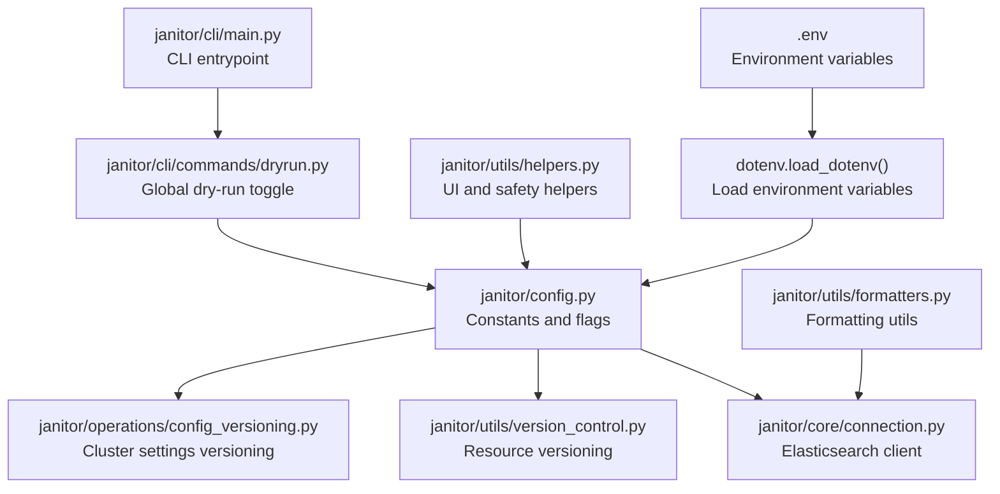
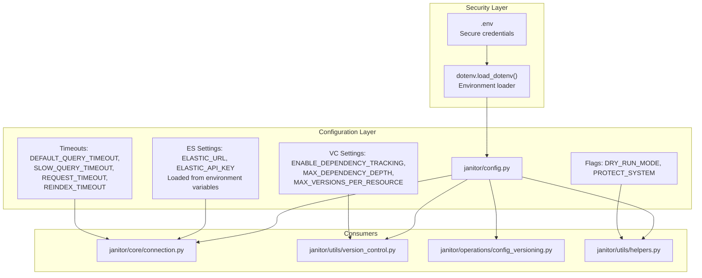
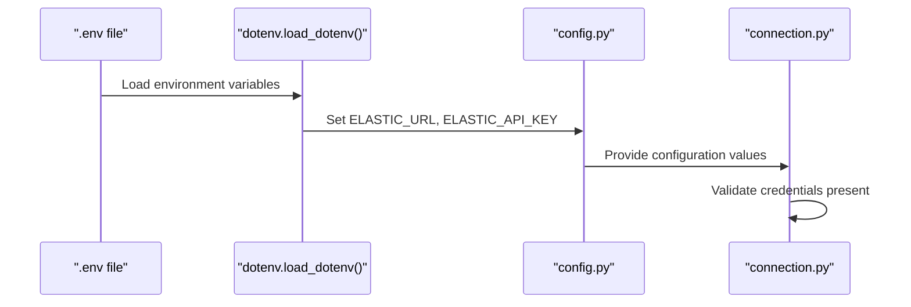
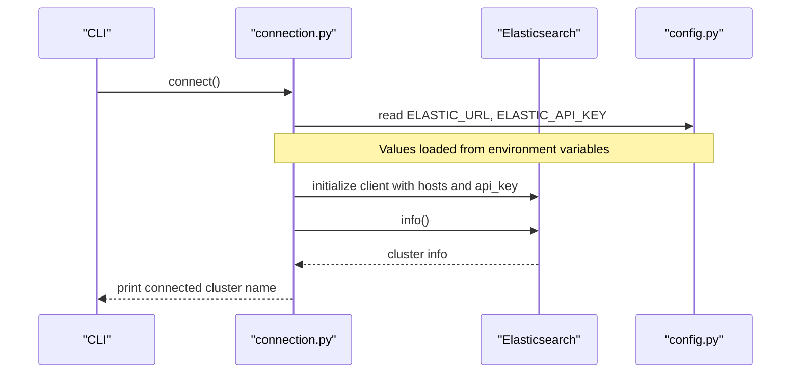
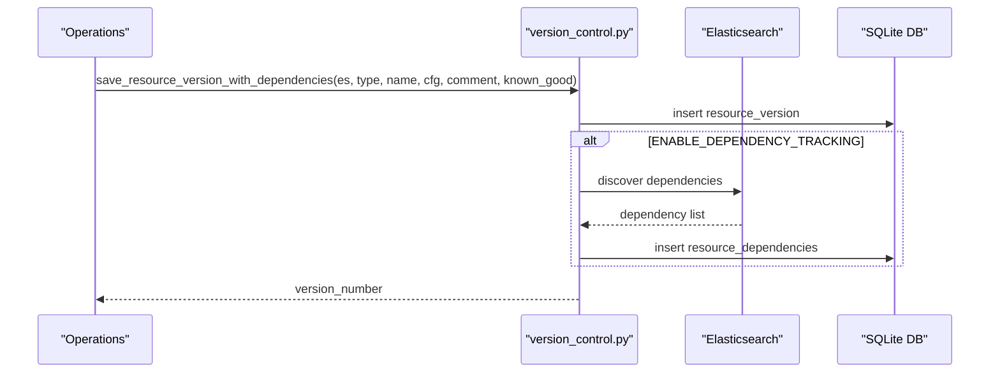
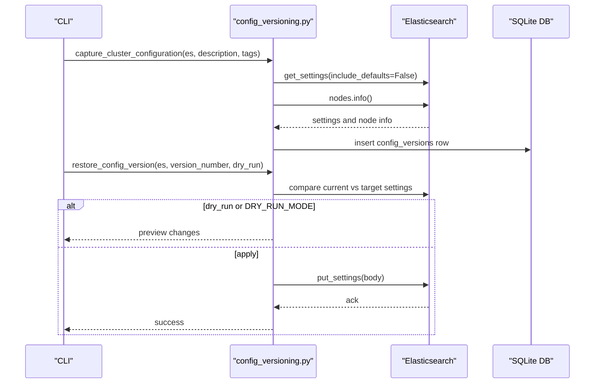
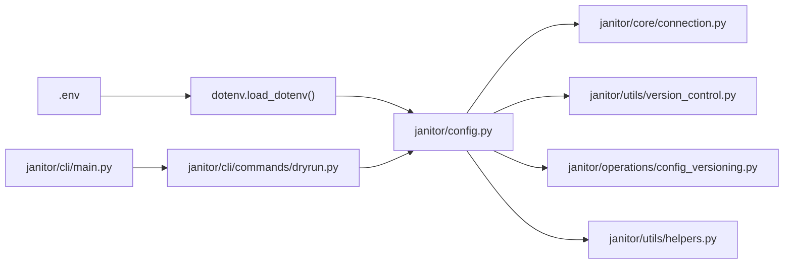

# Configuration and Customization

<cite>
**Referenced Files in This Document**
- [config.py](file://janitor/config.py)
- [connection.py](file://janitor/core/connection.py)
- [version_control.py](file://janitor/utils/version_control.py)
- [config_versioning.py](file://janitor/operations/config_versioning.py)
- [helpers.py](file://janitor/utils/helpers.py)
- [formatters.py](file://janitor/utils/formatters.py)
- [dryrun.py](file://janitor/cli/commands/dryrun.py)
- [main.py](file://janitor/cli/main.py)
- [pyproject.toml](file://pyproject.toml)
- [.env](file://.env)
- [requirements.txt](file://requirements.txt)
</cite>

## Update Summary
**Changes Made**
- Enhanced security configuration management with dotenv support for environment variable loading
- Updated Elasticsearch connection settings to use environment variables instead of hardcoded values
- Added comprehensive environment variable documentation and security best practices
- Updated troubleshooting guide to address dotenv-related configuration issues

## Table of Contents
1. [Introduction](#introduction)
2. [Project Structure](#project-structure)
3. [Core Components](#core-components)
4. [Architecture Overview](#architecture-overview)
5. [Detailed Component Analysis](#detailed-component-analysis)
6. [Dependency Analysis](#dependency-analysis)
7. [Performance Considerations](#performance-considerations)
8. [Troubleshooting Guide](#troubleshooting-guide)
9. [Conclusion](#conclusion)
10. [Appendices](#appendices)

## Introduction
This document explains Elastic Janitor's flexible configuration system with enhanced security features. It covers how to configure Elasticsearch connectivity using environment variables, application behavior controls, timeouts, version control and dependency tracking, UI preferences, and global dry-run mode. The system now includes dotenv support for secure environment variable loading, replacing hardcoded credentials with configurable environment variables for improved security and compliance.

## Project Structure
Elastic Janitor organizes configuration primarily in a central module with dotenv integration and integrates with CLI commands and utilities:
- Central configuration constants and runtime flags are loaded from environment variables via dotenv.
- Elasticsearch connection is established via a dedicated module that reads configuration from environment variables.
- Version control systems for Elasticsearch resources and cluster-wide settings are implemented in separate modules.
- CLI commands expose runtime toggles (e.g., dry-run) that modify global behavior.
- Utilities provide formatting and helper functions used across the app.

**Diagram sources**
- [.env](file://.env#L1-L5)
- [config.py](file://janitor/config.py#L4-L10)
- [connection.py](file://janitor/core/connection.py#L1-L72)
- [version_control.py](file://janitor/utils/version_control.py#L1-L974)
- [config_versioning.py](file://janitor/operations/config_versioning.py#L1-L705)
- [helpers.py](file://janitor/utils/helpers.py#L1-L258)
- [formatters.py](file://janitor/utils/formatters.py#L1-L53)
- [dryrun.py](file://janitor/cli/commands/dryrun.py#L1-L87)
- [main.py](file://janitor/cli/main.py#L1-L57)

**Section sources**
- [config.py](file://janitor/config.py#L1-L85)
- [connection.py](file://janitor/core/connection.py#L1-L72)
- [version_control.py](file://janitor/utils/version_control.py#L1-L974)
- [config_versioning.py](file://janitor/operations/config_versioning.py#L1-L705)
- [helpers.py](file://janitor/utils/helpers.py#L1-L258)
- [formatters.py](file://janitor/utils/formatters.py#L1-L53)
- [dryrun.py](file://janitor/cli/commands/dryrun.py#L1-L87)
- [main.py](file://janitor/cli/main.py#L1-L57)

## Core Components
- **Enhanced Security Configuration**: Environment variables are loaded via dotenv for secure credential management.
- **Elasticsearch connection settings**: URL and API key are now configured through environment variables (ELASTIC_URL, ELASTIC_API_KEY).
- **Application behavior controls**: System protection flag, retention days, delete limits, and dry-run mode.
- **Operational timeouts**: Default query, slow query, request, and reindex timeouts.
- **Version control and dependency tracking**: Flags and limits for automatic dependency capture and version pruning.
- **UI configuration**: Rich console initialization and custom Questionary styles.

The configuration system now prioritizes security by loading sensitive data from environment variables rather than hardcoded values.

**Section sources**
- [config.py](file://janitor/config.py#L4-L17)
- [connection.py](file://janitor/core/connection.py#L11-L17)

## Architecture Overview
The configuration system is centralized with dotenv integration and consumed by modules responsible for:
- Establishing secure Elasticsearch connections using environment variables
- Managing resource and cluster configuration versions
- Enforcing safety and UI behavior

**Diagram sources**
- [.env](file://.env#L1-L5)
- [config.py](file://janitor/config.py#L4-L17)
- [connection.py](file://janitor/core/connection.py#L1-L72)
- [version_control.py](file://janitor/utils/version_control.py#L1-L974)
- [config_versioning.py](file://janitor/operations/config_versioning.py#L1-L705)
- [helpers.py](file://janitor/utils/helpers.py#L1-L258)

## Detailed Component Analysis

### Enhanced Security Configuration Management
- **Dotenv Integration**: The system now loads environment variables from a `.env` file using `dotenv.load_dotenv()`.
- **Secure Credential Loading**: Elasticsearch URL and API key are loaded from environment variables instead of hardcoded values.
- **Fallback Values**: Default values are still available but should be overridden in production environments.
- **Environment Variable Precedence**: Environment variables override `.env` file values, allowing for deployment-specific configurations.

**Diagram sources**
- [.env](file://.env#L1-L5)
- [config.py](file://janitor/config.py#L4-L17)
- [connection.py](file://janitor/core/connection.py#L11-L17)

**Section sources**
- [config.py](file://janitor/config.py#L4-L17)
- [.env](file://.env#L1-L5)

### Elasticsearch Connection Settings
- **Environment-Based Configuration**: Connection URL and API key are now loaded from environment variables.
- **Enhanced Security**: Credentials are no longer hardcoded in the source code, improving security posture.
- **Validation and Error Handling**: On missing credentials, the connection routine prints an error and exits.
- **Connection Attempts**: Wrapped with progress indicators and robust error handling.

**Diagram sources**
- [connection.py](file://janitor/core/connection.py#L11-L33)
- [config.py](file://janitor/config.py#L16-L17)

**Section sources**
- [connection.py](file://janitor/core/connection.py#L11-L33)
- [config.py](file://janitor/config.py#L16-L17)

### Application Behavior Controls
- **System Protection**: When enabled, system resources (names starting with a dot) are skipped during destructive operations.
- **Retention Days**: Default retention window for cleanup operations.
- **Max Delete Limit**: Upper bound for batch deletions.
- **Dry-Run Mode**: Global toggle that prevents destructive actions and shows what would change.

**Diagram sources**
- [helpers.py](file://janitor/utils/helpers.py#L18-L29)
- [config.py](file://janitor/config.py#L23-L30)

**Section sources**
- [helpers.py](file://janitor/utils/helpers.py#L18-L29)
- [config.py](file://janitor/config.py#L23-L30)

### Operational Timeouts
- **Default Query Timeout**: Used for regular queries.
- **Slow Query Timeout**: Extended timeout for expensive operations like wildcard searches.
- **Request Timeout**: Client-side request timeout.
- **Reindex Timeout**: Dedicated timeout for reindex operations.

These values are defined centrally and can be adjusted to balance responsiveness and reliability for different environments.

**Section sources**
- [config.py](file://janitor/config.py#L36-L46)

### Version Control and Dependency Tracking
- **Resource Versioning**: Maintains SQLite databases for resource versions and dependencies.
- **Dependency Tracking**: Discovers and captures dependencies for pipelines, index templates, and component templates.
- **Version Pruning**: Limits the number of stored versions per resource.
- **Cluster Configuration Versioning**: Captures and restores cluster-wide settings with metadata.

**Diagram sources**
- [version_control.py](file://janitor/utils/version_control.py#L167-L734)
- [config.py](file://janitor/config.py#L52-L62)

**Section sources**
- [version_control.py](file://janitor/utils/version_control.py#L167-L734)
- [config.py](file://janitor/config.py#L52-L62)

### Cluster Configuration Versioning
- **Captures Cluster Settings**: Cluster settings, allocation settings, shard settings, and metadata.
- **Provides Listing and Comparison**: Lists, compares, and restores configuration versions.
- **Export/Import Capabilities**: Supports export/import of versions to/from JSON files.
- **Restoration Process**: Respects dry-run mode and applies persistent/transient settings appropriately.

**Diagram sources**
- [config_versioning.py](file://janitor/operations/config_versioning.py#L74-L414)
- [dryrun.py](file://janitor/cli/commands/dryrun.py#L15-L34)

**Section sources**
- [config_versioning.py](file://janitor/operations/config_versioning.py#L74-L414)
- [dryrun.py](file://janitor/cli/commands/dryrun.py#L15-L34)

### UI Configuration
- **Rich Console Initialization**: Centralized for consistent output formatting.
- **Custom Questionary Style**: Defined for interactive prompts.

**Section sources**
- [config.py](file://janitor/config.py#L68-L83)

## Dependency Analysis
- **Central Configuration Module**: Imported by connection, version control, and helper modules with dotenv integration.
- **CLI Commands**: Update global flags (e.g., dry-run) that influence downstream behavior.
- **Utilities**: Depend on configuration flags for safety and UI behavior.
- **Environment Variable Loading**: Dotenv is loaded at module import time, making environment variables available globally.

**Diagram sources**
- [.env](file://.env#L1-L5)
- [config.py](file://janitor/config.py#L4-L17)
- [connection.py](file://janitor/core/connection.py#L1-L72)
- [version_control.py](file://janitor/utils/version_control.py#L1-L974)
- [config_versioning.py](file://janitor/operations/config_versioning.py#L1-L705)
- [helpers.py](file://janitor/utils/helpers.py#L1-L258)
- [dryrun.py](file://janitor/cli/commands/dryrun.py#L1-L87)
- [main.py](file://janitor/cli/main.py#L1-L57)

**Section sources**
- [config.py](file://janitor/config.py#L4-L17)
- [connection.py](file://janitor/core/connection.py#L1-L72)
- [version_control.py](file://janitor/utils/version_control.py#L1-L974)
- [config_versioning.py](file://janitor/operations/config_versioning.py#L1-L705)
- [helpers.py](file://janitor/utils/helpers.py#L1-L258)
- [dryrun.py](file://janitor/cli/commands/dryrun.py#L1-L87)
- [main.py](file://janitor/cli/main.py#L1-L57)

## Performance Considerations
- **Adjust Timeouts**: Configure timeouts to match cluster capacity and network conditions to avoid premature failures.
- **Limit Version Retention**: Control storage growth in version control databases by limiting stored versions.
- **Use Dry-Run Mode**: Validate impact before applying changes using the global dry-run toggle.
- **Environment Variable Loading**: Dotenv loading occurs at import time, so consider startup performance implications for large applications.

## Troubleshooting Guide
Common configuration issues and resolutions:
- **Missing Elasticsearch Credentials**: The connection routine prints an error and exits when URL or API key are not set in environment variables.
- **Environment Variable Loading Issues**: Ensure `.env` file exists and is readable; check that `python-dotenv` is installed.
- **Connection Failures**: The connection routine catches exceptions and prints detailed error messages before exiting.
- **Dry-Run Mode Not Taking Effect**: Ensure the global flag is enabled via the CLI command; downstream operations check this flag to decide whether to apply changes.
- **Version Control Errors**: Version control functions handle exceptions and print warnings; verify database paths and permissions.
- **Dotenv Import Errors**: If `from dotenv import load_dotenv` fails, install python-dotenv: `pip install python-dotenv`.

**Section sources**
- [connection.py](file://janitor/core/connection.py#L13-L17)
- [config.py](file://janitor/config.py#L4-L10)
- [dryrun.py](file://janitor/cli/commands/dryrun.py#L15-L34)
- [version_control.py](file://janitor/utils/version_control.py#L525-L527)

## Conclusion
Elastic Janitor's configuration system is now enhanced with secure environment variable management through dotenv integration. The system provides centralized, explicit, and secure configuration for safety and flexibility. By adjusting environment variables and flags, operators can tailor behavior to their environment, enforce protective measures, and manage versions of both Elasticsearch resources and cluster settings. The CLI provides runtime toggles that integrate seamlessly with the configuration layer, while the dotenv system ensures sensitive credentials are managed securely.

## Appendices

### Environment Variables and Configuration Files
- **Dotenv Integration**: The central configuration module imports `dotenv` and calls `load_dotenv()` to load environment variables from `.env` files.
- **Environment Variable Loading**: ELASTIC_URL and ELASTIC_API_KEY are loaded from environment variables with fallback to default values.
- **Security Best Practices**: Environment variables override `.env` file values, allowing for deployment-specific configurations without hardcoding secrets.
- **Version Control Databases**: Stored under the user's home directory and initialized on first use.

**Section sources**
- [config.py](file://janitor/config.py#L4-L17)
- [.env](file://.env#L1-L5)
- [version_control.py](file://janitor/utils/version_control.py#L13-L16)
- [config_versioning.py](file://janitor/operations/config_versioning.py#L20-L22)

### Configuration Options Reference
- **Enhanced Security Configuration**
  - ELASTIC_URL: Elasticsearch endpoint (loaded from environment variables)
  - ELASTIC_API_KEY: API key for authentication (loaded from environment variables)
- **Application Behavior**
  - PROTECT_SYSTEM: Protect system resources
  - DEFAULT_RETENTION_DAYS: Default retention window
  - MAX_DELETE_LIMIT: Upper bound for batch deletions
  - GOD_MODE: Enable god-mode for destructive operations
  - GOD_MODE_CONFIRMATION_PHRASE: Confirmation phrase for god-mode
  - DRY_RUN_MODE: Global dry-run toggle
- **Timeouts**
  - DEFAULT_QUERY_TIMEOUT: Default query timeout
  - SLOW_QUERY_TIMEOUT: Extended timeout for slow queries
  - REQUEST_TIMEOUT: Client-side request timeout
  - REINDEX_TIMEOUT: Reindex operation timeout
- **Version Control and Dependencies**
  - ENABLE_DEPENDENCY_TRACKING: Enable automatic dependency capture
  - MAX_DEPENDENCY_DEPTH: Maximum traversal depth for dependencies
  - MAX_VERSIONS_PER_RESOURCE: Maximum stored versions per resource
- **UI Configuration**
  - console: Rich console instance
  - custom_style: Questionary style for prompts

**Section sources**
- [config.py](file://janitor/config.py#L16-L83)

### Advanced Configuration Scenarios
- **Environment Variable Management**: Use `.env` files for development and environment variables for production deployments.
- **Enabling Global Dry-Run Mode**: Use the CLI command to toggle the global flag; downstream operations will preview changes instead of applying them.
- **Customizing Retention and Delete Limits**: Adjust retention days and delete limits to fit workload and safety requirements.
- **Tuning Timeouts**: Increase slow query and reindex timeouts for heavy workloads; reduce request timeout for stricter responsiveness.
- **Managing Version Retention**: Lower the maximum versions per resource to conserve disk space.
- **God-Mode Operations**: Enable god-mode for destructive operations with proper confirmation.

**Section sources**
- [dryrun.py](file://janitor/cli/commands/dryrun.py#L15-L34)
- [config.py](file://janitor/config.py#L23-L30)
- [config.py](file://janitor/config.py#L29-L30)
- [config.py](file://janitor/config.py#L52-L62)

### Configuration Validation and Error Handling
- **Connection Validation**: Credentials are checked before establishing a client; exceptions during connection are caught and reported.
- **Environment Variable Loading**: Dotenv loading occurs at import time with graceful fallback to default values.
- **Version Control Validation**: Import routines validate required fields; database operations wrap errors and print warnings.
- **Safety Checks**: System resource protection and dry-run mode are enforced at runtime.

**Section sources**
- [connection.py](file://janitor/core/connection.py#L13-L17)
- [config.py](file://janitor/config.py#L4-L10)
- [version_control.py](file://janitor/utils/version_control.py#L438-L441)
- [helpers.py](file://janitor/utils/helpers.py#L18-L29)

### Best Practices for Version Control Integration
- **Use Cluster Configuration Versioning**: Capture pre-change snapshots before applying settings.
- **Leverage Dependency Tracking**: Understand the impact of changes to pipelines and templates.
- **Export Versions to Files**: Store versions in JSON files for off-cluster storage and audit trails.
- **Keep Version Counts Reasonable**: Avoid excessive storage usage by limiting stored versions.
- **Environment Variable Security**: Never commit `.env` files to version control; use environment variables for production deployments.
- **Dotenv Installation**: Ensure `python-dotenv` is installed in development environments.

**Section sources**
- [config_versioning.py](file://janitor/operations/config_versioning.py#L74-L184)
- [version_control.py](file://janitor/utils/version_control.py#L167-L224)
- [config.py](file://janitor/config.py#L52-L62)
- [requirements.txt](file://requirements.txt#L2)

### Security Configuration Examples
- **Development Environment Setup**: Create a `.env` file with development credentials
- **Production Environment Setup**: Set environment variables in deployment environment
- **Credential Rotation**: Update environment variables without code changes
- **Multi-Environment Configuration**: Use different environment variables for staging and production

**Section sources**
- [.env](file://.env#L1-L5)
- [config.py](file://janitor/config.py#L16-L17)
- [requirements.txt](file://requirements.txt#L2)