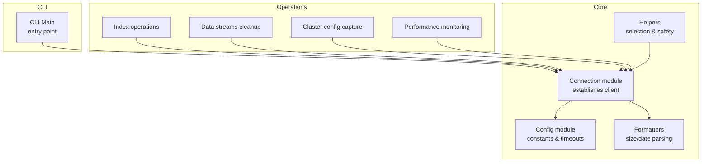
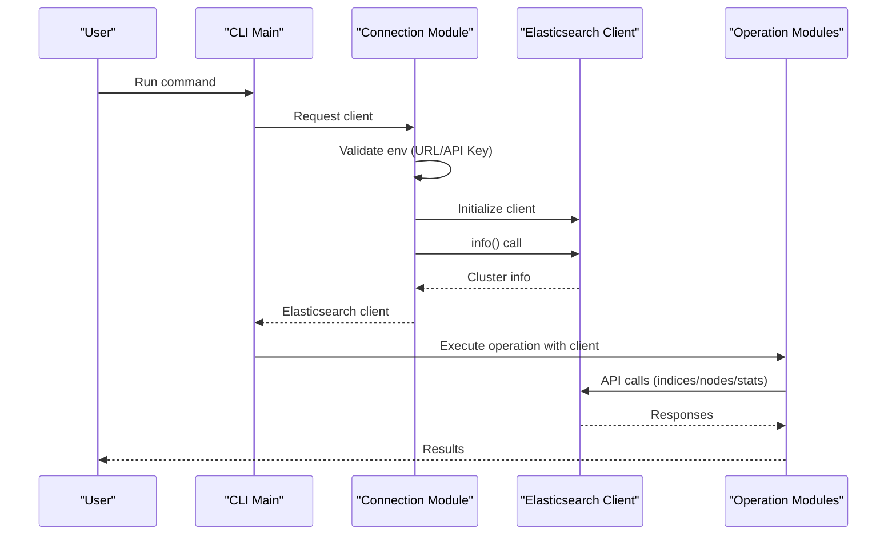
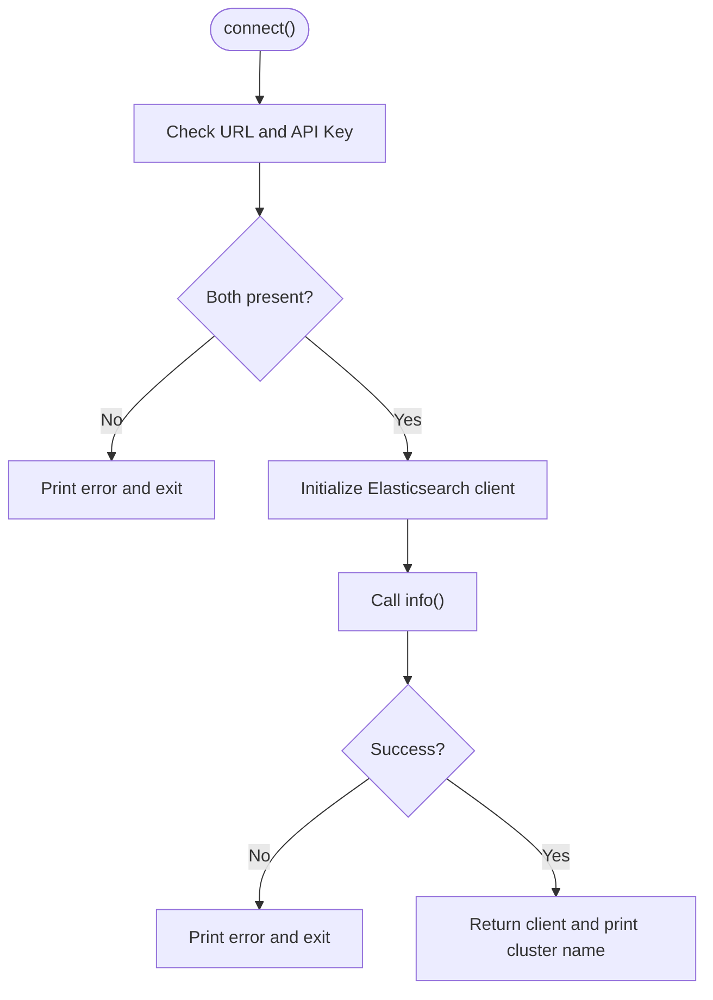
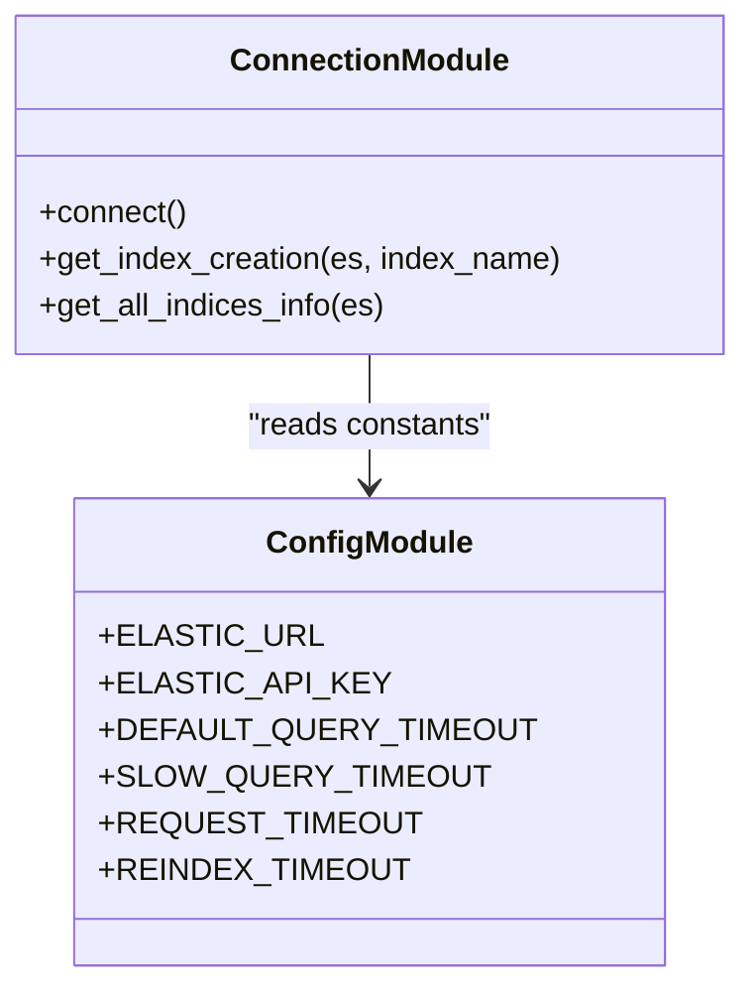
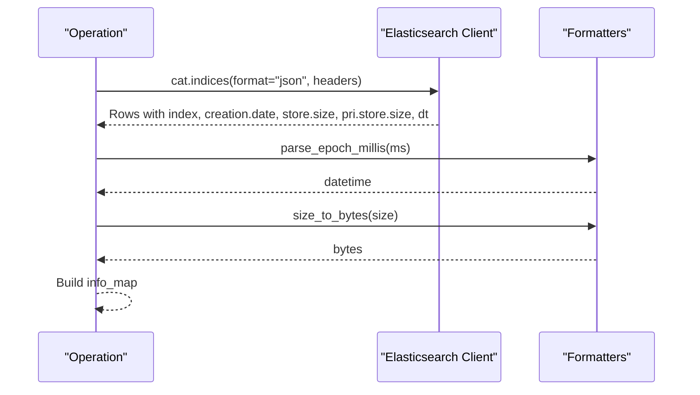
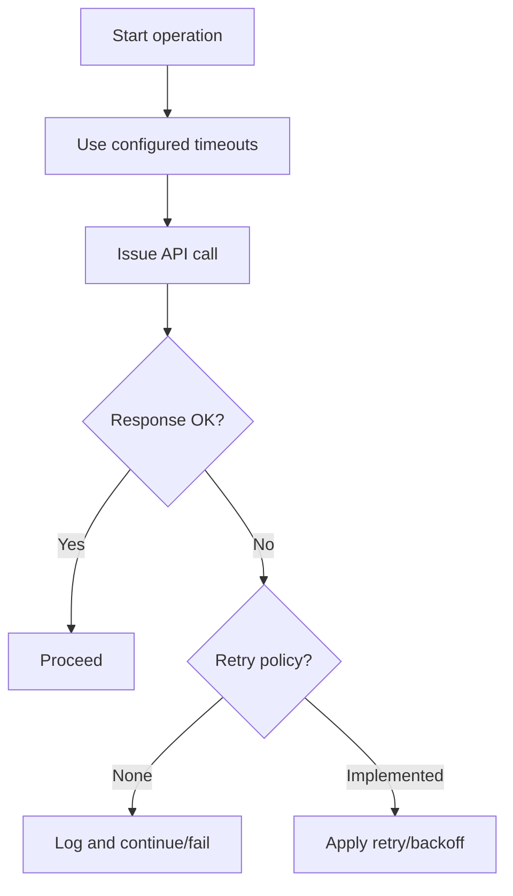
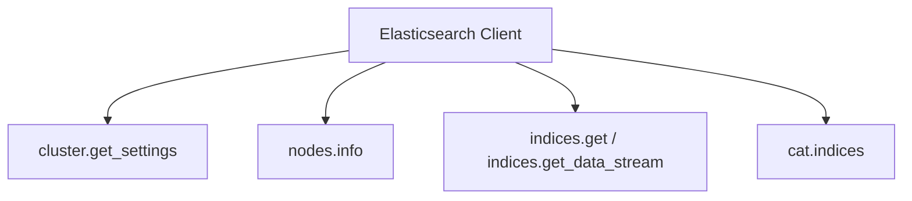
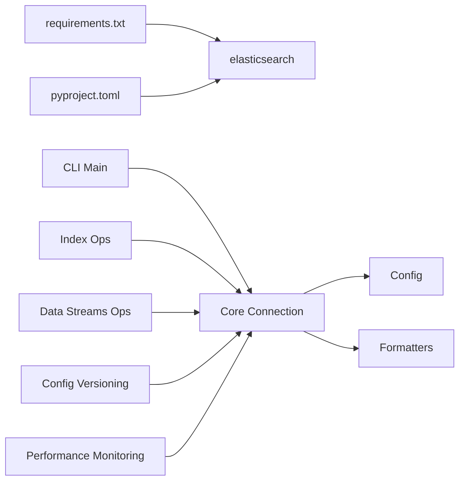

# Connection and Integration

<cite>
**Referenced Files in This Document**
- [connection.py](file://janitor/core/connection.py)
- [config.py](file://janitor/config.py)
- [main.py](file://janitor/cli/main.py)
- [formatters.py](file://janitor/utils/formatters.py)
- [helpers.py](file://janitor/utils/helpers.py)
- [requirements.txt](file://requirements.txt)
- [pyproject.toml](file://pyproject.toml)
- [index_basic.py](file://janitor/operations/index_basic.py)
- [data_streams_cleanup.py](file://janitor/operations/data_streams_cleanup.py)
- [config_versioning.py](file://janitor/operations/config_versioning.py)
- [performance_monitoring.py](file://janitor/operations/performance_monitoring.py)
</cite>

## Table of Contents
1. [Introduction](#introduction)
2. [Project Structure](#project-structure)
3. [Core Components](#core-components)
4. [Architecture Overview](#architecture-overview)
5. [Detailed Component Analysis](#detailed-component-analysis)
6. [Dependency Analysis](#dependency-analysis)
7. [Performance Considerations](#performance-considerations)
8. [Troubleshooting Guide](#troubleshooting-guide)
9. [Conclusion](#conclusion)

## Introduction
This document focuses on the connection and integration layer for Elasticsearch within the project. It explains how connections are established, how credentials are handled, and how the Elasticsearch client is configured and used across operations. It also covers timeouts, error handling, and integration patterns with Elasticsearch APIs, along with guidance for validating connections, implementing retries, and addressing security concerns.

## Project Structure
The connection and integration logic centers around a small set of modules:
- Core connection management and index information retrieval
- Global configuration for credentials, timeouts, and UI
- CLI entry points that orchestrate operations
- Utilities for formatting and user interactions
- Operation modules that consume the Elasticsearch client

**Diagram sources**
- [main.py](file://janitor/cli/main.py#L1-L57)
- [connection.py](file://janitor/core/connection.py#L1-L72)
- [config.py](file://janitor/config.py#L1-L78)
- [formatters.py](file://janitor/utils/formatters.py#L1-L53)
- [helpers.py](file://janitor/utils/helpers.py#L1-L258)
- [index_basic.py](file://janitor/operations/index_basic.py#L1-L200)
- [data_streams_cleanup.py](file://janitor/operations/data_streams_cleanup.py#L1-L200)
- [config_versioning.py](file://janitor/operations/config_versioning.py#L74-L144)
- [performance_monitoring.py](file://janitor/operations/performance_monitoring.py#L1285-L1323)

**Section sources**
- [main.py](file://janitor/cli/main.py#L1-L57)
- [connection.py](file://janitor/core/connection.py#L1-L72)
- [config.py](file://janitor/config.py#L1-L78)
- [formatters.py](file://janitor/utils/formatters.py#L1-L53)
- [helpers.py](file://janitor/utils/helpers.py#L1-L258)

## Core Components
- Connection establishment and validation: Creates an Elasticsearch client using URL and API key, validates connectivity via a cluster info call, and prints the cluster name upon success.
- Configuration: Centralizes credentials, timeouts, and UI/console settings.
- Index information retrieval: Provides index creation timestamps and aggregated size/tier metadata via a single cat indices call.
- Utilities: Date/time and size parsing/formatting helpers used across operations.

Key responsibilities:
- Establish a single Elasticsearch client per process lifecycle
- Validate connectivity early and fail fast on errors
- Provide shared index metadata for downstream operations
- Enforce consistent timeout behavior across operations

**Section sources**
- [connection.py](file://janitor/core/connection.py#L11-L32)
- [connection.py](file://janitor/core/connection.py#L35-L70)
- [config.py](file://janitor/config.py#L11-L12)
- [config.py](file://janitor/config.py#L29-L39)
- [formatters.py](file://janitor/utils/formatters.py#L7-L38)

## Architecture Overview
The system follows a thin client model:
- CLI orchestrates commands
- Core connection module initializes the Elasticsearch client and performs a quick validation
- Operations modules accept the client instance and issue API calls
- Shared configuration supplies timeouts and credentials

**Diagram sources**
- [main.py](file://janitor/cli/main.py#L8-L36)
- [connection.py](file://janitor/core/connection.py#L11-L32)
- [index_basic.py](file://janitor/operations/index_basic.py#L14-L24)
- [performance_monitoring.py](file://janitor/operations/performance_monitoring.py#L1294-L1300)

## Detailed Component Analysis

### Connection Management and Authentication
- Authentication: Uses API key authentication with the Elasticsearch client initialized from environment-provided URL and API key.
- Validation: Immediately calls cluster info to validate connectivity and print the cluster name.
- Failure handling: On missing credentials or connection failure, prints an error and exits the process.

**Diagram sources**
- [connection.py](file://janitor/core/connection.py#L11-L32)

**Section sources**
- [connection.py](file://janitor/core/connection.py#L11-L32)

### Elasticsearch Client Configuration and Connection Pooling
- Client initialization: The client is created with a single host entry derived from the configured URL.
- Connection pooling: The underlying HTTP transport uses default requests-based pooling behavior; no explicit pool configuration is applied in the code.
- Timeouts: There is no explicit client-level timeout configuration in the connection module. Timeouts are managed at the operation level via configuration constants.

**Diagram sources**
- [connection.py](file://janitor/core/connection.py#L11-L70)
- [config.py](file://janitor/config.py#L11-L12)
- [config.py](file://janitor/config.py#L29-L39)

**Section sources**
- [connection.py](file://janitor/core/connection.py#L17-L17)
- [config.py](file://janitor/config.py#L29-L39)

### API Integration Patterns and Error Handling
- Index listing and metadata: Uses cat indices to fetch creation date, sizes, and data tier in a single call, then normalizes and enriches the data.
- Cluster and node operations: Operations modules call cluster settings, nodes info, and thread pool stats; they wrap calls with progress indicators and handle exceptions gracefully.
- Error handling: Exceptions during API calls are caught and surfaced to the user; operations often continue after logging warnings for optional settings.

**Diagram sources**
- [connection.py](file://janitor/core/connection.py#L42-L70)
- [formatters.py](file://janitor/utils/formatters.py#L7-L38)

**Section sources**
- [connection.py](file://janitor/core/connection.py#L42-L70)
- [formatters.py](file://janitor/utils/formatters.py#L7-L38)
- [index_basic.py](file://janitor/operations/index_basic.py#L14-L24)
- [config_versioning.py](file://janitor/operations/config_versioning.py#L90-L131)
- [performance_monitoring.py](file://janitor/operations/performance_monitoring.py#L1294-L1300)

### Connection Validation, Retry Mechanisms, and Timeouts
- Validation: Immediate validation via cluster info on startup.
- Retries: No explicit retry logic is implemented in the connection module or operations.
- Timeouts: Timeouts are defined in configuration constants and are intended to guide operation-level behavior; however, the connection module itself does not apply them to client initialization.

**Diagram sources**
- [config.py](file://janitor/config.py#L29-L39)
- [connection.py](file://janitor/core/connection.py#L11-L32)

**Section sources**
- [config.py](file://janitor/config.py#L29-L39)
- [connection.py](file://janitor/core/connection.py#L11-L32)

### Integration with Elasticsearch APIs and Version Compatibility
- API usage: Operations rely on standard cluster, nodes, indices, and cat APIs. There is no explicit version detection or feature gating in the code.
- Compatibility: The project declares a minimum Elasticsearch version requirement in its packaging metadata.

**Diagram sources**
- [config_versioning.py](file://janitor/operations/config_versioning.py#L98-L130)
- [performance_monitoring.py](file://janitor/operations/performance_monitoring.py#L1294-L1300)
- [data_streams_cleanup.py](file://janitor/operations/data_streams_cleanup.py#L31-L31)
- [index_basic.py](file://janitor/operations/index_basic.py#L24-L24)

**Section sources**
- [config_versioning.py](file://janitor/operations/config_versioning.py#L98-L130)
- [performance_monitoring.py](file://janitor/operations/performance_monitoring.py#L1294-L1300)
- [data_streams_cleanup.py](file://janitor/operations/data_streams_cleanup.py#L31-L31)
- [index_basic.py](file://janitor/operations/index_basic.py#L24-L24)
- [pyproject.toml](file://pyproject.toml#L34-L34)

## Dependency Analysis
- External dependencies include the Elasticsearch client library and related packages.
- Internal dependencies:
  - CLI depends on core connection module to obtain a client
  - Operations depend on the core connection module and configuration constants
  - Utilities are consumed by operations and connection module

**Diagram sources**
- [requirements.txt](file://requirements.txt#L1-L7)
- [pyproject.toml](file://pyproject.toml#L31-L39)
- [main.py](file://janitor/cli/main.py#L40-L51)
- [connection.py](file://janitor/core/connection.py#L1-L8)
- [config.py](file://janitor/config.py#L1-L78)

**Section sources**
- [requirements.txt](file://requirements.txt#L1-L7)
- [pyproject.toml](file://pyproject.toml#L31-L39)
- [main.py](file://janitor/cli/main.py#L40-L51)

## Performance Considerations
- Single-client pattern: A single client instance is created and reused across operations, reducing overhead.
- Aggregated metadata: Index information is fetched in one call to minimize round-trips.
- Progress indicators: Long-running operations display progress to improve UX.
- Timeouts: Operation-level timeouts are defined centrally; ensure they align with expected workload characteristics.

[No sources needed since this section provides general guidance]

## Troubleshooting Guide
Common issues and remedies:
- Missing credentials: Ensure URL and API key are set; the connection module enforces presence and exits on missing values.
- Connectivity failures: The connection module attempts a cluster info call and exits on failure; verify endpoint reachability and credentials.
- Timeout-related delays: Review operation-level timeout constants and adjust as needed for your environment.
- Optional API failures: Some operations catch exceptions for optional settings (e.g., allocation, shard routing) and continue.

Operational checks:
- Validate that the client can reach the cluster and that the cluster name is printed on successful connection.
- Confirm that index metadata retrieval completes without errors.
- For operations that rely on optional cluster settings, verify whether those settings are present and accessible.

**Section sources**
- [connection.py](file://janitor/core/connection.py#L13-L15)
- [connection.py](file://janitor/core/connection.py#L30-L32)
- [config.py](file://janitor/config.py#L29-L39)
- [config_versioning.py](file://janitor/operations/config_versioning.py#L103-L110)

## Security Considerations
- Credential handling: Credentials are loaded from configuration constants. In production, prefer environment variables or secure secret management to avoid embedding secrets in code.
- Least privilege: Use API keys with minimal required permissions for the tasks performed by the tool.
- Transport security: Ensure the configured URL uses HTTPS and that certificates are valid.
- Logging: Avoid printing sensitive information in logs or console output.

[No sources needed since this section provides general guidance]

## Conclusion
The project’s connection and integration layer is intentionally minimal and robust: it establishes a single client, validates connectivity early, and exposes a small set of index metadata utilities. Operations modules integrate seamlessly by accepting the client instance and applying operation-specific timeouts and error handling. While explicit retry and advanced client configuration are not present, the design supports straightforward extension for resilience and performance tuning as needs evolve.