# Core Functionality

<cite>
**Referenced Files in This Document**
- [README.md](file://README.md)
- [janitor/__init__.py](file://janitor/__init__.py)
- [janitor/config.py](file://janitor/config.py)
- [janitor/core/connection.py](file://janitor/core/connection.py)
- [janitor/menus/main_menu.py](file://janitor/menus/main_menu.py)
- [janitor/cli/main.py](file://janitor/cli/main.py)
- [janitor/cli/commands/index.py](file://janitor/cli/commands/index.py)
- [janitor/cli/commands/dryrun.py](file://janitor/cli/commands/dryrun.py)
- [janitor/utils/helpers.py](file://janitor/utils/helpers.py)
- [janitor/operations/index_basic.py](file://janitor/operations/index_basic.py)
- [janitor/operations/data_streams_cleanup.py](file://janitor/operations/data_streams_cleanup.py)
- [janitor/operations/template_management.py](file://janitor/operations/template_management.py)
- [janitor/operations/snapshots.py](file://janitor/operations/snapshots.py)
- [janitor/operations/cluster.py](file://janitor/operations/cluster.py)
- [janitor/operations/storage_optimization.py](file://janitor/operations/storage_optimization.py)
</cite>

## Table of Contents
1. [Introduction](#introduction)
2. [Project Structure](#project-structure)
3. [Core Components](#core-components)
4. [Architecture Overview](#architecture-overview)
5. [Detailed Component Analysis](#detailed-component-analysis)
6. [Dependency Analysis](#dependency-analysis)
7. [Performance Considerations](#performance-considerations)
8. [Troubleshooting Guide](#troubleshooting-guide)
9. [Conclusion](#conclusion)

## Introduction
This document explains the core functionality of Elastic Janitor, focusing on its modular operation architecture and how different functional areas are organized. It details the relationship between operations and the underlying Elasticsearch APIs, covers supported operations across indices, data streams, templates/policies, snapshots, and cluster diagnostics, and describes safety mechanisms, dry-run capabilities, and protections. Practical workflows and execution patterns are included, along with performance considerations and best practices for each functional area. Finally, it explains how operations integrate with the broader system architecture.

## Project Structure
Elastic Janitor organizes functionality into clearly separated modules:
- Core connectivity and shared utilities
- CLI entry points and command groups
- Menus for interactive navigation
- Operations grouped by functional domain
- Configuration and constants

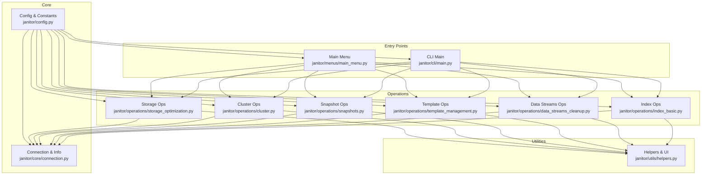

**Diagram sources**
- [janitor/cli/main.py](file://janitor/cli/main.py#L1-L57)
- [janitor/menus/main_menu.py](file://janitor/menus/main_menu.py#L1-L125)
- [janitor/core/connection.py](file://janitor/core/connection.py#L1-L72)
- [janitor/config.py](file://janitor/config.py#L1-L78)
- [janitor/utils/helpers.py](file://janitor/utils/helpers.py#L1-L258)
- [janitor/operations/index_basic.py](file://janitor/operations/index_basic.py#L1-L217)
- [janitor/operations/data_streams_cleanup.py](file://janitor/operations/data_streams_cleanup.py#L1-L271)
- [janitor/operations/template_management.py](file://janitor/operations/template_management.py#L1-L821)
- [janitor/operations/snapshots.py](file://janitor/operations/snapshots.py#L1-L927)
- [janitor/operations/cluster.py](file://janitor/operations/cluster.py#L1-L242)
- [janitor/operations/storage_optimization.py](file://janitor/operations/storage_optimization.py#L1-L1560)

**Section sources**
- [README.md](file://README.md#L143-L184)
- [janitor/__init__.py](file://janitor/__init__.py#L1-L15)
- [janitor/config.py](file://janitor/config.py#L1-L78)
- [janitor/core/connection.py](file://janitor/core/connection.py#L1-L72)
- [janitor/menus/main_menu.py](file://janitor/menus/main_menu.py#L1-L125)
- [janitor/cli/main.py](file://janitor/cli/main.py#L1-L57)

## Core Components
- Configuration and constants: centralize application settings, timeouts, and UI preferences.
- Connection layer: establish Elasticsearch client, fetch cluster info, and batch index metadata.
- Utilities: input handling, confirmation prompts, pattern selection, and safety checks.
- Operations: domain-specific modules implementing index/data stream/template/snapshot/cluster/storage functions.
- CLI and menus: entry points exposing commands and interactive navigation.

Key safety and operational constants:
- PROTECT_SYSTEM: protect indices starting with "." from deletion.
- MAX_DELETE_LIMIT: cap bulk deletions per run.
- DRY_RUN_MODE: global dry-run toggle affecting destructive operations.
- Timeout settings: DEFAULT_QUERY_TIMEOUT, SLOW_QUERY_TIMEOUT, REQUEST_TIMEOUT, REINDEX_TIMEOUT.

**Section sources**
- [janitor/config.py](file://janitor/config.py#L11-L56)
- [janitor/utils/helpers.py](file://janitor/utils/helpers.py#L18-L30)
- [janitor/operations/cluster.py](file://janitor/operations/cluster.py#L21-L33)

## Architecture Overview
Elastic Janitor’s architecture is layered:
- Presentation layer: CLI and interactive menus.
- Operations layer: domain-specific modules orchestrating Elasticsearch API calls.
- Core layer: connection and metadata retrieval.
- Utilities layer: shared helpers for safety, UX, and formatting.
- Configuration layer: centralized settings and constants.

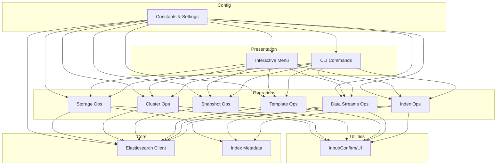

**Diagram sources**
- [janitor/cli/main.py](file://janitor/cli/main.py#L1-L57)
- [janitor/menus/main_menu.py](file://janitor/menus/main_menu.py#L1-L125)
- [janitor/core/connection.py](file://janitor/core/connection.py#L1-L72)
- [janitor/utils/helpers.py](file://janitor/utils/helpers.py#L1-L258)
- [janitor/config.py](file://janitor/config.py#L1-L78)

## Detailed Component Analysis

### Modular Operation Architecture
- CLI groups register subcommands for index, datastream, template, policy, snapshot, performance, governance, tuning, and dry-run management.
- Interactive menu routes to domain-specific submenus and operations.
- Each operation module encapsulates a functional area and interacts with Elasticsearch via the connection layer.

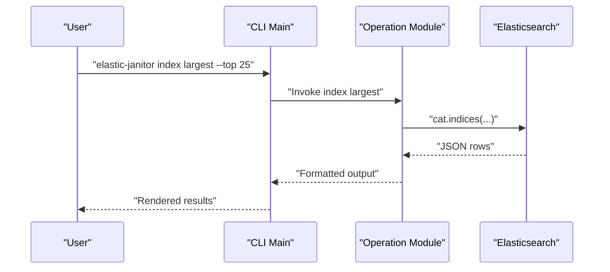

**Diagram sources**
- [janitor/cli/main.py](file://janitor/cli/main.py#L1-L57)
- [janitor/cli/commands/index.py](file://janitor/cli/commands/index.py#L1-L318)
- [janitor/core/connection.py](file://janitor/core/connection.py#L42-L71)

**Section sources**
- [janitor/cli/main.py](file://janitor/cli/main.py#L39-L51)
- [janitor/menus/main_menu.py](file://janitor/menus/main_menu.py#L44-L125)
- [janitor/operations/index_basic.py](file://janitor/operations/index_basic.py#L14-L71)

### Relationship Between Operations and Elasticsearch APIs
- Index operations use cat.indices and indices.get_settings to list, compare, and analyze indices.
- Data streams operations leverage indices.get_data_stream and indices.delete for cleanup.
- Template operations call indices.get_index_template, cluster.get_component_template, put_index_template, and put_component_template.
- Snapshot operations use snapshot.get_repository, snapshot.get, snapshot.delete, snapshot.verify_repository, snapshot.restore, and slm.get_lifecycle.
- Cluster operations use cluster.health, cluster.stats, and nodes.stats for diagnostics.
- Storage operations rely on cat.indices, indices.get_settings, and nodes.stats for analytics and recommendations.

**Section sources**
- [janitor/operations/index_basic.py](file://janitor/operations/index_basic.py#L24-L68)
- [janitor/operations/data_streams_cleanup.py](file://janitor/operations/data_streams_cleanup.py#L31-L72)
- [janitor/operations/template_management.py](file://janitor/operations/template_management.py#L39-L61)
- [janitor/operations/snapshots.py](file://janitor/operations/snapshots.py#L18-L50)
- [janitor/operations/cluster.py](file://janitor/operations/cluster.py#L63-L100)
- [janitor/operations/storage_optimization.py](file://janitor/operations/storage_optimization.py#L34-L121)

### Supported Operations and Execution Patterns

#### Index Management
- List largest indices by size, filtered by pattern.
- Index health status and counts by health color.
- Pattern analysis recommending optimal partitioning and shard strategies.
- Settings viewer for selected indices.
- Duplicate index detector grouping by derived patterns.

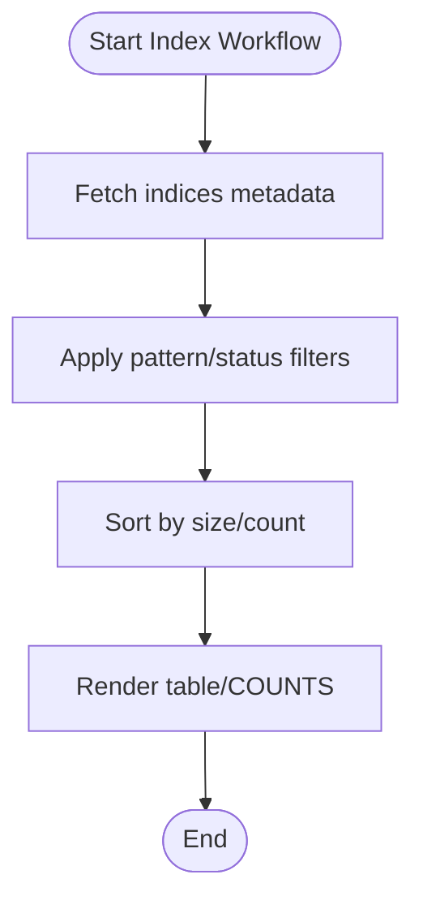

**Diagram sources**
- [janitor/cli/commands/index.py](file://janitor/cli/commands/index.py#L23-L103)
- [janitor/operations/index_basic.py](file://janitor/operations/index_basic.py#L14-L71)

**Section sources**
- [janitor/cli/commands/index.py](file://janitor/cli/commands/index.py#L17-L318)
- [janitor/operations/index_basic.py](file://janitor/operations/index_basic.py#L79-L148)
- [janitor/operations/index_basic.py](file://janitor/operations/index_basic.py#L153-L213)

#### Data Streams
- Clean data streams by retention cutoff, protecting the current write index.
- Preview eligible backing indices and pagination.
- Interactive selection and confirmation prior to deletion.
- Standalone index cleanup path.

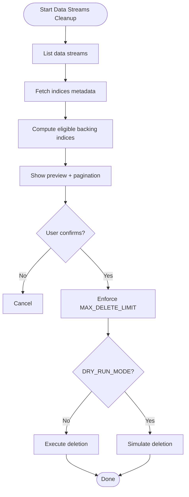

**Diagram sources**
- [janitor/operations/data_streams_cleanup.py](file://janitor/operations/data_streams_cleanup.py#L15-L167)
- [janitor/operations/data_streams_cleanup.py](file://janitor/operations/data_streams_cleanup.py#L203-L262)

**Section sources**
- [janitor/operations/data_streams_cleanup.py](file://janitor/operations/data_streams_cleanup.py#L15-L262)

#### Template Management
- View index and component template details, including structure and version history.
- Edit templates with version control, including saving known-good backups and rolling back.
- Import/export templates with validation and overwrite confirmation.
- Component template management mirrors index template workflows.

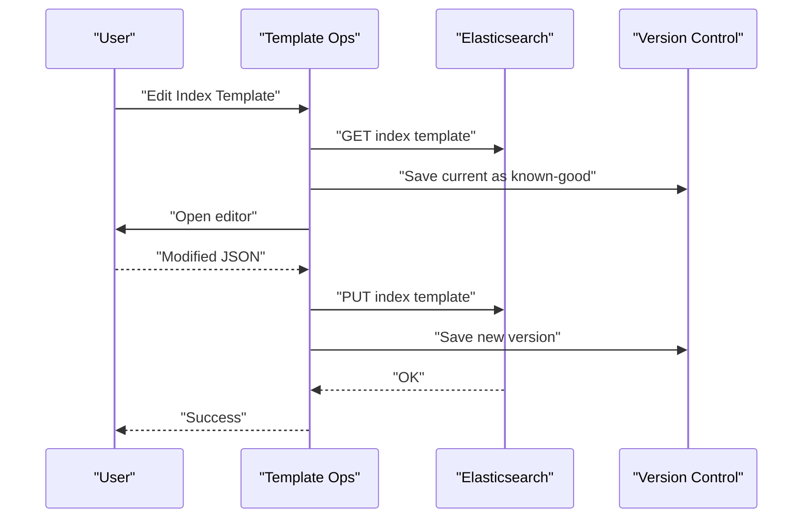

**Diagram sources**
- [janitor/operations/template_management.py](file://janitor/operations/template_management.py#L222-L365)
- [janitor/operations/template_management.py](file://janitor/operations/template_management.py#L368-L446)

**Section sources**
- [janitor/operations/template_management.py](file://janitor/operations/template_management.py#L25-L125)
- [janitor/operations/template_management.py](file://janitor/operations/template_management.py#L222-L446)

#### Snapshot Handling
- List repositories and snapshots; verify repository integrity.
- Delete snapshots older than a retention threshold with limit enforcement.
- List and delete SLM policies by match.
- Snapshot size analysis and automated cleanup with combined retention policies.
- Cross-repository copy and restore wizard with index selection and renaming.

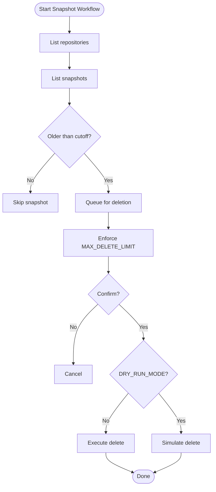

**Diagram sources**
- [janitor/operations/snapshots.py](file://janitor/operations/snapshots.py#L84-L157)
- [janitor/operations/snapshots.py](file://janitor/operations/snapshots.py#L195-L251)

**Section sources**
- [janitor/operations/snapshots.py](file://janitor/operations/snapshots.py#L15-L34)
- [janitor/operations/snapshots.py](file://janitor/operations/snapshots.py#L84-L157)
- [janitor/operations/snapshots.py](file://janitor/operations/snapshots.py#L165-L251)
- [janitor/operations/snapshots.py](file://janitor/operations/snapshots.py#L404-L550)
- [janitor/operations/snapshots.py](file://janitor/operations/snapshots.py#L557-L633)
- [janitor/operations/snapshots.py](file://janitor/operations/snapshots.py#L640-L778)

#### Cluster Diagnostics
- Toggle global dry-run mode; display dashboard and static stats.
- Cluster health overview, node information, and cluster stats.
- Real-time dashboard updates using rich Live.

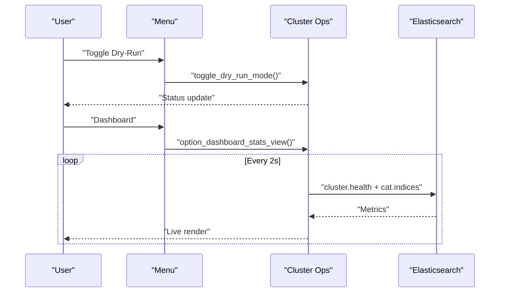

**Diagram sources**
- [janitor/operations/cluster.py](file://janitor/operations/cluster.py#L21-L33)
- [janitor/operations/cluster.py](file://janitor/operations/cluster.py#L37-L119)
- [janitor/operations/cluster.py](file://janitor/operations/cluster.py#L127-L200)

**Section sources**
- [janitor/operations/cluster.py](file://janitor/operations/cluster.py#L21-L33)
- [janitor/operations/cluster.py](file://janitor/operations/cluster.py#L37-L200)

#### Storage Optimization
- Storage forecast and tier distribution.
- Compression analysis for default codec indices above threshold.
- Empty index cleanup with multi-select and limit enforcement.
- Sparse index detection by docs-per-GB.
- Cost estimator by tier pricing.
- Shard size predictor and resource allocation optimizer.

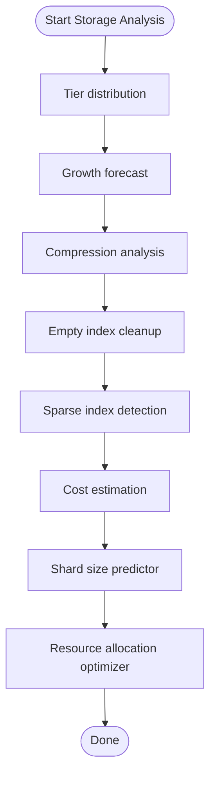

**Diagram sources**
- [janitor/operations/storage_optimization.py](file://janitor/operations/storage_optimization.py#L17-L88)
- [janitor/operations/storage_optimization.py](file://janitor/operations/storage_optimization.py#L90-L156)
- [janitor/operations/storage_optimization.py](file://janitor/operations/storage_optimization.py#L159-L241)
- [janitor/operations/storage_optimization.py](file://janitor/operations/storage_optimization.py#L243-L384)
- [janitor/operations/storage_optimization.py](file://janitor/operations/storage_optimization.py#L386-L464)
- [janitor/operations/storage_optimization.py](file://janitor/operations/storage_optimization.py#L466-L551)
- [janitor/operations/storage_optimization.py](file://janitor/operations/storage_optimization.py#L553-L669)
- [janitor/operations/storage_optimization.py](file://janitor/operations/storage_optimization.py#L671-L784)

**Section sources**
- [janitor/operations/storage_optimization.py](file://janitor/operations/storage_optimization.py#L17-L88)
- [janitor/operations/storage_optimization.py](file://janitor/operations/storage_optimization.py#L90-L156)
- [janitor/operations/storage_optimization.py](file://janitor/operations/storage_optimization.py#L159-L241)
- [janitor/operations/storage_optimization.py](file://janitor/operations/storage_optimization.py#L243-L384)
- [janitor/operations/storage_optimization.py](file://janitor/operations/storage_optimization.py#L386-L464)
- [janitor/operations/storage_optimization.py](file://janitor/operations/storage_optimization.py#L466-L551)
- [janitor/operations/storage_optimization.py](file://janitor/operations/storage_optimization.py#L553-L669)
- [janitor/operations/storage_optimization.py](file://janitor/operations/storage_optimization.py#L671-L784)

### Safety Mechanisms, Dry-Run, and Protections
- Global dry-run mode toggled via CLI and menu; all destructive operations simulate actions when enabled.
- System index protection: indices starting with "." are skipped by default.
- Confirmation prompts: typed “DELETE” required for destructive actions.
- Deletion limits: MAX_DELETE_LIMIT caps batch size for safety.
- Timeout configuration: tailored timeouts for standard, slow, request, and reindex operations.

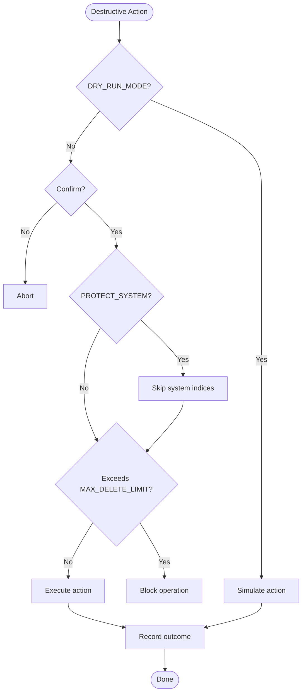

**Diagram sources**
- [janitor/operations/data_streams_cleanup.py](file://janitor/operations/data_streams_cleanup.py#L236-L247)
- [janitor/operations/snapshots.py](file://janitor/operations/snapshots.py#L120-L132)
- [janitor/operations/storage_optimization.py](file://janitor/operations/storage_optimization.py#L349-L353)
- [janitor/utils/helpers.py](file://janitor/utils/helpers.py#L18-L30)
- [janitor/config.py](file://janitor/config.py#L18-L23)

**Section sources**
- [janitor/cli/commands/dryrun.py](file://janitor/cli/commands/dryrun.py#L15-L53)
- [janitor/operations/cluster.py](file://janitor/operations/cluster.py#L21-L33)
- [janitor/utils/helpers.py](file://janitor/utils/helpers.py#L18-L30)
- [janitor/config.py](file://janitor/config.py#L18-L23)

### Practical Workflows and Execution Patterns
- CLI quick-start: list largest indices, check cluster health, enable dry-run globally, and run data stream cleanup previews.
- Interactive menu: navigate categories, choose domain-specific operations, and confirm actions.
- Batch automation: use CLI output formats (JSON/YAML/CSV) for scripting and automation pipelines.

Examples (paths only):
- [CLI usage examples](file://README.md#L122-L136)
- [CLI group registration](file://janitor/cli/main.py#L39-L51)
- [Dry-run CLI commands](file://janitor/cli/commands/dryrun.py#L15-L87)
- [Index largest command](file://janitor/cli/commands/index.py#L17-L103)

**Section sources**
- [README.md](file://README.md#L83-L136)
- [janitor/cli/main.py](file://janitor/cli/main.py#L39-L51)
- [janitor/cli/commands/dryrun.py](file://janitor/cli/commands/dryrun.py#L15-L87)
- [janitor/cli/commands/index.py](file://janitor/cli/commands/index.py#L17-L103)

## Dependency Analysis
- Loose coupling: operations depend on the connection layer and configuration; they avoid tight coupling to each other.
- Shared utilities: helpers provide common input/confirmation logic used across operations.
- Centralized configuration: constants and settings propagate to CLI, menu, and operations.

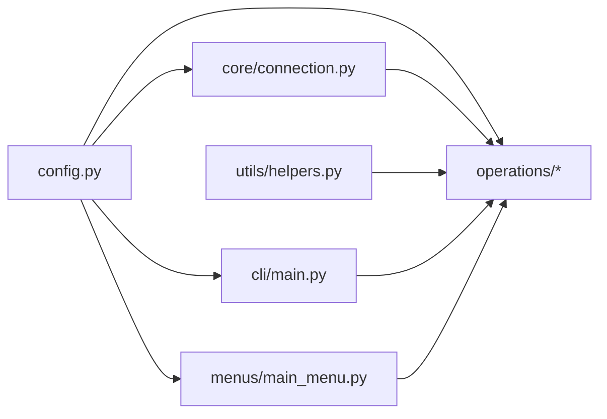

**Diagram sources**
- [janitor/config.py](file://janitor/config.py#L1-L78)
- [janitor/cli/main.py](file://janitor/cli/main.py#L1-L57)
- [janitor/menus/main_menu.py](file://janitor/menus/main_menu.py#L1-L125)
- [janitor/core/connection.py](file://janitor/core/connection.py#L1-L72)
- [janitor/utils/helpers.py](file://janitor/utils/helpers.py#L1-L258)

**Section sources**
- [janitor/config.py](file://janitor/config.py#L1-L78)
- [janitor/core/connection.py](file://janitor/core/connection.py#L1-L72)
- [janitor/utils/helpers.py](file://janitor/utils/helpers.py#L1-L258)

## Performance Considerations
- Prefer batched metadata retrieval (e.g., cat.indices with targeted headers) to minimize API calls.
- Apply pattern filtering early to reduce payload sizes.
- Use appropriate timeouts for slow queries and reindex operations.
- Limit concurrent destructive operations to respect MAX_DELETE_LIMIT and avoid overwhelming the cluster.
- Monitor node resource utilization and shard sizes to prevent hotspots and oversized shards.

[No sources needed since this section provides general guidance]

## Troubleshooting Guide
- Connection failures: verify ELASTIC_URL and ELASTIC_API_KEY; ensure network access and credentials.
- Permission errors: confirm API key permissions for required endpoints (indices, snapshot, slm, cluster).
- Excessive deletion risk: review MAX_DELETE_LIMIT and adjust as needed; use dry-run mode first.
- Interactive prompts: handle keyboard interrupts gracefully; operations exit cleanly on cancellation.
- Timeout issues: increase timeout constants for slow environments; use slower queries judiciously.

**Section sources**
- [janitor/core/connection.py](file://janitor/core/connection.py#L11-L33)
- [janitor/config.py](file://janitor/config.py#L29-L40)
- [janitor/utils/helpers.py](file://janitor/utils/helpers.py#L9-L16)

## Conclusion
Elastic Janitor provides a modular, safe, and efficient toolkit for managing Elasticsearch clusters. Its operations cleanly wrap Elasticsearch APIs, enforce safety via dry-run, protections, and limits, and offer both CLI and interactive workflows. By leveraging domain-specific modules and shared utilities, it scales from simple diagnostics to complex cleanup and optimization tasks while maintaining operability and reliability.