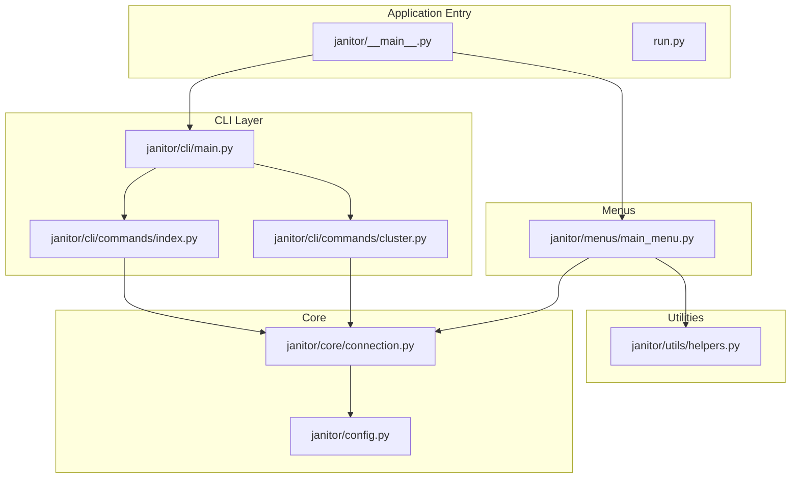
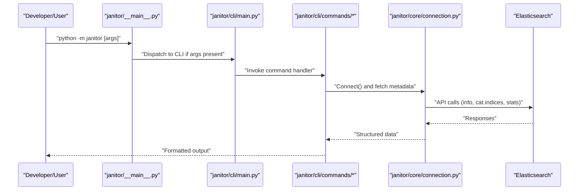
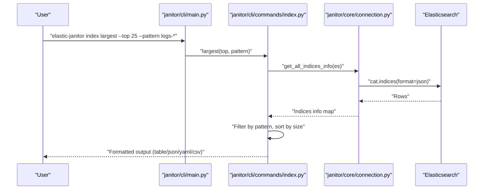
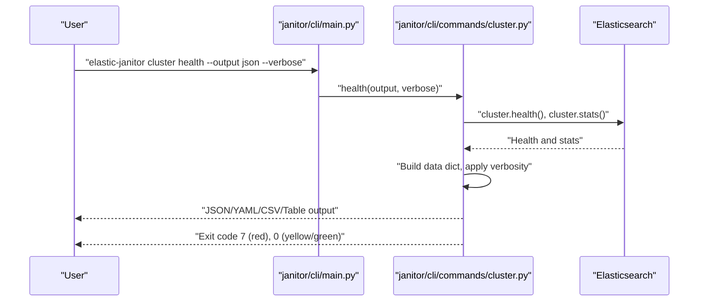
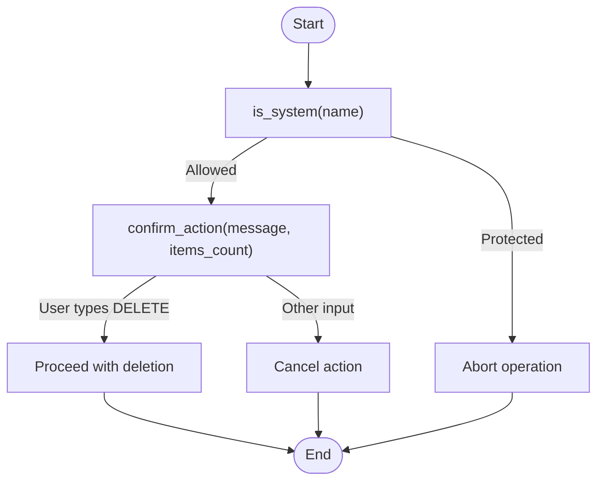
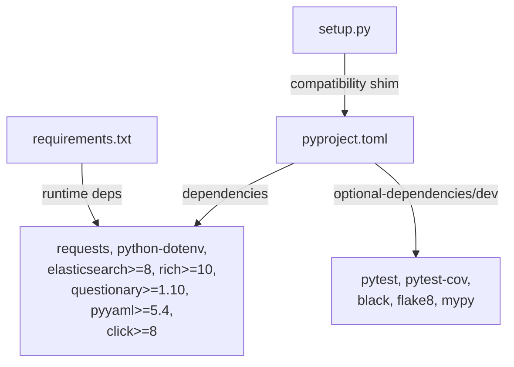

# Development and Testing

<cite>
**Referenced Files in This Document**
- [README.md](file://README.md)
- [requirements.txt](file://requirements.txt)
- [setup.py](file://setup.py)
- [pyproject.toml](file://pyproject.toml)
- [run.py](file://run.py)
- [janitor/__main__.py](file://janitor/__main__.py)
- [janitor/config.py](file://janitor/config.py)
- [janitor/core/connection.py](file://janitor/core/connection.py)
- [janitor/cli/main.py](file://janitor/cli/main.py)
- [janitor/cli/commands/index.py](file://janitor/cli/commands/index.py)
- [janitor/cli/commands/cluster.py](file://janitor/cli/commands/cluster.py)
- [janitor/menus/main_menu.py](file://janitor/menus/main_menu.py)
- [janitor/utils/helpers.py](file://janitor/utils/helpers.py)
</cite>

## Table of Contents
1. [Introduction](#introduction)
2. [Project Structure](#project-structure)
3. [Core Components](#core-components)
4. [Architecture Overview](#architecture-overview)
5. [Detailed Component Analysis](#detailed-component-analysis)
6. [Dependency Analysis](#dependency-analysis)
7. [Performance Considerations](#performance-considerations)
8. [Troubleshooting Guide](#troubleshooting-guide)
9. [Contribution Guidelines](#contribution-guidelines)
10. [Build and Packaging](#build-and-packaging)
11. [Testing Strategies](#testing-strategies)
12. [Debugging Techniques and Workflows](#debugging-techniques-and-workflows)
13. [Continuous Integration and Releases](#continuous-integration-and-releases)
14. [Conclusion](#conclusion)

## Introduction
This document provides a comprehensive guide for developing and testing Elastic Janitor. It covers environment setup, dependencies, tooling, testing strategies, code quality standards, contribution guidelines, build and packaging configuration, adding new features, maintaining backward compatibility, debugging techniques, development workflows, and continuous integration and release processes. The goal is to enable contributors to confidently extend the project while preserving safety, reliability, and usability.

## Project Structure
Elastic Janitor is organized into modular packages that separate CLI, core connectivity, menus, operations, and utilities. The CLI entry point supports both interactive menu mode and command-line invocation. Configuration centralizes runtime settings and UI styling. Core modules encapsulate Elasticsearch connectivity and index metadata retrieval. Operations modules implement domain-specific tasks. Utilities provide shared helpers for user input, formatting, and UI.

**Diagram sources**
- [janitor/__main__.py](file://janitor/__main__.py#L16-L32)
- [janitor/cli/main.py](file://janitor/cli/main.py#L8-L51)
- [janitor/cli/commands/index.py](file://janitor/cli/commands/index.py#L17-L103)
- [janitor/cli/commands/cluster.py](file://janitor/cli/commands/cluster.py#L16-L131)
- [janitor/core/connection.py](file://janitor/core/connection.py#L11-L33)
- [janitor/menus/main_menu.py](file://janitor/menus/main_menu.py#L31-L120)
- [janitor/utils/helpers.py](file://janitor/utils/helpers.py#L9-L46)
- [janitor/config.py](file://janitor/config.py#L11-L76)

**Section sources**
- [README.md](file://README.md#L143-L184)
- [janitor/__main__.py](file://janitor/__main__.py#L16-L32)
- [janitor/cli/main.py](file://janitor/cli/main.py#L8-L51)
- [janitor/core/connection.py](file://janitor/core/connection.py#L11-L33)
- [janitor/menus/main_menu.py](file://janitor/menus/main_menu.py#L31-L120)
- [janitor/utils/helpers.py](file://janitor/utils/helpers.py#L9-L46)
- [janitor/config.py](file://janitor/config.py#L11-L76)

## Core Components
- CLI entry and grouping: The CLI groups commands under a Click group and registers subcommands for cluster, index, datastream, dry-run, performance, governance, tuning, template, and policy operations.
- Core connection: Establishes an Elasticsearch client, validates credentials, and provides index metadata retrieval utilities.
- Configuration: Centralizes Elasticsearch URLs, API keys, safety flags, timeouts, version control settings, and UI styling.
- Menus: Interactive main menu orchestrates navigation to operation submenus and toggles dry-run mode.
- Utilities: Provide safe input handling, confirmation prompts, index pattern discovery, and validation helpers.

Key responsibilities:
- CLI commands delegate to core and operations modules, formatting output via shared utilities.
- Core connection enforces safe defaults and progress feedback.
- Menus integrate with core and utilities to present a guided workflow.
- Utilities enforce safety and UX consistency across features.

**Section sources**
- [janitor/cli/main.py](file://janitor/cli/main.py#L8-L51)
- [janitor/cli/commands/index.py](file://janitor/cli/commands/index.py#L17-L103)
- [janitor/cli/commands/cluster.py](file://janitor/cli/commands/cluster.py#L16-L131)
- [janitor/core/connection.py](file://janitor/core/connection.py#L11-L72)
- [janitor/config.py](file://janitor/config.py#L11-L76)
- [janitor/menus/main_menu.py](file://janitor/menus/main_menu.py#L31-L120)
- [janitor/utils/helpers.py](file://janitor/utils/helpers.py#L9-L46)

## Architecture Overview
The system supports dual modes:
- Interactive menu mode: Launched via the module entry point or launcher script, navigates to operation submenus, and invokes core connections and utilities.
- CLI mode: Launched with arguments, parses commands, and executes corresponding functions with standardized output formatting.

**Diagram sources**
- [janitor/__main__.py](file://janitor/__main__.py#L23-L31)
- [janitor/cli/main.py](file://janitor/cli/main.py#L8-L51)
- [janitor/cli/commands/index.py](file://janitor/cli/commands/index.py#L17-L103)
- [janitor/core/connection.py](file://janitor/core/connection.py#L11-L72)

## Detailed Component Analysis

### CLI Command Flow: Index Largest
This command demonstrates the standard CLI flow: argument parsing, connection injection, error handling, filtering, sorting, and output formatting.

**Diagram sources**
- [janitor/cli/main.py](file://janitor/cli/main.py#L8-L51)
- [janitor/cli/commands/index.py](file://janitor/cli/commands/index.py#L17-L103)
- [janitor/core/connection.py](file://janitor/core/connection.py#L42-L72)

**Section sources**
- [janitor/cli/commands/index.py](file://janitor/cli/commands/index.py#L17-L103)
- [janitor/core/connection.py](file://janitor/core/connection.py#L42-L72)

### CLI Command Flow: Cluster Health
Cluster health command showcases structured output, verbosity controls, and exit code semantics based on cluster status.

**Diagram sources**
- [janitor/cli/main.py](file://janitor/cli/main.py#L8-L51)
- [janitor/cli/commands/cluster.py](file://janitor/cli/commands/cluster.py#L16-L131)

**Section sources**
- [janitor/cli/commands/cluster.py](file://janitor/cli/commands/cluster.py#L16-L131)

### Interactive Menu Workflow
Menu-driven workflow integrates connection, breadcrumb display, dry-run status, and navigation to operation submenus.

```mermaid
flowchart TD
Start(["Start"]) --> Connect["Connect to Elasticsearch"]
Connect --> MenuLoop["Display Main Menu"]
MenuLoop --> Choice{"User selects category"}
Choice --> |Index Management| SubIndex["submenu_index_management"]
Choice --> |Data Streams| SubDS["submenu_data_streams"]
Choice --> |Templates & Policies| SubTpl["submenu_templates_policies"]
Choice --> |Snapshots| SubSnap["submenu_snapshots"]
Choice --> |Cluster Health| SubCluster["submenu_cluster_health"]
Choice --> |Storage Optimization| SubStorage["submenu_storage_optimization"]
Choice --> |Performance Monitoring| SubPerf["submenu_performance_monitoring"]
Choice --> |Bulk Automation| SubBulk["submenu_bulk_automation"]
Choice --> |Advanced Cleanup| SubAdv["submenu_advanced_cleanup"]
Choice --> |Data Quality| SubDQ["submenu_data_quality"]
Choice --> |AWS Ingestion| SubAWS["submenu_aws_ingestion"]
Choice --> |Developer Tools| SubDev["submenu_developer_tools"]
Choice --> |Data Governance| SubGov["submenu_data_governance"]
Choice --> |Performance Tuning| SubTune["submenu_performance_tuning"]
Choice --> |Dashboard| Dash["option_dashboard_stats_view"]
Choice --> |Toggle Dry-Run| Toggle["toggle_dry_run_mode()"]
Choice --> |Quit| Quit["Exit"]
SubIndex --> MenuLoop
SubDS --> MenuLoop
SubTpl --> MenuLoop
SubSnap --> MenuLoop
SubCluster --> MenuLoop
SubStorage --> MenuLoop
SubPerf --> MenuLoop
SubBulk --> MenuLoop
SubAdv --> MenuLoop
SubDQ --> MenuLoop
SubAWS --> MenuLoop
SubDev --> MenuLoop
SubGov --> MenuLoop
SubTune --> MenuLoop
Dash --> MenuLoop
Toggle --> MenuLoop
```

**Diagram sources**
- [janitor/menus/main_menu.py](file://janitor/menus/main_menu.py#L31-L120)

**Section sources**
- [janitor/menus/main_menu.py](file://janitor/menus/main_menu.py#L31-L120)

### Safety and Input Utilities
Safety utilities enforce protection of system indices, require explicit confirmation for destructive actions, and provide robust input validation.

**Diagram sources**
- [janitor/utils/helpers.py](file://janitor/utils/helpers.py#L18-L46)
- [janitor/config.py](file://janitor/config.py#L18-L23)

**Section sources**
- [janitor/utils/helpers.py](file://janitor/utils/helpers.py#L18-L46)
- [janitor/config.py](file://janitor/config.py#L18-L23)

## Dependency Analysis
Elastic Janitor relies on a small set of core dependencies for HTTP, configuration, Elasticsearch client, CLI, formatting, and interactive prompts. Development dependencies include pytest, coverage, black, flake8, and mypy.

**Diagram sources**
- [pyproject.toml](file://pyproject.toml#L31-L48)
- [requirements.txt](file://requirements.txt#L1-L7)
- [setup.py](file://setup.py#L7-L10)

**Section sources**
- [pyproject.toml](file://pyproject.toml#L31-L48)
- [requirements.txt](file://requirements.txt#L1-L7)
- [setup.py](file://setup.py#L7-L10)

## Performance Considerations
- Prefer batched API calls where possible (e.g., fetching index metadata in a single cat.indices call).
- Use pattern filters to limit result sets for large clusters.
- Respect timeout settings for slow queries and reindex operations.
- Limit concurrent operations and avoid unnecessary repeated queries.

[No sources needed since this section provides general guidance]

## Troubleshooting Guide
Common issues and remedies:
- Authentication failures: Verify Elasticsearch URL and API key configuration.
- Connection timeouts: Increase timeout settings for slow queries or reindex operations.
- Pattern mismatches: Use wildcard patterns and validate with dry-run mode.
- Excessive indices: Apply pattern filters and consider storage optimization features.

**Section sources**
- [janitor/config.py](file://janitor/config.py#L11-L40)
- [janitor/core/connection.py](file://janitor/core/connection.py#L11-L33)
- [janitor/utils/helpers.py](file://janitor/utils/helpers.py#L113-L258)

## Contribution Guidelines
Follow these steps to contribute:
- Fork the repository and create a feature branch.
- Implement changes with clear commit messages.
- Add tests for new functionality and ensure all tests pass.
- Format code with black and adhere to PEP 8 style.
- Submit a pull request for review.

**Section sources**
- [README.md](file://README.md#L233-L242)
- [pyproject.toml](file://pyproject.toml#L84-L89)
- [pyproject.toml](file://pyproject.toml#L66-L82)

## Build and Packaging
- Modern installation uses pyproject.toml; setup.py remains for backward compatibility.
- Scripts expose elastic-janitor and ej entry points.
- Packaging includes package data and defines classifiers and keywords.

**Section sources**
- [setup.py](file://setup.py#L7-L10)
- [pyproject.toml](file://pyproject.toml#L56-L64)
- [pyproject.toml](file://pyproject.toml#L16-L29)

## Testing Strategies
- Install development dependencies and run pytest.
- Coverage reports are generated in HTML and terminal formats.
- Test discovery targets files prefixed with test_ and classes/functions following pytest conventions.

Recommended practices:
- Add unit tests for CLI command handlers and core utilities.
- Mock Elasticsearch client interactions for deterministic tests.
- Validate output formatting and exit codes.
- Include integration tests for end-to-end flows where applicable.

**Section sources**
- [README.md](file://README.md#L215-L223)
- [pyproject.toml](file://pyproject.toml#L84-L89)

## Debugging Techniques and Workflows
- Use verbose output flags to inspect internal state and API responses.
- Leverage dry-run mode to preview operations safely.
- Utilize structured output formats (JSON/YAML/CSV) for external inspection.
- Employ interactive menus for guided exploration before automating with CLI.

**Section sources**
- [janitor/cli/commands/index.py](file://janitor/cli/commands/index.py#L23-L102)
- [janitor/cli/commands/cluster.py](file://janitor/cli/commands/cluster.py#L20-L131)
- [janitor/menus/main_menu.py](file://janitor/menus/main_menu.py#L35-L38)

## Continuous Integration and Releases
- Version is defined in pyproject.toml; maintain semantic versioning.
- Use CI to run pytest with coverage and lint checks.
- Publish distributions via standard Python packaging workflows.

**Section sources**
- [pyproject.toml](file://pyproject.toml#L7-L8)
- [pyproject.toml](file://pyproject.toml#L84-L89)

## Conclusion
This guide consolidates development and testing practices for Elastic Janitor. By following the outlined setup, testing, formatting, and contribution procedures, contributors can reliably extend functionality while preserving safety, performance, and usability. Adhering to the documented workflows ensures backward compatibility and smooth integration with existing features.