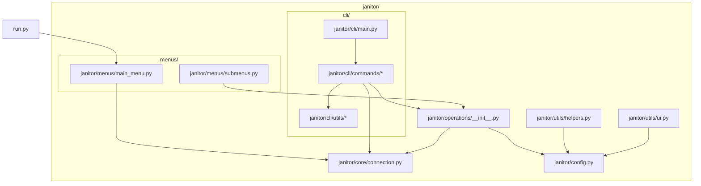
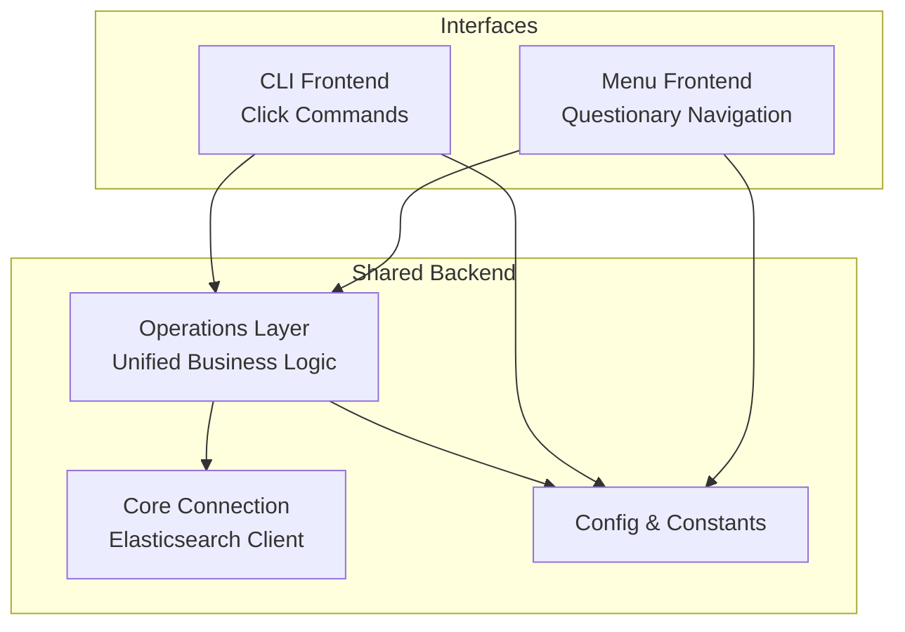
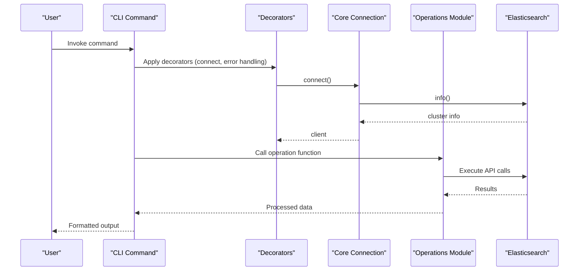
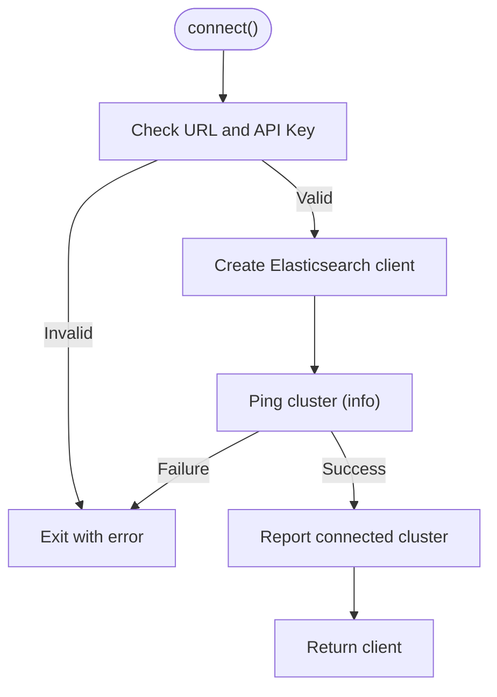
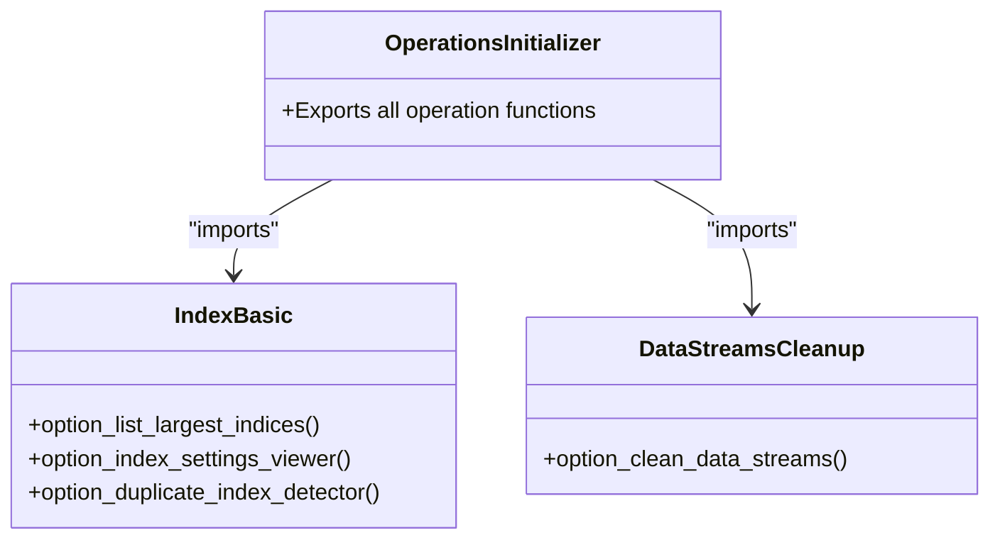
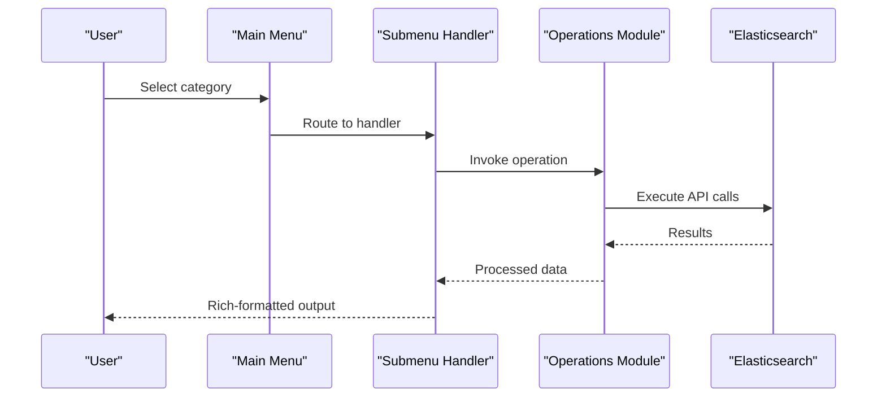
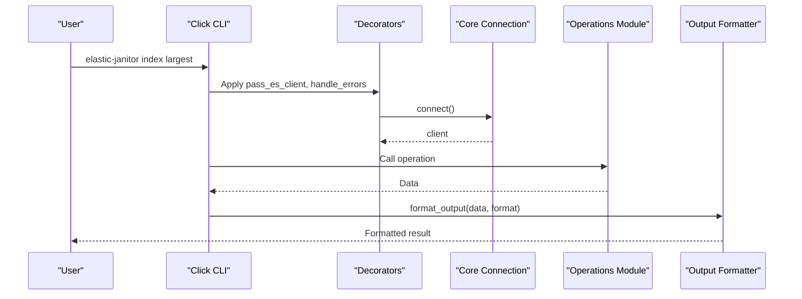
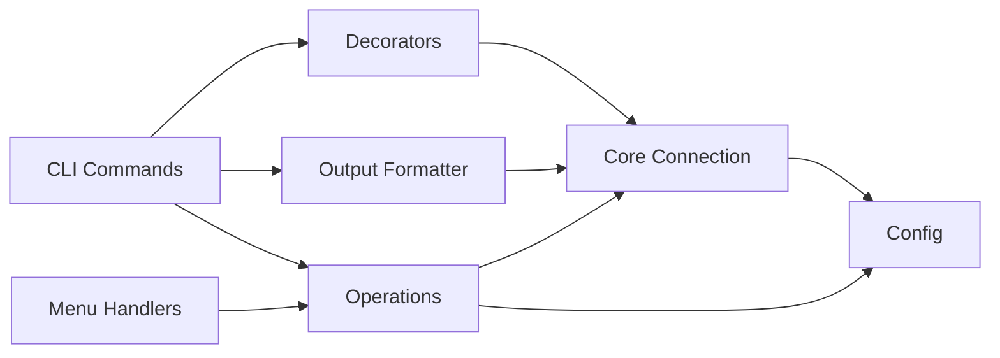

# Architecture Overview

<cite>
**Referenced Files in This Document**
- [janitor/__init__.py](file://janitor/__init__.py)
- [run.py](file://run.py)
- [janitor/cli/main.py](file://janitor/cli/main.py)
- [janitor/menus/main_menu.py](file://janitor/menus/main_menu.py)
- [janitor/menus/submenus.py](file://janitor/menus/submenus.py)
- [janitor/core/connection.py](file://janitor/core/connection.py)
- [janitor/config.py](file://janitor/config.py)
- [janitor/operations/__init__.py](file://janitor/operations/__init__.py)
- [janitor/operations/index_basic.py](file://janitor/operations/index_basic.py)
- [janitor/operations/data_streams_cleanup.py](file://janitor/operations/data_streams_cleanup.py)
- [janitor/cli/commands/index.py](file://janitor/cli/commands/index.py)
- [janitor/cli/utils/decorators.py](file://janitor/cli/utils/decorators.py)
- [janitor/cli/utils/output.py](file://janitor/cli/utils/output.py)
- [janitor/utils/helpers.py](file://janitor/utils/helpers.py)
- [janitor/utils/ui.py](file://janitor/utils/ui.py)
</cite>

## Table of Contents
1. [Introduction](#introduction)
2. [Project Structure](#project-structure)
3. [Core Components](#core-components)
4. [Architecture Overview](#architecture-overview)
5. [Detailed Component Analysis](#detailed-component-analysis)
6. [Dependency Analysis](#dependency-analysis)
7. [Performance Considerations](#performance-considerations)
8. [Troubleshooting Guide](#troubleshooting-guide)
9. [Conclusion](#conclusion)
10. [Appendices](#appendices)

## Introduction
This document describes the architecture of Elastic Janitor, a dual-interface tool that integrates a Command-Line Interface (CLI) and an interactive menu-driven interface. The system is designed around a unified backend that exposes shared operation modules to both frontends. It follows a layered architecture:
- Core connection layer for Elasticsearch integration
- Operations layer containing specialized business logic modules
- Menu system for GUI-style navigation
- CLI framework for command-line operations

The architecture emphasizes separation of concerns, shared operation modules, and a plugin-friendly design that enables easy extension of features and operations.

## Project Structure
The repository is organized by functional layers and interfaces:
- janitor/: Package root
  - cli/: CLI framework and command implementations
  - menus/: Interactive menu system
  - core/: Elasticsearch connection and low-level utilities
  - operations/: Shared business logic modules
  - utils/: UI helpers and common utilities
  - config.py: Centralized configuration and constants
- Top-level scripts:
  - run.py: Launcher for the interactive menu
  - CLI entry points and command groups are defined under janitor/cli/

**Diagram sources**
- [janitor/cli/main.py](file://janitor/cli/main.py#L1-L57)
- [janitor/menus/main_menu.py](file://janitor/menus/main_menu.py#L1-L125)
- [janitor/menus/submenus.py](file://janitor/menus/submenus.py#L1-L1149)
- [janitor/core/connection.py](file://janitor/core/connection.py#L1-L72)
- [janitor/config.py](file://janitor/config.py#L1-L78)
- [janitor/operations/__init__.py](file://janitor/operations/__init__.py#L1-L351)
- [janitor/utils/helpers.py](file://janitor/utils/helpers.py#L1-L258)
- [janitor/utils/ui.py](file://janitor/utils/ui.py#L1-L12)
- [run.py](file://run.py#L1-L10)

**Section sources**
- [janitor/__init__.py](file://janitor/__init__.py#L1-L15)
- [run.py](file://run.py#L1-L10)
- [janitor/cli/main.py](file://janitor/cli/main.py#L1-L57)
- [janitor/menus/main_menu.py](file://janitor/menus/main_menu.py#L1-L125)
- [janitor/menus/submenus.py](file://janitor/menus/submenus.py#L1-L1149)
- [janitor/core/connection.py](file://janitor/core/connection.py#L1-L72)
- [janitor/config.py](file://janitor/config.py#L1-L78)
- [janitor/operations/__init__.py](file://janitor/operations/__init__.py#L1-L351)
- [janitor/utils/helpers.py](file://janitor/utils/helpers.py#L1-L258)
- [janitor/utils/ui.py](file://janitor/utils/ui.py#L1-L12)

## Core Components
- Unified backend operations: The operations module exports a comprehensive catalog of capabilities (index management, data streams, templates/policies, snapshots, cluster health, storage optimization, performance monitoring, bulk automation, advanced cleanup, data quality, AWS ingestion diagnostics, dependency viewer, lifecycle enhancements, data governance, and performance tuning). These functions are imported and invoked by both the CLI and menu systems.
- Core connection layer: Provides a single point of Elasticsearch connectivity and index metadata retrieval, ensuring consistent behavior across both interfaces.
- CLI framework: Uses Click to define command groups and subcommands, with shared decorators for connection, error handling, dry-run toggling, and output formatting.
- Interactive menu system: Built with Questionary and Rich, offering hierarchical navigation and consistent UX patterns.

Key responsibilities:
- Core connection: Establishes Elasticsearch client, validates connectivity, and retrieves index information.
- Operations: Encapsulate business logic for all supported tasks, enabling reuse by both CLI and menu.
- CLI: Parse arguments, apply decorators, and render formatted output.
- Menus: Drive user interactions, orchestrate operations, and present results via Rich.

**Section sources**
- [janitor/operations/__init__.py](file://janitor/operations/__init__.py#L1-L351)
- [janitor/core/connection.py](file://janitor/core/connection.py#L1-L72)
- [janitor/cli/utils/decorators.py](file://janitor/cli/utils/decorators.py#L1-L89)
- [janitor/cli/utils/output.py](file://janitor/cli/utils/output.py#L1-L153)
- [janitor/menus/main_menu.py](file://janitor/menus/main_menu.py#L1-L125)
- [janitor/menus/submenus.py](file://janitor/menus/submenus.py#L1-L1149)

## Architecture Overview
The system’s dual-interface design centers on shared operation modules. Both CLI and menu systems depend on the core connection layer and configuration, while the operations layer provides the domain-specific logic.

**Diagram sources**
- [janitor/operations/__init__.py](file://janitor/operations/__init__.py#L1-L351)
- [janitor/core/connection.py](file://janitor/core/connection.py#L1-L72)
- [janitor/config.py](file://janitor/config.py#L1-L78)
- [janitor/cli/main.py](file://janitor/cli/main.py#L1-L57)
- [janitor/menus/main_menu.py](file://janitor/menus/main_menu.py#L1-L125)

## Detailed Component Analysis

### Dual-Interface Design and Data Flow
- CLI flow: The CLI entry registers command groups and subcommands. Each command uses decorators to inject an Elasticsearch client, handle errors, and format output. Commands call into shared operations modules for business logic and rely on the core connection layer for connectivity.
- Menu flow: The main menu connects to Elasticsearch, presents categories, and routes selections to submenu handlers. Submenus invoke the same shared operations modules, ensuring identical behavior across interfaces.

**Diagram sources**
- [janitor/cli/main.py](file://janitor/cli/main.py#L1-L57)
- [janitor/cli/utils/decorators.py](file://janitor/cli/utils/decorators.py#L1-L89)
- [janitor/core/connection.py](file://janitor/core/connection.py#L1-L72)
- [janitor/operations/index_basic.py](file://janitor/operations/index_basic.py#L1-L200)

**Section sources**
- [janitor/cli/main.py](file://janitor/cli/main.py#L1-L57)
- [janitor/cli/utils/decorators.py](file://janitor/cli/utils/decorators.py#L1-L89)
- [janitor/menus/main_menu.py](file://janitor/menus/main_menu.py#L1-L125)
- [janitor/menus/submenus.py](file://janitor/menus/submenus.py#L1-L1149)
- [janitor/core/connection.py](file://janitor/core/connection.py#L1-L72)
- [janitor/operations/index_basic.py](file://janitor/operations/index_basic.py#L1-L200)

### Core Connection Layer
- Responsibilities:
  - Validate credentials and connect to Elasticsearch
  - Retrieve cluster information and report connectivity status
  - Fetch index metadata (creation date, sizes, tiers) in a single efficient call
- Coupling:
  - Depends on configuration constants for endpoint and credentials
  - Uses Rich progress indicators for user feedback
- Cohesion:
  - High cohesion around Elasticsearch connectivity and index metadata retrieval

**Diagram sources**
- [janitor/core/connection.py](file://janitor/core/connection.py#L1-L72)
- [janitor/config.py](file://janitor/config.py#L1-L78)

**Section sources**
- [janitor/core/connection.py](file://janitor/core/connection.py#L1-L72)
- [janitor/config.py](file://janitor/config.py#L1-L78)

### Operations Layer
- Responsibilities:
  - Provide reusable functions for all supported tasks
  - Encapsulate Elasticsearch API calls and data transformations
  - Support dry-run mode and system protection flags
- Organization:
  - A central initializer aggregates functions from individual modules
  - Modules are grouped by domain (index, data streams, templates/policies, snapshots, cluster, storage optimization, performance, bulk automation, advanced cleanup, data quality, AWS ingestion, lifecycle enhancements, data governance, performance tuning)
- Extensibility:
  - New features can be added by implementing a new module and exporting functions via the initializer

**Diagram sources**
- [janitor/operations/__init__.py](file://janitor/operations/__init__.py#L1-L351)
- [janitor/operations/index_basic.py](file://janitor/operations/index_basic.py#L1-L200)
- [janitor/operations/data_streams_cleanup.py](file://janitor/operations/data_streams_cleanup.py#L1-L200)

**Section sources**
- [janitor/operations/__init__.py](file://janitor/operations/__init__.py#L1-L351)
- [janitor/operations/index_basic.py](file://janitor/operations/index_basic.py#L1-L200)
- [janitor/operations/data_streams_cleanup.py](file://janitor/operations/data_streams_cleanup.py#L1-L200)

### Menu System
- Responsibilities:
  - Present hierarchical navigation using Questionary
  - Route selections to appropriate submenu handlers
  - Integrate with shared operations modules for execution
  - Provide breadcrumbs and consistent UI via Rich
- Dry-run and system protection:
  - Menu displays dry-run status and toggles global dry-run mode
  - Uses system protection checks to avoid destructive actions on protected resources

**Diagram sources**
- [janitor/menus/main_menu.py](file://janitor/menus/main_menu.py#L1-L125)
- [janitor/menus/submenus.py](file://janitor/menus/submenus.py#L1-L1149)
- [janitor/operations/__init__.py](file://janitor/operations/__init__.py#L1-L351)

**Section sources**
- [janitor/menus/main_menu.py](file://janitor/menus/main_menu.py#L1-L125)
- [janitor/menus/submenus.py](file://janitor/menus/submenus.py#L1-L1149)
- [janitor/utils/ui.py](file://janitor/utils/ui.py#L1-L12)
- [janitor/utils/helpers.py](file://janitor/utils/helpers.py#L1-L258)

### CLI Framework
- Responsibilities:
  - Define command groups and subcommands
  - Apply decorators for connection, error handling, dry-run, and output formatting
  - Provide consistent output formats (JSON, YAML, CSV, table)
- Integration:
  - Commands import shared operations and core connection utilities
  - Output formatting leverages Rich tables and structured serializers

**Diagram sources**
- [janitor/cli/main.py](file://janitor/cli/main.py#L1-L57)
- [janitor/cli/utils/decorators.py](file://janitor/cli/utils/decorators.py#L1-L89)
- [janitor/cli/utils/output.py](file://janitor/cli/utils/output.py#L1-L153)
- [janitor/operations/index_basic.py](file://janitor/operations/index_basic.py#L1-L200)

**Section sources**
- [janitor/cli/main.py](file://janitor/cli/main.py#L1-L57)
- [janitor/cli/utils/decorators.py](file://janitor/cli/utils/decorators.py#L1-L89)
- [janitor/cli/utils/output.py](file://janitor/cli/utils/output.py#L1-L153)
- [janitor/cli/commands/index.py](file://janitor/cli/commands/index.py#L1-L318)

### Configuration and Constants
- Centralizes:
  - Elasticsearch endpoint and credentials
  - Global flags (dry-run, protect system)
  - Timeouts and limits
  - UI styling and console configuration
- Impact:
  - Ensures consistent behavior across CLI and menu
  - Enables environment-specific customization

**Section sources**
- [janitor/config.py](file://janitor/config.py#L1-L78)

### Utilities and Helpers
- Helpers:
  - Safe input handling and confirmation dialogs
  - Pattern discovery for index selection
  - System resource detection and protection
- UI:
  - Breadcrumb navigation for menus
- Cohesion:
  - Utilities are cohesive around user interaction and safety

**Section sources**
- [janitor/utils/helpers.py](file://janitor/utils/helpers.py#L1-L258)
- [janitor/utils/ui.py](file://janitor/utils/ui.py#L1-L12)

## Dependency Analysis
- Interface-to-backend coupling:
  - CLI commands depend on core connection and operations initializer
  - Menu handlers depend on core connection and operations initializer
- Backend cohesion:
  - Operations initializer aggregates domain modules, promoting reuse
  - Core connection encapsulates Elasticsearch specifics
- External dependencies:
  - Elasticsearch client library for API interactions
  - Rich for terminal rendering and progress indicators
  - Questionary for interactive prompts
  - Click for CLI argument parsing and command registration

**Diagram sources**
- [janitor/cli/main.py](file://janitor/cli/main.py#L1-L57)
- [janitor/cli/utils/decorators.py](file://janitor/cli/utils/decorators.py#L1-L89)
- [janitor/cli/utils/output.py](file://janitor/cli/utils/output.py#L1-L153)
- [janitor/menus/submenus.py](file://janitor/menus/submenus.py#L1-L1149)
- [janitor/operations/__init__.py](file://janitor/operations/__init__.py#L1-L351)
- [janitor/core/connection.py](file://janitor/core/connection.py#L1-L72)
- [janitor/config.py](file://janitor/config.py#L1-L78)

**Section sources**
- [janitor/cli/main.py](file://janitor/cli/main.py#L1-L57)
- [janitor/menus/submenus.py](file://janitor/menus/submenus.py#L1-L1149)
- [janitor/operations/__init__.py](file://janitor/operations/__init__.py#L1-L351)
- [janitor/core/connection.py](file://janitor/core/connection.py#L1-L72)
- [janitor/config.py](file://janitor/config.py#L1-L78)

## Performance Considerations
- Efficient metadata retrieval:
  - Core connection fetches index information in a single API call to minimize latency and reduce load on the cluster.
- Progress reporting:
  - Rich progress indicators provide user feedback during long-running operations.
- Output formatting:
  - Structured output formats (JSON/YAML/CSV) enable downstream automation and reduce parsing overhead.
- Dry-run mode:
  - Prevents unnecessary writes and reduces risk during exploration and planning.

[No sources needed since this section provides general guidance]

## Troubleshooting Guide
- Connection failures:
  - Verify Elasticsearch URL and API key configuration. The connection routine reports errors and exits on failure.
- Permission and system protection:
  - System indices are protected by default; confirm flags and patterns to avoid unintended deletions.
- CLI error handling:
  - Decorators catch keyboard interrupts and general exceptions, printing helpful messages and exiting with appropriate codes.
- Menu cancellation:
  - Menu handlers gracefully handle user cancellations and return to previous screens.

**Section sources**
- [janitor/core/connection.py](file://janitor/core/connection.py#L1-L72)
- [janitor/config.py](file://janitor/config.py#L1-L78)
- [janitor/cli/utils/decorators.py](file://janitor/cli/utils/decorators.py#L1-L89)
- [janitor/utils/helpers.py](file://janitor/utils/helpers.py#L1-L258)

## Conclusion
Elastic Janitor’s architecture cleanly separates concerns across a core connection layer, a rich operations layer, and two complementary user interfaces. The shared operation modules ensure consistent behavior, while the layered design supports both power users (CLI) and administrators (interactive menus). The plugin-friendly initializer and cohesive utilities facilitate extensibility and maintainability.

[No sources needed since this section summarizes without analyzing specific files]

## Appendices

### System Context and Elasticsearch Ecosystem
- Elastic Janitor integrates with Elasticsearch through the official client, leveraging cluster information, index metadata, and API endpoints to deliver management and optimization capabilities.
- The tool operates alongside Elasticsearch’s native features (indices, data streams, templates, ILM, snapshots, SLM) and provides higher-level workflows and dashboards.

[No sources needed since this section provides general context]