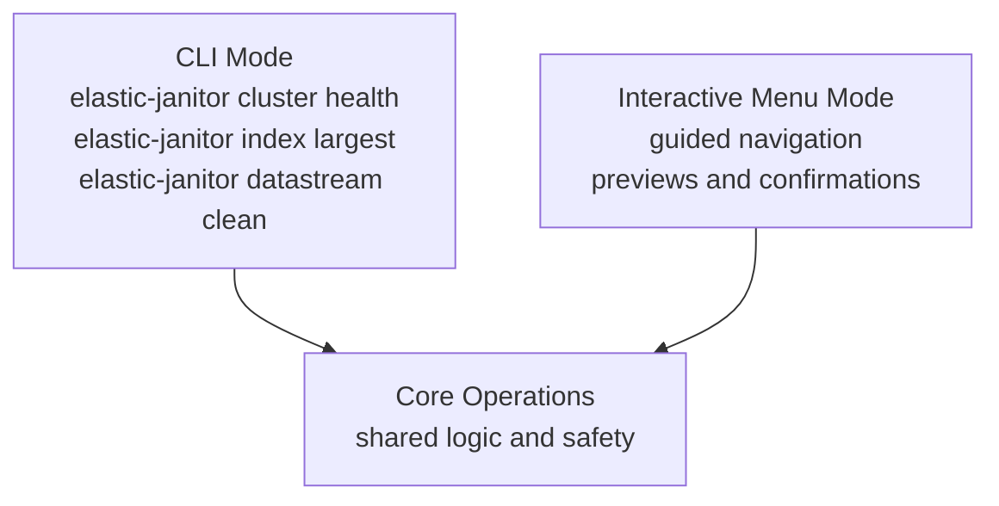
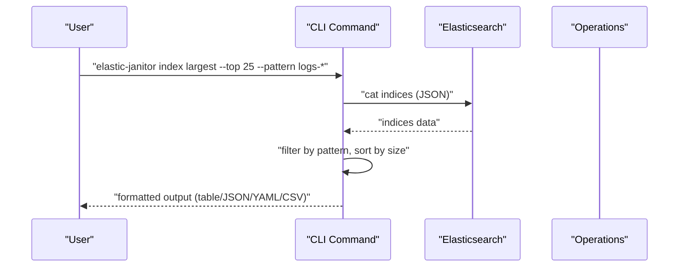
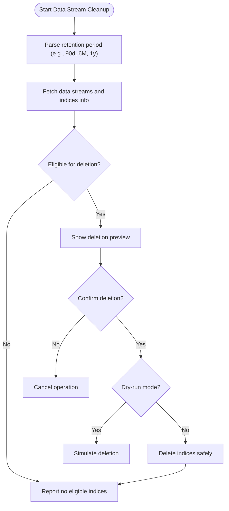
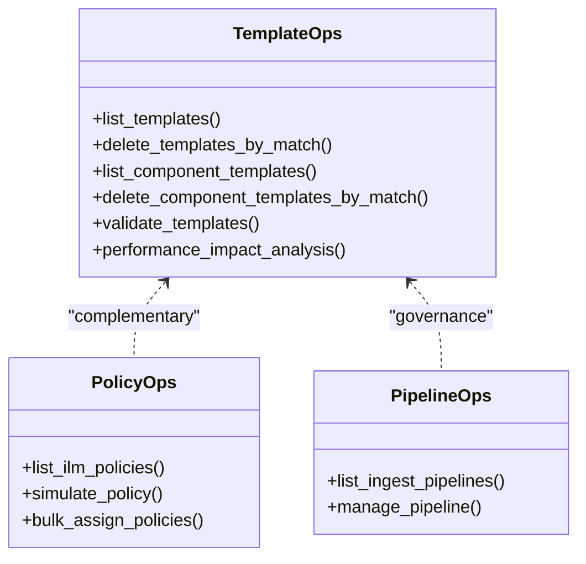
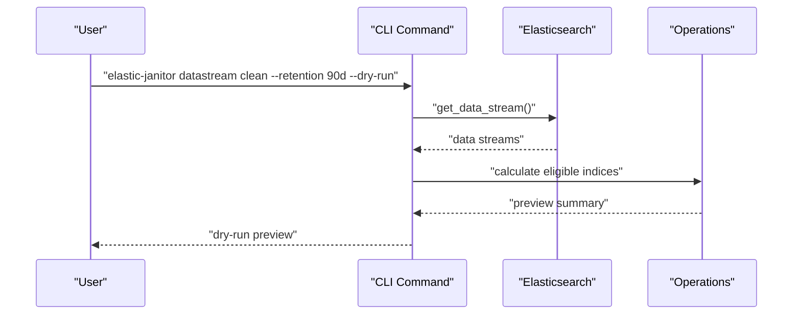
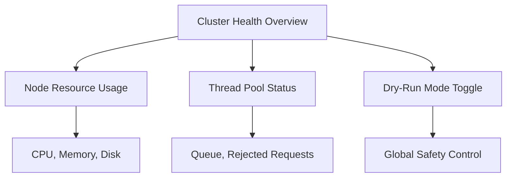
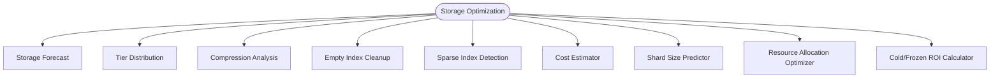
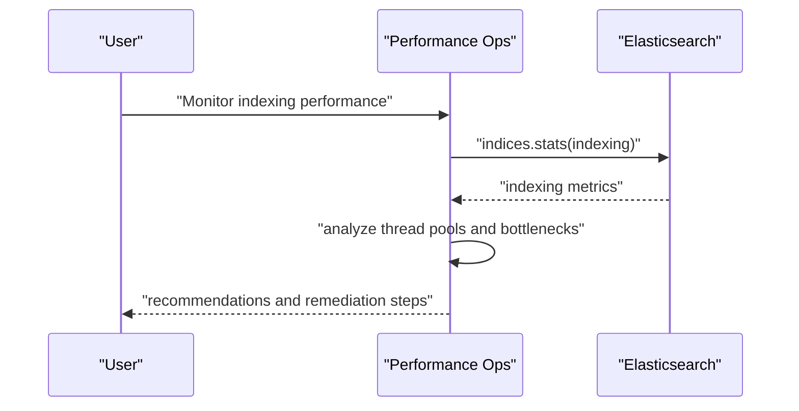
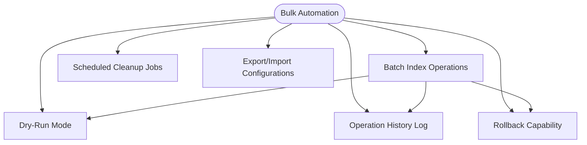

# Feature Highlights

<cite>
**Referenced Files in This Document**
- [README.md](file://README.md)
- [QUICK_START.md](file://docs/QUICK_START.md)
- [main.py](file://janitor/cli/main.py)
- [index.py](file://janitor/cli/commands/index.py)
- [datastream.py](file://janitor/cli/commands/datastream.py)
- [template.py](file://janitor/cli/commands/template.py)
- [main_menu.py](file://janitor/menus/main_menu.py)
- [config.py](file://janitor/config.py)
- [index_basic.py](file://janitor/operations/index_basic.py)
- [index_health.py](file://janitor/operations/index_health.py)
- [data_streams_preview.py](file://janitor/operations/data_streams_preview.py)
- [data_streams_cleanup.py](file://janitor/operations/data_streams_cleanup.py)
- [data_streams_stats.py](file://janitor/operations/data_streams_stats.py)
- [data_streams_migration.py](file://janitor/operations/data_streams_migration.py)
- [templates_index.py](file://janitor/operations/templates_index.py)
- [snapshots.py](file://janitor/operations/snapshots.py)
- [storage_optimization.py](file://janitor/operations/storage_optimization.py)
- [performance_monitoring.py](file://janitor/operations/performance_monitoring.py)
- [bulk_automation.py](file://janitor/operations/bulk_automation.py)
</cite>

## Table of Contents
1. [Introduction](#introduction)
2. [Dual-Interface Approach](#dual-interface-approach)
3. [Index Management](#index-management)
4. [Data Streams](#data-streams)
5. [Templates & Policies](#templates--policies)
6. [Snapshots](#snapshots)
7. [Cluster Health](#cluster-health)
8. [Storage Optimization](#storage-optimization)
9. [Performance Monitoring](#performance-monitoring)
10. [Bulk Automation](#bulk-automation)
11. [Practical Use Cases](#practical-use-cases)
12. [Conclusion](#conclusion)

## Introduction
Elastic Janitor is a comprehensive Elasticsearch cluster management tool designed to streamline administration through an intuitive dual-interface approach: a modern CLI and an interactive menu system. It centralizes essential operations—index management, data streams, templates and policies, snapshots, cluster health, storage optimization, performance monitoring, and bulk automation—into a unified platform that integrates seamlessly with the broader Elasticsearch ecosystem.

Key strengths:
- Dual-interface design enabling both scripted automation and guided workflows
- Strong safety controls (dry-run mode, system index protection, operation limits)
- Rich output formats (table, JSON, YAML, CSV) for CLI integrations
- Extensive operational coverage spanning day-one operations to long-term optimization

**Section sources**
- [README.md](file://README.md#L1-L269)

## Dual-Interface Approach
Elastic Janitor supports two complementary modes of operation:

- CLI Mode: Ideal for automation, scripting, and integration into pipelines. Commands are structured and support standardized output formats.
- Interactive Menu Mode: Designed for guided workflows, offering contextual navigation, previews, and safety checks.

Both modes share the same underlying operations and safety mechanisms, ensuring consistent behavior regardless of the interface used.

**Diagram sources**
- [main.py](file://janitor/cli/main.py#L8-L56)
- [main_menu.py](file://janitor/menus/main_menu.py#L44-L124)

**Section sources**
- [README.md](file://README.md#L83-L141)
- [main.py](file://janitor/cli/main.py#L8-L56)
- [main_menu.py](file://janitor/menus/main_menu.py#L44-L124)

## Index Management
Index Management covers the full lifecycle of indices with both basic and advanced capabilities.

- Basic Operations
  - List largest indices by size with optional pattern filtering and output formatting
  - Index settings viewer to compare settings across selected indices
  - Duplicate index detector to identify potential duplication patterns

- Health Monitoring
  - Index health dashboard grouped by health status with filtering
  - Shard analysis summarizing shard distribution, unassigned shards, and node distribution

- Advanced Operations
  - Alias management, rollover status, tier migration, and merge optimization (menu-driven)
  - Pattern analysis for optimal index partitioning and routing strategies (CLI)

**Diagram sources**
- [index.py](file://janitor/cli/commands/index.py#L17-L103)

**Section sources**
- [README.md](file://README.md#L9-L12)
- [index_basic.py](file://janitor/operations/index_basic.py#L14-L217)
- [index_health.py](file://janitor/operations/index_health.py#L13-L188)
- [index.py](file://janitor/cli/commands/index.py#L17-L103)

## Data Streams
Data Streams operations focus on lifecycle management, cleanup, and operational insights.

- Cleanup
  - Preview and clean old backing indices based on retention policies while protecting the current write index
  - Batch-safe deletion respecting configured limits and dry-run mode

- Preview
  - Preview tool to visualize which backing indices would be eligible for deletion given a retention threshold

- Statistics
  - Ingestion rates, document counts, total size, and growth trends per data stream
  - Lifecycle viewer showing ILM policy status, current phase, and action for each backing index

- Advanced Features
  - Migration wizard supporting same-cluster cloning and cross-cluster migration (with preview and safety checks)

**Diagram sources**
- [datastream.py](file://janitor/cli/commands/datastream.py#L20-L193)
- [data_streams_cleanup.py](file://janitor/operations/data_streams_cleanup.py#L15-L262)
- [data_streams_preview.py](file://janitor/operations/data_streams_preview.py#L14-L167)
- [data_streams_stats.py](file://janitor/operations/data_streams_stats.py#L15-L241)
- [data_streams_migration.py](file://janitor/operations/data_streams_migration.py#L19-L307)

**Section sources**
- [README.md](file://README.md#L14-L18)
- [data_streams_cleanup.py](file://janitor/operations/data_streams_cleanup.py#L15-L262)
- [data_streams_preview.py](file://janitor/operations/data_streams_preview.py#L14-L167)
- [data_streams_stats.py](file://janitor/operations/data_streams_stats.py#L15-L241)
- [data_streams_migration.py](file://janitor/operations/data_streams_migration.py#L19-L307)
- [datastream.py](file://janitor/cli/commands/datastream.py#L20-L193)

## Templates & Policies
Template and policy management ensures consistent index configuration and lifecycle governance.

- Index Templates
  - List and manage index templates and component templates
  - Bulk deletion by pattern with safety checks and dry-run simulation

- ILM Policies
  - Lifecycle policy management and simulation
  - Bulk assignment and conflict detection

- Ingest Pipelines
  - List and manage ingest pipelines

**Diagram sources**
- [templates_index.py](file://janitor/operations/templates_index.py#L12-L208)
- [template.py](file://janitor/cli/commands/template.py#L19-L74)

**Section sources**
- [README.md](file://README.md#L20-L24)
- [templates_index.py](file://janitor/operations/templates_index.py#L12-L208)
- [template.py](file://janitor/cli/commands/template.py#L19-L74)

## Snapshots
Snapshot and backup management provides repository oversight, snapshot lifecycle, and restoration capabilities.

- Repository Management
  - List and verify snapshot repositories across the cluster

- Snapshot Operations
  - List snapshots, delete old snapshots by retention, and analyze snapshot sizes

- SLM
  - Manage Snapshot Lifecycle Management policies
  - Automated cleanup with flexible retention policies (keep last N, daily/weekly/monthly)

- Advanced
  - Cross-repository copy (preview and guidance)
  - Restore wizard with index selection and rename patterns

**Diagram sources**
- [datastream.py](file://janitor/cli/commands/datastream.py#L20-L193)
- [snapshots.py](file://janitor/operations/snapshots.py#L15-L927)

**Section sources**
- [README.md](file://README.md#L26-L30)
- [snapshots.py](file://janitor/operations/snapshots.py#L15-L927)
- [datastream.py](file://janitor/cli/commands/datastream.py#L20-L193)

## Cluster Health
Cluster Health provides centralized visibility and diagnostics.

- Overview
  - Cluster health and statistics with node information

- Node Information
  - Detailed node information including resource usage and diagnostics

- Diagnostics
  - Dry-run mode toggle for safe testing and operation previews

**Diagram sources**
- [main_menu.py](file://janitor/menus/main_menu.py#L44-L124)
- [performance_monitoring.py](file://janitor/operations/performance_monitoring.py#L568-L733)

**Section sources**
- [README.md](file://README.md#L32-L35)
- [main_menu.py](file://janitor/menus/main_menu.py#L44-L124)
- [performance_monitoring.py](file://janitor/operations/performance_monitoring.py#L568-L733)

## Storage Optimization
Storage Optimization helps manage capacity, reduce waste, and estimate costs.

- Forecasting
  - Analyze historical growth and project future storage needs

- Analysis
  - Tier distribution report, compression analysis, empty index cleanup, and sparse index detection

- Cost Estimation
  - Monthly storage cost estimates by tier pricing

- Additional Tools
  - Shard size predictor, resource allocation optimizer, and cold/frozen ROI calculator

**Diagram sources**
- [storage_optimization.py](file://janitor/operations/storage_optimization.py#L17-L1560)

**Section sources**
- [README.md](file://README.md#L37-L41)
- [storage_optimization.py](file://janitor/operations/storage_optimization.py#L17-L1560)

## Performance Monitoring
Performance Monitoring delivers actionable insights into query and indexing performance.

- Metrics
  - Slow query analyzer, indexing performance monitor, and search performance dashboard

- Analysis
  - Cluster health timeline, node resource usage, and hot spot detector

- Recommendations
  - Detailed, actionable recommendations for thread pool tuning, bulk optimization, and preventive measures

**Diagram sources**
- [performance_monitoring.py](file://janitor/operations/performance_monitoring.py#L346-L733)

**Section sources**
- [README.md](file://README.md#L43-L45)
- [performance_monitoring.py](file://janitor/operations/performance_monitoring.py#L20-L800)

## Bulk Automation
Bulk Automation streamlines repetitive tasks and ensures safe execution at scale.

- Batch Operations
  - Batch index operations including settings changes, closing/opening indices, and applying bulk updates

- Scheduled Cleanup
  - Scheduled cleanup jobs (placeholder for future implementation)

- Safety and Rollback
  - Dry-run mode, operation history log, and rollback capability for destructive operations
  - Export/import configurations for versioning and restore

**Diagram sources**
- [bulk_automation.py](file://janitor/operations/bulk_automation.py#L20-L290)

**Section sources**
- [README.md](file://README.md#L47-L50)
- [bulk_automation.py](file://janitor/operations/bulk_automation.py#L20-L290)

## Practical Use Cases
Elastic Janitor addresses common Elasticsearch administration challenges with practical, repeatable workflows:

- Preventing storage bloat
  - Use data stream cleanup with retention policies to reclaim space from old backing indices
  - Apply storage forecasting and tier distribution reports to anticipate growth and plan capacity

- Ensuring compliance and safety
  - Enable dry-run mode before executing destructive operations
  - Use system index protection and operation limits to avoid accidental deletions

- Improving performance
  - Run slow query analyzer and search performance dashboard to identify bottlenecks
  - Use indexing performance monitor and thread pool recommendations to tune bulk operations

- Standardizing governance
  - Validate and analyze templates for configuration issues and performance impact
  - Manage ILM policies and ingest pipelines consistently across environments

- Automating routine tasks
  - Leverage CLI commands for scripted cleanup and reporting
  - Use batch operations to apply settings changes across many indices efficiently

**Section sources**
- [README.md](file://README.md#L1-L269)
- [QUICK_START.md](file://docs/QUICK_START.md#L79-L116)

## Conclusion
Elastic Janitor consolidates Elasticsearch cluster administration into a single, safe, and efficient platform. Its dual-interface design accommodates both automation-focused workflows and guided operations, while its comprehensive feature set—from index and data stream management to storage optimization and performance monitoring—addresses the full spectrum of administrative needs. By combining powerful capabilities with strong safety controls and rich output formats, Elastic Janitor is a robust solution for modern Elasticsearch operations.

**Section sources**
- [README.md](file://README.md#L1-L269)
- [config.py](file://janitor/config.py#L18-L56)