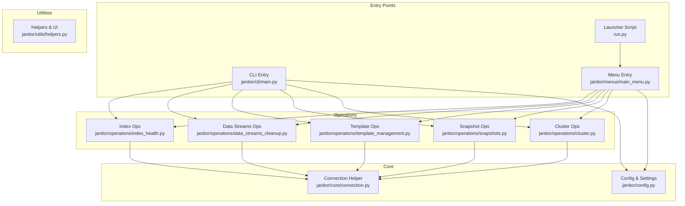
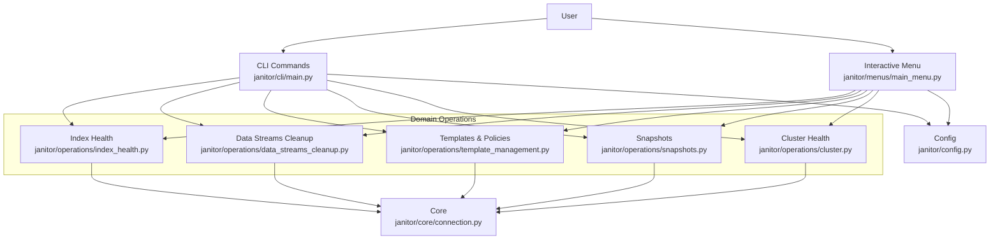
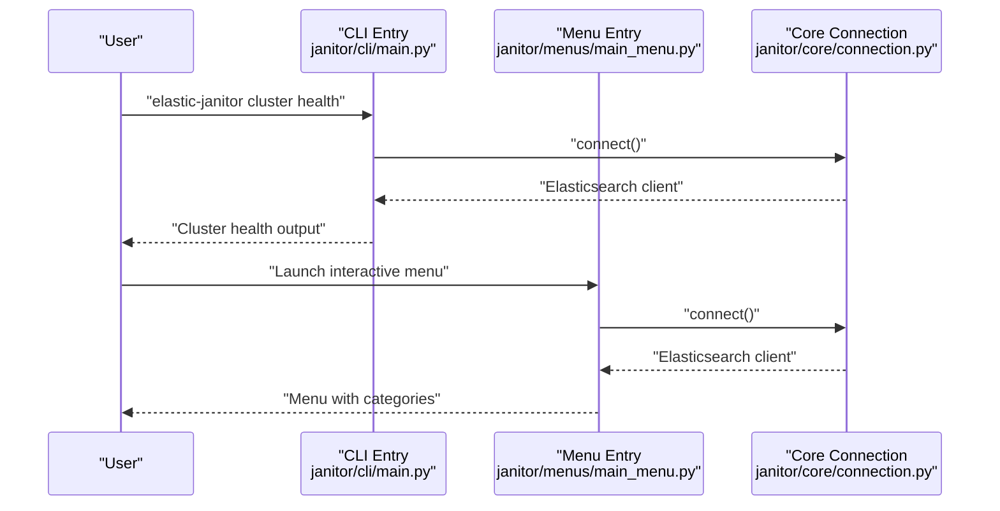
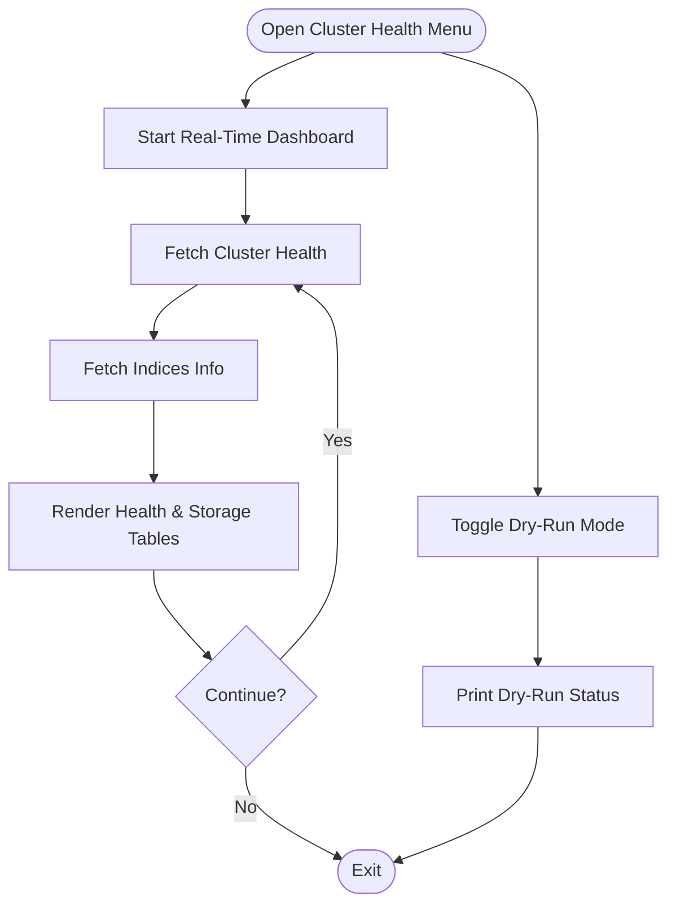
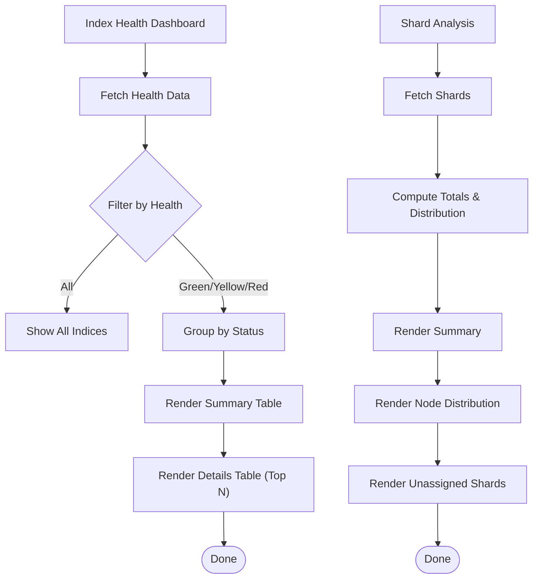
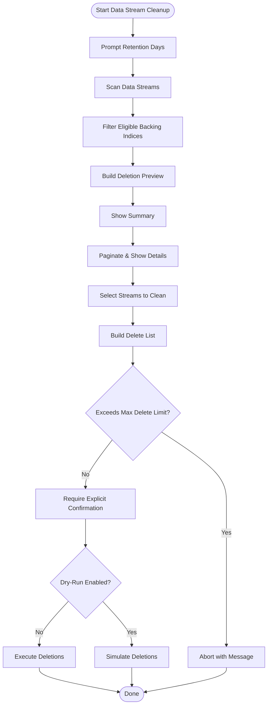
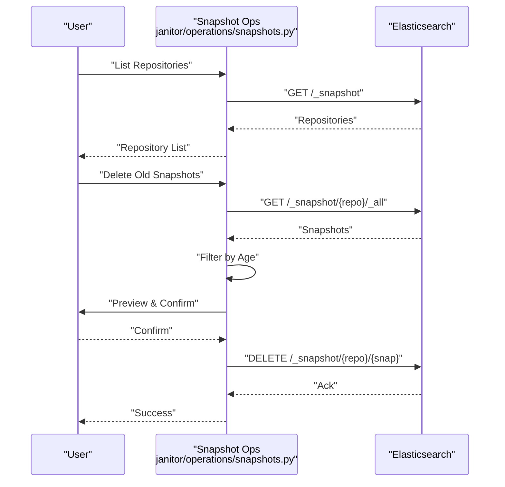
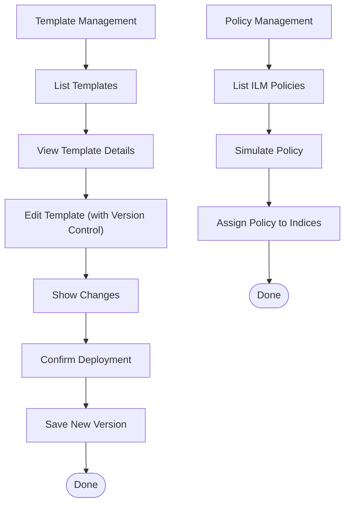
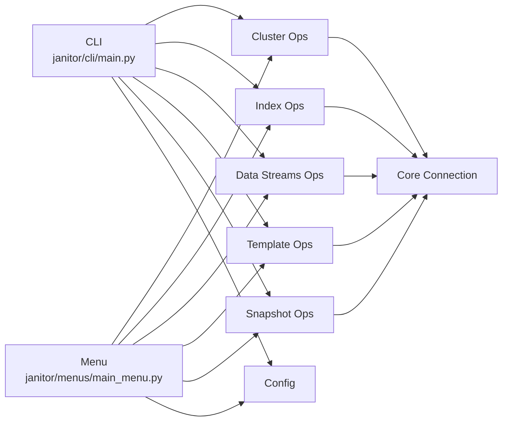

# Project Overview

<cite>
**Referenced Files in This Document**
- [README.md](file://README.md)
- [janitor/__init__.py](file://janitor/__init__.py)
- [janitor/cli/main.py](file://janitor/cli/main.py)
- [janitor/menus/main_menu.py](file://janitor/menus/main_menu.py)
- [janitor/config.py](file://janitor/config.py)
- [janitor/core/connection.py](file://janitor/core/connection.py)
- [janitor/operations/index_health.py](file://janitor/operations/index_health.py)
- [janitor/operations/data_streams_cleanup.py](file://janitor/operations/data_streams_cleanup.py)
- [janitor/operations/snapshots.py](file://janitor/operations/snapshots.py)
- [janitor/operations/cluster.py](file://janitor/operations/cluster.py)
- [janitor/operations/template_management.py](file://janitor/operations/template_management.py)
- [janitor/utils/helpers.py](file://janitor/utils/helpers.py)
- [run.py](file://run.py)
- [docs/CLI_COMMAND_INDEX.md](file://docs/CLI_COMMAND_INDEX.md)
- [docs/QUICK_START.md](file://docs/QUICK_START.md)
</cite>

## Table of Contents
1. [Introduction](#introduction)
2. [Project Structure](#project-structure)
3. [Core Components](#core-components)
4. [Architecture Overview](#architecture-overview)
5. [Detailed Component Analysis](#detailed-component-analysis)
6. [Dependency Analysis](#dependency-analysis)
7. [Performance Considerations](#performance-considerations)
8. [Troubleshooting Guide](#troubleshooting-guide)
9. [Conclusion](#conclusion)
10. [Appendices](#appendices)

## Introduction
Elastic Janitor is a comprehensive Elasticsearch cluster management tool designed to simplify everyday cluster administration. It centralizes operations across indices, data streams, templates, policies, snapshots, and cluster health into a unified interface. The project supports both a modern CLI and an interactive menu mode, enabling both automation and guided workflows.

Key value propositions:
- Unified management surface for indices, data streams, templates, policies, snapshots, and cluster health
- Dual-interface architecture for power users and administrators who prefer guided navigation
- Strong safety controls: dry-run mode, system index protection, explicit confirmations, and operation limits
- Practical automation for routine tasks like cluster health monitoring, index cleanup, and data stream management
- Rich terminal UX powered by modern libraries for readable dashboards and interactive prompts

Target audience:
- Site Reliability Engineers (SREs) and DevOps practitioners responsible for Elasticsearch cluster operations
- Platform teams managing multi-tenant or high-volume data environments
- Administrators seeking a consistent, safe way to perform bulk operations and governance tasks

Core benefits:
- Reduce risk with dry-run mode and safeguards before executing destructive actions
- Accelerate operations with batch and automation-friendly workflows
- Improve observability with real-time dashboards and health monitoring
- Simplify governance with template and policy management, including version control and rollback

Position in the Elasticsearch ecosystem:
- Elastic Janitor complements official Elasticsearch tooling by offering a streamlined, operator-focused interface for day-to-day maintenance and governance
- It integrates with the official Elasticsearch client and leverages official APIs for cluster interactions

## Project Structure
The project is organized around a modular architecture:
- Core connectivity and shared utilities
- CLI entrypoint and command groups
- Interactive menu system with categorized submenus
- Operations modules grouped by domain (indices, data streams, templates, snapshots, cluster health, etc.)
- Configuration and runtime settings

**Diagram sources**
- [janitor/cli/main.py](file://janitor/cli/main.py#L1-L57)
- [janitor/menus/main_menu.py](file://janitor/menus/main_menu.py#L1-L125)
- [janitor/config.py](file://janitor/config.py#L1-L78)
- [janitor/core/connection.py](file://janitor/core/connection.py#L1-L72)
- [janitor/operations/index_health.py](file://janitor/operations/index_health.py#L1-L188)
- [janitor/operations/data_streams_cleanup.py](file://janitor/operations/data_streams_cleanup.py#L1-L271)
- [janitor/operations/template_management.py](file://janitor/operations/template_management.py#L1-L821)
- [janitor/operations/snapshots.py](file://janitor/operations/snapshots.py#L1-L927)
- [janitor/operations/cluster.py](file://janitor/operations/cluster.py#L1-L242)
- [janitor/utils/helpers.py](file://janitor/utils/helpers.py#L1-L258)
- [run.py](file://run.py#L1-L10)

**Section sources**
- [README.md](file://README.md#L143-L184)
- [janitor/__init__.py](file://janitor/__init__.py#L1-L15)
- [janitor/cli/main.py](file://janitor/cli/main.py#L1-L57)
- [janitor/menus/main_menu.py](file://janitor/menus/main_menu.py#L1-L125)
- [janitor/config.py](file://janitor/config.py#L1-L78)
- [janitor/core/connection.py](file://janitor/core/connection.py#L1-L72)
- [janitor/utils/helpers.py](file://janitor/utils/helpers.py#L1-L258)
- [run.py](file://run.py#L1-L10)

## Core Components
- CLI group and commands: Provides a structured command-line interface with subcommands for cluster, index, datastream, dry-run, performance, governance, tuning, template, and policy operations.
- Interactive menu system: Hierarchical menu with categories covering index management, data streams, templates/policies, snapshots, cluster health, storage optimization, performance monitoring, bulk automation, and more.
- Core connection: Establishes a secure connection to the Elasticsearch cluster using configured credentials and validates connectivity.
- Configuration: Centralized settings for Elasticsearch endpoints, application behavior (e.g., dry-run, protection flags), timeouts, and UI styling.
- Utilities: Helpers for safe input, confirmations, pattern selection, and system resource detection.

Practical examples:
- Cluster health monitoring: Use the interactive menu or CLI to view cluster health, node information, and real-time dashboards.
- Index cleanup: Use the interactive menu or CLI to list largest indices, preview health, and safely delete eligible indices with dry-run mode enabled.
- Data stream management: Use the interactive menu or CLI to preview data streams, analyze lifecycle, and clean old backing indices with a safe preview and explicit confirmation.

**Section sources**
- [janitor/cli/main.py](file://janitor/cli/main.py#L8-L56)
- [janitor/menus/main_menu.py](file://janitor/menus/main_menu.py#L44-L125)
- [janitor/core/connection.py](file://janitor/core/connection.py#L11-L33)
- [janitor/config.py](file://janitor/config.py#L11-L78)
- [janitor/utils/helpers.py](file://janitor/utils/helpers.py#L9-L109)

## Architecture Overview
Elastic Janitor follows a layered architecture:
- Presentation layer: CLI and interactive menu provide user-facing interfaces
- Domain operations layer: Feature-specific modules encapsulate Elasticsearch interactions
- Core layer: Shared connection and utility functions
- Configuration layer: Centralized settings and UI preferences

**Diagram sources**
- [janitor/cli/main.py](file://janitor/cli/main.py#L1-L57)
- [janitor/menus/main_menu.py](file://janitor/menus/main_menu.py#L1-L125)
- [janitor/operations/index_health.py](file://janitor/operations/index_health.py#L1-L188)
- [janitor/operations/data_streams_cleanup.py](file://janitor/operations/data_streams_cleanup.py#L1-L271)
- [janitor/operations/template_management.py](file://janitor/operations/template_management.py#L1-L821)
- [janitor/operations/snapshots.py](file://janitor/operations/snapshots.py#L1-L927)
- [janitor/operations/cluster.py](file://janitor/operations/cluster.py#L1-L242)
- [janitor/core/connection.py](file://janitor/core/connection.py#L1-L72)
- [janitor/config.py](file://janitor/config.py#L1-L78)

## Detailed Component Analysis

### Dual-Interface Architecture
- CLI mode: Subcommand-driven interface for scripting and automation. Commands are registered under a central CLI group and mapped to feature modules.
- Interactive menu mode: Guided navigation through categorized submenus with breadcrumb navigation and consistent safety prompts.

**Diagram sources**
- [janitor/cli/main.py](file://janitor/cli/main.py#L8-L56)
- [janitor/menus/main_menu.py](file://janitor/menus/main_menu.py#L44-L85)
- [janitor/core/connection.py](file://janitor/core/connection.py#L11-L33)

**Section sources**
- [janitor/cli/main.py](file://janitor/cli/main.py#L8-L56)
- [janitor/menus/main_menu.py](file://janitor/menus/main_menu.py#L44-L125)
- [run.py](file://run.py#L1-L10)

### Cluster Health and Diagnostics
- Real-time dashboard: Live updating cluster health and storage by tier
- Health overview and node information: Structured tables for cluster status and node metrics
- Dry-run mode toggle: Global switch affecting all destructive operations

**Diagram sources**
- [janitor/operations/cluster.py](file://janitor/operations/cluster.py#L37-L119)
- [janitor/operations/cluster.py](file://janitor/operations/cluster.py#L127-L200)
- [janitor/operations/cluster.py](file://janitor/operations/cluster.py#L21-L33)

**Section sources**
- [janitor/operations/cluster.py](file://janitor/operations/cluster.py#L37-L119)
- [janitor/operations/cluster.py](file://janitor/operations/cluster.py#L127-L200)
- [janitor/operations/cluster.py](file://janitor/operations/cluster.py#L21-L33)

### Index Management and Health Monitoring
- Health dashboard: Filters by health status, shows counts and detailed tables
- Shard analysis: Summarizes shard distribution, node counts, and unassigned shards

**Diagram sources**
- [janitor/operations/index_health.py](file://janitor/operations/index_health.py#L13-L103)
- [janitor/operations/index_health.py](file://janitor/operations/index_health.py#L107-L188)

**Section sources**
- [janitor/operations/index_health.py](file://janitor/operations/index_health.py#L13-L103)
- [janitor/operations/index_health.py](file://janitor/operations/index_health.py#L107-L188)

### Data Streams Management
- Data stream cleanup: Calculates eligible backing indices based on retention, previews deletions, paginates results, enforces limits, and supports dry-run simulation
- Standalone index cleanup: Handles indices not part of a data stream

**Diagram sources**
- [janitor/operations/data_streams_cleanup.py](file://janitor/operations/data_streams_cleanup.py#L15-L271)

**Section sources**
- [janitor/operations/data_streams_cleanup.py](file://janitor/operations/data_streams_cleanup.py#L15-L271)

### Snapshot and Backup Management
- Repository listing and verification
- Snapshot listing, deletion, and size analysis
- SLM policy listing and deletion
- Automated snapshot cleanup with configurable retention policies
- Cross-repository copy guidance and restore wizard

**Diagram sources**
- [janitor/operations/snapshots.py](file://janitor/operations/snapshots.py#L15-L157)
- [janitor/operations/snapshots.py](file://janitor/operations/snapshots.py#L404-L550)

**Section sources**
- [janitor/operations/snapshots.py](file://janitor/operations/snapshots.py#L15-L157)
- [janitor/operations/snapshots.py](file://janitor/operations/snapshots.py#L404-L550)

### Template and Policy Management
- Index and component template listing, viewing, editing, importing, exporting, and rolling back with version control
- ILM policy operations: listing, viewing, assigning, simulating, and deleting
- Ingest pipeline management: listing, editing, cloning, and rollback

**Diagram sources**
- [janitor/operations/template_management.py](file://janitor/operations/template_management.py#L25-L125)
- [janitor/operations/template_management.py](file://janitor/operations/template_management.py#L222-L365)
- [janitor/operations/template_management.py](file://janitor/operations/template_management.py#L368-L446)

**Section sources**
- [janitor/operations/template_management.py](file://janitor/operations/template_management.py#L25-L125)
- [janitor/operations/template_management.py](file://janitor/operations/template_management.py#L222-L365)
- [janitor/operations/template_management.py](file://janitor/operations/template_management.py#L368-L446)

### Conceptual Overview for Beginners
- Elasticsearch fundamentals:
  - Indices: Logical containers for stored data, managed with settings, mappings, and aliases
  - Data streams: Append-only sequences of time-series data with write index and backing indices
  - Templates: Define index settings, mappings, and aliases; component templates compose reusable building blocks
  - Policies: Lifecycle and ingest policies govern index behavior and data movement
  - Snapshots: Point-in-time backups of indices or entire clusters
- How Elastic Janitor helps:
  - Provides guided workflows to inspect, manage, and optimize these building blocks
  - Offers safety-first defaults (dry-run, protections, confirmations) to reduce risk during routine operations
  - Delivers real-time dashboards and health views for continuous monitoring

[No sources needed since this section provides conceptual guidance]

## Dependency Analysis
- CLI depends on command modules for cluster, index, datastream, dry-run, performance, governance, tuning, template, and policy
- Menu depends on submenus and operations modules for each category
- All operations depend on core connection for Elasticsearch client instantiation and shared helpers for input and safety
- Configuration is injected into CLI, menu, and operations for consistent behavior

**Diagram sources**
- [janitor/cli/main.py](file://janitor/cli/main.py#L40-L51)
- [janitor/menus/main_menu.py](file://janitor/menus/main_menu.py#L13-L28)
- [janitor/core/connection.py](file://janitor/core/connection.py#L11-L33)
- [janitor/config.py](file://janitor/config.py#L11-L78)

**Section sources**
- [janitor/cli/main.py](file://janitor/cli/main.py#L40-L51)
- [janitor/menus/main_menu.py](file://janitor/menus/main_menu.py#L13-L28)
- [janitor/core/connection.py](file://janitor/core/connection.py#L11-L33)
- [janitor/config.py](file://janitor/config.py#L11-L78)

## Performance Considerations
- Use dry-run mode to preview operations before execution, especially for bulk deletions
- Leverage built-in limits (e.g., maximum delete thresholds) to avoid unintentional large-scale changes
- Prefer targeted index patterns and filters to minimize API overhead
- Utilize real-time dashboards for continuous monitoring and early intervention

[No sources needed since this section provides general guidance]

## Troubleshooting Guide
Common issues and resolutions:
- Import errors: Ensure running from repository root and using the module entry point
- Missing dependencies: Install requirements and activate virtual environment
- Connection errors: Verify Elasticsearch URL and API key; check network and cluster availability
- Permission errors: Confirm API key permissions and review system index protection settings

Safety features:
- Dry-run mode prevents destructive actions until explicitly disabled
- System index protection avoids accidental deletion of protected resources
- Explicit confirmations are required for all destructive operations
- Operation limits cap bulk deletions to prevent cascading effects

**Section sources**
- [docs/QUICK_START.md](file://docs/QUICK_START.md#L119-L151)
- [janitor/config.py](file://janitor/config.py#L18-L23)
- [janitor/utils/helpers.py](file://janitor/utils/helpers.py#L25-L29)

## Conclusion
Elastic Janitor delivers a practical, safe, and efficient way to manage Elasticsearch clusters. Its dual-interface design accommodates both scripted automation and guided administration, while robust safety features and real-time monitoring help operators maintain reliability and performance. By consolidating common tasks—cluster health, index cleanup, data stream management, template/policy governance, and snapshot operations—into a single tool, Elastic Janitor reduces cognitive load and operational risk for teams managing Elasticsearch at scale.

[No sources needed since this section summarizes without analyzing specific files]

## Appendices

### Practical Examples
- Cluster health monitoring: Use the interactive menu or CLI to view cluster health, node information, and real-time dashboards
- Index cleanup: Use the interactive menu or CLI to list largest indices, preview health, and safely delete eligible indices with dry-run mode enabled
- Data stream management: Use the interactive menu or CLI to preview data streams, analyze lifecycle, and clean old backing indices with a safe preview and explicit confirmation

**Section sources**
- [README.md](file://README.md#L83-L137)
- [docs/CLI_COMMAND_INDEX.md](file://docs/CLI_COMMAND_INDEX.md#L182-L222)