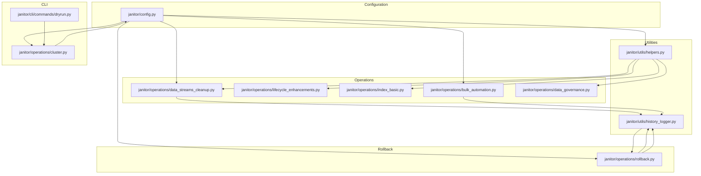
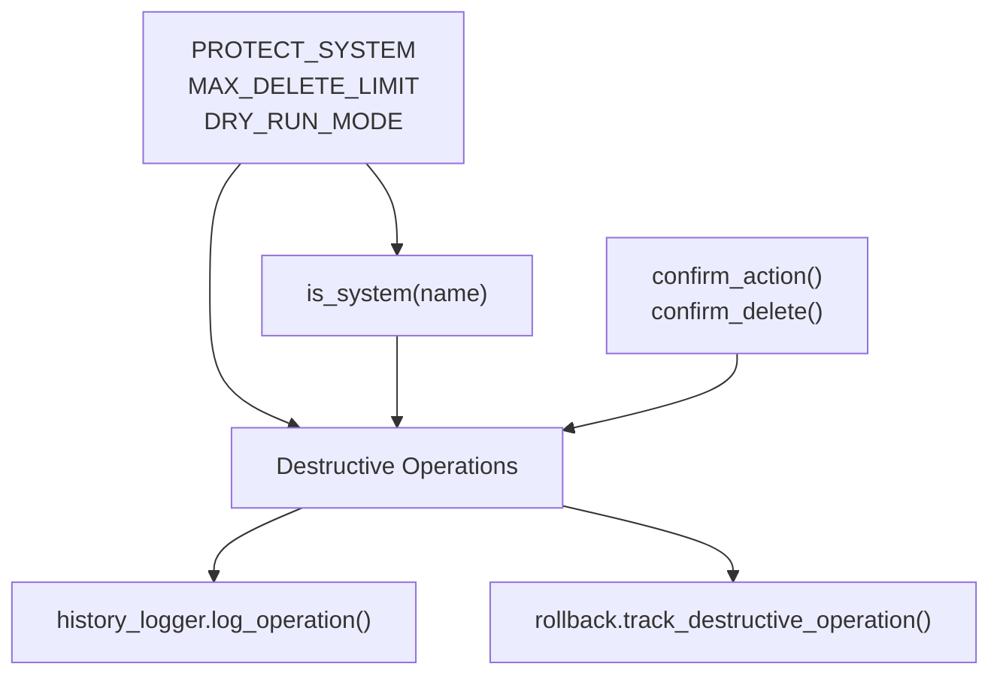
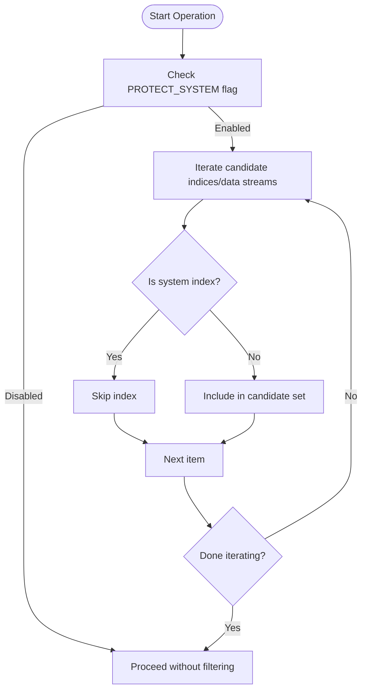
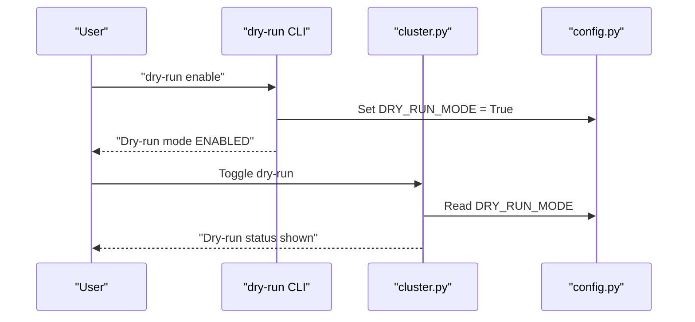
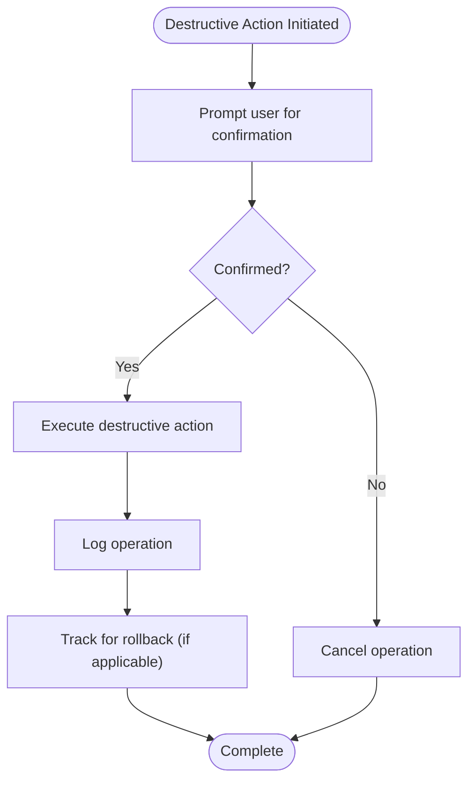
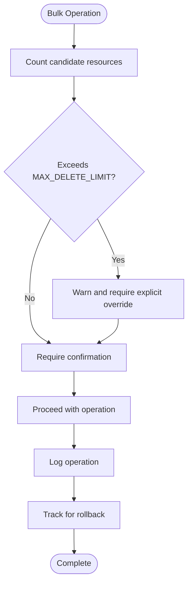
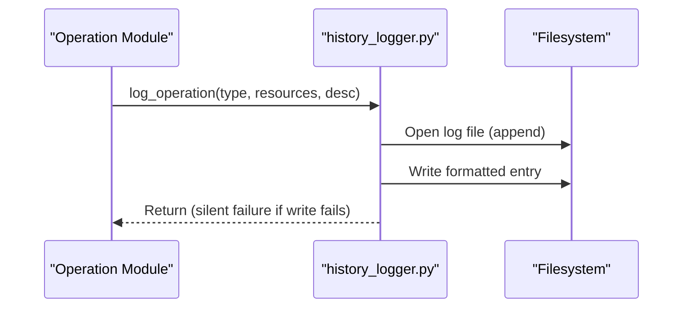
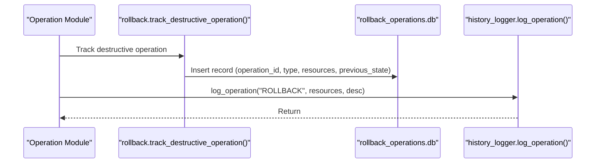
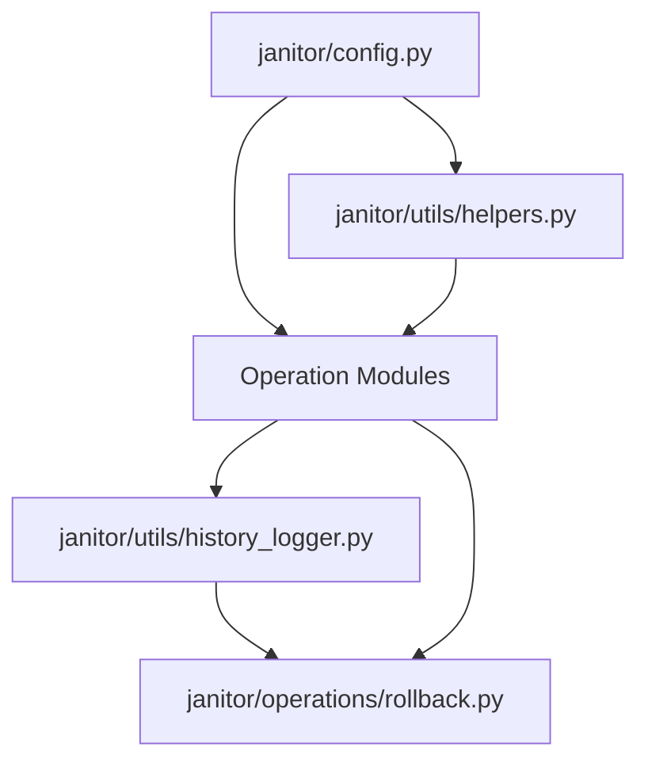

# Safety and Security

<cite>
**Referenced Files in This Document**
- [config.py](file://janitor/config.py)
- [helpers.py](file://janitor/utils/helpers.py)
- [dryrun.py](file://janitor/cli/commands/dryrun.py)
- [cluster.py](file://janitor/operations/cluster.py)
- [history_logger.py](file://janitor/utils/history_logger.py)
- [rollback.py](file://janitor/operations/rollback.py)
- [bulk_automation.py](file://janitor/operations/bulk_automation.py)
- [data_streams_cleanup.py](file://janitor/operations/data_streams_cleanup.py)
- [lifecycle_enhancements.py](file://janitor/operations/lifecycle_enhancements.py)
- [index_basic.py](file://janitor/operations/index_basic.py)
- [data_governance.py](file://janitor/operations/data_governance.py)
</cite>

## Table of Contents
1. [Introduction](#introduction)
2. [Project Structure](#project-structure)
3. [Core Components](#core-components)
4. [Architecture Overview](#architecture-overview)
5. [Detailed Component Analysis](#detailed-component-analysis)
6. [Dependency Analysis](#dependency-analysis)
7. [Performance Considerations](#performance-considerations)
8. [Troubleshooting Guide](#troubleshooting-guide)
9. [Conclusion](#conclusion)
10. [Appendices](#appendices)

## Introduction
This document explains the multi-layered safety and security architecture of Elastic Janitor. It focuses on protective mechanisms that prevent accidental or unsafe operations, including:
- Dry-run mode for safe testing and preview
- System index protection to avoid deletion of critical indices
- Confirmation prompts for all destructive operations
- Configurable operation limits to prevent accidental bulk deletions
- Operation history logging for auditability
- Practical examples and best practices for secure operation management

## Project Structure
The safety and security features are implemented across configuration, utilities, CLI commands, and operation modules:
- Centralized configuration defines global safety flags and limits
- Utility helpers enforce system index checks and confirmation prompts
- CLI commands manage dry-run mode globally
- Operation modules apply protections and confirmations during destructive actions
- Rollback and history utilities provide audit trails and recovery capability

**Diagram sources**
- [config.py](file://janitor/config.py#L18-L23)
- [helpers.py](file://janitor/utils/helpers.py#L6-L22)
- [dryrun.py](file://janitor/cli/commands/dryrun.py#L9-L86)
- [cluster.py](file://janitor/operations/cluster.py#L21-L33)
- [history_logger.py](file://janitor/utils/history_logger.py#L9-L36)
- [rollback.py](file://janitor/operations/rollback.py#L14-L21)
- [data_streams_cleanup.py](file://janitor/operations/data_streams_cleanup.py#L10-L11)
- [lifecycle_enhancements.py](file://janitor/operations/lifecycle_enhancements.py#L49-L58)
- [index_basic.py](file://janitor/operations/index_basic.py#L10)
- [bulk_automation.py](file://janitor/operations/bulk_automation.py#L164-L186)
- [data_governance.py](file://janitor/operations/data_governance.py#L786-L829)

**Section sources**
- [config.py](file://janitor/config.py#L18-L23)
- [helpers.py](file://janitor/utils/helpers.py#L6-L22)
- [dryrun.py](file://janitor/cli/commands/dryrun.py#L9-L86)
- [cluster.py](file://janitor/operations/cluster.py#L21-L33)
- [history_logger.py](file://janitor/utils/history_logger.py#L9-L36)
- [rollback.py](file://janitor/operations/rollback.py#L14-L21)
- [data_streams_cleanup.py](file://janitor/operations/data_streams_cleanup.py#L10-L11)
- [lifecycle_enhancements.py](file://janitor/operations/lifecycle_enhancements.py#L49-L58)
- [index_basic.py](file://janitor/operations/index_basic.py#L10)
- [bulk_automation.py](file://janitor/operations/bulk_automation.py#L164-L186)
- [data_governance.py](file://janitor/operations/data_governance.py#L786-L829)

## Core Components
- PROTECT_SYSTEM: When enabled, system indices (names starting with a dot) are excluded from destructive operations.
- DRY_RUN_MODE: When enabled, destructive operations are previewed without performing changes.
- MAX_DELETE_LIMIT: A configurable cap on the number of resources that can be processed in a single destructive action.
- Confirmation prompts: Enhanced dialogs and typed confirmation ensure explicit user intent for destructive actions.
- Operation history logging: All operations are logged locally for auditability.
- Rollback tracking: Destructive operations are tracked for potential rollback, with a local database of tracked operations.

**Section sources**
- [config.py](file://janitor/config.py#L18-L23)
- [helpers.py](file://janitor/utils/helpers.py#L18-L45)
- [history_logger.py](file://janitor/utils/history_logger.py#L9-L36)
- [rollback.py](file://janitor/operations/rollback.py#L75-L123)

## Architecture Overview
The safety architecture is enforced at three layers:
- Configuration layer: central flags and limits
- Utility layer: shared helpers for system checks and confirmations
- Operation layer: enforcement in destructive workflows and CLI commands

**Diagram sources**
- [config.py](file://janitor/config.py#L18-L23)
- [helpers.py](file://janitor/utils/helpers.py#L18-L45)
- [history_logger.py](file://janitor/utils/history_logger.py#L9-L36)
- [rollback.py](file://janitor/operations/rollback.py#L75-L123)

## Detailed Component Analysis

### System Index Protection (PROTECT_SYSTEM)
System indices are identified by names starting with a dot and are excluded from destructive operations when PROTECT_SYSTEM is enabled. This is enforced across multiple operation modules.

Key behaviors:
- Pattern-based detection of system indices
- Conditional exclusion in cleanup and lifecycle operations
- Safe fallbacks when system indices are encountered

**Diagram sources**
- [helpers.py](file://janitor/utils/helpers.py#L18-L22)
- [data_streams_cleanup.py](file://janitor/operations/data_streams_cleanup.py#L44-L45)
- [lifecycle_enhancements.py](file://janitor/operations/lifecycle_enhancements.py#L49-L58)
- [index_basic.py](file://janitor/operations/index_basic.py#L92)

**Section sources**
- [helpers.py](file://janitor/utils/helpers.py#L18-L22)
- [data_streams_cleanup.py](file://janitor/operations/data_streams_cleanup.py#L44-L45)
- [lifecycle_enhancements.py](file://janitor/operations/lifecycle_enhancements.py#L49-L58)
- [index_basic.py](file://janitor/operations/index_basic.py#L92)

### Dry-Run Mode (DRY_RUN_MODE)
Dry-run mode is a global switch that previews destructive operations without applying changes. It is managed via CLI commands and toggled in-cluster.

Implementation highlights:
- CLI commands to enable/disable/status dry-run mode
- In-cluster toggle command
- Consistent application across operations that log and track destructive actions

**Diagram sources**
- [dryrun.py](file://janitor/cli/commands/dryrun.py#L15-L53)
- [cluster.py](file://janitor/operations/cluster.py#L21-L33)
- [config.py](file://janitor/config.py#L23)

**Section sources**
- [dryrun.py](file://janitor/cli/commands/dryrun.py#L15-L53)
- [cluster.py](file://janitor/operations/cluster.py#L21-L33)
- [config.py](file://janitor/config.py#L23)

### Confirmation Prompts for Destructive Operations
All destructive operations require explicit confirmation. Two confirmation mechanisms are used:
- Typed confirmation for deletions
- Questionary-based confirmation dialogs for bulk actions

**Diagram sources**
- [helpers.py](file://janitor/utils/helpers.py#L25-L45)
- [bulk_automation.py](file://janitor/operations/bulk_automation.py#L184-L186)
- [history_logger.py](file://janitor/utils/history_logger.py#L9-L36)
- [rollback.py](file://janitor/operations/rollback.py#L75-L123)

**Section sources**
- [helpers.py](file://janitor/utils/helpers.py#L25-L45)
- [bulk_automation.py](file://janitor/operations/bulk_automation.py#L184-L186)
- [history_logger.py](file://janitor/utils/history_logger.py#L9-L36)
- [rollback.py](file://janitor/operations/rollback.py#L75-L123)

### Configurable Operation Limits (MAX_DELETE_LIMIT)
A configurable maximum number of items that can be processed in a single destructive operation helps prevent accidental bulk deletions. While the constant is defined centrally, enforcement varies by operation module. Administrators can adjust the limit by modifying the configuration.

Practical enforcement examples:
- Data streams cleanup calculates eligibility and presents totals before prompting confirmation
- Bulk automation enforces confirmation per batch and logs/rolls back operations

**Diagram sources**
- [config.py](file://janitor/config.py#L20)
- [data_streams_cleanup.py](file://janitor/operations/data_streams_cleanup.py#L76-L98)
- [bulk_automation.py](file://janitor/operations/bulk_automation.py#L164-L186)
- [history_logger.py](file://janitor/utils/history_logger.py#L9-L36)
- [rollback.py](file://janitor/operations/rollback.py#L75-L123)

**Section sources**
- [config.py](file://janitor/config.py#L20)
- [data_streams_cleanup.py](file://janitor/operations/data_streams_cleanup.py#L76-L98)
- [bulk_automation.py](file://janitor/operations/bulk_automation.py#L164-L186)
- [history_logger.py](file://janitor/utils/history_logger.py#L9-L36)
- [rollback.py](file://janitor/operations/rollback.py#L75-L123)

### Operation History Logging
All operations are logged to a local file for auditability. The logger appends entries with timestamps, operation type, description, and affected resources. Failures are handled silently to avoid interrupting operations.

**Diagram sources**
- [history_logger.py](file://janitor/utils/history_logger.py#L9-L36)

**Section sources**
- [history_logger.py](file://janitor/utils/history_logger.py#L9-L36)

### Rollback Tracking
Destructive operations are tracked in a local SQLite database for potential rollback. The tracker records operation type, timestamp, target resources, previous state, and whether rollback is available. Rollbacks can be initiated and marked complete, with audit logging.

**Diagram sources**
- [rollback.py](file://janitor/operations/rollback.py#L75-L123)
- [history_logger.py](file://janitor/utils/history_logger.py#L9-L36)

**Section sources**
- [rollback.py](file://janitor/operations/rollback.py#L75-L123)
- [history_logger.py](file://janitor/utils/history_logger.py#L9-L36)

### Real-World Scenarios
- Safe testing with dry-run mode:
  - Enable dry-run via CLI
  - Run a cleanup operation; the tool previews deletions without changing data
  - Disable dry-run to execute the operation after review
- Protecting system indices:
  - With PROTECT_SYSTEM enabled, indices starting with a dot are automatically skipped during cleanup
  - This prevents accidental deletion of internal indices
- Preventing bulk deletions:
  - When a cleanup would exceed the configured MAX_DELETE_LIMIT, the tool warns and requires explicit confirmation
- Audit trail:
  - Every destructive action is logged with timestamp and affected resources
  - Administrators can review recent operations and initiate rollbacks when needed

**Section sources**
- [dryrun.py](file://janitor/cli/commands/dryrun.py#L15-L53)
- [cluster.py](file://janitor/operations/cluster.py#L21-L33)
- [helpers.py](file://janitor/utils/helpers.py#L18-L22)
- [data_streams_cleanup.py](file://janitor/operations/data_streams_cleanup.py#L76-L98)
- [history_logger.py](file://janitor/utils/history_logger.py#L9-L36)
- [rollback.py](file://janitor/operations/rollback.py#L75-L123)

## Dependency Analysis
Safety features depend on shared configuration and utilities, ensuring consistent enforcement across modules.

**Diagram sources**
- [config.py](file://janitor/config.py#L18-L23)
- [helpers.py](file://janitor/utils/helpers.py#L6-L22)
- [history_logger.py](file://janitor/utils/history_logger.py#L9-L36)
- [rollback.py](file://janitor/operations/rollback.py#L14-L21)

**Section sources**
- [config.py](file://janitor/config.py#L18-L23)
- [helpers.py](file://janitor/utils/helpers.py#L6-L22)
- [history_logger.py](file://janitor/utils/history_logger.py#L9-L36)
- [rollback.py](file://janitor/operations/rollback.py#L14-L21)

## Performance Considerations
- Dry-run mode avoids heavy operations by previewing only, reducing load on the cluster
- Confirmation prompts and logging are lightweight and designed to minimize overhead
- Rollback tracking persists minimal metadata; ensure adequate disk space in the user’s home directory for the rollback database

[No sources needed since this section provides general guidance]

## Troubleshooting Guide
- Dry-run mode not taking effect:
  - Verify the global flag is set via CLI or in-cluster toggle
  - Confirm that operations are checking the DRY_RUN_MODE flag before executing destructive steps
- System indices still being targeted:
  - Ensure PROTECT_SYSTEM is enabled
  - Confirm that is_system() correctly identifies system indices by name prefix
- Excessive deletions despite MAX_DELETE_LIMIT:
  - Review the operation’s logic for counting candidates and confirm the warning prompt appears
  - Adjust the MAX_DELETE_LIMIT in configuration if appropriate
- History not recorded:
  - Check filesystem permissions for the log file location
  - Note that logging failures are handled silently to avoid interrupting operations
- Rollback not available:
  - Some operations may not capture previous state; the tracker marks rollback unavailable accordingly

**Section sources**
- [dryrun.py](file://janitor/cli/commands/dryrun.py#L15-L53)
- [cluster.py](file://janitor/operations/cluster.py#L21-L33)
- [helpers.py](file://janitor/utils/helpers.py#L18-L22)
- [config.py](file://janitor/config.py#L20)
- [history_logger.py](file://janitor/utils/history_logger.py#L9-L36)
- [rollback.py](file://janitor/operations/rollback.py#L108-L111)

## Conclusion
Elastic Janitor’s safety and security model combines centralized configuration, shared utilities, and operation-specific enforcement to minimize risk. The combination of system index protection, dry-run mode, confirmation prompts, configurable limits, and comprehensive logging provides strong safeguards for production environments. Administrators should enable PROTECT_SYSTEM by default, leverage dry-run for testing, and maintain strict operational controls around bulk actions.

[No sources needed since this section summarizes without analyzing specific files]

## Appendices

### Security Considerations for Credentials
- Environment variables and separate configuration files:
  - Store credentials in environment variables or dedicated configuration files outside the repository
  - Restrict file permissions to the minimum necessary
  - Avoid committing secrets to version control
  - Use role-based access and rotation policies for API keys and tokens

[No sources needed since this section provides general guidance]

### Best Practices for Secure Operation Management
- Always enable PROTECT_SYSTEM in production
- Use dry-run mode for all new procedures before enabling destructive execution
- Set conservative MAX_DELETE_LIMIT values and review totals before confirming
- Require explicit approvals for bulk operations
- Regularly review operation history logs and rollback records
- Limit who can toggle dry-run mode and execute destructive operations
- Monitor cluster health and storage tiers during cleanup operations

[No sources needed since this section provides general guidance]