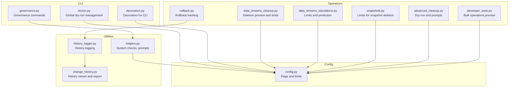
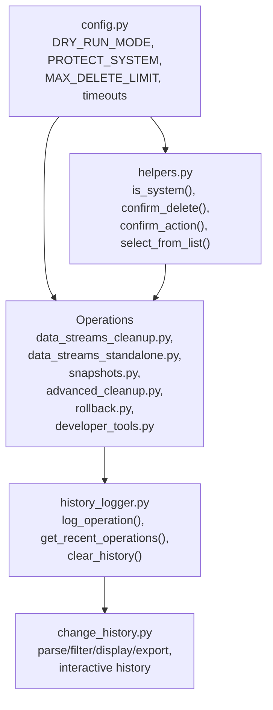
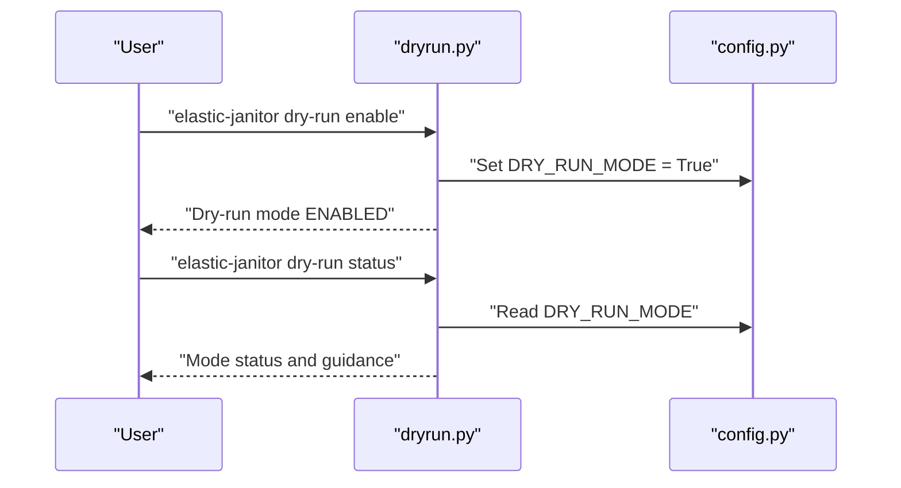
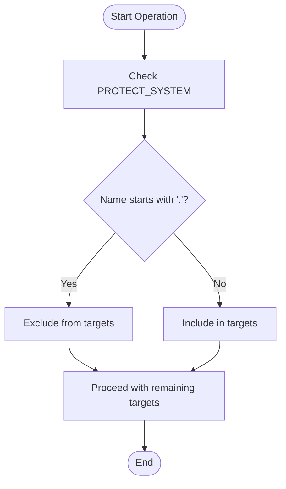
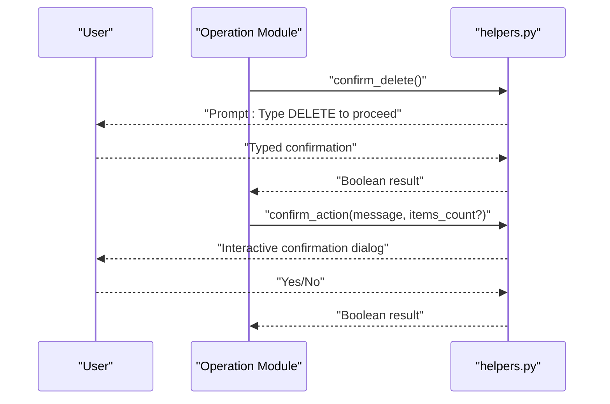
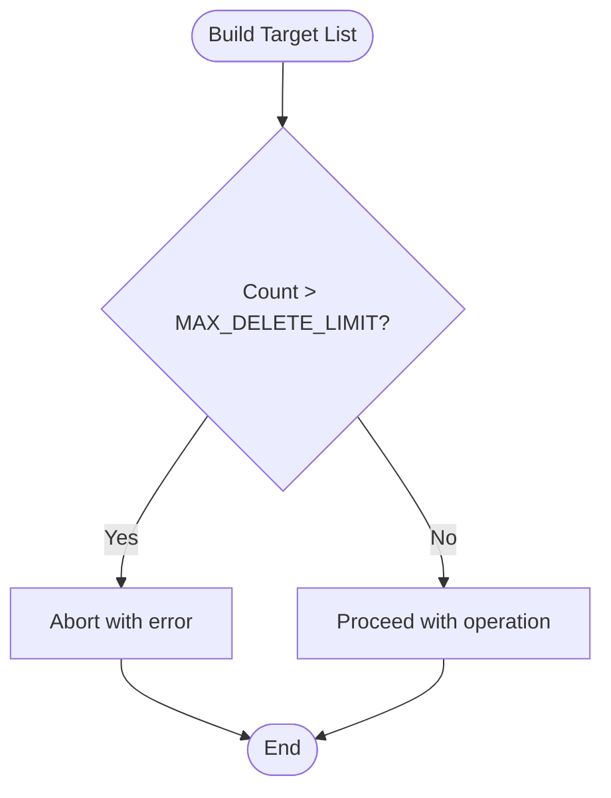
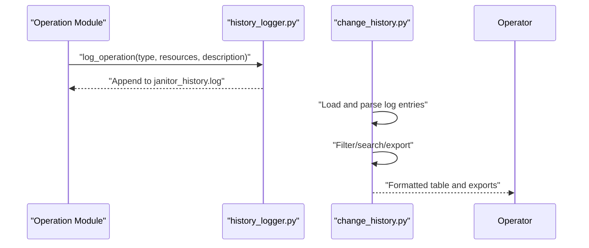
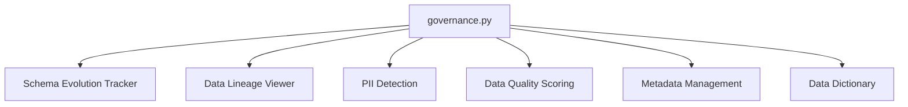
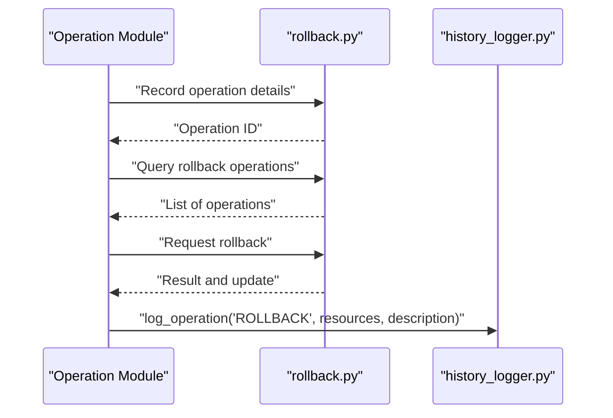
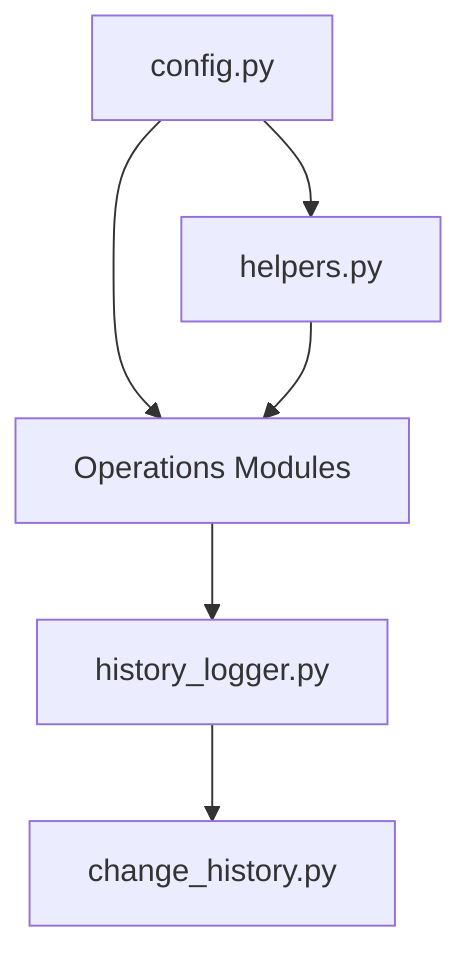

# Safety and Security Features

<cite>
**Referenced Files in This Document**
- [dryrun.py](file://janitor/cli/commands/dryrun.py)
- [config.py](file://janitor/config.py)
- [helpers.py](file://janitor/utils/helpers.py)
- [history_logger.py](file://janitor/utils/history_logger.py)
- [change_history.py](file://janitor/operations/change_history.py)
- [data_streams_cleanup.py](file://janitor/operations/data_streams_cleanup.py)
- [data_streams_standalone.py](file://janitor/operations/data_streams_standalone.py)
- [snapshots.py](file://janitor/operations/snapshots.py)
- [advanced_cleanup.py](file://janitor/operations/advanced_cleanup.py)
- [rollback.py](file://janitor/operations/rollback.py)
- [decorators.py](file://janitor/cli/utils/decorators.py)
- [governance.py](file://janitor/cli/commands/governance.py)
- [developer_tools.py](file://janitor/operations/developer_tools.py)
</cite>

## Table of Contents
1. [Introduction](#introduction)
2. [Project Structure](#project-structure)
3. [Core Components](#core-components)
4. [Architecture Overview](#architecture-overview)
5. [Detailed Component Analysis](#detailed-component-analysis)
6. [Dependency Analysis](#dependency-analysis)
7. [Performance Considerations](#performance-considerations)
8. [Troubleshooting Guide](#troubleshooting-guide)
9. [Conclusion](#conclusion)
10. [Appendices](#appendices)

## Introduction
This section documents the safety and security features built into Elastic Janitor. It focuses on protective mechanisms that prevent accidental or unsafe operations, including dry-run mode, system index protection, confirmation prompts, operation limits, audit logging, and governance capabilities. Guidance is provided for secure operation, risk mitigation, and compliance considerations.

## Project Structure
The safety and security features span CLI commands, configuration, utilities, and operation modules:
- CLI commands expose dry-run management and governance features.
- Configuration centralizes safety-related flags and limits.
- Utilities provide system checks, confirmation prompts, and history logging.
- Operations modules implement safeguards during destructive actions.

**Diagram sources**
- [dryrun.py](file://janitor/cli/commands/dryrun.py#L9-L87)
- [governance.py](file://janitor/cli/commands/governance.py#L17-L153)
- [decorators.py](file://janitor/cli/utils/decorators.py#L13-L89)
- [config.py](file://janitor/config.py#L11-L78)
- [helpers.py](file://janitor/utils/helpers.py#L9-L109)
- [history_logger.py](file://janitor/utils/history_logger.py#L9-L73)
- [change_history.py](file://janitor/operations/change_history.py#L190-L379)
- [data_streams_cleanup.py](file://janitor/operations/data_streams_cleanup.py#L15-L200)
- [data_streams_standalone.py](file://janitor/operations/data_streams_standalone.py#L75-L136)
- [snapshots.py](file://janitor/operations/snapshots.py#L84-L122)
- [advanced_cleanup.py](file://janitor/operations/advanced_cleanup.py#L21-L150)
- [rollback.py](file://janitor/operations/rollback.py#L103-L156)
- [developer_tools.py](file://janitor/operations/developer_tools.py#L1122-L1205)

**Section sources**
- [dryrun.py](file://janitor/cli/commands/dryrun.py#L9-L87)
- [config.py](file://janitor/config.py#L11-L78)
- [helpers.py](file://janitor/utils/helpers.py#L9-L109)
- [history_logger.py](file://janitor/utils/history_logger.py#L9-L73)
- [change_history.py](file://janitor/operations/change_history.py#L190-L379)
- [data_streams_cleanup.py](file://janitor/operations/data_streams_cleanup.py#L15-L200)
- [data_streams_standalone.py](file://janitor/operations/data_streams_standalone.py#L75-L136)
- [snapshots.py](file://janitor/operations/snapshots.py#L84-L122)
- [advanced_cleanup.py](file://janitor/operations/advanced_cleanup.py#L21-L150)
- [rollback.py](file://janitor/operations/rollback.py#L103-L156)
- [decorators.py](file://janitor/cli/utils/decorators.py#L13-L89)
- [governance.py](file://janitor/cli/commands/governance.py#L17-L153)
- [developer_tools.py](file://janitor/operations/developer_tools.py#L1122-L1205)

## Core Components
- Global dry-run mode: A runtime toggle that prevents destructive actions while still previewing changes.
- System index protection: Automatic exclusion of system resources from destructive operations.
- Confirmation prompts: Interactive user confirmations for high-risk operations.
- Operation limits: Guards against bulk deletions exceeding configurable thresholds.
- Audit logging and change tracking: Persistent logs of operations with filtering and export.
- Governance features: Schema evolution tracking, data lineage, PII detection, and metadata management.
- Rollback tracking: Records of operations eligible for rollback and their outcomes.

**Section sources**
- [dryrun.py](file://janitor/cli/commands/dryrun.py#L15-L87)
- [config.py](file://janitor/config.py#L18-L23)
- [helpers.py](file://janitor/utils/helpers.py#L18-L46)
- [snapshots.py](file://janitor/operations/snapshots.py#L120-L122)
- [data_streams_standalone.py](file://janitor/operations/data_streams_standalone.py#L132-L136)
- [history_logger.py](file://janitor/utils/history_logger.py#L9-L36)
- [change_history.py](file://janitor/operations/change_history.py#L190-L379)
- [governance.py](file://janitor/cli/commands/governance.py#L23-L153)
- [rollback.py](file://janitor/operations/rollback.py#L103-L156)

## Architecture Overview
The safety architecture integrates configuration flags, utility functions, and operation modules to enforce protective mechanisms consistently across the application.

**Diagram sources**
- [config.py](file://janitor/config.py#L18-L23)
- [helpers.py](file://janitor/utils/helpers.py#L18-L46)
- [history_logger.py](file://janitor/utils/history_logger.py#L9-L36)
- [change_history.py](file://janitor/operations/change_history.py#L190-L379)
- [data_streams_cleanup.py](file://janitor/operations/data_streams_cleanup.py#L15-L200)
- [data_streams_standalone.py](file://janitor/operations/data_streams_standalone.py#L75-L136)
- [snapshots.py](file://janitor/operations/snapshots.py#L84-L122)
- [advanced_cleanup.py](file://janitor/operations/advanced_cleanup.py#L21-L150)
- [rollback.py](file://janitor/operations/rollback.py#L103-L156)
- [developer_tools.py](file://janitor/operations/developer_tools.py#L1122-L1205)

## Detailed Component Analysis

### Dry-Run Mode
Dry-run mode is a global toggle that allows operators to preview destructive actions without applying them. It is managed via CLI commands and controlled by a configuration flag.

Key behaviors:
- Enabling dry-run sets the global flag and informs the operator that destructive actions will be previewed but not executed.
- Disabling dry-run restores normal execution of destructive operations.
- Status reporting shows current mode and guidance to toggle the mode.

**Diagram sources**
- [dryrun.py](file://janitor/cli/commands/dryrun.py#L15-L87)
- [config.py](file://janitor/config.py#L22-L23)

**Section sources**
- [dryrun.py](file://janitor/cli/commands/dryrun.py#L15-L87)
- [config.py](file://janitor/config.py#L22-L23)

### System Index Protection
System resources are automatically protected from destructive operations. The protection mechanism checks resource names and conditionally excludes them based on configuration.

Key behaviors:
- System detection identifies protected resources by naming convention.
- Operations filter out system resources when building targets for deletion or modification.
- Protection can be toggled globally via configuration.

**Diagram sources**
- [helpers.py](file://janitor/utils/helpers.py#L18-L23)
- [data_streams_cleanup.py](file://janitor/operations/data_streams_cleanup.py#L44-L45)

**Section sources**
- [helpers.py](file://janitor/utils/helpers.py#L18-L23)
- [data_streams_cleanup.py](file://janitor/operations/data_streams_cleanup.py#L44-L45)

### Confirmation Prompt Systems
Multiple confirmation mechanisms prevent accidental execution of risky operations:
- Typed confirmation for deletions requires the operator to type a specific keyword.
- Interactive confirmations use a questionary-based dialog with custom styling.
- Selection dialogs support multi-select and fuzzy search for safer targeting.

**Diagram sources**
- [helpers.py](file://janitor/utils/helpers.py#L25-L46)

**Section sources**
- [helpers.py](file://janitor/utils/helpers.py#L25-L46)

### Operation Limits and Bulk Deletion Safeguards
To prevent runaway bulk deletions, the system enforces explicit limits on the number of items processed in a single run across multiple operation types.

- Snapshot deletion: Enforced limit prevents deletion of more than a configured maximum in one invocation.
- Standalone indices: Enforced limit prevents deletion of more than a configured maximum in one invocation.
- Data streams: Enforced limit prevents deletion of more than a configured maximum in one invocation.

**Diagram sources**
- [snapshots.py](file://janitor/operations/snapshots.py#L120-L122)
- [data_streams_standalone.py](file://janitor/operations/data_streams_standalone.py#L132-L136)
- [data_streams_cleanup.py](file://janitor/operations/data_streams_cleanup.py#L165-L169)

**Section sources**
- [snapshots.py](file://janitor/operations/snapshots.py#L120-L122)
- [data_streams_standalone.py](file://janitor/operations/data_streams_standalone.py#L132-L136)
- [data_streams_cleanup.py](file://janitor/operations/data_streams_cleanup.py#L165-L169)

### Audit Logging and Change Tracking
All operations are logged to a persistent history file, enabling post-operation review and compliance tracking. Operators can filter, search, and export historical records.

Key capabilities:
- Logging: Timestamped entries with operation type, description, and affected resources.
- Viewing: Interactive history viewer with filtering by operation type, date range, resource type, and success status.
- Export: Export to JSON or CSV for external auditing and reporting.

**Diagram sources**
- [history_logger.py](file://janitor/utils/history_logger.py#L9-L36)
- [change_history.py](file://janitor/operations/change_history.py#L190-L379)

**Section sources**
- [history_logger.py](file://janitor/utils/history_logger.py#L9-L36)
- [change_history.py](file://janitor/operations/change_history.py#L190-L379)

### Governance Features
Governance commands provide visibility and control over data assets, supporting compliance and risk management:
- Schema evolution tracking: Monitor mapping changes across indices over time.
- Data lineage: Visualize data flow through ingest pipelines and transforms.
- PII detection: Scan documents for sensitive patterns.
- Quality scoring: Score indices based on completeness and consistency.
- Metadata management: Maintain ownership, purpose, and sensitivity metadata.
- Data dictionary: Maintain field documentation and data dictionary.

**Diagram sources**
- [governance.py](file://janitor/cli/commands/governance.py#L23-L153)

**Section sources**
- [governance.py](file://janitor/cli/commands/governance.py#L23-L153)

### Rollback Tracking
Rollback tracking maintains a database of operations with details sufficient to support recovery. It records whether rollback is available and marks operations as rolled back after successful restoration.

Key behaviors:
- Recording: Insertion of operation details into a rollback database.
- Querying: Retrieve recent operations with optional filters.
- Execution: Confirm rollback intent and perform restoration, logging the action.

**Diagram sources**
- [rollback.py](file://janitor/operations/rollback.py#L103-L156)
- [history_logger.py](file://janitor/utils/history_logger.py#L9-L36)

**Section sources**
- [rollback.py](file://janitor/operations/rollback.py#L103-L156)
- [history_logger.py](file://janitor/utils/history_logger.py#L9-L36)

### Best Practices for Secure Operation
- Always enable dry-run mode before executing destructive operations to preview changes.
- Use system index protection and review deletion previews to avoid unintended targets.
- Apply operation limits to prevent bulk deletions beyond acceptable thresholds.
- Require typed confirmations for deletions and use interactive selection for safer targeting.
- Maintain audit logs and regularly review operation history for anomalies.
- Leverage governance features to monitor schema changes, data lineage, and sensitive data.
- Use rollback tracking to recover from unintended changes when applicable.

**Section sources**
- [dryrun.py](file://janitor/cli/commands/dryrun.py#L15-L87)
- [helpers.py](file://janitor/utils/helpers.py#L25-L46)
- [snapshots.py](file://janitor/operations/snapshots.py#L120-L122)
- [data_streams_standalone.py](file://janitor/operations/data_streams_standalone.py#L132-L136)
- [data_streams_cleanup.py](file://janitor/operations/data_streams_cleanup.py#L165-L169)
- [change_history.py](file://janitor/operations/change_history.py#L190-L379)
- [governance.py](file://janitor/cli/commands/governance.py#L23-L153)
- [rollback.py](file://janitor/operations/rollback.py#L103-L156)

## Dependency Analysis
Safety and security features depend on shared configuration and utilities. The following diagram highlights key dependencies among modules implementing protective mechanisms.

**Diagram sources**
- [config.py](file://janitor/config.py#L18-L23)
- [helpers.py](file://janitor/utils/helpers.py#L18-L46)
- [history_logger.py](file://janitor/utils/history_logger.py#L9-L36)
- [change_history.py](file://janitor/operations/change_history.py#L190-L379)

**Section sources**
- [config.py](file://janitor/config.py#L18-L23)
- [helpers.py](file://janitor/utils/helpers.py#L18-L46)
- [history_logger.py](file://janitor/utils/history_logger.py#L9-L36)
- [change_history.py](file://janitor/operations/change_history.py#L190-L379)

## Performance Considerations
- Dry-run mode avoids heavy operations by previewing changes, reducing load on the cluster.
- Interactive confirmations and previews provide immediate feedback, minimizing repeated retries.
- Operation limits reduce the risk of long-running bulk operations overwhelming the system.
- History logging is append-only and designed to minimize overhead; failures are handled silently to avoid interrupting operations.

[No sources needed since this section provides general guidance]

## Troubleshooting Guide
- Dry-run mode not taking effect: Verify the global flag is set and that operations respect the flag.
- Unexpectedly excluded targets: Confirm system protection is enabled and resource names match the protection criteria.
- Exceeded operation limits: Reduce the scope of the operation or adjust limits thoughtfully.
- History not recorded: Check file permissions for the history log and ensure logging is invoked by operations.
- Governance reports missing data: Validate that the underlying operations are permitted and that the cluster is reachable.

**Section sources**
- [dryrun.py](file://janitor/cli/commands/dryrun.py#L15-L87)
- [helpers.py](file://janitor/utils/helpers.py#L18-L23)
- [snapshots.py](file://janitor/operations/snapshots.py#L120-L122)
- [data_streams_standalone.py](file://janitor/operations/data_streams_standalone.py#L132-L136)
- [history_logger.py](file://janitor/utils/history_logger.py#L9-L36)

## Conclusion
Elastic Janitor incorporates robust safety and security mechanisms across its CLI, configuration, utilities, and operations. These include a global dry-run mode, system index protection, confirmation prompts, operation limits, comprehensive audit logging, governance features, and rollback tracking. Together, these features enable secure, auditable, and reversible operations tailored for production environments.

[No sources needed since this section summarizes without analyzing specific files]

## Appendices

### Compliance and Risk Mitigation Checklist
- Enable dry-run mode for all pre-production validations.
- Review deletion previews and confirmations before executing destructive actions.
- Apply operation limits to prevent bulk deletions beyond policy thresholds.
- Maintain and review operation history for compliance audits.
- Use governance features to track schema evolution, data lineage, and sensitive data.
- Implement rollback procedures for critical changes.

[No sources needed since this section provides general guidance]