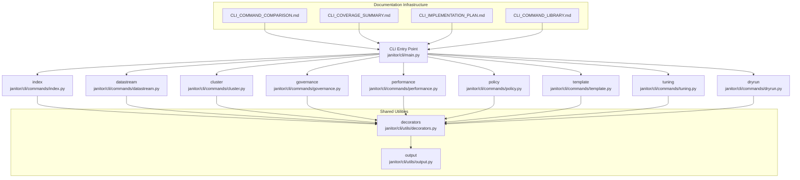
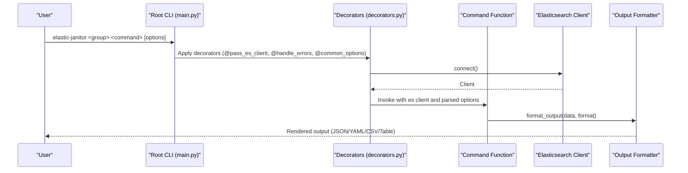
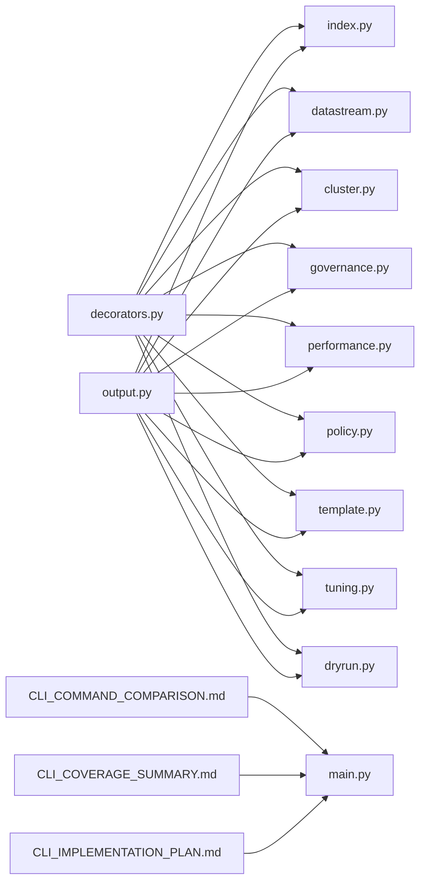

# CLI Command Reference

<cite>
**Referenced Files in This Document**
- [janitor/cli/main.py](file://janitor/cli/main.py)
- [janitor/cli/commands/__init__.py](file://janitor/cli/commands/__init__.py)
- [janitor/cli/commands/index.py](file://janitor/cli/commands/index.py)
- [janitor/cli/commands/datastream.py](file://janitor/cli/commands/datastream.py)
- [janitor/cli/commands/cluster.py](file://janitor/cli/commands/cluster.py)
- [janitor/cli/commands/governance.py](file://janitor/cli/commands/governance.py)
- [janitor/cli/commands/performance.py](file://janitor/cli/commands/performance.py)
- [janitor/cli/commands/policy.py](file://janitor/cli/commands/policy.py)
- [janitor/cli/commands/template.py](file://janitor/cli/commands/template.py)
- [janitor/cli/commands/tuning.py](file://janitor/cli/commands/tuning.py)
- [janitor/cli/commands/dryrun.py](file://janitor/cli/commands/dryrun.py)
- [janitor/cli/utils/decorators.py](file://janitor/cli/utils/decorators.py)
- [janitor/cli/utils/output.py](file://janitor/cli/utils/output.py)
- [docs/CLI_COMMAND_INDEX.md](file://docs/CLI_COMMAND_INDEX.md)
- [docs/MIGRATION.md](file://docs/MIGRATION.md)
- [docs/CLI_COMMAND_COMPARISON.md](file://docs/CLI_COMMAND_COMPARISON.md)
- [docs/CLI_COVERAGE_SUMMARY.md](file://docs/CLI_COVERAGE_SUMMARY.md)
- [docs/CLI_IMPLEMENTATION_PLAN.md](file://docs/CLI_IMPLEMENTATION_PLAN.md)
- [docs/CLI_QUICK_REFERENCE.md](file://docs/CLI_QUICK_REFERENCE.md)
- [docs/CLI_USAGE.md](file://docs/CLI_USAGE.md)
- [docs/CLI_COMMAND_LIBRARY.md](file://docs/CLI_COMMAND_LIBRARY.md)
</cite>

## Update Summary
**Changes Made**
- Updated documentation to reflect comprehensive CLI documentation infrastructure including CLI_COMMAND_COMPARISON.md, CLI_COVERAGE_SUMMARY.md, CLI_IMPLEMENTATION_PLAN.md, and CLI_COVERAGE_AUDIT.md
- Enhanced template and policy command groups documentation with advanced analysis capabilities for template validation and performance impact analysis
- Added detailed coverage analysis showing current implementation status (28/113 commands, 24.8% coverage)
- Updated command library with expanded template and policy management capabilities
- Added implementation roadmap for future command expansion

## Table of Contents
1. [Introduction](#introduction)
2. [Project Structure](#project-structure)
3. [Core Components](#core-components)
4. [Architecture Overview](#architecture-overview)
5. [Detailed Component Analysis](#detailed-component-analysis)
6. [Implementation Coverage and Roadmap](#implementation-coverage-and-roadmap)
7. [Dependency Analysis](#dependency-analysis)
8. [Performance Considerations](#performance-considerations)
9. [Troubleshooting Guide](#troubleshooting-guide)
10. [Conclusion](#conclusion)
11. [Appendices](#appendices)

## Introduction
This document provides a comprehensive CLI command reference for the Click-based command-line interface of the Elastic Janitor tool. The CLI has evolved to include comprehensive documentation infrastructure and advanced command groups for template and policy management. Currently covering 28 out of 113 planned commands (24.8% coverage), the system provides nine command groups: index, datastream, cluster, governance, performance, policy, template, tuning, and dryrun. For each group, you will find command syntax, parameter options, flags, output formats, and result interpretation. Practical examples demonstrate common workflows and automation scenarios, including command chaining, batch operations, and scripting. Guidance is included for migrating from menu-based operations to CLI usage, along with error handling, verbose output, and troubleshooting.

## Project Structure
The CLI is organized around a central entry point that registers nine command groups. Each group is implemented as a separate module under janitor/cli/commands/. Shared utilities provide common options, error handling, and output formatting. The documentation infrastructure includes comprehensive coverage tracking, implementation plans, and detailed command libraries.

**Diagram sources**
- [janitor/cli/main.py](file://janitor/cli/main.py#L8-L51)
- [janitor/cli/commands/index.py](file://janitor/cli/commands/index.py#L11-L14)
- [janitor/cli/commands/datastream.py](file://janitor/cli/commands/datastream.py#L14-L17)
- [janitor/cli/commands/cluster.py](file://janitor/cli/commands/cluster.py#L10-L13)
- [janitor/cli/commands/governance.py](file://janitor/cli/commands/governance.py#L17-L20)
- [janitor/cli/commands/performance.py](file://janitor/cli/commands/performance.py#L10-L13)
- [janitor/cli/commands/policy.py](file://janitor/cli/commands/policy.py#L13-L16)
- [janitor/cli/commands/template.py](file://janitor/cli/commands/template.py#L13-L16)
- [janitor/cli/commands/tuning.py](file://janitor/cli/commands/tuning.py#L17-L20)
- [janitor/cli/commands/dryrun.py](file://janitor/cli/commands/dryrun.py#L9-L12)
- [janitor/cli/utils/decorators.py](file://janitor/cli/utils/decorators.py#L13-L88)
- [janitor/cli/utils/output.py](file://janitor/cli/utils/output.py#L14-L153)
- [docs/CLI_COMMAND_COMPARISON.md](file://docs/CLI_COMMAND_COMPARISON.md#L1-L191)
- [docs/CLI_COVERAGE_SUMMARY.md](file://docs/CLI_COVERAGE_SUMMARY.md#L1-L174)
- [docs/CLI_IMPLEMENTATION_PLAN.md](file://docs/CLI_IMPLEMENTATION_PLAN.md#L1-L316)
- [docs/CLI_COMMAND_LIBRARY.md](file://docs/CLI_COMMAND_LIBRARY.md#L1-L800)

**Section sources**
- [janitor/cli/main.py](file://janitor/cli/main.py#L8-L51)
- [janitor/cli/commands/__init__.py](file://janitor/cli/commands/__init__.py#L1-L5)

## Core Components
- Central CLI entry point registers nine command groups and exposes version/help options.
- Shared decorators provide common options (verbose, quiet, output format), dry-run flag, and error handling.
- Shared output utilities support JSON, YAML, CSV, and table formats with Rich rendering.
- Comprehensive documentation infrastructure tracks coverage, implementation status, and future roadmap.

Key shared elements:
- Version and help options at the CLI root.
- Common options decorator adds --verbose, --quiet, and --output.
- Dry-run decorator adds --dry-run/-d.
- Error handling decorator catches exceptions, supports verbose stack traces, and exits with appropriate codes.
- Output formatter supports structured and tabular output.

**Section sources**
- [janitor/cli/main.py](file://janitor/cli/main.py#L8-L36)
- [janitor/cli/utils/decorators.py](file://janitor/cli/utils/decorators.py#L13-L88)
- [janitor/cli/utils/output.py](file://janitor/cli/utils/output.py#L14-L153)

## Architecture Overview
The CLI follows a modular architecture with comprehensive documentation support:
- A Click group defines the root CLI with version/help.
- Nine subgroups register commands for index, datastream, cluster, governance, performance, policy, template, tuning, and dryrun.
- Each command uses shared decorators for connection, error handling, and output formatting.
- Output formatting is centralized to ensure consistent JSON/YAML/CSV/table rendering.
- Documentation infrastructure tracks implementation progress and future development plans.

**Diagram sources**
- [janitor/cli/main.py](file://janitor/cli/main.py#L8-L51)
- [janitor/cli/utils/decorators.py](file://janitor/cli/utils/decorators.py#L13-L88)
- [janitor/cli/utils/output.py](file://janitor/cli/utils/output.py#L22-L153)

## Detailed Component Analysis

### Index Commands
Purpose: Index management and insights.

Commands:
- index largest
  - Options: --top/-n (default 25), --pattern/-p (default "*"), plus common options.
  - Output: table (default), json, yaml, csv.
  - Behavior: Fetches indices, filters by pattern, sorts by size, and prints top N with optional verbose fields.
- index health
  - Options: --pattern/-p (default "*"), --status/-s (repeatable, filters by health status), plus common options.
  - Output: table (default), json, yaml, csv.
  - Behavior: Uses cat.indices to get health and status, filters by status if provided, and optionally prints counts by health.
- index analyze-patterns
  - Options: --days/-d (default 7), --pattern/-p (default "*"), plus common options.
  - Output: table (default), json.
  - Behavior: Analyzes index patterns and query workload to recommend optimal partitioning and routing strategies.

Example usages:
- elastic-janitor index largest --top 50 --pattern "logs-*" --output json
- elastic-janitor index health --status yellow --status red
- elastic-janitor index analyze-patterns --days 30 --pattern "metrics-*" --output yaml

**Section sources**
- [janitor/cli/commands/index.py](file://janitor/cli/commands/index.py#L17-L103)
- [janitor/cli/commands/index.py](file://janitor/cli/commands/index.py#L105-L181)
- [janitor/cli/commands/index.py](file://janitor/cli/commands/index.py#L183-L318)

### Data Stream Commands
Purpose: Data stream lifecycle and cleanup.

Commands:
- datastream clean
  - Options: --retention/-r (required, e.g., 90d, 6M, 1y), --pattern/-p (default "*"), --batch-size/-b (default 100), plus dry-run and common options.
  - Output: table (default), json, yaml.
  - Behavior: Parses retention to a cutoff date, enumerates data streams, identifies eligible backing indices (excluding write index), aggregates totals, and optionally deletes in batches respecting a maximum deletion limit.
- datastream migrate
  - Options: --source/-s (required), --dest/-d (required), --mode/-m (choices: cross-cluster, same-cluster, default same-cluster), plus dry-run and common options.
  - Output: table (default), json.
  - Behavior: Provides a preview of migration including backing indices and total size; actual migration is deferred to interactive mode.

Example usages:
- elastic-janitor datastream clean --retention 90d --dry-run --output json
- elastic-janitor datastream migrate --source logs-app --dest logs-app-v2 --mode same-cluster --output table

**Section sources**
- [janitor/cli/commands/datastream.py](file://janitor/cli/commands/datastream.py#L20-L194)
- [janitor/cli/commands/datastream.py](file://janitor/cli/commands/datastream.py#L226-L328)

### Cluster Commands
Purpose: Cluster health, nodes, and statistics.

Commands:
- cluster health
  - Options: common options.
  - Output: table (default), json, yaml, csv.
  - Behavior: Retrieves cluster health and stats, builds a structured payload, and prints color-coded table output. Exits with non-zero code for red status.
- cluster nodes
  - Options: common options.
  - Output: table (default), json, yaml, csv.
  - Behavior: Gathers node roles, IP, version, and optionally JVM and OS metrics.
- cluster stats
  - Options: common options.
  - Output: table (default), json, yaml, csv.
  - Behavior: Retrieves indices and nodes counts and sizes, with optional segment and cache metrics in verbose mode.

Example usages:
- elastic-janitor cluster health --output json
- elastic-janitor cluster nodes --verbose
- elastic-janitor cluster stats --output yaml

**Section sources**
- [janitor/cli/commands/cluster.py](file://janitor/cli/commands/cluster.py#L16-L125)
- [janitor/cli/commands/cluster.py](file://janitor/cli/commands/cluster.py#L134-L187)
- [janitor/cli/commands/cluster.py](file://janitor/cli/commands/cluster.py#L189-L239)

### Governance Commands
Purpose: Data governance and quality.

Commands:
- governance schema-evolution
  - Options: --pattern/-p (default "*"), --days/-d (default 30), plus common options.
  - Output: delegated to operation function.
  - Behavior: Tracks mapping changes over time across indices.
- governance data-lineage
  - Options: common options.
  - Output: delegated to operation function.
  - Behavior: Visualizes data flow through ingest pipelines and transforms.
- governance pii-detection
  - Options: --pattern/-p (default "*"), --sample-size/-s (default 1000), plus common options.
  - Output: delegated to operation function.
  - Behavior: Scans documents for PII patterns.
- governance quality-score
  - Options: --pattern/-p (default "*"), --sample-size/-s (default 1000), --threshold/-t (default 70), plus common options.
  - Output: delegated to operation function.
  - Behavior: Scores indices based on completeness, consistency, and validity.
- governance metadata
  - Options: common options.
  - Output: delegated to operation function.
  - Behavior: Manages index metadata (owner, purpose, sensitivity).
- governance dictionary
  - Options: common options.
  - Output: delegated to operation function.
  - Behavior: Maintains field documentation and data dictionary.

Example usages:
- elastic-janitor governance schema-evolution --pattern "logs-*" --days 60
- elastic-janitor governance quality-score --threshold 80 --output json

**Section sources**
- [janitor/cli/commands/governance.py](file://janitor/cli/commands/governance.py#L23-L46)
- [janitor/cli/commands/governance.py](file://janitor/cli/commands/governance.py#L52-L64)
- [janitor/cli/commands/governance.py](file://janitor/cli/commands/governance.py#L73-L88)
- [janitor/cli/commands/governance.py](file://janitor/cli/commands/governance.py#L98-L113)
- [janitor/cli/commands/governance.py](file://janitor/cli/commands/governance.py#L120-L132)
- [janitor/cli/commands/governance.py](file://janitor/cli/commands/governance.py#L139-L151)

### Performance Commands
Purpose: Performance monitoring and optimization recommendations.

Commands:
- performance aggregations
  - Options: --threshold/-t (default 1000 ms), --index/-i (default "*"), plus common options.
  - Output: table (default), json, csv.
  - Behavior: Analyzes slow aggregation queries, identifies issues, and provides recommendations (e.g., eager global ordinals, composite aggregations).

Example usages:
- elastic-janitor perf aggregations --threshold 500 --index "logs-*" --output csv

**Section sources**
- [janitor/cli/commands/performance.py](file://janitor/cli/commands/performance.py#L16-L181)

### Policy Commands
Purpose: ILM policy health and template-policy alignment.

Commands:
- policy health-check
  - Options: common options.
  - Output: delegated to operation function.
  - Behavior: Analyzes ILM policies for misconfigurations and best practice violations.
- policy alignment
  - Options: common options.
  - Output: delegated to operation function.
  - Behavior: Cross-references templates, policies, and indices to find misalignments.

Example usages:
- elastic-janitor policy health-check --verbose
- elastic-janitor policy alignment --output json

**Section sources**
- [janitor/cli/commands/policy.py](file://janitor/cli/commands/policy.py#L19-L44)
- [janitor/cli/commands/policy.py](file://janitor/cli/commands/policy.py#L51-L73)

### Template Commands
Purpose: Template validation and performance impact analysis.

Commands:
- template validate
  - Options: common options.
  - Output: delegated to operation function.
  - Behavior: Analyzes index templates and component templates for configuration issues.
- template performance-impact
  - Options: common options.
  - Output: delegated to operation function.
  - Behavior: Analyzes template settings for potential performance problems.

Example usages:
- elastic-janitor template validate --verbose
- elastic-janitor template performance-impact --output json

**Section sources**
- [janitor/cli/commands/template.py](file://janitor/cli/commands/template.py#L19-L44)
- [janitor/cli/commands/template.py](file://janitor/cli/commands/template.py#L51-L73)

### Tuning Commands
Purpose: Performance tuning recommendations.

Commands:
- tuning auto-tune
  - Options: common options.
  - Output: delegated to operation function.
  - Behavior: Analyzes cluster and recommends performance optimizations.
- tuning shard-optimizer
  - Options: --target-size/-t (default 30 GB), plus common options.
  - Output: delegated to operation function.
  - Behavior: Analyzes shard distribution and recommends optimal shard counts.
- tuning refresh-interval
  - Options: --pattern/-p (default "*"), plus common options.
  - Output: delegated to operation function.
  - Behavior: Analyzes and optimizes refresh intervals based on workload.
- tuning merge-policy
  - Options: --pattern/-p (default "*"), plus common options.
  - Output: delegated to operation function.
  - Behavior: Analyzes segments and recommends merge policy optimizations.
- tuning cache
  - Options: common options.
  - Output: delegated to operation function.
  - Behavior: Analyzes cache performance and recommends optimizations.
- tuning jvm
  - Options: common options.
  - Output: delegated to operation function.
  - Behavior: Analyzes JVM performance and recommends heap/GC optimizations.

Example usages:
- elastic-janitor tuning auto-tune
- elastic-janitor tuning shard-optimizer --target-size 50
- elastic-janitor tuning refresh-interval --pattern "logs-*" --output json

**Section sources**
- [janitor/cli/commands/tuning.py](file://janitor/cli/commands/tuning.py#L23-L39)
- [janitor/cli/commands/tuning.py](file://janitor/cli/commands/tuning.py#L47-L62)
- [janitor/cli/commands/tuning.py](file://janitor/cli/commands/tuning.py#L70-L82)
- [janitor/cli/commands/tuning.py](file://janitor/cli/commands/tuning.py#L90-L102)
- [janitor/cli/commands/tuning.py](file://janitor/cli/commands/tuning.py#L109-L121)
- [janitor/cli/commands/tuning.py](file://janitor/cli/commands/tuning.py#L128-L140)

### Dry-Run Commands
Purpose: Global dry-run mode management.

Commands:
- dry-run enable
  - Behavior: Enables global dry-run mode so destructive operations preview changes without executing.
- dry-run disable
  - Behavior: Disables global dry-run mode so destructive operations execute normally.
- dry-run status
  - Behavior: Prints current dry-run mode status and guidance.

Example usages:
- elastic-janitor dry-run enable
- elastic-janitor dry-run status

**Section sources**
- [janitor/cli/commands/dryrun.py](file://janitor/cli/commands/dryrun.py#L15-L34)
- [janitor/cli/commands/dryrun.py](file://janitor/cli/commands/dryrun.py#L36-L53)
- [janitor/cli/commands/dryrun.py](file://janitor/cli/commands/dryrun.py#L55-L87)

## Implementation Coverage and Roadmap

### Current Coverage Status
The CLI currently implements 28 out of 113 planned commands, representing 24.8% coverage. The implementation comparison matrix shows:

- **Cluster Commands**: 3/3 (100% complete)
- **Dry-Run Commands**: 3/3 (100% complete)
- **Governance Commands**: 6/6 (100% complete)
- **Tuning Commands**: 6/6 (100% complete)
- **Policy Commands**: 2/6 (33% complete)
- **Index Commands**: 3/9 (33% complete)
- **Data Stream Commands**: 2/8 (25% complete)
- **Performance Commands**: 1/6 (17% complete)
- **Template Commands**: 2/14 (14% complete)

### Implementation Roadmap
The implementation plan outlines a phased approach to expand CLI coverage:

**Phase 1 (Weeks 1-4)**: Critical Commands
- Implement Snapshot commands (11 commands)
- Implement Pipeline commands (11 commands)
- Expand Template commands (12 new commands)

**Phase 2 (Weeks 5-8)**: Important Commands
- Implement Storage commands (6 commands)
- Expand Index commands (7 new commands)
- Expand Data Stream commands (7 new commands)
- Implement Bulk and Policy commands (10 commands)

**Phase 3 (Weeks 9-11)**: Nice-to-Have Commands
- Implement Performance commands (6 commands)
- Implement Cleanup and Quality commands (11 commands)
- Implement AWS and Dashboard commands (11 commands)

### Priority Commands
The top 10 most critical missing commands include:
1. `snapshot list` - Backup visibility
2. `snapshot delete` - Backup management
3. `snapshot restore` - Disaster recovery
4. `pipeline list` - Config visibility
5. `pipeline edit` - Config management
6. `template index list` - Standardization
7. `template index edit` - Config management
8. `storage cost` - Cost optimization
9. `storage forecast` - Capacity planning
10. `bulk schedule` - Automation

**Section sources**
- [docs/CLI_COMMAND_COMPARISON.md](file://docs/CLI_COMMAND_COMPARISON.md#L1-L191)
- [docs/CLI_COVERAGE_SUMMARY.md](file://docs/CLI_COVERAGE_SUMMARY.md#L1-L174)
- [docs/CLI_IMPLEMENTATION_PLAN.md](file://docs/CLI_IMPLEMENTATION_PLAN.md#L1-L316)

## Dependency Analysis
The CLI relies on shared decorators and output utilities across all command groups. The decorators encapsulate connection management, error handling, and common flags. The output formatter ensures consistent rendering across formats. The documentation infrastructure provides comprehensive coverage tracking and implementation planning.

**Diagram sources**
- [janitor/cli/utils/decorators.py](file://janitor/cli/utils/decorators.py#L13-L88)
- [janitor/cli/utils/output.py](file://janitor/cli/utils/output.py#L22-L153)
- [janitor/cli/commands/index.py](file://janitor/cli/commands/index.py#L5-L6)
- [janitor/cli/commands/datastream.py](file://janitor/cli/commands/datastream.py#L6)
- [janitor/cli/commands/cluster.py](file://janitor/cli/commands/cluster.py#L5-L6)
- [janitor/cli/commands/governance.py](file://janitor/cli/commands/governance.py#L5-L6)
- [janitor/cli/commands/performance.py](file://janitor/cli/commands/performance.py#L5-L6)
- [janitor/cli/commands/policy.py](file://janitor/cli/commands/policy.py#L5-L6)
- [janitor/cli/commands/template.py](file://janitor/cli/commands/template.py#L5-L6)
- [janitor/cli/commands/tuning.py](file://janitor/cli/commands/tuning.py#L5-L6)
- [janitor/cli/commands/dryrun.py](file://janitor/cli/commands/dryrun.py#L5)
- [docs/CLI_COMMAND_COMPARISON.md](file://docs/CLI_COMMAND_COMPARISON.md#L1-L191)
- [docs/CLI_COVERAGE_SUMMARY.md](file://docs/CLI_COVERAGE_SUMMARY.md#L1-L174)
- [docs/CLI_IMPLEMENTATION_PLAN.md](file://docs/CLI_IMPLEMENTATION_PLAN.md#L1-L316)

**Section sources**
- [janitor/cli/utils/decorators.py](file://janitor/cli/utils/decorators.py#L13-L88)
- [janitor/cli/utils/output.py](file://janitor/cli/utils/output.py#L22-L153)

## Performance Considerations
- Use --output json/yaml/csv for machine-readable results suitable for automation and parsing.
- Leverage --quiet to suppress informational messages when piping output to scripts.
- Use --batch-size in datastream clean to control deletion throughput and avoid overwhelming the cluster.
- Prefer filtering with --pattern to reduce API load and response sizes.
- Use --threshold in performance aggregations to focus on queries exceeding acceptable latency.
- Monitor implementation progress using the coverage reports to prioritize development efforts.

## Troubleshooting Guide
Common issues and remedies:
- Connection failures: Ensure Elasticsearch endpoint and credentials are configured correctly; the decorators automatically handle connection errors and exit with a non-zero code.
- Verbose diagnostics: Use --verbose to print stack traces for debugging command failures.
- Dry-run safety: Use dry-run commands or --dry-run flags to preview destructive actions before execution.
- Non-zero exit codes: Some commands exit with specific codes (e.g., cluster health exits with non-zero for red status) to integrate with monitoring systems.
- Output readability: Switch to --output json for reliable parsing in scripts; use --output table for human-friendly summaries.
- Coverage awareness: Use CLI_COMMAND_COMPARISON.md to understand which commands are implemented versus planned.

**Section sources**
- [janitor/cli/utils/decorators.py](file://janitor/cli/utils/decorators.py#L29-L46)
- [janitor/cli/utils/output.py](file://janitor/cli/utils/output.py#L22-L153)
- [janitor/cli/commands/cluster.py](file://janitor/cli/commands/cluster.py#L118-L125)
- [docs/CLI_COMMAND_COMPARISON.md](file://docs/CLI_COMMAND_COMPARISON.md#L1-L191)

## Conclusion
The Elastic Janitor CLI offers a comprehensive, modular command interface for Elasticsearch cluster management with extensive documentation infrastructure. Currently implementing 28 out of 113 planned commands (24.8% coverage), the system provides nine command groups covering essential areas: index management, data streams, cluster diagnostics, governance, performance monitoring, policy analysis, template validation, tuning, and dry-run safety. The comprehensive documentation infrastructure including CLI_COMMAND_COMPARISON.md, CLI_COVERAGE_SUMMARY.md, and CLI_IMPLEMENTATION_PLAN.md provides clear visibility into current status and future development plans. The provided examples and guidance enable efficient automation and migration from menu-based workflows, with a well-defined roadmap for expanding coverage to 100% complete functionality.

## Appendices

### Command Syntax and Flags Reference
- Root options:
  - --version: Show version.
  - --help/-h: Show help for the CLI or a specific command.
- Common options (available to most commands):
  - --verbose/-v: Enable verbose output.
  - --quiet/-q: Suppress non-essential output.
  - --output/-o json|table|yaml|csv: Select output format.
- Dry-run flag (available to commands supporting previews):
  - --dry-run/-d: Preview changes without executing.

**Section sources**
- [janitor/cli/main.py](file://janitor/cli/main.py#L8-L36)
- [janitor/cli/utils/decorators.py](file://janitor/cli/utils/decorators.py#L64-L88)
- [janitor/cli/utils/decorators.py](file://janitor/cli/utils/decorators.py#L49-L62)

### Output Formats and Interpretation
- table: Human-readable tables with color and headers; default for most commands.
- json: Structured JSON suitable for scripts and APIs.
- yaml: Human-readable YAML for inspection and diffs.
- csv: Comma-separated values for spreadsheets and ETL pipelines.

**Section sources**
- [janitor/cli/utils/output.py](file://janitor/cli/utils/output.py#L14-L153)

### Practical Workflows and Automation
- Daily health monitoring:
  - elastic-janitor cluster health --output json
- Capacity planning:
  - elastic-janitor index largest --top 50 --pattern "logs-*" --output json
- Data stream cleanup (dry-run first):
  - elastic-janitor datastream clean --retention 90d --dry-run
  - elastic-janitor datastream clean --retention 90d --batch-size 100
- Performance tuning:
  - elastic-janitor perf aggregations --threshold 500 --index "logs-*" --output csv
- Policy and template validation:
  - elastic-janitor policy health-check --verbose
  - elastic-janitor template validate --output json

**Section sources**
- [janitor/cli/commands/cluster.py](file://janitor/cli/commands/cluster.py#L20-L34)
- [janitor/cli/commands/index.py](file://janitor/cli/commands/index.py#L23-L40)
- [janitor/cli/commands/datastream.py](file://janitor/cli/commands/datastream.py#L28-L48)
- [janitor/cli/commands/performance.py](file://janitor/cli/commands/performance.py#L22-L43)
- [janitor/cli/commands/policy.py](file://janitor/cli/commands/policy.py#L23-L44)
- [janitor/cli/commands/template.py](file://janitor/cli/commands/template.py#L23-L44)

### Menu-to-CLI Mapping
The command index provides a comprehensive mapping of menu operations to CLI equivalents. Use this as a quick lookup to translate interactive menu actions into repeatable CLI commands.

**Section sources**
- [docs/CLI_COMMAND_INDEX.md](file://docs/CLI_COMMAND_INDEX.md#L1-L222)

### Migration Guidance
For power users migrating from menu-based operations to CLI usage:
- Enable global dry-run mode to safely validate workflows before executing destructive actions.
- Export JSON outputs for historical tracking and regression testing.
- Use batch operations (e.g., datastream clean --batch-size) to control throughput.
- Combine commands in scripts to automate recurring tasks (e.g., daily health checks followed by capacity reporting).
- Monitor implementation progress using CLI_COMMAND_COMPARISON.md to track coverage improvements.

**Section sources**
- [janitor/cli/commands/dryrun.py](file://janitor/cli/commands/dryrun.py#L15-L34)
- [docs/MIGRATION.md](file://docs/MIGRATION.md#L1-L261)
- [docs/CLI_COMMAND_COMPARISON.md](file://docs/CLI_COMMAND_COMPARISON.md#L1-L191)

### Implementation Progress Tracking
Use the documentation infrastructure to track CLI development progress:
- CLI_COMMAND_COMPARISON.md: Visual comparison of documented vs implemented commands
- CLI_COVERAGE_SUMMARY.md: Quick reference to overall coverage and priority status
- CLI_IMPLEMENTATION_PLAN.md: Concrete action plan for completing CLI command coverage
- CLI_COMMAND_LIBRARY.md: Comprehensive command documentation with examples and usage

**Section sources**
- [docs/CLI_COMMAND_COMPARISON.md](file://docs/CLI_COMMAND_COMPARISON.md#L1-L191)
- [docs/CLI_COVERAGE_SUMMARY.md](file://docs/CLI_COVERAGE_SUMMARY.md#L1-L174)
- [docs/CLI_IMPLEMENTATION_PLAN.md](file://docs/CLI_IMPLEMENTATION_PLAN.md#L1-L316)
- [docs/CLI_COMMAND_LIBRARY.md](file://docs/CLI_COMMAND_LIBRARY.md#L1-L800)