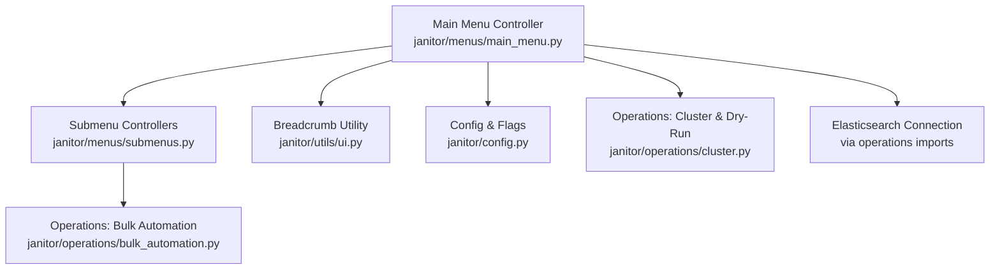
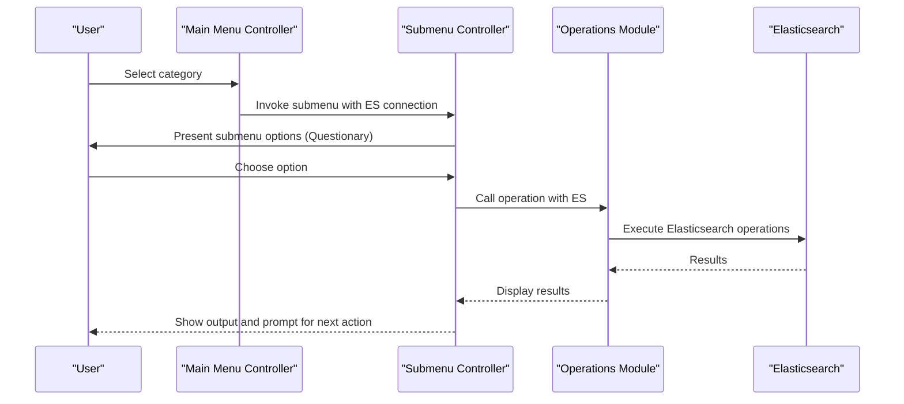
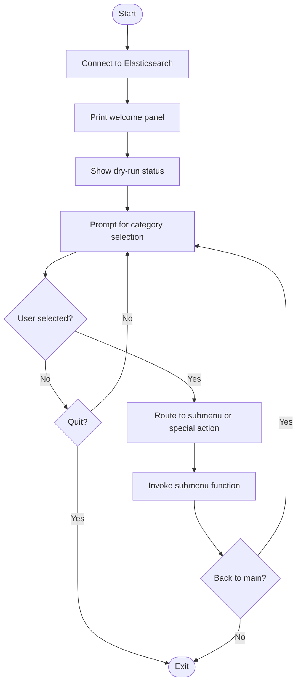
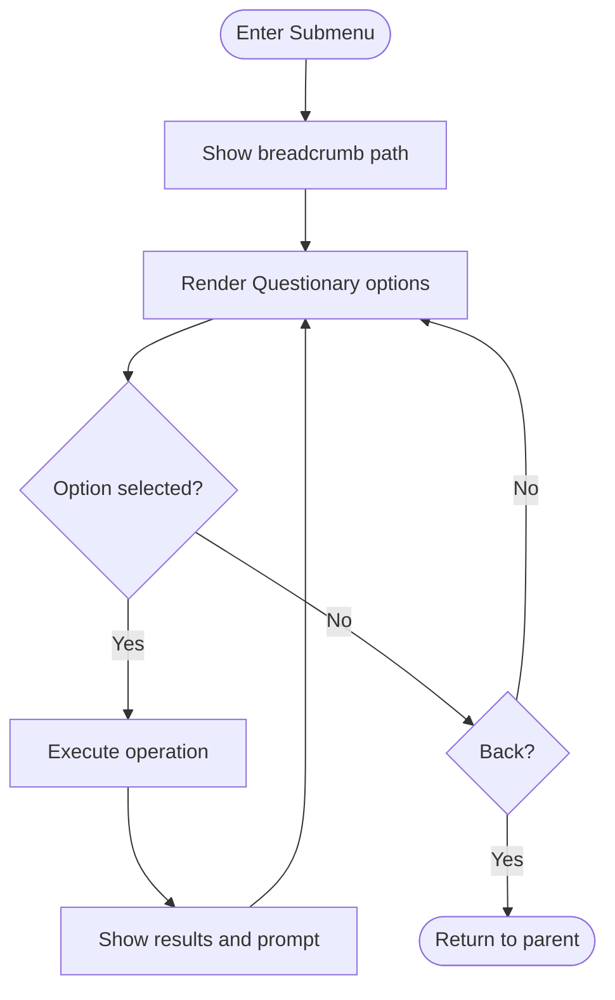
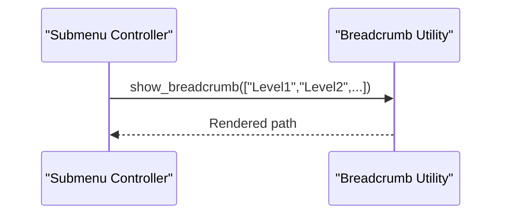
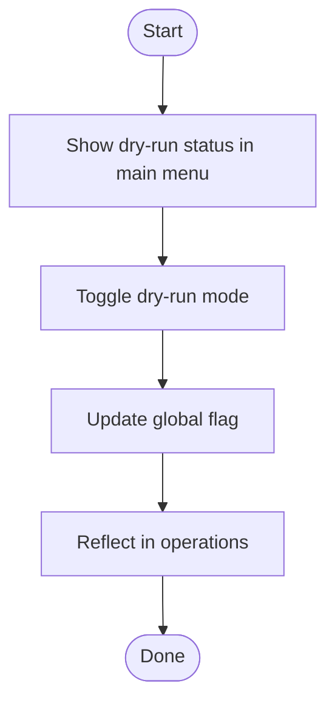
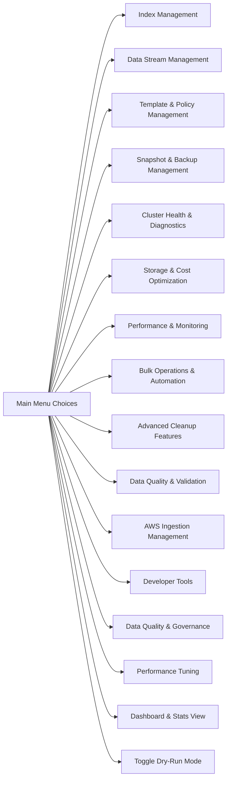
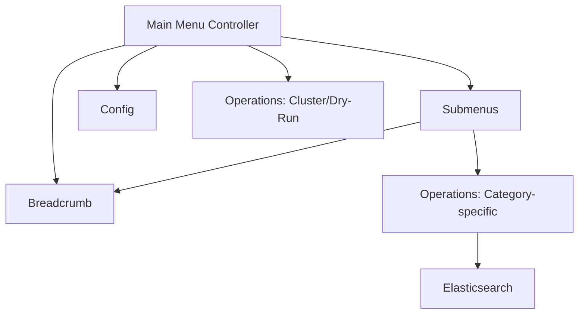

# Interactive Menu System

<cite>
**Referenced Files in This Document**
- [main_menu.py](file://janitor/menus/main_menu.py)
- [submenus.py](file://janitor/menus/submenus.py)
- [ui.py](file://janitor/utils/ui.py)
- [config.py](file://janitor/config.py)
- [cluster.py](file://janitor/operations/cluster.py)
- [bulk_automation.py](file://janitor/operations/bulk_automation.py)
- [README.md](file://README.md)
</cite>

## Table of Contents
1. [Introduction](#introduction)
2. [Project Structure](#project-structure)
3. [Core Components](#core-components)
4. [Architecture Overview](#architecture-overview)
5. [Detailed Component Analysis](#detailed-component-analysis)
6. [Dependency Analysis](#dependency-analysis)
7. [Performance Considerations](#performance-considerations)
8. [Troubleshooting Guide](#troubleshooting-guide)
9. [Conclusion](#conclusion)

## Introduction
This document describes the interactive menu system that provides a GUI-style navigation interface for Elastic Janitor. It covers the main menu structure with 15+ categories, hierarchical navigation with breadcrumb tracking, the Questionary-based interface with arrow key navigation and separators, dry-run mode indicators and toggles, and practical workflows for navigating categories, accessing submenus, and performing operations. It also addresses user experience considerations, error handling, and efficient navigation patterns.

## Project Structure
The interactive menu system is implemented using:
- A main menu controller that orchestrates top-level navigation
- Submenu controllers that handle category-specific workflows
- A breadcrumb utility for contextual navigation feedback
- A global dry-run mode flag managed via configuration and operations

**Diagram sources**
- [main_menu.py](file://janitor/menus/main_menu.py#L31-L125)
- [submenus.py](file://janitor/menus/submenus.py#L1-L1149)
- [ui.py](file://janitor/utils/ui.py#L7-L11)
- [config.py](file://janitor/config.py#L22-L23)
- [cluster.py](file://janitor/operations/cluster.py#L21-L33)
- [bulk_automation.py](file://janitor/operations/bulk_automation.py#L1-L200)

**Section sources**
- [main_menu.py](file://janitor/menus/main_menu.py#L1-L125)
- [submenus.py](file://janitor/menus/submenus.py#L1-L1149)
- [ui.py](file://janitor/utils/ui.py#L1-L12)
- [config.py](file://janitor/config.py#L1-L78)
- [README.md](file://README.md#L143-L183)

## Core Components
- Main Menu Controller: Presents top-level categories and routes selections to appropriate submenus. It displays the dry-run mode status and provides a Quit option.
- Submenu Controllers: Implement category-specific navigation with hierarchical submenus and “Back” navigation.
- Breadcrumb Utility: Displays the current navigation path to improve orientation.
- Dry-Run Mode: Managed globally via a flag and toggled through dedicated operations.

Key responsibilities:
- Navigation orchestration and user feedback
- Hierarchical menu rendering with separators
- Safe operation execution with dry-run awareness
- Graceful cancellation and error handling

**Section sources**
- [main_menu.py](file://janitor/menus/main_menu.py#L31-L125)
- [submenus.py](file://janitor/menus/submenus.py#L161-L917)
- [ui.py](file://janitor/utils/ui.py#L7-L11)
- [cluster.py](file://janitor/operations/cluster.py#L21-L33)

## Architecture Overview
The menu system uses a layered architecture:
- Presentation layer: Questionary-driven menus with arrow key navigation and separators
- Navigation layer: Breadcrumb tracking and back navigation
- Operations layer: Category-specific functions invoked from submenus
- Configuration layer: Global flags (e.g., dry-run mode) and UI styling

**Diagram sources**
- [main_menu.py](file://janitor/menus/main_menu.py#L44-L119)
- [submenus.py](file://janitor/menus/submenus.py#L161-L917)
- [cluster.py](file://janitor/operations/cluster.py#L21-L33)

## Detailed Component Analysis

### Main Menu Controller
The main menu controller:
- Initializes the session, connects to Elasticsearch, and prints a welcome panel
- Displays dry-run mode status using the global flag
- Presents a Questionary menu with 15+ categories and a Quit option
- Routes selections to corresponding submenu functions or special actions (e.g., dashboard, dry-run toggle)

**Diagram sources**
- [main_menu.py](file://janitor/menus/main_menu.py#L44-L119)

**Section sources**
- [main_menu.py](file://janitor/menus/main_menu.py#L31-L125)

### Submenu Controllers
Each submenu controller:
- Displays a breadcrumb path for the current level
- Presents a Questionary menu with category-specific options and separators
- Handles “Back” navigation to the previous level
- Invokes corresponding operations modules for each option

Examples of categories:
- Index Management
- Data Stream Management
- Template & Policy Management (with sub-submenus)
- Snapshot & Backup Management (with sub-submenus)
- Cluster Health & Diagnostics
- Storage & Cost Optimization
- Performance & Monitoring
- Bulk Operations & Automation
- Advanced Cleanup Features
- Data Quality & Validation
- AWS Ingestion Management
- Developer Tools
- Data Quality & Governance
- Performance Tuning
- Dashboard & Stats View
- Dry-Run Mode Toggle

**Diagram sources**
- [submenus.py](file://janitor/menus/submenus.py#L161-L917)

**Section sources**
- [submenus.py](file://janitor/menus/submenus.py#L161-L1149)

### Breadcrumb Tracking
The breadcrumb utility:
- Displays a navigable path indicating the current menu hierarchy
- Improves user orientation and reduces cognitive load during deep navigation

**Diagram sources**
- [ui.py](file://janitor/utils/ui.py#L7-L11)

**Section sources**
- [ui.py](file://janitor/utils/ui.py#L1-L12)

### Dry-Run Mode Indicator and Toggle
Dry-run mode:
- Displayed prominently in the main menu with color-coded status
- Toggled globally via a dedicated operation and reflected immediately
- Respects the global flag in destructive operations across submenus

**Diagram sources**
- [main_menu.py](file://janitor/menus/main_menu.py#L35-L38)
- [cluster.py](file://janitor/operations/cluster.py#L21-L33)
- [config.py](file://janitor/config.py#L22-L23)

**Section sources**
- [main_menu.py](file://janitor/menus/main_menu.py#L35-L38)
- [cluster.py](file://janitor/operations/cluster.py#L21-L33)
- [config.py](file://janitor/config.py#L22-L23)

### Practical Navigation Workflows
- Navigating categories:
  - From the main menu, select a category (e.g., “Index Management”) to enter its submenu
  - Use arrow keys to move between options; separators visually group related actions
- Accessing submenus:
  - Within “Template & Policy Management,” choose “Index Templates” to reach a sub-submenu
  - Use “Back” to return to the previous level
- Performing operations:
  - Select an operation (e.g., “Index Health Dashboard”) to display results
  - Confirm destructive actions when prompted; dry-run mode will indicate what would happen without changes
- Dry-run toggle:
  - From the main menu, select “Toggle Dry-Run Mode” to switch the global flag
  - The main menu will reflect the new status immediately

**Section sources**
- [main_menu.py](file://janitor/menus/main_menu.py#L54-L119)
- [submenus.py](file://janitor/menus/submenus.py#L161-L917)
- [bulk_automation.py](file://janitor/operations/bulk_automation.py#L1-L200)

### Relationship Between Main Menu Choices and Submenu Functions
- Main menu routes to submenu functions by category value
- Submenus call operations modules that interact with Elasticsearch
- Special actions include:
  - Dashboard view invocation
  - Dry-run mode toggle

**Diagram sources**
- [main_menu.py](file://janitor/menus/main_menu.py#L58-L76)

**Section sources**
- [main_menu.py](file://janitor/menus/main_menu.py#L87-L118)

## Dependency Analysis
The menu system exhibits clear separation of concerns:
- Main menu depends on:
  - Submenu modules for routing
  - Breadcrumb utility for UX
  - Config for dry-run flag
  - Operations for dashboard and dry-run toggle
- Submenus depend on:
  - Operations modules for category-specific actions
  - Breadcrumb utility for navigation context
  - Questionary for interactive selection

**Diagram sources**
- [main_menu.py](file://janitor/menus/main_menu.py#L13-L28)
- [submenus.py](file://janitor/menus/submenus.py#L8-L158)
- [ui.py](file://janitor/utils/ui.py#L7-L11)
- [config.py](file://janitor/config.py#L22-L23)
- [cluster.py](file://janitor/operations/cluster.py#L21-L33)

**Section sources**
- [main_menu.py](file://janitor/menus/main_menu.py#L13-L28)
- [submenus.py](file://janitor/menus/submenus.py#L8-L158)

## Performance Considerations
- Menu rendering uses Questionary for responsive, keyboard-friendly navigation
- Breadcrumb updates are lightweight and occur on each submenu entry
- Dry-run mode avoids heavy operations by simulating destructive actions
- Batch operations in bulk automation use progress bars and controlled concurrency

[No sources needed since this section provides general guidance]

## Troubleshooting Guide
- Graceful cancellation:
  - Keyboard interrupts are handled consistently across menus, printing a yellow “Cancelled” message and returning to the previous menu
- Error handling:
  - Submenus catch interrupt exceptions and return gracefully
  - Operations modules handle Elasticsearch errors and present user-friendly messages
- Dry-run mode:
  - Verify status via the main menu; toggle using the dedicated option
  - Confirm destructive operations are simulated when enabled

**Section sources**
- [main_menu.py](file://janitor/menus/main_menu.py#L79-L81)
- [submenus.py](file://janitor/menus/submenus.py#L186-L188)
- [cluster.py](file://janitor/operations/cluster.py#L21-L33)

## Conclusion
The interactive menu system delivers a structured, navigable interface with clear breadcrumbs, robust error handling, and a prominent dry-run indicator. It organizes 15+ categories into logical workflows, enabling efficient navigation and safe execution of Elasticsearch operations. Users can confidently explore features, preview changes via dry-run mode, and revert to earlier levels using “Back” navigation.