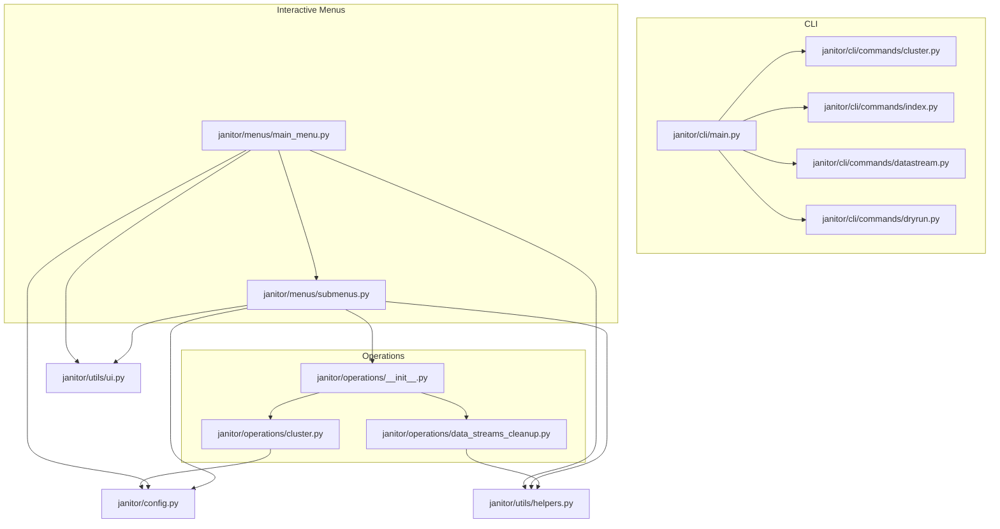
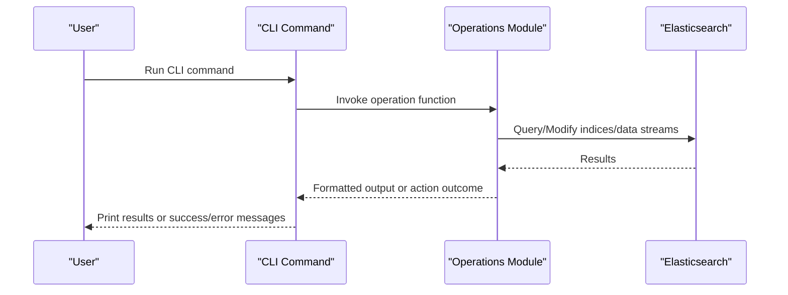
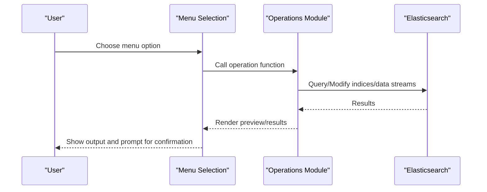
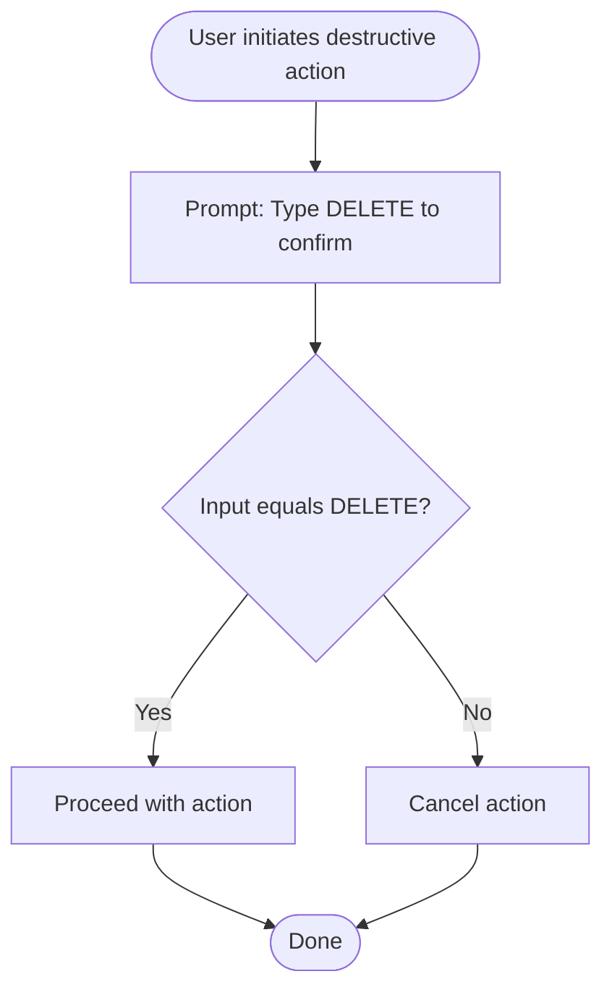
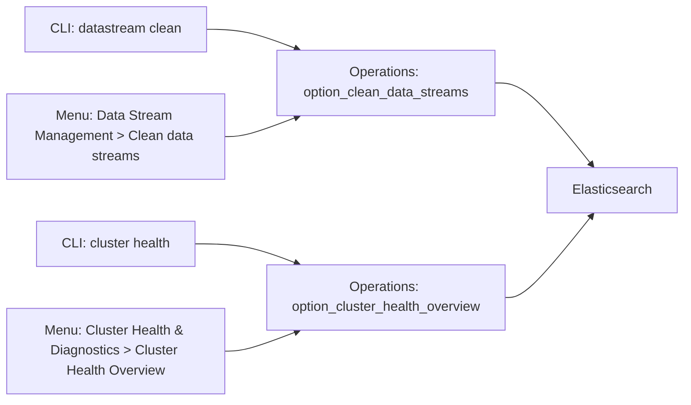
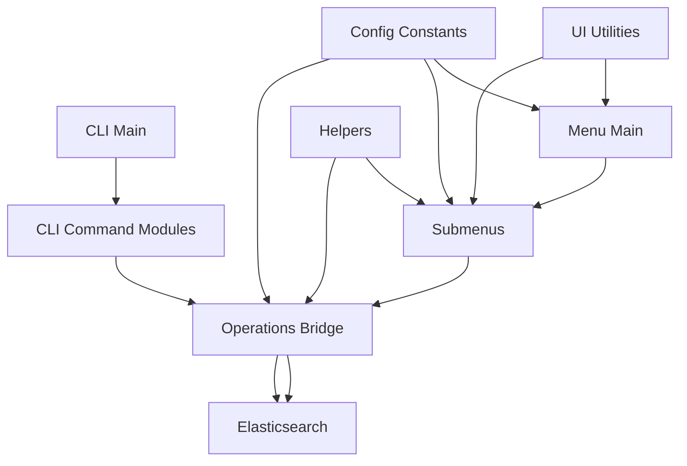

# User Interface Guide

<cite>
**Referenced Files in This Document**
- [janitor/cli/main.py](file://janitor/cli/main.py)
- [janitor/cli/commands/cluster.py](file://janitor/cli/commands/cluster.py)
- [janitor/cli/commands/index.py](file://janitor/cli/commands/index.py)
- [janitor/cli/commands/datastream.py](file://janitor/cli/commands/datastream.py)
- [janitor/cli/commands/dryrun.py](file://janitor/cli/commands/dryrun.py)
- [janitor/menus/main_menu.py](file://janitor/menus/main_menu.py)
- [janitor/menus/submenus.py](file://janitor/menus/submenus.py)
- [janitor/utils/ui.py](file://janitor/utils/ui.py)
- [janitor/utils/helpers.py](file://janitor/utils/helpers.py)
- [janitor/operations/__init__.py](file://janitor/operations/__init__.py)
- [janitor/operations/cluster.py](file://janitor/operations/cluster.py)
- [janitor/operations/data_streams_cleanup.py](file://janitor/operations/data_streams_cleanup.py)
- [janitor/config.py](file://janitor/config.py)
- [docs/CLI_COMMAND_INDEX.md](file://docs/CLI_COMMAND_INDEX.md)
- [docs/CLI_COMMAND_LIBRARY.md](file://docs/CLI_COMMAND_LIBRARY.md)
</cite>

## Table of Contents
1. [Introduction](#introduction)
2. [Project Structure](#project-structure)
3. [Core Components](#core-components)
4. [Architecture Overview](#architecture-overview)
5. [Detailed Component Analysis](#detailed-component-analysis)
6. [Dependency Analysis](#dependency-analysis)
7. [Performance Considerations](#performance-considerations)
8. [Troubleshooting Guide](#troubleshooting-guide)
9. [Conclusion](#conclusion)
10. [Appendices](#appendices)

## Introduction
This guide explains the dual-interface architecture of Elastic Janitor, covering both the Command-Line Interface (CLI) and the interactive menu interface. It describes when to use each mode, how the main menu navigation works with breadcrumb paths, the CLI command structure and options, interactive workflows including confirmation prompts and safety features, practical examples for common tasks, and the relationship between CLI commands and menu selections. It also provides user experience considerations and guidance for choosing between CLI and menu modes based on workflow preferences.

## Project Structure
Elastic Janitor organizes its interfaces and capabilities across two primary entry points:
- CLI: A Click-based command group with categorized subcommands.
- Interactive Menus: A hierarchical menu system built with Questionary and Rich.

Key modules:
- CLI entry and grouping: [janitor/cli/main.py](file://janitor/cli/main.py)
- CLI commands: [janitor/cli/commands/cluster.py](file://janitor/cli/commands/cluster.py), [janitor/cli/commands/index.py](file://janitor/cli/commands/index.py), [janitor/cli/commands/datastream.py](file://janitor/cli/commands/datastream.py), [janitor/cli/commands/dryrun.py](file://janitor/cli/commands/dryrun.py)
- Interactive menus: [janitor/menus/main_menu.py](file://janitor/menus/main_menu.py), [janitor/menus/submenus.py](file://janitor/menus/submenus.py)
- UI utilities: [janitor/utils/ui.py](file://janitor/utils/ui.py), [janitor/utils/helpers.py](file://janitor/utils/helpers.py)
- Operations bridge: [janitor/operations/__init__.py](file://janitor/operations/__init__.py), [janitor/operations/cluster.py](file://janitor/operations/cluster.py), [janitor/operations/data_streams_cleanup.py](file://janitor/operations/data_streams_cleanup.py)
- Configuration: [janitor/config.py](file://janitor/config.py)
- CLI documentation: [docs/CLI_COMMAND_INDEX.md](file://docs/CLI_COMMAND_INDEX.md), [docs/CLI_COMMAND_LIBRARY.md](file://docs/CLI_COMMAND_LIBRARY.md)

**Diagram sources**
- [janitor/cli/main.py](file://janitor/cli/main.py#L8-L51)
- [janitor/cli/commands/cluster.py](file://janitor/cli/commands/cluster.py#L10-L13)
- [janitor/cli/commands/index.py](file://janitor/cli/commands/index.py#L11-L14)
- [janitor/cli/commands/datastream.py](file://janitor/cli/commands/datastream.py#L14-L17)
- [janitor/cli/commands/dryrun.py](file://janitor/cli/commands/dryrun.py#L9-L12)
- [janitor/menus/main_menu.py](file://janitor/menus/main_menu.py#L31-L120)
- [janitor/menus/submenus.py](file://janitor/menus/submenus.py#L161-L213)
- [janitor/operations/__init__.py](file://janitor/operations/__init__.py#L1-L351)
- [janitor/operations/cluster.py](file://janitor/operations/cluster.py#L21-L33)
- [janitor/operations/data_streams_cleanup.py](file://janitor/operations/data_streams_cleanup.py#L15-L200)
- [janitor/utils/ui.py](file://janitor/utils/ui.py#L7-L11)
- [janitor/utils/helpers.py](file://janitor/utils/helpers.py#L32-L46)
- [janitor/config.py](file://janitor/config.py#L22-L23)

**Section sources**
- [janitor/cli/main.py](file://janitor/cli/main.py#L8-L51)
- [janitor/menus/main_menu.py](file://janitor/menus/main_menu.py#L31-L120)
- [janitor/menus/submenus.py](file://janitor/menus/submenus.py#L161-L213)
- [janitor/operations/__init__.py](file://janitor/operations/__init__.py#L1-L351)
- [janitor/utils/ui.py](file://janitor/utils/ui.py#L7-L11)
- [janitor/utils/helpers.py](file://janitor/utils/helpers.py#L32-L46)
- [janitor/config.py](file://janitor/config.py#L22-L23)

## Core Components
- CLI command grouping and registration:
  - Groups: cluster, index, datastream, dry-run, performance, governance, tuning, template, policy.
  - Example usage and help text are embedded in the CLI entry.
- Interactive menu system:
  - Main menu categories and submenus route to operation functions.
  - Breadcrumb navigation is consistently shown via a UI utility.
- Operations bridge:
  - Submenu selections call functions from the operations package, which encapsulate Elasticsearch interactions and user prompts.
- Safety and UX:
  - Dry-run mode toggles destructive behavior globally.
  - Confirmation dialogs require explicit user input for destructive actions.
  - Helper utilities provide safe input handling and validation.

**Section sources**
- [janitor/cli/main.py](file://janitor/cli/main.py#L8-L51)
- [janitor/menus/main_menu.py](file://janitor/menus/main_menu.py#L44-L120)
- [janitor/menus/submenus.py](file://janitor/menus/submenus.py#L161-L213)
- [janitor/operations/__init__.py](file://janitor/operations/__init__.py#L1-L351)
- [janitor/utils/ui.py](file://janitor/utils/ui.py#L7-L11)
- [janitor/utils/helpers.py](file://janitor/utils/helpers.py#L25-L46)
- [janitor/config.py](file://janitor/config.py#L22-L23)

## Architecture Overview
The dual-interface architecture ensures consistent behavior regardless of the chosen mode:
- CLI commands call the same underlying operations as menu selections.
- Both paths share the same safety mechanisms (dry-run, confirmation prompts).
- UI utilities standardize breadcrumbs and styling.

**Diagram sources**
- [janitor/cli/commands/datastream.py](file://janitor/cli/commands/datastream.py#L20-L48)
- [janitor/operations/data_streams_cleanup.py](file://janitor/operations/data_streams_cleanup.py#L15-L200)

**Diagram sources**
- [janitor/menus/submenus.py](file://janitor/menus/submenus.py#L217-L266)
- [janitor/operations/data_streams_cleanup.py](file://janitor/operations/data_streams_cleanup.py#L15-L200)

## Detailed Component Analysis

### CLI Command Structure and Syntax
- Command naming convention: elastic-janitor <category> <action> [options].
- Categories include index, datastream, template, policy, snapshot, cluster, storage, performance, bulk, cleanup, quality, aws, governance, tuning, dashboard.
- Global options supported by all commands:
  - --dry-run, --verbose, --output, --help, --config, --url, --api-key, --no-color, --quiet.
- Examples:
  - Check cluster health: elastic-janitor cluster health
  - List largest indices: elastic-janitor index largest --top 25
  - Clean old data streams (dry-run first): elastic-janitor datastream clean --retention 90d --dry-run
  - Enable global dry-run mode: elastic-janitor dry-run enable

Practical examples (syntax only):
- Cluster health: elastic-janitor cluster health [--output json|table|yaml|csv] [--verbose] [--quiet]
- Index largest: elastic-janitor index largest --top N --pattern "pattern" [--output json|table|yaml|csv] [--verbose]
- Data stream clean: elastic-janitor datastream clean --retention 90d|6M|1y --pattern "pattern" [--batch-size INT] [--dry-run] [--output json|table|yaml|csv] [--verbose]
- Dry-run enable/disable/status: elastic-janitor dry-run enable|disable|status

**Section sources**
- [docs/CLI_COMMAND_LIBRARY.md](file://docs/CLI_COMMAND_LIBRARY.md#L40-L55)
- [docs/CLI_COMMAND_LIBRARY.md](file://docs/CLI_COMMAND_LIBRARY.md#L58-L88)
- [docs/CLI_COMMAND_INDEX.md](file://docs/CLI_COMMAND_INDEX.md#L1-L222)
- [janitor/cli/main.py](file://janitor/cli/main.py#L18-L35)
- [janitor/cli/commands/cluster.py](file://janitor/cli/commands/cluster.py#L16-L132)
- [janitor/cli/commands/index.py](file://janitor/cli/commands/index.py#L17-L103)
- [janitor/cli/commands/datastream.py](file://janitor/cli/commands/datastream.py#L20-L194)
- [janitor/cli/commands/dryrun.py](file://janitor/cli/commands/dryrun.py#L15-L87)

### Interactive Menu Navigation and Breadcrumb System
- Main menu categories:
  - Index Management, Data Stream Management, Template & Policy Management, Snapshot & Backup Management, Cluster Health & Diagnostics, Storage & Cost Optimization, Performance & Monitoring, Bulk Operations & Automation, Advanced Cleanup Features, Data Quality & Validation, AWS Ingestion Management, Developer Tools, Data Quality & Governance, Performance Tuning, Dashboard & Stats View, Toggle Dry-Run Mode, Quit.
- Submenus branch from main menu into specialized workflows.
- Breadcrumb navigation:
  - Consistently shown using a UI utility to reflect current path (e.g., Main Menu > Index Management > Index Health Dashboard).
- Dry-run status display:
  - The main menu prints the current dry-run mode status for awareness.

```mermaid
flowchart TD
Start(["Open Main Menu"]) --> ShowBreadcrumb["Show Breadcrumb"]
ShowBreadcrumb --> ShowDryRun["Show Dry-Run Status"]
ShowDryRun --> PromptCategory["Prompt: Select category"]
PromptCategory --> |Index Management| SubIndex["Go to Index Management submenu"]
PromptCategory --> |Data Stream Management| SubDS["Go to Data Stream Management submenu"]
PromptCategory --> |Template & Policy Management| SubTemplates["Go to Template & Policy Management submenu"]
PromptCategory --> |Snapshot & Backup Management| SubSnapshots["Go to Snapshot & Backup Management submenu"]
PromptCategory --> |Cluster Health & Diagnostics| SubCluster["Go to Cluster Health & Diagnostics submenu"]
PromptCategory --> |Storage & Cost Optimization| SubStorage["Go to Storage & Cost Optimization submenu"]
PromptCategory --> |Performance & Monitoring| SubPerf["Go to Performance & Monitoring submenu"]
PromptCategory --> |Bulk Operations & Automation| SubBulk["Go to Bulk Operations & Automation submenu"]
PromptCategory --> |Advanced Cleanup Features| SubCleanup["Go to Advanced Cleanup Features submenu"]
PromptCategory --> |Data Quality & Validation| SubQuality["Go to Data Quality & Validation submenu"]
PromptCategory --> |AWS Ingestion Management| SubAWS["Go to AWS Ingestion Management submenu"]
PromptCategory --> |Developer Tools| SubDev["Go to Developer Tools submenu"]
PromptCategory --> |Data Quality & Governance| SubGovernance["Go to Data Quality & Governance submenu"]
PromptCategory --> |Performance Tuning| SubTuning["Go to Performance Tuning submenu"]
PromptCategory --> |Dashboard & Stats View| Dashboard["View Dashboard"]
PromptCategory --> |Toggle Dry-Run Mode| ToggleDRY["Toggle Dry-Run Mode"]
PromptCategory --> |Quit| End(["Exit"])
```

**Diagram sources**
- [janitor/menus/main_menu.py](file://janitor/menus/main_menu.py#L44-L120)
- [janitor/menus/submenus.py](file://janitor/menus/submenus.py#L161-L213)
- [janitor/utils/ui.py](file://janitor/utils/ui.py#L7-L11)

**Section sources**
- [janitor/menus/main_menu.py](file://janitor/menus/main_menu.py#L44-L120)
- [janitor/menus/submenus.py](file://janitor/menus/submenus.py#L161-L213)
- [janitor/utils/ui.py](file://janitor/utils/ui.py#L7-L11)

### Interactive Workflows: Confirmation Prompts and Safety Features
- Explicit confirmation for destructive actions:
  - Deletion confirmation requires typing the literal word "DELETE".
  - General confirmations use a checkbox/select dialog with a custom style.
- Safe input handling:
  - Keyboard interrupts are handled gracefully with a clear cancellation message.
- Dry-run mode:
  - Global toggle affects both menu-driven and CLI-driven destructive operations.
  - Menu displays dry-run status prominently.

**Diagram sources**
- [janitor/utils/helpers.py](file://janitor/utils/helpers.py#L25-L29)
- [janitor/utils/helpers.py](file://janitor/utils/helpers.py#L32-L46)
- [janitor/operations/cluster.py](file://janitor/operations/cluster.py#L21-L33)

**Section sources**
- [janitor/utils/helpers.py](file://janitor/utils/helpers.py#L25-L46)
- [janitor/operations/cluster.py](file://janitor/operations/cluster.py#L21-L33)
- [janitor/config.py](file://janitor/config.py#L22-L23)

### Practical Examples: Common Operations in Both Interfaces
- Check cluster health
  - CLI: elastic-janitor cluster health [--output json|table|yaml|csv] [--verbose]
  - Menu: Main Menu > Cluster Health & Diagnostics > Cluster Health Overview
- List largest indices
  - CLI: elastic-janitor index largest --top 25 --pattern "*"
  - Menu: Main Menu > Index Management > List Largest Indices
- Clean old data streams (dry-run first)
  - CLI: elastic-janitor datastream clean --retention 90d --dry-run
  - Menu: Main Menu > Data Stream Management > Clean data streams (delete backing indices older than X days)
- Enable global dry-run mode
  - CLI: elastic-janitor dry-run enable
  - Menu: Main Menu > Toggle Dry-Run Mode

Note: Replace the bracketed placeholders with your desired values. The CLI supports JSON/YAML/CSV output and verbose/quiet modes for machine-readable and concise output respectively.

**Section sources**
- [janitor/cli/commands/cluster.py](file://janitor/cli/commands/cluster.py#L16-L132)
- [janitor/cli/commands/index.py](file://janitor/cli/commands/index.py#L17-L103)
- [janitor/cli/commands/datastream.py](file://janitor/cli/commands/datastream.py#L20-L194)
- [janitor/cli/commands/dryrun.py](file://janitor/cli/commands/dryrun.py#L15-L87)
- [janitor/menus/submenus.py](file://janitor/menus/submenus.py#L217-L266)
- [janitor/menus/main_menu.py](file://janitor/menus/main_menu.py#L117-L118)

### Relationship Between CLI Commands and Menu Selections
- Both CLI and menu selections call the same operation functions in the operations package.
- Example mapping:
  - CLI: datastream clean → Menu: Data Stream Management > Clean data streams → Operation: option_clean_data_streams
  - CLI: cluster health → Menu: Cluster Health & Diagnostics > Cluster Health Overview → Operation: option_cluster_health_overview
- Dry-run mode is global and respected by both CLI and menu flows.

**Diagram sources**
- [janitor/cli/commands/datastream.py](file://janitor/cli/commands/datastream.py#L20-L48)
- [janitor/menus/submenus.py](file://janitor/menus/submenus.py#L217-L266)
- [janitor/operations/data_streams_cleanup.py](file://janitor/operations/data_streams_cleanup.py#L15-L200)
- [janitor/operations/cluster.py](file://janitor/operations/cluster.py#L127-L200)

**Section sources**
- [janitor/operations/__init__.py](file://janitor/operations/__init__.py#L1-L351)
- [janitor/operations/data_streams_cleanup.py](file://janitor/operations/data_streams_cleanup.py#L15-L200)
- [janitor/operations/cluster.py](file://janitor/operations/cluster.py#L127-L200)

### User Experience Considerations and Interface Consistency
- Consistent breadcrumbs in menus improve orientation and reduce cognitive load.
- Clear dry-run status messaging helps users understand whether destructive actions are simulated or executed.
- Standardized confirmation prompts prevent accidental destructive operations.
- Output formatting options (JSON/YAML/CSV/table) support both human readability and automation needs.
- Graceful handling of keyboard interrupts prevents abrupt exits and maintains a friendly UX.

**Section sources**
- [janitor/utils/ui.py](file://janitor/utils/ui.py#L7-L11)
- [janitor/utils/helpers.py](file://janitor/utils/helpers.py#L32-L46)
- [janitor/config.py](file://janitor/config.py#L22-L23)
- [docs/CLI_COMMAND_LIBRARY.md](file://docs/CLI_COMMAND_LIBRARY.md#L40-L55)

### Choosing Between CLI and Menu Modes
- Use CLI when:
  - You need scripted automation or machine-readable output.
  - You prefer concise command invocations and piping results to other tools.
  - You want to leverage global options (e.g., --output, --dry-run) consistently.
- Use Menu when:
  - You prefer guided workflows with contextual previews and paginated views.
  - You want to review detailed summaries and confirmations before executing changes.
  - You need interactive selection of patterns or indices with auto-discovered suggestions.
- For safety:
  - Enable global dry-run mode before performing risky operations, regardless of the interface used.

**Section sources**
- [docs/CLI_COMMAND_LIBRARY.md](file://docs/CLI_COMMAND_LIBRARY.md#L40-L55)
- [janitor/cli/commands/dryrun.py](file://janitor/cli/commands/dryrun.py#L15-L87)
- [janitor/menus/main_menu.py](file://janitor/menus/main_menu.py#L35-L38)

## Dependency Analysis
- CLI depends on:
  - Command modules for each category.
  - Decorators and output utilities for consistent formatting and error handling.
- Menus depend on:
  - Submenu modules for each category.
  - Operations modules for Elasticsearch interactions.
  - UI utilities for breadcrumbs and styling.
- Shared dependencies:
  - Configuration constants (e.g., dry-run flag).
  - Helper utilities for safe input and confirmation.

**Diagram sources**
- [janitor/cli/main.py](file://janitor/cli/main.py#L8-L51)
- [janitor/menus/main_menu.py](file://janitor/menus/main_menu.py#L44-L120)
- [janitor/menus/submenus.py](file://janitor/menus/submenus.py#L161-L213)
- [janitor/operations/__init__.py](file://janitor/operations/__init__.py#L1-L351)
- [janitor/utils/ui.py](file://janitor/utils/ui.py#L7-L11)
- [janitor/utils/helpers.py](file://janitor/utils/helpers.py#L32-L46)
- [janitor/config.py](file://janitor/config.py#L22-L23)

**Section sources**
- [janitor/cli/main.py](file://janitor/cli/main.py#L8-L51)
- [janitor/menus/main_menu.py](file://janitor/menus/main_menu.py#L44-L120)
- [janitor/menus/submenus.py](file://janitor/menus/submenus.py#L161-L213)
- [janitor/operations/__init__.py](file://janitor/operations/__init__.py#L1-L351)
- [janitor/utils/ui.py](file://janitor/utils/ui.py#L7-L11)
- [janitor/utils/helpers.py](file://janitor/utils/helpers.py#L32-L46)
- [janitor/config.py](file://janitor/config.py#L22-L23)

## Performance Considerations
- Prefer filtering options (e.g., --pattern, --top) to limit result sets and reduce network overhead.
- Use JSON/YAML output for downstream processing to avoid parsing tables.
- Dry-run mode avoids heavy operations and is useful for validating workflows before execution.
- Interactive menus may fetch indices and compute summaries; use pagination and selective viewing to minimize terminal rendering overhead.

## Troubleshooting Guide
- Dry-run mode not taking effect:
  - Verify the global dry-run toggle in menu or CLI status.
  - Ensure destructive operations are invoked after enabling dry-run.
- Confirmed destructive actions not executing:
  - Confirm that the exact confirmation text was entered when prompted.
  - Check for keyboard interrupt cancellations during prompts.
- Output formatting issues:
  - Use --output json|yaml|csv for structured output suitable for scripts.
  - Use --verbose for additional diagnostic information; --quiet suppresses non-error output.
- Connection or timeout errors:
  - Review configuration settings for URL and API key.
  - Increase timeouts if dealing with large datasets or slow clusters.

**Section sources**
- [janitor/cli/commands/dryrun.py](file://janitor/cli/commands/dryrun.py#L55-L87)
- [janitor/utils/helpers.py](file://janitor/utils/helpers.py#L25-L46)
- [docs/CLI_COMMAND_LIBRARY.md](file://docs/CLI_COMMAND_LIBRARY.md#L40-L55)
- [janitor/config.py](file://janitor/config.py#L11-L12)

## Conclusion
Elastic Janitor’s dual-interface design provides flexibility and safety. The CLI offers automation-friendly, scriptable workflows with rich output options, while the interactive menus deliver guided, preview-driven experiences with strong safety safeguards. By leveraging shared operations and consistent UX patterns, users can seamlessly switch between modes and maintain predictable outcomes.

## Appendices
- Quick reference to categories and representative commands:
  - Cluster: health, nodes, stats
  - Index: health, largest, analyze-patterns
  - Data Stream: clean, preview, stats, lifecycle
  - Template & Policy: list/view/edit/delete, conflicts, inheritance
  - Snapshot: list/repo, delete, restore, compare
  - Storage: forecast, tiers, cost, compression
  - Performance: slow-queries, indexing, search, timeline
  - Bulk: config export/import, schedule, rollback
  - Cleanup: duplicates, gaps, mappings, wildcard-delete
  - Quality: missing-fields, null-stats, cardinality, resolve-conflicts
  - AWS: analyze-fields, detect-issues, health-check, quality-metrics
  - Governance: schema evolution, lineage, PII detection, scoring
  - Tuning: auto-tuning engine, shard size optimizer, JVM tuning assistant
  - Dashboard: cluster, indices, performance

**Section sources**
- [docs/CLI_COMMAND_INDEX.md](file://docs/CLI_COMMAND_INDEX.md#L1-L222)