# Utility Functions and Helpers

<cite>
**Referenced Files in This Document**
- [__init__.py](file://janitor/utils/__init__.py)
- [helpers.py](file://janitor/utils/helpers.py)
- [formatters.py](file://janitor/utils/formatters.py)
- [ui.py](file://janitor/utils/ui.py)
- [history_logger.py](file://janitor/utils/history_logger.py)
- [pipeline_versions.py](file://janitor/utils/pipeline_versions.py)
- [version_control.py](file://janitor/utils/version_control.py)
- [config.py](file://janitor/config.py)
- [output.py](file://janitor/cli/utils/output.py)
- [decorators.py](file://janitor/cli/utils/decorators.py)
- [index_basic.py](file://janitor/operations/index_basic.py)
- [data_streams_cleanup.py](file://janitor/operations/data_streams_cleanup.py)
- [template_management.py](file://janitor/operations/template_management.py)
- [rollback.py](file://janitor/operations/rollback.py)
- [change_history.py](file://janitor/operations/change_history.py)
- [template_policy_advanced.py](file://janitor/operations/template_policy_advanced.py)
- [lifecycle_enhancements.py](file://janitor/operations/lifecycle_enhancements.py)
- [templates_policies.py](file://janitor/operations/templates_policies.py)
</cite>

## Update Summary
**Changes Made**
- Added comprehensive template conflict detection capabilities
- Enhanced ILM policy simulation with advanced analytical features
- Integrated policy health checking and validation mechanisms
- Added template validation analyzer with configuration issue detection
- Implemented lifecycle phase distribution analysis with cost calculations
- Enhanced template inheritance viewer with component template analysis
- Added unused template detector for cleanup operations
- Expanded utility functions with advanced analytical operations

## Table of Contents
1. [Introduction](#introduction)
2. [Project Structure](#project-structure)
3. [Core Components](#core-components)
4. [Architecture Overview](#architecture-overview)
5. [Detailed Component Analysis](#detailed-component-analysis)
6. [Advanced Template and Policy Management](#advanced-template-and-policy-management)
7. [Dependency Analysis](#dependency-analysis)
8. [Performance Considerations](#performance-considerations)
9. [Troubleshooting Guide](#troubleshooting-guide)
10. [Conclusion](#conclusion)
11. [Appendices](#appendices)

## Introduction
This document covers the utility functions and helpers that underpin Elastic Janitor's operational safety, user experience, and auditability. It focuses on:
- Input validation utilities that ensure safe operations
- Formatting functions for dates, sizes, and other data types
- UI helper components such as breadcrumbs and interactive prompts
- History logging and change tracking mechanisms
- Pipeline and generic resource version management
- Practical usage examples and extensibility points for customization
- **Enhanced** Advanced template and policy management capabilities including conflict detection, simulation, and comprehensive reporting

These utilities are foundational to the CLI and menu-driven workflows, enabling robust, user-friendly, and auditable operations against Elasticsearch with advanced analytical capabilities.

## Project Structure
The utility layer is organized into cohesive modules with enhanced template and policy management capabilities:
- Input validation and user prompts
- Formatting helpers for dates and sizes
- UI helpers for breadcrumbs
- History logging for operations
- Pipeline-specific version control
- Generic resource version control with dependency tracking
- CLI output formatting and decorators
- **Enhanced** Advanced template and policy analysis tools
- **Enhanced** Lifecycle management and simulation features

```mermaid
graph TB
subgraph "Core Utilities"
U1["janitor/utils/helpers.py"]
U2["janitor/utils/formatters.py"]
U3["janitor/utils/ui.py"]
U4["janitor/utils/history_logger.py"]
U5["janitor/utils/pipeline_versions.py"]
U6["janitor/utils/version_control.py"]
end
subgraph "CLI Utilities"
C1["janitor/cli/utils/output.py"]
C2["janitor/cli/utils/decorators.py"]
end
subgraph "Advanced Template & Policy Management"
T1["janitor/operations/template_policy_advanced.py"]
T2["janitor/operations/lifecycle_enhancements.py"]
T3["janitor/operations/templates_policies.py"]
end
subgraph "Config"
CFG["janitor/config.py"]
end
subgraph "Operations"
O1["janitor/operations/index_basic.py"]
O2["janitor/operations/data_streams_cleanup.py"]
O3["janitor/operations/template_management.py"]
O4["janitor/operations/rollback.py"]
O5["janitor/operations/change_history.py"]
end
U1 --> O1
U1 --> O2
U1 --> O3
U1 --> O4
U2 --> O1
U2 --> O2
U3 --> O1
U3 --> O2
U3 --> O3
U4 --> O4
U4 --> O5
U5 --> O3
U6 --> O3
C1 --> O3
C2 --> O3
T1 --> O3
T2 --> O3
T3 --> O3
CFG --> U1
CFG --> U6
```

**Diagram sources**
- [helpers.py](file://janitor/utils/helpers.py#L1-L258)
- [formatters.py](file://janitor/utils/formatters.py#L1-L53)
- [ui.py](file://janitor/utils/ui.py#L1-L12)
- [history_logger.py](file://janitor/utils/history_logger.py#L1-L73)
- [pipeline_versions.py](file://janitor/utils/pipeline_versions.py#L1-L303)
- [version_control.py](file://janitor/utils/version_control.py#L1-L974)
- [output.py](file://janitor/cli/utils/output.py#L1-L153)
- [decorators.py](file://janitor/cli/utils/decorators.py#L1-L89)
- [template_policy_advanced.py](file://janitor/operations/template_policy_advanced.py#L1-L1881)
- [lifecycle_enhancements.py](file://janitor/operations/lifecycle_enhancements.py#L1-L947)
- [templates_policies.py](file://janitor/operations/templates_policies.py#L1-L180)
- [config.py](file://janitor/config.py#L1-L78)
- [index_basic.py](file://janitor/operations/index_basic.py#L1-L200)
- [data_streams_cleanup.py](file://janitor/operations/data_streams_cleanup.py#L1-L200)
- [template_management.py](file://janitor/operations/template_management.py#L1-L200)
- [rollback.py](file://janitor/operations/rollback.py#L156-L509)
- [change_history.py](file://janitor/operations/change_history.py#L194-L282)

**Section sources**
- [__init__.py](file://janitor/utils/__init__.py#L1-L27)
- [config.py](file://janitor/config.py#L1-L78)

## Core Components
- Input validation and user prompts:
  - Safe input handling with cancellation support
  - System resource protection checks
  - Confirmation dialogs with keyboard interrupt handling
  - Interactive selection with fuzzy filtering
  - Numeric input validation with bounds
  - Text input with defaults
  - Intelligent index pattern selection with fallbacks
- Formatting utilities:
  - Epoch milliseconds to UTC datetime
  - Human-readable size parsing to bytes
  - Byte-to-human-readable conversion
- UI helpers:
  - Breadcrumb navigation display
- History logging:
  - Operation logging to a local file
  - Retrieval of recent operations
  - Clearing history
- Pipeline version management:
  - SQLite-backed versioning for ingest pipelines
  - Known-good markers and pruning
- Generic resource version control:
  - Multi-resource versioning with dependency tracking
  - Automatic dependency discovery and snapshotting
  - Migration from legacy pipeline-only storage
- CLI output formatting and decorators:
  - Structured output in JSON, YAML, CSV, or Rich tables
  - Error handling and dry-run options
- **Enhanced** Advanced template and policy management:
  - Template conflict detection with pattern overlap analysis
  - ILM policy simulation with phase transition predictions
  - Policy health checking with configuration validation
  - Template validation analyzer with issue detection
  - Lifecycle phase distribution analysis with cost calculations
  - Template inheritance viewer with component analysis
  - Unused template detection for cleanup operations

**Section sources**
- [helpers.py](file://janitor/utils/helpers.py#L1-L258)
- [formatters.py](file://janitor/utils/formatters.py#L1-L53)
- [ui.py](file://janitor/utils/ui.py#L1-L12)
- [history_logger.py](file://janitor/utils/history_logger.py#L1-L73)
- [pipeline_versions.py](file://janitor/utils/pipeline_versions.py#L1-L303)
- [version_control.py](file://janitor/utils/version_control.py#L1-L974)
- [output.py](file://janitor/cli/utils/output.py#L1-L153)
- [decorators.py](file://janitor/cli/utils/decorators.py#L1-L89)
- [template_policy_advanced.py](file://janitor/operations/template_policy_advanced.py#L1-L1881)
- [lifecycle_enhancements.py](file://janitor/operations/lifecycle_enhancements.py#L1-L947)
- [templates_policies.py](file://janitor/operations/templates_policies.py#L1-L180)

## Architecture Overview
The utilities integrate across layers with enhanced template and policy management capabilities:
- Operations modules import helpers for safe user interactions and formatting
- Version control integrates with Elasticsearch clients to discover dependencies
- CLI utilities provide consistent output and error handling
- Config centralizes global flags affecting behavior (e.g., system protection, dependency tracking)
- **Enhanced** Advanced template and policy management modules provide comprehensive analysis and simulation capabilities

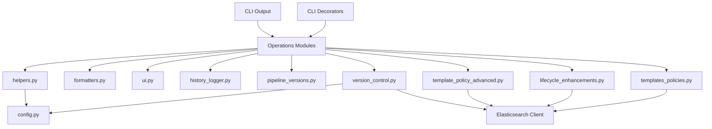

**Diagram sources**
- [helpers.py](file://janitor/utils/helpers.py#L1-L258)
- [formatters.py](file://janitor/utils/formatters.py#L1-L53)
- [ui.py](file://janitor/utils/ui.py#L1-L12)
- [history_logger.py](file://janitor/utils/history_logger.py#L1-L73)
- [pipeline_versions.py](file://janitor/utils/pipeline_versions.py#L1-L303)
- [version_control.py](file://janitor/utils/version_control.py#L1-L974)
- [template_policy_advanced.py](file://janitor/operations/template_policy_advanced.py#L1-L1881)
- [lifecycle_enhancements.py](file://janitor/operations/lifecycle_enhancements.py#L1-L947)
- [templates_policies.py](file://janitor/operations/templates_policies.py#L1-L180)
- [config.py](file://janitor/config.py#L1-L78)
- [output.py](file://janitor/cli/utils/output.py#L1-L153)
- [decorators.py](file://janitor/cli/utils/decorators.py#L1-L89)

## Detailed Component Analysis

### Input Validation and User Prompts
Purpose:
- Enforce safe operations by validating inputs and confirming destructive actions
- Provide resilient user interactions with graceful cancellation and fallbacks

Key functions:
- Safe input handling with keyboard interrupt support
- System resource protection checks
- Confirmation dialogs with counts and keyboard interrupt handling
- Interactive selection with checkbox and select modes
- Numeric input validation with optional min/max bounds
- Text input with defaults
- Intelligent index pattern selection with auto-discovery and fallbacks

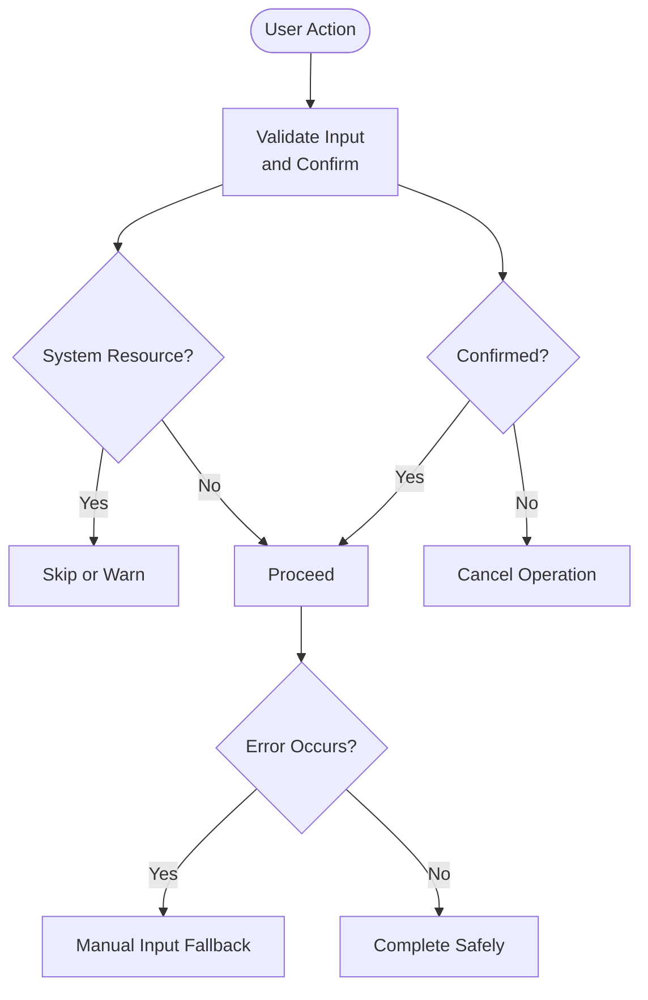

**Diagram sources**
- [helpers.py](file://janitor/utils/helpers.py#L18-L258)
- [config.py](file://janitor/config.py#L18-L23)

Practical examples:
- Index cleanup operations use numeric input validation for retention days and interactive selection for targets
- Template management uses confirmation dialogs and breadcrumb navigation for clarity
- Rollback operations rely on safe input and confirmation to prevent accidental rollbacks

**Section sources**
- [helpers.py](file://janitor/utils/helpers.py#L1-L258)
- [index_basic.py](file://janitor/operations/index_basic.py#L14-L71)
- [data_streams_cleanup.py](file://janitor/operations/data_streams_cleanup.py#L15-L200)
- [template_management.py](file://janitor/operations/template_management.py#L25-L125)
- [rollback.py](file://janitor/operations/rollback.py#L447-L509)

### Formatting Functions
Purpose:
- Normalize and present data consistently across the application

Functions:
- Epoch milliseconds to UTC datetime
- Size string to bytes (supports kb, mb, gb, tb, b)
- Bytes to human-readable format

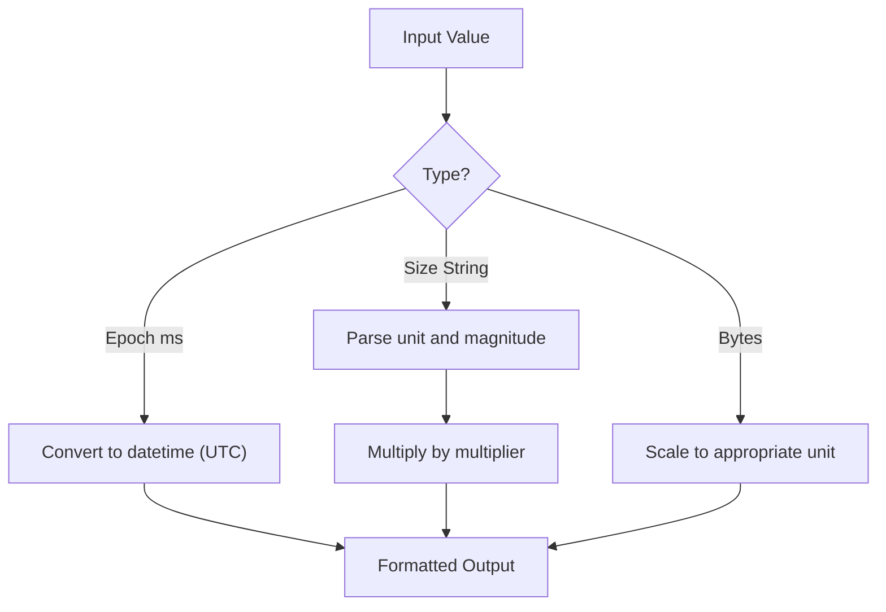

**Diagram sources**
- [formatters.py](file://janitor/utils/formatters.py#L7-L52)

Practical examples:
- Index listing and cleanup operations use size parsing and human-readable formatting for reports
- Data stream operations compute reclaimed space and present it in human-readable units

**Section sources**
- [formatters.py](file://janitor/utils/formatters.py#L1-L53)
- [index_basic.py](file://janitor/operations/index_basic.py#L26-L49)
- [data_streams_cleanup.py](file://janitor/operations/data_streams_cleanup.py#L95-L162)

### UI Helper Components
Purpose:
- Improve user experience with structured navigation and feedback

Components:
- Breadcrumb navigation display for menu-based workflows

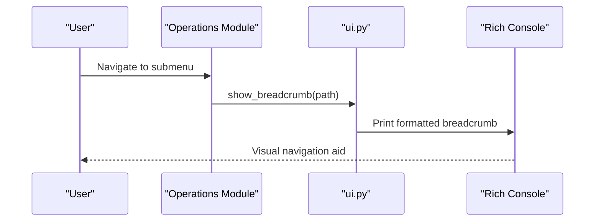

**Diagram sources**
- [ui.py](file://janitor/utils/ui.py#L7-L11)
- [index_basic.py](file://janitor/operations/index_basic.py#L79-L81)
- [data_streams_cleanup.py](file://janitor/operations/data_streams_cleanup.py#L154-L156)
- [template_management.py](file://janitor/operations/template_management.py#L25-L27)

**Section sources**
- [ui.py](file://janitor/utils/ui.py#L1-L12)
- [index_basic.py](file://janitor/operations/index_basic.py#L79-L81)
- [data_streams_cleanup.py](file://janitor/operations/data_streams_cleanup.py#L154-L156)
- [template_management.py](file://janitor/operations/template_management.py#L25-L27)

### History Logging and Change Tracking
Purpose:
- Maintain an audit trail of operations for accountability and recovery

Functions:
- Log operations to a local file with timestamps and resource lists
- Retrieve recent operations for review
- Clear history

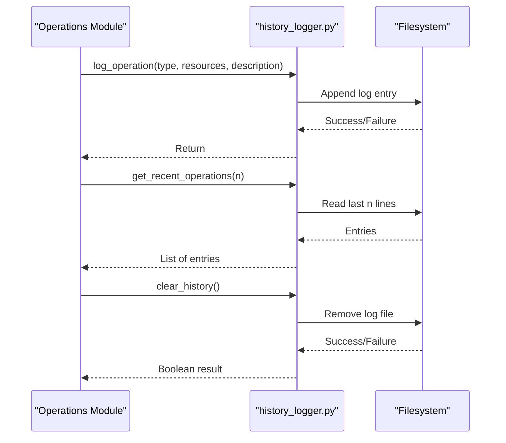

**Diagram sources**
- [history_logger.py](file://janitor/utils/history_logger.py#L9-L72)
- [rollback.py](file://janitor/operations/rollback.py#L503-L507)
- [change_history.py](file://janitor/operations/change_history.py#L194-L282)

Practical examples:
- Rollback operations log the action with affected resources
- Change history module loads and filters historical entries for analysis

**Section sources**
- [history_logger.py](file://janitor/utils/history_logger.py#L1-L73)
- [rollback.py](file://janitor/operations/rollback.py#L503-L507)
- [change_history.py](file://janitor/operations/change_history.py#L194-L282)

### Pipeline Version Management
Purpose:
- Track and manage ingest pipeline configurations with version limits and known-good markers

Key functions:
- Save pipeline versions with comments and known-good flags
- Retrieve all versions, specific versions, and last known-good version
- Prune older versions beyond a configurable limit
- Delete all versions for a pipeline
- Enumerate pipelines with stored versions and count versions

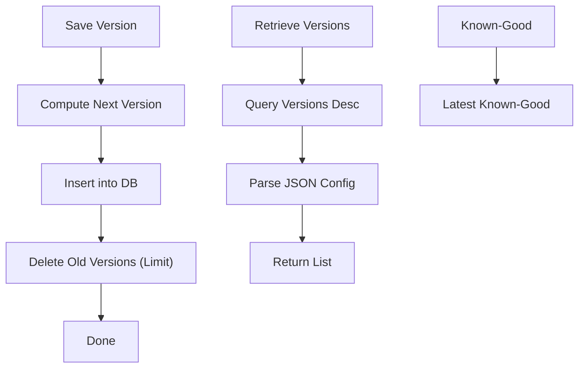

**Diagram sources**
- [pipeline_versions.py](file://janitor/utils/pipeline_versions.py#L61-L116)
- [pipeline_versions.py](file://janitor/utils/pipeline_versions.py#L118-L189)
- [pipeline_versions.py](file://janitor/utils/pipeline_versions.py#L191-L227)

Practical examples:
- Template management leverages pipeline versioning during edits and rollbacks

**Section sources**
- [pipeline_versions.py](file://janitor/utils/pipeline_versions.py#L1-L303)
- [template_management.py](file://janitor/operations/template_management.py#L18-L22)

### Generic Resource Version Control and Dependency Tracking
Purpose:
- Extend versioning to multiple resource types (pipelines, index templates, component templates)
- Capture and compare dependencies across versions

Core capabilities:
- Save resource versions with comments and known-good flags
- Retrieve versions, specific version, and last known-good version
- Delete all versions for a resource
- Enumerate resources by type and count versions
- Discover dependencies across resource types
- Save dependency snapshots and compare with current state
- Migration from legacy pipeline-only storage

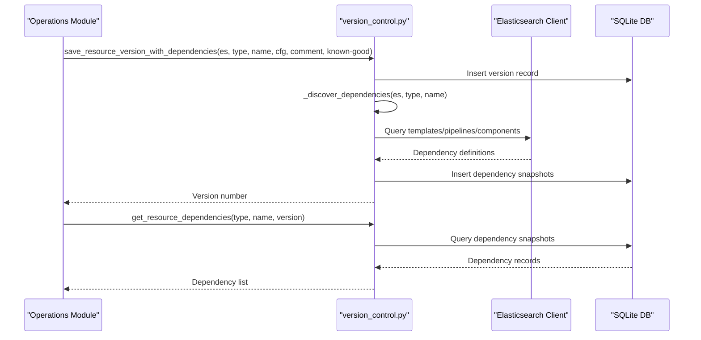

**Diagram sources**
- [version_control.py](file://janitor/utils/version_control.py#L167-L224)
- [version_control.py](file://janitor/utils/version_control.py#L441-L528)
- [version_control.py](file://janitor/utils/version_control.py#L703-L734)
- [version_control.py](file://janitor/utils/version_control.py#L737-L773)

Practical examples:
- Template management uses dependency-aware versioning to capture composed-of relationships and pipeline references

**Section sources**
- [version_control.py](file://janitor/utils/version_control.py#L1-L974)
- [template_management.py](file://janitor/operations/template_management.py#L18-L22)

### CLI Output Formatting and Decorators
Purpose:
- Standardize output presentation and error handling across CLI commands

Capabilities:
- Output formatting in JSON, YAML, CSV, or Rich tables
- Structured success/warning/error/info messaging
- Command decorators for Elasticsearch client injection, error handling, dry-run, and common options

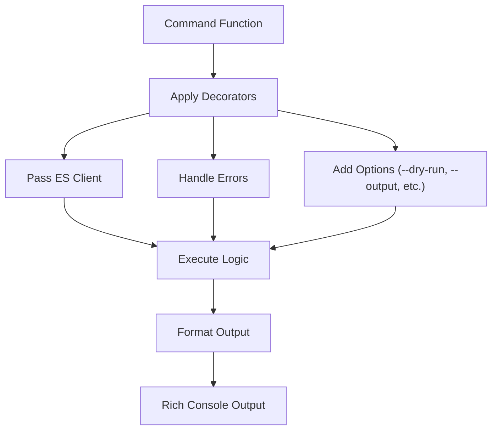

**Diagram sources**
- [decorators.py](file://janitor/cli/utils/decorators.py#L13-L89)
- [output.py](file://janitor/cli/utils/output.py#L22-L132)

**Section sources**
- [output.py](file://janitor/cli/utils/output.py#L1-L153)
- [decorators.py](file://janitor/cli/utils/decorators.py#L1-L89)
- [template_management.py](file://janitor/operations/template_management.py#L25-L125)

## Advanced Template and Policy Management

### Template Conflict Detection
Purpose:
- Identify overlapping or conflicting index patterns across templates
- Analyze template priority and precedence rules
- Provide actionable recommendations for template conflicts

Key capabilities:
- Pattern overlap analysis with wildcard pattern matching
- Priority-based precedence determination
- Conflict reporting with visual indicators
- Automated conflict resolution suggestions

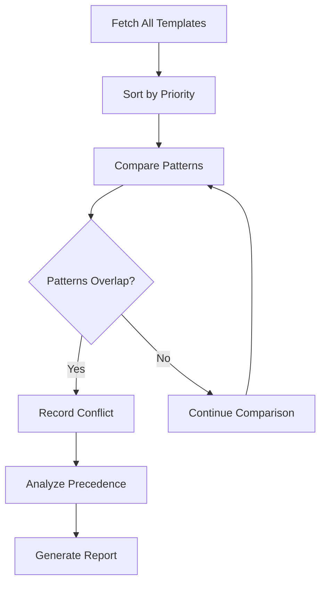

**Diagram sources**
- [template_policy_advanced.py](file://janitor/operations/template_policy_advanced.py#L20-L107)
- [template_policy_advanced.py](file://janitor/operations/template_policy_advanced.py#L109-L142)

Practical examples:
- Detects conflicts between templates with overlapping patterns like `logs-*` and `logs-2024*`
- Determines precedence based on template priority values
- Provides recommendations for resolving conflicts

**Section sources**
- [template_policy_advanced.py](file://janitor/operations/template_policy_advanced.py#L20-L107)
- [template_policy_advanced.py](file://janitor/operations/template_policy_advanced.py#L109-L142)

### ILM Policy Simulation and Analysis
Purpose:
- Test ILM policies against existing indices without affecting production
- Predict phase transitions and upcoming actions
- Analyze policy effectiveness across different index groups

Key capabilities:
- Interactive policy simulation with real index metrics
- Phase transition timeline prediction
- Policy effectiveness reporting with usage statistics
- Rollover prediction for indices with rollover conditions
- Lifecycle phase distribution analysis with cost calculations

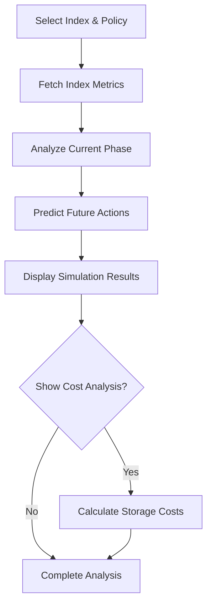

**Diagram sources**
- [lifecycle_enhancements.py](file://janitor/operations/lifecycle_enhancements.py#L20-L151)
- [lifecycle_enhancements.py](file://janitor/operations/lifecycle_enhancements.py#L154-L206)
- [lifecycle_enhancements.py](file://janitor/operations/lifecycle_enhancements.py#L742-L885)

Practical examples:
- Tests ILM policies against live indices to predict phase transitions
- Calculates storage costs per phase based on user-defined pricing
- Predicts rollover timing for indices with rollover aliases

**Section sources**
- [lifecycle_enhancements.py](file://janitor/operations/lifecycle_enhancements.py#L20-L151)
- [lifecycle_enhancements.py](file://janitor/operations/lifecycle_enhancements.py#L154-L206)
- [lifecycle_enhancements.py](file://janitor/operations/lifecycle_enhancements.py#L231-L383)
- [lifecycle_enhancements.py](file://janitor/operations/lifecycle_enhancements.py#L742-L947)

### Template Validation and Health Checking
Purpose:
- Analyze template configurations for potential performance and stability issues
- Validate policy references and component template dependencies
- Provide actionable recommendations for template optimization

Key capabilities:
- Configuration issue detection with severity ratings
- Policy reference validation and orphaned policy identification
- Component template analysis and circular dependency detection
- Shard configuration optimization recommendations
- Template inheritance chain analysis

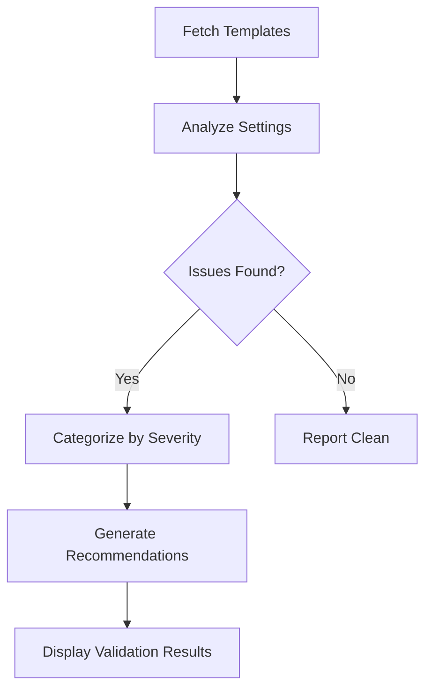

**Diagram sources**
- [template_policy_advanced.py](file://janitor/operations/template_policy_advanced.py#L1059-L1265)
- [template_policy_advanced.py](file://janitor/operations/template_policy_advanced.py#L1266-L1276)
- [template_policy_advanced.py](file://janitor/operations/template_policy_advanced.py#L1278-L1450)

Practical examples:
- Detects missing critical settings like number_of_shards and replicas
- Identifies orphaned policy references in templates
- Analyzes component template composition for circular dependencies

**Section sources**
- [template_policy_advanced.py](file://janitor/operations/template_policy_advanced.py#L1059-L1265)
- [template_policy_advanced.py](file://janitor/operations/template_policy_advanced.py#L1266-L1276)
- [template_policy_advanced.py](file://janitor/operations/template_policy_advanced.py#L1278-L1450)

### Policy Health Checking
Purpose:
- Validate ILM policies for logical consistency and best practices
- Identify misconfigurations that could cause operational issues
- Provide remediation recommendations for policy optimization

Key capabilities:
- Orphaned policy detection and removal recommendations
- Phase transition logic validation with monotonicity checks
- Rollover condition validation and missing condition detection
- Conflicting action placement detection (e.g., readonly in hot phase)
- Action ordering validation and best practice enforcement

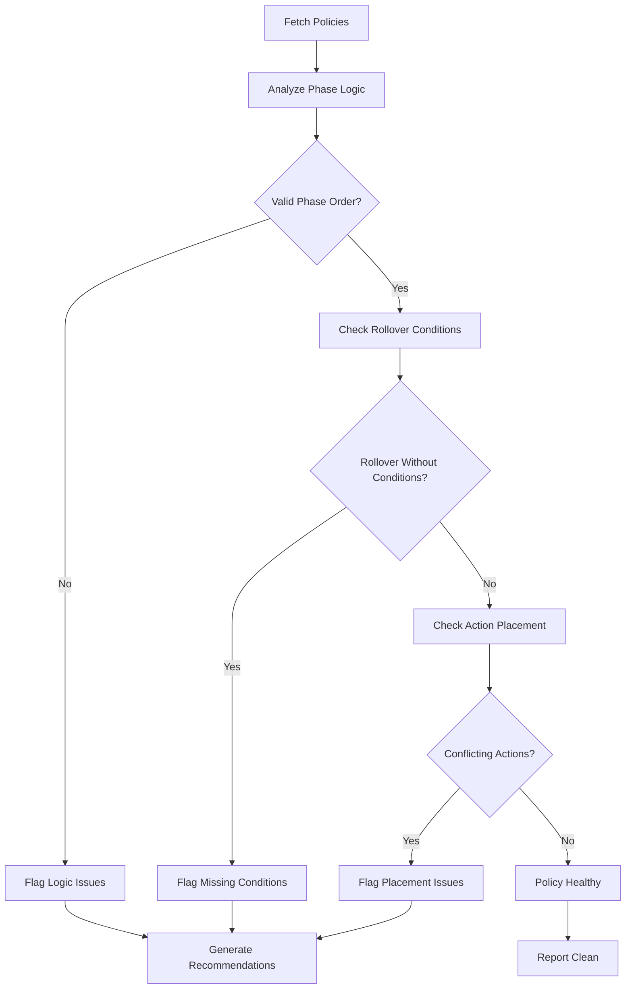

**Diagram sources**
- [template_policy_advanced.py](file://janitor/operations/template_policy_advanced.py#L1278-L1450)
- [template_policy_advanced.py](file://janitor/operations/template_policy_advanced.py#L1452-L1636)

Practical examples:
- Validates that phase min_age values increase monotonically
- Ensures rollover actions include appropriate size/age/doc conditions
- Prevents conflicting actions like readonly in hot phase
- Identifies orphaned policies not referenced by templates or indices

**Section sources**
- [template_policy_advanced.py](file://janitor/operations/template_policy_advanced.py#L1278-L1450)
- [template_policy_advanced.py](file://janitor/operations/template_policy_advanced.py#L1452-L1636)

### Lifecycle Phase Distribution Analysis
Purpose:
- Analyze ILM policy effectiveness across all managed indices
- Provide insights into phase distribution and storage utilization
- Enable cost optimization through phase-based storage analysis

Key capabilities:
- Group indices by policy and current phase
- Calculate metrics including count, total size, and average age
- Identify indices with ILM errors and retry counts
- Optional cost calculation based on tier pricing
- Visualization of phase distribution trends

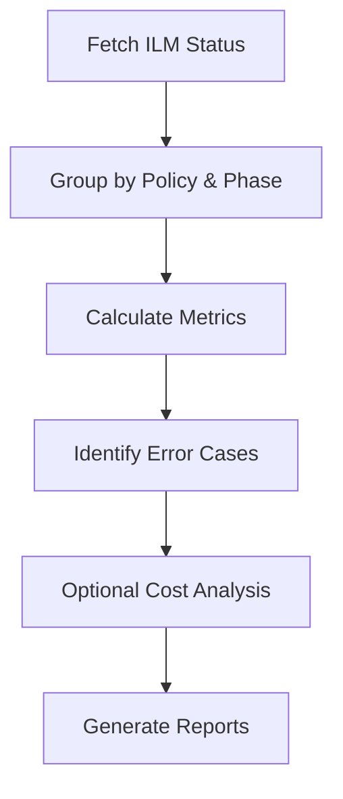

**Diagram sources**
- [lifecycle_enhancements.py](file://janitor/operations/lifecycle_enhancements.py#L742-L885)
- [lifecycle_enhancements.py](file://janitor/operations/lifecycle_enhancements.py#L887-L947)

Practical examples:
- Groups 1000+ indices by policy and phase for comprehensive analysis
- Calculates total storage costs per phase with user-defined pricing
- Identifies indices stuck in problematic phases with error details

**Section sources**
- [lifecycle_enhancements.py](file://janitor/operations/lifecycle_enhancements.py#L742-L885)
- [lifecycle_enhancements.py](file://janitor/operations/lifecycle_enhancements.py#L887-L947)

### Template Inheritance and Unused Template Detection
Purpose:
- Analyze template composition and inheritance chains
- Identify templates that are no longer in use for cleanup
- Provide comprehensive template inventory and analysis

Key capabilities:
- Template inheritance chain visualization with component analysis
- Unused template detection across index and component templates
- Automated cleanup recommendations with safety checks
- Pattern matching for template usage verification

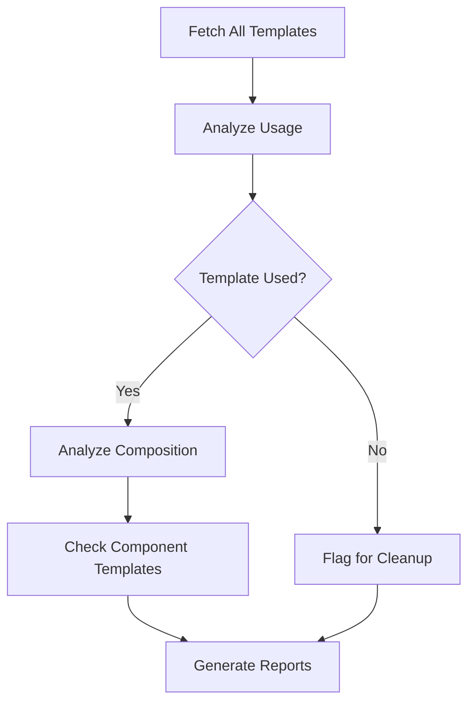

**Diagram sources**
- [template_policy_advanced.py](file://janitor/operations/template_policy_advanced.py#L847-L1018)
- [template_policy_advanced.py](file://janitor/operations/template_policy_advanced.py#L847-L1057)

Practical examples:
- Detects unused index templates that could be safely removed
- Identifies unused component templates referenced by other templates
- Provides safety checks before automated template cleanup operations

**Section sources**
- [template_policy_advanced.py](file://janitor/operations/template_policy_advanced.py#L847-L1018)
- [template_policy_advanced.py](file://janitor/operations/template_policy_advanced.py#L1020-L1057)

## Dependency Analysis
- Cohesion:
  - Each module encapsulates a distinct concern (input validation, formatting, UI, logging, versioning, template analysis)
- Coupling:
  - Operations modules depend on helpers and formatters for safe UX and consistent data display
  - Version control depends on Elasticsearch for dependency discovery
  - CLI utilities are consumed by operations for standardized output and error handling
  - **Enhanced** Advanced template and policy modules depend on Elasticsearch for comprehensive analysis
- External dependencies:
  - SQLite for local persistence of versions and history
  - Rich and Questionary for UI and interactive prompts
  - Elasticsearch client for dependency discovery and resource operations
  - **Enhanced** Advanced analytical operations require extensive Elasticsearch API calls for comprehensive analysis

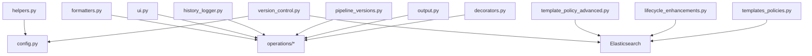

**Diagram sources**
- [helpers.py](file://janitor/utils/helpers.py#L1-L258)
- [formatters.py](file://janitor/utils/formatters.py#L1-L53)
- [ui.py](file://janitor/utils/ui.py#L1-L12)
- [history_logger.py](file://janitor/utils/history_logger.py#L1-L73)
- [pipeline_versions.py](file://janitor/utils/pipeline_versions.py#L1-L303)
- [version_control.py](file://janitor/utils/version_control.py#L1-L974)
- [template_policy_advanced.py](file://janitor/operations/template_policy_advanced.py#L1-L1881)
- [lifecycle_enhancements.py](file://janitor/operations/lifecycle_enhancements.py#L1-L947)
- [templates_policies.py](file://janitor/operations/templates_policies.py#L1-L180)
- [config.py](file://janitor/config.py#L1-L78)
- [output.py](file://janitor/cli/utils/output.py#L1-L153)
- [decorators.py](file://janitor/cli/utils/decorators.py#L1-L89)

**Section sources**
- [__init__.py](file://janitor/utils/__init__.py#L1-L27)
- [config.py](file://janitor/config.py#L1-L78)

## Performance Considerations
- Input validation:
  - Interactive selections and numeric inputs use lightweight validators; avoid excessive retries by providing sensible defaults
- Formatting:
  - Size parsing and byte conversions are O(1); ensure minimal repeated conversions in tight loops
- UI:
  - Breadcrumbs are lightweight prints; avoid frequent updates in hot loops
- History logging:
  - Logging is append-only and non-blocking; consider rotating logs for long-running sessions
- Version control:
  - SQLite operations are efficient; pruning limits reduce overhead
  - Dependency discovery queries can be expensive; enable depth limits and disable tracking when unnecessary
- CLI output:
  - Rich tables and syntax highlighting add overhead; prefer JSON/YAML for machine consumption
- **Enhanced** Advanced template and policy analysis:
  - Template conflict detection involves pairwise pattern comparisons; complexity grows with template count
  - ILM policy simulation requires multiple Elasticsearch API calls; consider caching for repeated operations
  - Lifecycle phase analysis processes thousands of indices; optimize batch processing and pagination
  - Template validation scans nested configurations; flatten settings to improve performance

## Troubleshooting Guide
- Keyboard interrupts:
  - Safe input and confirmation dialogs handle interrupts gracefully; operations cancel cleanly
- No indices found:
  - Index pattern selection falls back to manual input; verify cluster connectivity and permissions
- History file issues:
  - Logging failures are suppressed to avoid interrupting operations; check filesystem permissions
- Dependency tracking disabled:
  - When dependency tracking is off, dependency snapshots are not captured; enable via configuration
- Dry-run mode:
  - Decorators support dry-run; ensure flags are respected in operations to preview changes
- **Enhanced** Template analysis timeouts:
  - Advanced template and policy analysis may timeout on large clusters; adjust timeout settings or process in batches
  - Elasticsearch API rate limiting may affect analysis performance; implement exponential backoff
- **Enhanced** Memory usage concerns:
  - Lifecycle phase distribution analysis processes large datasets; monitor memory usage for large clusters
  - Template validation may consume significant memory for complex nested configurations

**Section sources**
- [helpers.py](file://janitor/utils/helpers.py#L13-L15)
- [helpers.py](file://janitor/utils/helpers.py#L63-L65)
- [helpers.py](file://janitor/utils/helpers.py#L250-L257)
- [history_logger.py](file://janitor/utils/history_logger.py#L33-L35)
- [version_control.py](file://janitor/utils/version_control.py#L462-L463)
- [decorators.py](file://janitor/cli/utils/decorators.py#L49-L61)
- [template_policy_advanced.py](file://janitor/operations/template_policy_advanced.py#L1-L1881)
- [lifecycle_enhancements.py](file://janitor/operations/lifecycle_enhancements.py#L1-L947)

## Conclusion
The utility layer in Elastic Janitor provides a robust foundation for safe, user-friendly, and auditable operations. With the enhanced template and policy management capabilities, the system now offers comprehensive analytical tools for template conflict detection, ILM policy simulation, health checking, and lifecycle analysis. By centralizing input validation, formatting, UI aids, logging, and version control—both for pipelines and generic resources—along with advanced analytical operations—the system ensures reliability across diverse workflows. Developers can extend these utilities to customize prompts, add new formats, or integrate additional resource types while maintaining consistent behavior and strong safeguards.

## Appendices

### Practical Examples and How Utilities Support Main Functionality
- Index management:
  - Uses safe input and size formatting for top-N largest indices
  - Applies system protection and breadcrumb navigation for clarity
- Data streams cleanup:
  - Validates numeric inputs for retention, computes reclaimed space, and paginates previews
- Template management:
  - Leverages version control with dependency tracking and structured output
  - **Enhanced** Uses template conflict detection and validation analyzers
- Rollback:
  - Logs rollback operations and relies on safe input and confirmation for safety
- Change history:
  - Loads and filters historical entries for auditing
- **Enhanced** Template and policy management:
  - Uses ILM policy simulation to test lifecycle policies safely
  - Applies policy health checking to validate configurations
  - Implements lifecycle phase distribution analysis for cost optimization

**Section sources**
- [index_basic.py](file://janitor/operations/index_basic.py#L14-L71)
- [data_streams_cleanup.py](file://janitor/operations/data_streams_cleanup.py#L15-L200)
- [template_management.py](file://janitor/operations/template_management.py#L25-L125)
- [rollback.py](file://janitor/operations/rollback.py#L447-L509)
- [change_history.py](file://janitor/operations/change_history.py#L194-L282)
- [template_policy_advanced.py](file://janitor/operations/template_policy_advanced.py#L1-L1881)
- [lifecycle_enhancements.py](file://janitor/operations/lifecycle_enhancements.py#L1-L947)

### Extensibility Points
- Adding new input validators:
  - Extend helpers with new validation functions and integrate into existing prompts
- New formatting rules:
  - Add format converters in formatters.py and apply in operations modules
- UI enhancements:
  - Extend ui.py with additional navigation aids or status indicators
- Logging improvements:
  - Enhance history_logger with structured metadata or external sinks
- Version control expansion:
  - Add new resource types to version_control.py and define discovery logic
- CLI output customization:
  - Extend output.py with new formats or styles, and update decorators for new options
- **Enhanced** Template and policy analysis:
  - Add new template validation rules and configuration checks
  - Implement additional ILM policy analysis capabilities
  - Extend lifecycle phase distribution with new metrics and visualizations
  - Integrate new template inheritance analysis features

**Section sources**
- [helpers.py](file://janitor/utils/helpers.py#L68-L96)
- [formatters.py](file://janitor/utils/formatters.py#L7-L52)
- [ui.py](file://janitor/utils/ui.py#L7-L11)
- [history_logger.py](file://janitor/utils/history_logger.py#L9-L36)
- [version_control.py](file://janitor/utils/version_control.py#L167-L224)
- [output.py](file://janitor/cli/utils/output.py#L22-L132)
- [decorators.py](file://janitor/cli/utils/decorators.py#L64-L89)
- [template_policy_advanced.py](file://janitor/operations/template_policy_advanced.py#L1-L1881)
- [lifecycle_enhancements.py](file://janitor/operations/lifecycle_enhancements.py#L1-L947)